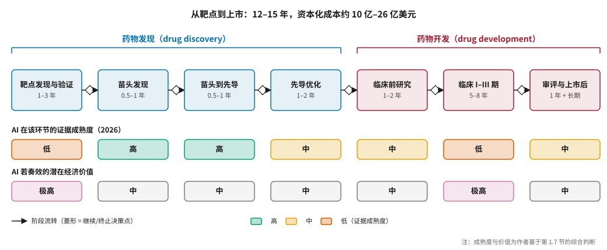
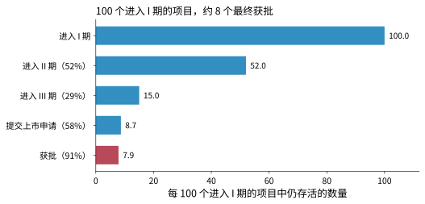
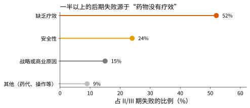
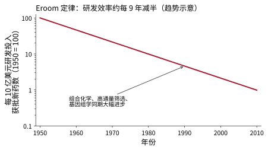
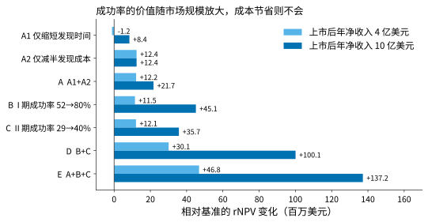
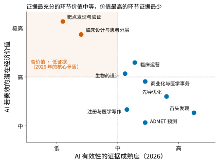

# 新药研发的经济学：AI 的切入点在哪里 {#sec-economics}

## 本章目的 {.unnumbered .unlisted}

::: {.purpose-question}
为什么“把分子设计得更快”并不等于“把新药做得更多”？
:::

新药研发是一门关于失败的经济学。一款创新药平均要花十亿美元以上，耗时十余年，而进入人体试验的候选药物只有不到十分之一能最终上市。行业真正付出的成本，大部分花在了失败的项目上。理解这一点，是评估 AI 价值的前提：一项技术如果只让研发流程中本来就不贵的环节变快、变便宜，它对整体经济的影响注定有限；如果它能让行业在昂贵的临床阶段之前更准确地识别出“注定失败”的项目，价值则会成倍放大。本章用成本、成功率和失败原因三组数据刻画新药研发的经济结构，用一个风险调整净现值模型量化 AI 在不同环节的价值，并据此画出全书反复使用的“AI 价值地图”。

::: {.callout-learning-objectives}

- 描述新药研发的七个阶段、每个阶段的关键决策点，以及药物发现与药物开发的分界
- 解释研发成本估算的主要口径差异（样本、资本成本、失败分摊），并说明成本在各阶段的分布
- 引用分阶段成功率数据，指出 II 期是漏斗最窄处，并说明治疗领域和生物标志物如何影响成功率
- 区分临床失败的主要原因，说明为什么“化学问题已部分解决、生物学问题是主战场”
- 用 Eroom 定律和“预测效度”概念，解释为什么提高筛选通量不能提高研发效率
- 用风险调整净现值（rNPV）比较加速、降本和提高成功率三类 AI 价值，并识别各自成立的条件
- 运用“AI 价值地图”判断某一 AI 应用的潜在价值与证据成熟度

:::

## 一个药是怎么来的 {#sec-economics-pipeline}

### 七个阶段 {#sec-economics-seven-stages}

新药研发可以拆成七个首尾相接的阶段（@fig-rd-pipeline）。前四个阶段——靶点发现与验证、苗头化合物发现、苗头到先导、先导优化——合称**药物发现**（drug discovery）\index{药物发现}，产出一个可以进入动物和人体试验的临床前候选化合物；后三个阶段——临床前研究、临床试验、审评与上市后——合称**药物开发**（drug development）\index{药物开发}，产出一个获批上市的药品。媒体所说的“AI 制药”，绝大多数指药物发现；而 2025–2026 年行业内部正在发生的变化，越来越多地落在药物开发一侧。

::: {#fig-rd-pipeline fig-cap="**新药研发的七个阶段与 AI 的位置**：从靶点到上市通常需要 12–15 年。菱形代表阶段之间的“继续/终止”决策点。下方两行分别给出 AI 在各环节的证据成熟度和潜在经济价值——证据最充分的环节（苗头发现、苗头到先导）价值中等，价值最高的环节（靶点选择、临床设计）证据最少。" fig-alt="横向流程图，七个圆角矩形依次为靶点发现与验证、苗头发现、苗头到先导、先导优化、临床前研究、临床 I–III 期、审评与上市后，前四个为蓝色、后三个为红色，之间有菱形决策点；下方两行彩色方块标注每个阶段的 AI 证据成熟度和潜在经济价值。"}

{width="100%"}

:::

@tbl-stages 给出了每个阶段要回答的问题、典型耗时和主要产出。

| 阶段 | 要回答的问题 | 典型耗时 | 主要产出 | 典型团队 |
|:---|:---|:---|:---|:---|
| ① 靶点发现与验证 | 疾病由什么分子机制驱动？干预哪个蛋白能改变病程？ | 1–3 年 | 经过验证的靶点 | 生物学、遗传学、生物信息 |
| ② 苗头化合物发现 | 有没有分子能和这个靶点结合？ | 0.5–1 年 | 一批苗头分子 | 筛选、计算化学 |
| ③ 苗头到先导 | 哪些苗头值得继续？结构上怎么改？ | 0.5–1 年 | 先导化合物系列 | 药物化学 |
| ④ 先导优化 | 同时优化活性、选择性、代谢、毒性、可合成性 | 1–2 年 | 临床前候选化合物（PCC） | 药化、DMPK、毒理 |
| ⑤ 临床前研究 | 动物药效、药代、毒理；原料药与制剂工艺 | 1–2 年 | IND 申报 | 药理、毒理、CMC |
| ⑥ 临床试验 I/II/III 期 | 安全吗？有效吗？比现有疗法好吗？ | 5–8 年 | NDA/BLA 申报 | 临床、统计、注册 |
| ⑦ 审评与上市后 | 能否获批？真实世界中的安全性与价值如何？ | 1 年 + 长期 | 上市药品 | 注册、药物警戒、市场准入 |

: 新药研发七个阶段的问题、耗时与产出 {#tbl-stages}

### 研发是一连串决策 {#sec-economics-decisions}

把研发看作一连串“继续还是终止”的决策，比看作一连串工作更有用。每个阶段末尾都有一个关键决策点：靶点立项、苗头确认、先导系列选择、候选化合物提名、IND 申报、II 期启动（概念验证）、III 期决策和上市申报。其中 III 期决策是整个研发中最贵的一次押注，通常要投入数亿美元。

::: {#dfn-economics-decision-quality .callout-definition title="决策质量"}

***决策质量***\index{决策质量}指在研发的每个“继续/终止”节点上，做出正确判断的概率：让终将成功的项目继续，让终将失败的项目尽早停止。

1.  **意义**：研发的整体效率主要由决策质量而非执行速度决定。一个本应在 I 期之前终止的项目若拖到 III 期才失败，浪费的是数亿美元和数年时间。
2.  **区别**：执行效率回答“把这件事做得多快”，决策质量回答“该不该做这件事”。AI 加快执行的证据已经很多，提高决策质量的证据仍然很少。
3.  **常见误区**：把“AI 让 PCC 提名提前了两年”等同于“AI 提高了研发成功率”。前者是执行效率，后者是决策质量，两者在经济上的价值可能相差一个数量级（见 @sec-economics-rnpv）。

:::

### 小分子与生物药 {#sec-economics-modalities}

药物按分子类型大致分两大类。**小分子药物**分子量一般在 500 道尔顿以下，化学合成，多数可以口服，能进入细胞作用于胞内靶点，但很难打击表面平坦的蛋白–蛋白相互作用界面。**生物药**包括单克隆抗体、双特异性抗体、抗体偶联药物（ADC）、多肽、核酸药物（siRNA、ASO、mRNA）以及细胞与基因疗法，特异性高、通常注射给药、生产工艺复杂。全球处方药销售额中，生物药的占比已接近一半；在研管线中，新模态的比例逐年上升。不同模态对 AI 的需求差别很大，第二篇会分章讨论（@sec-biologics 专门讨论生物药）。

## 研发成本：数字与口径 {#sec-economics-cost}

### 几个常被引用的估算 {#sec-economics-cost-estimates}

“每个新药平均花多少钱”首先是一个口径问题（@tbl-cost-estimates）。

| 研究 | 样本与方法 | 估算结果 |
|:---|:---|:---|
| DiMasi 等 [@dimasi2016]，塔夫茨药物开发研究中心 | 10 家大药企的 106 个新化合物，基于公司内部机密数据 | 每个获批新药资本化成本约 25.6 亿美元（2013 年美元），其中直接现金支出约 14 亿美元 |
| Wouters 等 [@wouters2020]，《美国医学会杂志》 | 63 个获批药物，基于公开的 SEC 文件 | 中位数约 9.85 亿美元，均值约 13.4 亿美元（2018 年美元） |

: 新药研发成本的两项代表性估算 {#tbl-cost-estimates}

差异主要来自三个方面：

1. **样本偏差**：塔夫茨研究的样本来自大药企，项目规模大、治疗领域偏向复杂疾病；Wouters 的样本来自公开披露的中小公司，偏向孤儿药和肿瘤药。
2. **资本成本**：研发持续十多年，资金的时间成本不可忽略。塔夫茨研究使用约 10.5% 的年资本成本，资本化后的成本几乎翻倍。
3. **失败分摊**：两项估算都把失败项目的成本分摊到获批药物上，否则无法反映真实的经济负担。

本书采用一个粗略区间：**一款创新药的资本化研发成本在 10 亿到 26 亿美元之间**。比具体数字更重要的是它的结构。

### 钱花在哪里 {#sec-economics-cost-structure}

按阶段拆分直接现金支出，药物发现约占 15%–25%，临床前约 5%–10%，I 期约 10%，II 期约 15%–20%，**III 期约 35%–45%**，审评与上市后研究约 5%。单项临床试验的费用常被引用的量级是：I 期数百万美元，II 期一千万美元以上，III 期数千万美元起；心血管、神经科学等需要大样本、长随访的 III 期，费用可达数亿美元。

这个结构决定了一个朴素但常被忽视的事实：**在药物发现阶段省下的钱，在总成本中占比有限**。

::: {.callout-perspective title="中国的成本与速度"}

中国创新药企业的研发成本结构与欧美有明显差异：患者招募快、单患者试验成本低，同等规模的临床试验费用往往只有美国的几分之一；化学和生物学人才薪酬较低；从 IND 到首例给药、从 I 期到概念验证的速度普遍更快。这种成本和速度优势，是 2024–2026 年中国创新药对外授权交易爆发的重要原因。据医药魔方数据，2026 年上半年中国创新药对外 BD 交易总额约 997 亿美元，约为 2024 年全年的两倍 [@21jingji2026licenseout]。但同一来源也指出，中国交易中确定性现金首付款的占比只有约 6%，大部分交易价值依赖后续里程碑——也就是依赖后期临床能否成功。成本优势降低了“试错”的代价，但没有改变失败本身的概率。@sec-china 会详细讨论 AI 制药公司在这一浪潮中的位置。

:::

## 成功率：漏斗有多窄 {#sec-economics-success}

### 分阶段成功率 {#sec-economics-phase-rates}

美国生物技术创新组织（BIO）联合 Informa 和 QLS 发布的《2011–2020 年临床开发成功率》报告 [@bio2021]，基于约 1.2 万次阶段转换，给出了以下数字：I 期进入 II 期约 52%，II 期进入 III 期约 29%，III 期到提交上市申请约 58%，上市申请到获批约 91%。连乘起来，**从 I 期到获批的累计成功率约为 7.9%**（@fig-attrition）。

::: {#fig-attrition fig-cap="**临床开发漏斗**：每 100 个进入 I 期的项目，约 52 个进入 II 期，约 15 个进入 III 期，约 8 个最终获批。括号内为该阶段的转换成功率。II 期是漏斗最窄处。数据来源：BIO/Informa/QLS 2011–2020 年统计 [@bio2021]。" fig-alt="水平条形图，五行分别为进入 I 期 100、进入 II 期 52.0、进入 III 期 15.0、提交上市申请 8.7、获批 7.9，最后一行为红色。"}

{width="85%"}

:::

其他研究给出的数字略有不同。麻省理工学院 Wong、Siah 和 Lo 用更大的数据集估算出累计成功率约为 13.8% [@wong2019]，差异主要来自统计方法（是否计入仍在进行中的项目）和样本范围。本书采用 **8%–14%** 的区间。

### 治疗领域与生物标志物 {#sec-economics-ta}

不同治疗领域的成功率差别很大。BIO 报告中，血液病的累计成功率最高（约 24%），肿瘤最低之一（约 5%），神经科学和心血管同样偏低。更值得注意的是：**使用生物标志物筛选患者的项目，成功率显著高于不使用的项目**。这说明“选对患者”与“选对靶点”同样关键，也是 AI 在临床阶段最有潜力的方向之一（@sec-clinical）。

从 I 期到获批平均约需 10.5 年。加上药物发现阶段的 3–6 年，一个新药从立项到上市通常需要 12–15 年。

::: {.callout-checkpoint title="研发漏斗"}

- [ ] 你能解释为什么 III 期单阶段成功率（约 58%）高于 II 期（约 29%），但 III 期失败的经济损失反而更大吗？
- [ ] 你能说出至少两个导致不同研究给出不同累计成功率的方法学原因吗？
- [ ] 你能解释为什么“使用生物标志物筛选患者”会同时提高成功率和降低试验成本吗？

:::

## 失败的原因 {#sec-economics-failure}

### 后期失败主要来自疗效 {#sec-economics-failure-reasons}

Harrison 分析了 2013–2015 年 II 期和 III 期的失败案例 [@harrison2016]：缺乏疗效约占 52%，安全性约 24%，战略或商业原因约 15%，其余为药代、操作等问题（@fig-failure-reasons）。Sun 等人 2022 年的综述给出了相近的分布：缺乏临床疗效约 40%–50%，不可控的毒性约 30%，药物性质差约 10%–15%，商业和战略原因约 10% [@sun2022]。

::: {#fig-failure-reasons fig-cap="**II/III 期失败的原因分布（2013–2015）**：超过一半的后期失败源于药物在患者身上没有显示出足够疗效，安全性问题约占四分之一。数据来源：Harrison 2016 [@harrison2016]。" fig-alt="棒棒糖图，四行分别为缺乏疗效 52%、安全性 24%、战略或商业原因 15%、其他 9%。"}

{width="80%"}

:::

### 化学问题已部分解决 {#sec-economics-chemistry-solved}

Kola 和 Landis 的分析显示，1991 年约 40% 的临床失败源于药代动力学和生物利用度问题；到 2000 年，这一比例已降到约 10% [@kola2004]。原因是行业大规模采用早期 ADMET 筛选，把药代问题挡在了临床之前。这组数字揭示了一个贯穿全书的规律：

::: {#pri-economics-biology-is-the-bottleneck .callout-principle title="生物学是瓶颈"}

**判断**：化学层面的问题（药代、可成药性）在过去三十年已被部分解决；生物学层面的问题（靶点在人体中是否成立、对哪些患者有效）是今天临床失败的主要来源。

**含义**：一项 AI 技术的经济价值，取决于它作用于哪一类问题。优化化学性质的 AI 能提高 I 期通过率，但对 II 期成功率的帮助有限；能改善靶点因果判断和患者分层的 AI，才可能影响后期成功率。

:::

### 疗效为什么失败 {#sec-economics-why-efficacy}

缺乏疗效的根源通常有五种：

1. **靶点与疾病没有因果关系**：靶点只是疾病的伴随现象，或者人体中存在冗余通路代偿。
2. **动物模型不能预测人体**：在小鼠中有效的机制在人体中不成立，神经退行性疾病和炎症性疾病尤其明显。
3. **患者人群过于异质**：药物只对部分患者有效，但试验入组了所有患者，疗效被稀释。
4. **剂量或暴露不足**：药物在靶组织中的浓度或作用时间不够。
5. **终点选择不当**：替代终点与真正的临床获益不一致。

AI 对这五类问题的帮助程度不同。第 5 条主要是临床设计问题；第 4 条可以通过更好的药代和 PBPK 预测改善（@sec-admet）；第 1、2、3 条——靶点因果性、物种转化和患者分层——才是最难、价值也最大的部分（@sec-target、@sec-clinical）。

::: {#ws-economics-torcetrapib .callout-war-story title="Torcetrapib：一次 III 期失败的代价（2006）"}

**背景**：Torcetrapib 是辉瑞开发的 CETP 抑制剂，能显著升高“好胆固醇”（HDL-C）。基于“HDL-C 越高、心血管风险越低”的流行病学关联，辉瑞把它视为下一代重磅心血管药物，在研发和生产准备上投入巨大，公开报道的投入约 8 亿美元。

**失败**：2006 年 12 月，约 1.5 万人参加的 III 期 ILLUMINATE 试验被提前终止：治疗组的死亡人数明显多于对照组。药物确实大幅升高了 HDL-C，但这个生物标志物并没有转化为临床获益，同时药物还带来了脱靶的血压升高。

**教训**：失败发生在研发链条的最末端，因此代价最大。根源不在化学——分子按设计发挥了作用——而在生物学假设：HDL-C 与心血管保护之间是相关而非因果。后来的孟德尔随机化研究也表明，遗传上 HDL-C 较高的人群并没有更低的心肌梗死风险。这正是 @sec-target 将要讨论的问题：如果在立项时就用人类遗传学证据检验因果假设，这类失败有可能更早被识别。

:::

## Eroom 定律：效率为什么持续下降 {#sec-economics-eroom}

### 现象 {#sec-economics-eroom-phenomenon}

Scannell 等人在 2012 年指出：从 1950 年起，每 10 亿美元研发投入（经通胀调整）带来的 FDA 批准新药数量，大约每九年减半 [@scannell2012]。他们把这一现象称为 **Eroom 定律**\index{Eroom 定律}——Moore 倒过来拼写（@fig-eroom）。

::: {#fig-eroom fig-cap="**Eroom 定律（趋势示意）**：按 Scannell 等人 [@scannell2012] 描述的“约每 9 年减半”绘制的示意曲线，纵轴为对数刻度，以 1950 年为 100。同一时期，组合化学、高通量筛选、DNA 测序和计算化学都取得了数量级的进步，研发整体效率却持续下降。本图是趋势模型，不是逐年数据。" fig-alt="对数纵轴折线图，从 1950 年的 100 平稳下降到 2010 年约 1，标注同期组合化学、高通量筛选和基因组学大幅进步。"}

{width="80%"}

:::

这与过去几十年的技术进步形成鲜明对比：组合化学让合成通量提高了数百倍，DNA 测序成本下降了数十亿倍，高通量筛选、X 射线晶体学、计算化学都有巨大进步，研发的整体效率却在下降。

### 四个解释 {#sec-economics-eroom-causes}

Scannell 等人给出了四个主要解释：

1. **“比披头士更好”问题**：新药必须优于已有药物，而已有药物越来越好、越来越便宜（仿制药），门槛越来越高。
2. **“谨慎的监管者”问题**：监管对安全性的要求逐步提高，试验规模和成本随之上升。
3. **“砸钱”倾向**：行业倾向于用更多资源解决问题，而不是提高每个决策的质量。
4. **“基础研究–暴力筛选”偏误**：行业高估了“测更多分子”的价值，低估了“选对生物学假设”的价值。

### 预测效度 {#sec-economics-predictive-validity}

Scannell 等人在 2022 年进一步提出，研发效率的关键变量是**预测效度**\index{预测效度}（predictive validity）：筛选体系和疾病模型中的结果，与人体中的结果有多大相关 [@scannell2022]。他们用决策理论模型说明，预测效度的小幅提高，比筛选通量的大幅提高更有价值。

::: {#dfn-economics-predictive-validity .callout-definition title="预测效度"}

***预测效度***指一个筛选模型或疾病模型（细胞实验、动物模型、计算模型）对“候选物在人体中是否有效”的预测能力，常用模型输出与人体结局之间的相关系数衡量。

1.  **意义**：在一个有 N 个候选的筛选中，提高通量只是让 N 变大；提高预测效度则让排在前面的候选更可能是真正有效的。当候选空间足够大时，后者对最终成功率的影响远大于前者。
2.  **区别**：模型在训练数据上的准确率不等于预测效度。一个在细胞实验数据上 AUC 很高的模型，如果细胞实验本身与人体相关性很低，它的预测效度仍然很低。
3.  **常见误区**：用“在基准数据集上的表现提升”来论证 AI 能提高研发成功率。基准衡量的是对替代终点的预测，而决定成功率的是对人体结局的预测。

:::

这个观点对 AI 制药有直接的指导意义：**如果 AI 只是让我们“更快地测更多分子”，它可能重演高通量筛选的故事——通量提高了，产出没变。AI 真正需要证明的，是它能提高预测效度，尤其是靶点和疾病模型的预测效度。**

有研究认为，2010 年代中期以后 FDA 批准的新药数量回升，Eroom 趋势有所放缓。可能的原因包括孤儿药和精准医疗的兴起、生物药的成熟，以及人类遗传学证据在靶点选择中的广泛应用——有遗传学证据支持的靶点，临床成功率约为没有支持的两倍以上 [@nelson2015; @minikel2024]。这说明研发效率并非注定下降，而改善生物学假设的质量正是突破口。

## 用风险调整净现值看 AI 的价值 {#sec-economics-rnpv}

### rNPV {#sec-economics-rnpv-definition}

药企评估研发项目时常用**风险调整净现值**\index{风险调整净现值}（risk-adjusted Net Present Value，rNPV）。它把每个阶段的成本和未来收入，按该阶段的存活概率和资金时间价值折现：

$$
\text{rNPV} = \sum_{t} \frac{p_t \cdot CF_t}{(1+r)^t}
$$ {#eq-rnpv}

其中 $CF_t$ 是第 $t$ 年的现金流（研发阶段为负，上市后为正），$p_t$ 是项目存活到第 $t$ 年的累计概率，$r$ 是折现率。

### 一个示意模型 {#sec-economics-rnpv-model}

为了说明 AI 在不同环节的价值，我们构造一个**示意性**项目（@tbl-rnpv-assumptions）。表中数字只是为说明问题设定的假设，不代表任何真实项目。

| 阶段 | 时长（年） | 成本（百万美元） | 阶段成功率 |
|:---|---:|---:|---:|
| 药物发现（到 PCC） | 4.0 | 30 | 70%（到 IND） |
| 临床前 | 1.0 | 15 | — |
| I 期 | 1.5 | 25 | 52% |
| II 期 | 2.5 | 60 | 29% |
| III 期 | 3.0 | 250 | 58% |
| 审评 | 1.0 | 5 | 91% |
| 上市后年净收入 | 10 年 | +400 或 +1000 / 年 | — |

: rNPV 示意模型的假设（折现率 10%，各阶段成本在阶段中点发生） {#tbl-rnpv-assumptions}

在这组假设下，项目从立项到获批的累计成功率约为 5.6%，与 @sec-economics-success 的行业数据大致相当。年收入 4 亿美元时基准 rNPV 约为 −2000 万美元，年收入 10 亿美元时约为 +4200 万美元。@fig-rnpv-scenarios 比较了七种 AI 改进情景相对基准的 rNPV 变化。

::: {#fig-rnpv-scenarios fig-cap="**不同 AI 改进情景对 rNPV 的影响（示意模型）**：浅蓝为上市后年净收入 4 亿美元的中等药物，深蓝为 10 亿美元的重磅药物。单纯缩短发现时间（A1）对一个本身 rNPV 为负的项目反而略有损害；成本节省的价值固定（约 1240 万美元），不随市场规模放大；成功率提升的价值则随市场规模放大三到四倍——B 情景从 1150 万美元升至 4510 万美元。值得注意的是，在 4 亿美元的中等药物上，A2、B、C 三种改进的价值几乎相同（均在 1200 万美元上下），因为该项目的基准 rNPV 本就为负，提高成功率只是让更多项目走到一个不赚钱的终点；组合情景 E 的收益则明显超过各单项之和。假设见 @tbl-rnpv-assumptions，图中数值由本章附带脚本按该表实算得出。" fig-alt="分组水平条形图，七个情景 A1、A2、A、B、C、D、E，每个情景两根条分别对应 4 亿和 10 亿美元年收入；4 亿情景下各单项改进均约 1200 万美元，10 亿情景下差异拉开，E 情景增加约 1.37 亿美元。"}

{width="90%"}

:::

这个示意模型揭示了几个容易被忽视的规律：

1. **“加速”的价值取决于项目本身值不值得做。** 在年收入 4 亿美元的情景下基准 rNPV 为负，单纯缩短发现时间（A1）反而略有损害，因为后续的大笔临床支出也被提前了。只有当项目本身有正价值时，加速才明显有利。**把一个不值得做的项目做得更快，没有意义。**
2. **成本节省的价值是固定的。** A2 在两种情景下都约为 1200 万美元，因为临床前成本只占总成本的一小部分。
3. **成功率的价值随市场规模放大。** 从 4 亿美元到 10 亿美元，B、C 两项的价值提高到原来的三到四倍。药物越有价值，“选对”就越重要。
4. **组合效应最大。** 同时提高 I 期和 II 期成功率（D）的价值远大于单独任何一项；再叠加加速（E），能把一个 rNPV 为负的项目变成明显为正。

这些数字完全取决于假设，只用于说明结构性规律，不能用于任何真实决策。真实项目的估值还要考虑治疗领域、竞争格局、定价、专利期限等大量因素。

外部机构的估算方向一致。波士顿咨询公司的估算认为，AI 大致能把药物最终上市的概率从 5%–10% 提高到 9%–18%，但增益主要集中在成本较低的早期阶段 [@bcg_ai_pos]；麦肯锡估计生成式 AI 每年可为制药和医疗产品行业创造 600 亿到 1100 亿美元的经济价值，其中相当部分来自研发以外的商业化、医学事务和运营 [@mckinsey2024genai]。

## AI 价值地图 {#sec-economics-value-map}

把以上分析汇总，可以得到一张“AI 价值地图”：每个环节 AI 能改变什么、价值多大、证据有多充分（@tbl-value-map，@fig-value-map）。

| 环节 | AI 主要改变的变量 | 潜在经济价值 | 2026 年证据成熟度 |
|:---|:---|:---|:---|
| 靶点发现与验证 | 靶点因果性判断的质量 | **极高**（决定 II 期成败） | 低：仅个别案例进入后期临床 |
| 苗头发现 | 速度、成本、化学空间覆盖 | 中 | 高：大量前瞻性成功案例 |
| 先导优化 | 周期、合成数量、多参数平衡 | 中 | 中高：多家公司报告周期缩短 |
| ADMET 预测 | 早期淘汰不良分子 | 中（大部分问题已被现有手段管住） | 中 |
| 生物药设计 | 结合物获取效率；可开发性 | 中高 | 中：从头设计刚刚突破 |
| 临床设计与患者分层 | II/III 期成功率、试验规模 | **极高** | 低到中：工具多，硬证据少 |
| 临床运营 | 招募、监查、文档的时间与成本 | 中高 | 中：效率改善有数据 |
| 注册与医学写作 | 时间与人力 | 中 | 中 |
| 商业化与医学事务 | 销售效率、患者可及性 | 中高 | 中 |

: AI 价值地图：各环节的潜在价值与证据成熟度 {#tbl-value-map}

::: {#fig-value-map fig-cap="**AI 价值地图**：横轴为 AI 在该环节有效的证据成熟度，纵轴为 AI 若奏效的潜在经济价值。左上象限（高价值、低证据）只有靶点发现与临床设计/患者分层两个环节，这是 2026 年 AI 制药的核心矛盾。各点位置为作者基于本章分析的综合判断，不是测量值。" fig-alt="二维散点图，横轴为证据成熟度低中高，纵轴为潜在价值中高极高；靶点发现与验证、临床设计与患者分层位于左上红色阴影区，其余七个环节位于右侧中部。"}

{width="80%"}

:::

这张图说明了全书的核心矛盾：**证据最充分的环节价值中等，价值最高的环节证据最少。**

::: {.column-margin}
**阅读提示**：第二篇的每一章开头都会标出该环节在这张图上的位置，方便读者把技术细节放回经济坐标中。
:::

## AI 能改变的，与不能改变的 {#sec-economics-what-ai-changes}

把研发看作漏斗，最终产出取决于三个变量：进入漏斗的速度和成本、每一层的通过率、每一层的停留时间。

**速度和成本：证据最充分。** 多家 AI 制药公司报告，从项目启动到 PCC 提名的时间从传统的 4–6 年缩短到 12–30 个月，合成和测试的分子数量也少了一个数量级。英矽智能披露，其 2021–2024 年二十余个自研项目从立项到 PCC 平均用时 12–18 个月，单个项目合成测试 60–200 个分子 [@21jingji2026licenseout]。这些数字大多来自公司自身披露，比较基线也不统一，需要谨慎看待。

**通过率：I 期有积极信号，II 期尚无证据。** Jayatunga 等人 2024 年的分析显示，AI 发现的分子 I 期成功率达到 80%–90%，明显高于历史平均水平；但 II 期成功率与传统药物相近 [@jayatunga2024]。这符合 @pri-economics-biology-is-the-bottleneck：AI 擅长优化化学性质，所以 I 期表现好；但靶点生物学错了，分子设计得再好也无济于事。

**停留时间：临床阶段刚刚起步。** AI 在试验设计、患者招募、数字孪生对照组、文档自动化等方面的应用正在增加（@sec-clinical），目前大多是效率工具，尚未改变临床试验的基本结构。

还有一些东西，AI 在可预见的未来很难改变：一个靶点在人体中是否有效，最终只能靠人体试验回答；监管要求的是临床证据，不是计算预测；阿尔茨海默病等疾病的机制尚未阐明，AI 不能凭空创造知识；研发效率提高后，所有竞争者同时提高，“比披头士更好”的门槛也会随之上升。

## 谬误与陷阱 {#sec-economics-fallacies}

围绕 AI 制药经济价值的误解，大多源于混淆了“执行效率”和“决策质量”，或者把局部指标当成了全局指标。

::: {.fallacy-pitfall}

**谬误**：*AI 把 PCC 提名时间从 5 年缩短到 18 个月，所以新药研发的周期和成本会大幅下降。*

药物发现阶段只占研发总成本的 15%–25%、总时长的四分之一左右。即使这一阶段完全被消除，临床开发的 6–9 年和数亿美元成本仍然存在。更重要的是，如 @fig-rnpv-scenarios 所示，对一个本身不值得做的项目，加速甚至可能降低其价值。

:::

::: {.fallacy-pitfall}

**谬误**：*AI 药物 I 期成功率达到 80%–90%，说明 AI 已经提高了新药成功率。*

I 期主要检验安全性和药代动力学，这恰好是 AI 最擅长优化的化学性质。决定累计成功率的瓶颈在 II 期，而目前 AI 药物的 II 期成功率与传统药物相近。此外，早期进入临床的 AI 项目有相当比例选择了已验证靶点，这会抬高 I 期成功率，且难以推广到新靶点项目。

:::

::: {.fallacy-pitfall}

**陷阱**：*用“合作交易总潜在价值”衡量 AI 制药公司的商业成功。*

数十亿美元的“总潜在价值”包含预付款、研发里程碑、商业化里程碑和销售分成，真正到账的往往只是预付款，占总额的很小比例（中国交易中约 6%）。其余金额取决于项目能否推进到后期并上市，而按历史成功率，大多数项目到不了那一步。评估时应关注已确认收入、现金储备和合作方是否在关键节点行使了选择权（@sec-capital）。

:::

::: {.fallacy-pitfall}

**陷阱**：*在基准数据集上的提升 = 在人体中的预测效度提升。*

模型在细胞实验或公开基准上的表现，衡量的是对替代终点的预测能力。如果替代终点本身与人体结局的相关性很低，模型再准也无法提高研发成功率（@dfn-economics-predictive-validity）。这是 Eroom 定律在 AI 时代可能重演的方式。

:::

## 小结 {#sec-economics-summary}

新药研发的根本困难是生物学的不确定性，而不是化学的复杂性。过去三十年，早期 ADMET 筛选已经把药代问题挡在了临床之前，今天的失败主要来自疗效不足，根源在于靶点选择和患者选择。Eroom 定律提醒我们：提高通量不等于提高效率，真正的杠杆是预测效度。

::: {.callout-takeaways title="选对比做快更值钱"}

* **成本结构决定 AI 价值的上限**：一款创新药的资本化研发成本在 10 亿到 26 亿美元之间，III 期占直接支出的 35%–45%。在药物发现阶段省下的钱，在总成本中占比有限。
* **漏斗最窄处在 II 期**：从 I 期到获批的累计成功率约为 8%–14%，II 期成功率仅约 29%。使用生物标志物筛选患者的项目成功率显著更高。
* **生物学是瓶颈**：超过一半的后期失败源于缺乏疗效，药代问题导致的失败已从 1991 年的约 40% 降至 2000 年的约 10%。
* **预测效度比通量更重要**：Eroom 定律表明，筛选通量的数量级提升没有带来研发效率提升；人类遗传学证据把靶点成功率提高了两倍以上。
* **rNPV 揭示价值结构**：成本节省的价值固定，加速的价值取决于项目本身是否值得做，成功率提升的价值随市场规模放大。
* **核心矛盾**：证据最充分的环节（苗头发现、先导优化）价值中等，价值最高的环节（靶点发现、临床设计与患者分层）证据最少。2026–2027 年读出的第一批 III 期数据将首次在大规模临床层面检验这一矛盾。

:::

::: {.callout-chapter-connection title="从经济结构到历史"}

本章从经济学角度说明了 AI 应该在哪里发力。但“用计算机设计药物”并不是新想法：定量构效关系诞生于 1960 年代，基于结构的药物设计在 1990 年代就已产出上市药物，每一次技术浪潮都伴随着“彻底改变研发”的期待。@sec-history 回顾这六十年的历史，看看今天的 AI 与前几次浪潮有什么不同，又在重复哪些相同的期待与失望。

:::
