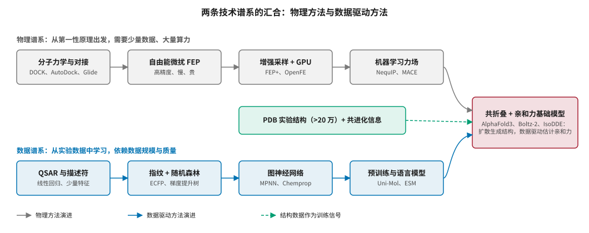
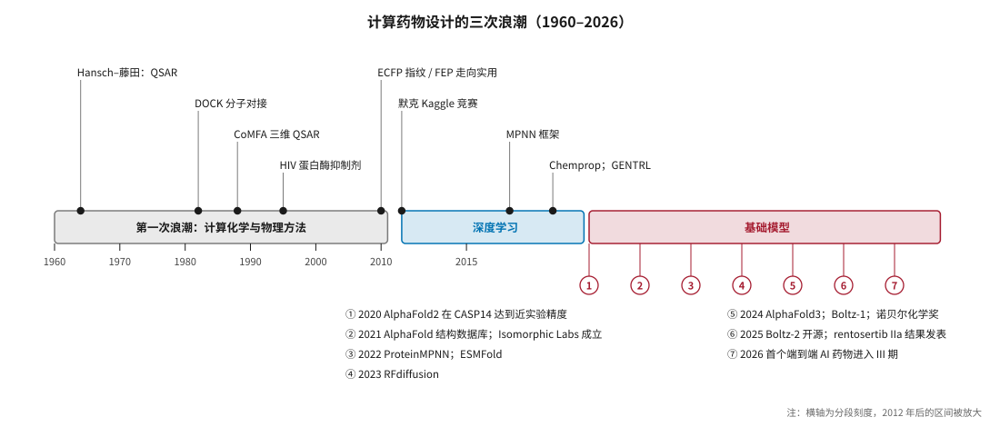

# 从 QSAR 到基础模型：六十年发展史 {#sec-history}

## 本章目的 {.unnumbered .unlisted}

::: {.purpose-question}
既然“用计算机设计药物”已经被承诺了六十年，这一次有什么不同？
:::

1981 年，《财富》杂志用一期封面宣告“下一次工业革命”：在默克，药物正在由计算机设计。此后四十多年，计算方法确实成为每家药企的标准配置，研发效率却没有随之提升（@sec-economics-eroom）。今天的 AI 制药站在第三次浪潮的顶点：深度学习、AlphaFold 和生成式基础模型带来了真实的技术突破，也带来了与前两次浪潮相似的期待。本章沿两条谱系——基于物理的计算方法和数据驱动的学习方法——回顾六十年发展史，说明每一次浪潮解决了什么、没有解决什么，以及第三次浪潮在哪些方面真正不同。读懂这段历史，是判断今天哪些说法值得相信的基础。

::: {.callout-learning-objectives}

- 概述计算药物设计的三次浪潮及其代表性方法与里程碑
- 区分基于物理的方法与数据驱动的方法，说明两者在数据需求、算力需求和可解释性上的差异
- 解释 QSAR、分子对接、自由能微扰、分子指纹和图神经网络的基本思想及其历史地位
- 说明 AlphaFold2 成功的技术与数据条件，以及它对药物研发的直接影响和局限
- 概括 2022–2026 年生成式与基础模型时代的四条主线
- 用历史案例识别“技术进步”与“研发产出提升”之间的差距

:::

## 两条谱系 {#sec-history-lineages}

计算药物设计的历史可以归结为两条既竞争又互补的技术谱系（@fig-two-lineages）。**物理谱系**从第一性原理出发，用分子力学、量子化学和统计力学模拟分子之间的相互作用；它需要的数据少、算力多，结果有明确的物理含义，但受力场精度和采样效率限制。**数据谱系**从实验数据中学习“结构–性质”映射，从 1960 年代的线性回归一路发展到今天的图神经网络和预训练模型；它的上限由数据规模和质量决定，往往难以外推到训练数据之外。

::: {#fig-two-lineages fig-cap="**两条技术谱系的汇合**：物理方法（上）从分子对接到自由能微扰再到机器学习力场，数据驱动方法（下）从 QSAR 到指纹、图神经网络和预训练模型。以 PDB 实验结构为训练信号的共折叠模型（AlphaFold3、Boltz-2 等）把两条谱系汇合到一起：用扩散模型生成复合物结构，用大规模实验数据估计结合亲和力，并以物理方法的精度为对标。" fig-alt="流程图，上行四个灰色方框为分子力学与对接、自由能微扰 FEP、增强采样加 GPU、机器学习力场；下行四个蓝色方框为 QSAR 与描述符、指纹加随机森林、图神经网络、预训练与语言模型；中间一个绿色方框为 PDB 实验结构加共进化信息；三条箭头汇入右侧红色方框共折叠加亲和力基础模型。"}

{width="100%"}

:::

两条谱系的张力贯穿全部历史。2025 年发布的 Boltz-2 把自己的亲和力预测精度直接对标自由能微扰（FEP），并宣称速度快 1000 倍以上 [@passaro2025boltz2]——这正是数据谱系第一次在物理谱系最擅长的任务上给出可比结果。@fig-history-timeline 把两条谱系的里程碑放在同一条时间线上。

::: {#fig-history-timeline fig-cap="**计算药物设计的三次浪潮**：第一次浪潮（1960–2011）以 QSAR、分子对接和自由能计算为代表；第二次（2012–2019）是深度学习进入化学；第三次（2020 年至今）由 AlphaFold2 开启，进入结构预测与生成式基础模型时代。横轴为分段刻度，2012 年后的区间被放大。" fig-alt="时间线，横条分三段：灰色第一次浪潮 1960 至 2011，蓝色深度学习 2012 至 2019，红色基础模型 2020 至 2026；上方标注 QSAR、DOCK、CoMFA、HIV 蛋白酶抑制剂、ECFP、默克 Kaggle、MPNN、Chemprop；下方用编号 1 至 7 标注 2020 至 2026 年的里程碑。"}

{width="100%"}

:::

## 第一次浪潮：计算化学（1960–2011） {#sec-history-wave1}

### QSAR：用统计学描述“结构决定性质” {#sec-history-qsar}

1964 年，Corwin Hansch 和藤田稔夫提出一套方法：用分子的几个物理化学参数——疏水性 $\pi$、电子效应 $\sigma$、空间位阻——作为自变量，用线性回归预测生物活性 [@hansch1964]：

$$
\log\left(\frac{1}{C}\right) = a\,\pi - b\,\pi^2 + \rho\,\sigma + c
$$ {#eq-hansch}

其中 $C$ 是产生特定生物效应所需的浓度。二次项 $-b\pi^2$ 表达了一个至今仍然成立的规律：亲脂性太低，分子穿不过细胞膜；太高，分子又会滞留在脂质中、溶解度变差。

::: {#dfn-history-qsar .callout-definition title="定量构效关系（QSAR）"}

***定量构效关系***\index{QSAR}（Quantitative Structure–Activity Relationship）是用数学模型把分子的结构特征映射为生物活性或物理化学性质的方法总称。

1.  **意义**：QSAR 的核心假设——结构相似的分子性质也相似——至今仍是所有分子性质预测模型的基础。今天的图神经网络本质上仍在学习一个“结构 → 性质”的映射，只是特征从人工设计的几个描述符变成了模型自动学出的高维表示。
2.  **区别**：与基于结构的方法不同，经典 QSAR 不需要靶点的三维结构，只需要一组已知活性的分子。
3.  **常见误区**：认为深度学习“取代”了 QSAR。更准确的说法是，深度学习是 QSAR 思想在更大数据和更强模型上的延续，它继承了 QSAR 的优点（不需要靶点结构），也继承了它的根本局限（难以外推到训练数据覆盖不到的化学空间）。

:::

此后几十年，QSAR 不断引入更丰富的特征和更强的学习器：1988 年的比较分子场分析（CoMFA）把分子周围的三维静电场和空间场作为特征 [@cramer1988]；2000 年代，扩展连通性指纹（ECFP）[@rogers2010] 加随机森林或支持向量机，成为药企计算化学部门的标准工具。这一组合在今天的很多中小数据任务上仍然是难以超越的基线（@sec-representation）。

### 基于结构的药物设计 {#sec-history-sbdd}

1980 年代起，随着 X 射线晶体学解析的蛋白结构越来越多，**基于结构的药物设计**\index{基于结构的药物设计}（Structure-Based Drug Design，SBDD）兴起：先拿到靶点的三维结构，再设计能嵌入结合口袋的分子。1982 年，加州大学旧金山分校 Kuntz 团队发表了 DOCK 程序，用几何匹配把配体放进蛋白口袋 [@kuntz1982]，开启了分子对接的时代。此后 AutoDock、Glide、GOLD 等程序相继出现，对接成为虚拟筛选的主力工具（@sec-screening）。

这一时期有几个常被引用的成功案例：血管紧张素转化酶抑制剂卡托普利（1981 年上市）的设计借助了酶活性位点模型；碳酸酐酶抑制剂多佐胺（1995 年上市）常被视为第一个主要依靠结构设计的上市药物；HIV 蛋白酶抑制剂沙奎那韦、利托那韦等（1995–1996 年上市）大量依赖蛋白酶的晶体结构进行优化，是 SBDD 的经典案例。

### 自由能计算 {#sec-history-fep}

对接打分函数速度快但精度低。更准确的方法是用分子动力学模拟直接计算结合自由能。**自由能微扰**\index{自由能微扰}（Free Energy Perturbation，FEP）通过一个热力学循环，计算把分子 A “炼金术式地”变成相似分子 B 时结合自由能的变化（@sec-screening 会详细推导）。FEP 的理论在 1980 年代已经成熟，但直到 2010 年代，随着 GPU 算力、力场改进和增强采样方法的进步，它对同系列化合物的预测误差才在许多靶点上降到约 1 kcal/mol，进入实用区间。薛定谔公司的 FEP+ 成为行业标杆，也是 Nimbus Therapeutics 发现 TYK2 抑制剂 zasocitinib 的核心工具之一（@sec-landscape）。

物理方法的优点是有第一性原理基础、不需要大量训练数据；缺点是慢、贵，精度受力场限制，而且需要可靠的初始复合物结构。

::: {#ws-history-fortune1981 .callout-war-story title="“下一次工业革命”（1981）"}

**背景**：1981 年 10 月，《财富》杂志以“下一次工业革命：在默克，用计算机设计药物”为封面故事，描述计算机图形学和分子建模将如何改变药物发现。当时的期待与今天高度相似：更少的实验、更快的速度、更理性的设计。

**结果**：此后二十多年，计算化学确实成为药物发现的标准配置，也贡献了若干成功案例。但如 @sec-economics-eroom 所述，研发的整体产出效率在同一时期持续下降。

**教训**：一项计算技术“变得有用”，与它“改变行业的整体产出效率”，是两回事。前者只需要在某个环节上优于替代方案，后者需要它作用于整个研发链条的瓶颈。1980 年代的瓶颈不在分子设计，今天的主要瓶颈也不在分子设计。

:::

## 第二次浪潮：深度学习进入化学（2012–2019） {#sec-history-wave2}

### 起点：默克分子活性挑战赛 {#sec-history-kaggle}

2012 年，默克在 Kaggle 上举办分子活性预测竞赛。获胜的是一支由 Geoffrey Hinton 的学生 George Dahl 等人组成的团队，他们用多任务深度神经网络，此前几乎没有化学背景。同一年，AlexNet 在 ImageNet 上取得突破。这场比赛常被视为深度学习进入药物发现的起点：它证明了通用的表示学习方法可以在化学任务上与领域专家多年打磨的方法竞争。

### 分子图神经网络 {#sec-history-gnn}

分子天然是一张图：原子是节点，化学键是边。2015–2019 年间，一系列工作奠定了分子图神经网络的基础：

- **神经指纹**（Duvenaud 等，2015）：用可微分的卷积式消息传递替代人工设计的 ECFP [@duvenaud2015]。
- **消息传递神经网络**（MPNN，Gilmer 等，2017）：统一了此前多种图网络，在量子化学数据集 QM9 上取得领先 [@gilmer2017]。
- **Chemprop / D-MPNN**（Yang 等，2019）：沿有向边传递消息，在多个性质预测基准上表现稳健，成为工业界使用最广的开源性质预测工具之一 [@yang2019]。

::: {#lh-history-halicin .callout-lighthouse title="Halicin：从药物再利用库中筛出抗生素（2020）"}

2020 年，MIT 团队用 Chemprop 在约 2500 个分子上训练了一个预测大肠杆菌生长抑制的模型，然后对药物再利用库和更大的化合物库进行打分，筛出了结构上与已知抗生素差异很大的化合物 halicin，并在小鼠感染模型中验证了其活性 [@stokes2020]。这项工作发表在《细胞》上，被广泛视为“深度学习发现新药理活性”的标志性案例。

它的意义在于方法论：用小规模、高质量的表型数据训练模型，在大规模库中前瞻性筛选，再用实验验证。它的局限同样清楚：从“在小鼠中有效”到“成为上市抗生素”，还要跨越药代、毒理和临床的全部障碍。据公开信息，halicin 尚未进入后期临床开发。

:::

### 第一代生成模型 {#sec-history-gen1}

2016–2019 年，深度生成模型开始用于“设计”分子：

- **基于 SMILES 的循环神经网络**：把分子写成字符串，像生成句子一样生成分子。
- **变分自编码器**：把分子映射到连续隐空间，在隐空间中做优化 [@gomezbombarelli2018]。
- **强化学习**：以性质预测模型为奖励引导生成模型，阿斯利康开源的 REINVENT 是代表 [@olivecrona2017]。
- **图生成模型**：直接在分子图上生成，保证化学合法性；为了解决字符串生成的语法问题，SELFIES 表示应运而生 [@krenn2020]。

2019 年，英矽智能在《自然·生物技术》上发表 GENTRL 工作：用生成模型在 21 天内设计出 DDR1 激酶抑制剂，并在 46 天内完成初步实验验证 [@zhavoronkov2019]。Walters 和 Murcko 随后指出，所得分子与已上市激酶抑制剂相似度较高，“速度”在很大程度上得益于靶点和化学空间已被充分研究 [@walters2020]。这场讨论为此后所有“AI 在 X 天内设计出药物”的说法提供了一个审视框架：**新颖性、可比基线和后续开发**同样重要。

### 这一阶段的局限 {#sec-history-wave2-limits}

2012–2019 年的模型有几个共同的问题，其中多数今天依然存在：

1. **数据少、噪声大**：公开活性数据主要来自 ChEMBL 等数据库，测量条件不一，阴性数据稀缺（@sec-data-quality）。
2. **评测失真**：随机划分训练集和测试集，让结构相似的分子同时出现在两边，严重高估模型性能（@sec-evaluation）。
3. **生成不等于可用**：生成的分子常常难以合成，或者只是在“刷”代理模型的分数（@sec-generative）。
4. **缺少三维结构**：大多数模型只看二维分子图，不考虑靶点结构。

## 第三次浪潮：结构预测与基础模型（2020–2026） {#sec-history-wave3}

### AlphaFold 时刻 {#sec-history-alphafold}

蛋白质由氨基酸链折叠成特定的三维结构，结构决定功能。从序列预测结构困扰了结构生物学界半个世纪。1994 年起，蛋白质结构预测关键评估（CASP）每两年举办一次盲测。2018 年的 CASP13 上，DeepMind 的第一代 AlphaFold 已经名列第一；2020 年的 CASP14 上，AlphaFold2 在全部目标上的中位 GDT 分数约为 92.4，在大多数目标上达到了接近实验测定的精度，组织者宣布这个问题在很大程度上已经被解决 [@jumper2021]。

AlphaFold2 的成功依赖三个条件，这三个条件解释了为什么它恰好发生在蛋白质结构预测领域：

1. **高质量的公开训练数据**：蛋白质数据库（PDB）积累了数十年、经过严格质控的约 17 万个实验结构。
2. **明确、公正的评测标准**：CASP 的盲测设计杜绝了训练数据泄漏和“自我评估”的问题。
3. **合适的归纳偏置**：从多序列比对中提取共进化信息，用三角更新保证几何一致性，用不变点注意力处理三维旋转平移（@sec-structure 详述）。

2021 年，DeepMind 开源了 AlphaFold2 并与欧洲生物信息研究所合作发布结构数据库，到 2022 年覆盖了超过 2 亿个蛋白质的预测结构。同年，Baker 实验室发布了思路相近的 RoseTTAFold [@baek2021]。2021 年，Alphabet 成立 Isomorphic Labs，由 Hassabis 兼任首席执行官，专门把这一技术用于药物发现。2024 年诺贝尔化学奖一半授予 David Baker，以表彰其计算蛋白质设计；另一半授予 Demis Hassabis 和 John Jumper，以表彰 AlphaFold。

::: {.callout-perspective title="AlphaFold2 对药物研发的直接影响"}

AlphaFold2 对药物研发的影响比很多人最初预期的更复杂。积极的一面是，大量此前没有实验结构的靶点有了可信的结构模型。局限的一面是，它预测的主要是单链、无配体结合的构象，而药物设计关心的是配体结合时的口袋构象；早期研究发现，直接用 AlphaFold2 结构做虚拟筛选，效果并不总优于用同源建模结构。它更深远的影响在于**范式与资本**：它证明了在一个有明确评测、有大规模公开数据的科学问题上，深度学习能够带来质变——这个叙事推动了此后五年 AI 制药的投资热潮。

:::

### 四条主线（2022–2026） {#sec-history-four-threads}

2022 年之后的发展可以概括为四条并行的主线（@tbl-four-threads）。

| 主线 | 代表工作 | 核心进展 | 详见 |
|:---|:---|:---|:---|
| 从单链结构到全原子复合物 | RoseTTAFold All-Atom（2023）、AlphaFold3（2024）[@abramson2024]、Boltz-1（2024）[@wohlwend2024boltz1]、Chai-1、Boltz-2（2025）[@passaro2025boltz2] | 预测蛋白与小分子、核酸、离子组成的复合物；联合预测结构与结合亲和力；开源模型追平闭源 | @sec-structure |
| 蛋白质从头设计 | ProteinMPNN（2022）[@dauparas2022]、RFdiffusion（2023）[@watson2023]、从头抗体设计（2025–2026）、Chai-2 | “扩散生成骨架 → 设计序列 → 结构验证”成为标准流程；从头设计抗体取得实验验证突破 | @sec-biologics |
| 蛋白质语言模型与生物学基础模型 | ESM-2 / ESMFold（2022–2023）[@lin2023]、ESM3（2024–2025）[@hayes2025]、单细胞基础模型 | 不依赖多序列比对的快速结构预测；序列–结构–功能联合生成；“虚拟细胞”探索 | @sec-representation |
| 大语言模型与科研智能体 | 化学工具调用智能体、自主实验系统、各公司的智能体平台 | 文献挖掘、假设生成、调用计算工具和自动化实验 | @sec-agents |

: 2022–2026 年 AI 药物研发的四条技术主线 {#tbl-four-threads}

开放与封闭的博弈是这一时期的重要背景。AlphaFold3 于 2024 年 5 月在《自然》发表时没有公开代码，超过一千名科学家联名呼吁开放；同年 11 月 DeepMind 向学术用户开放了代码和权重，但限制商业使用。开源社区迅速跟进：Boltz-1 成为第一个精度接近 AlphaFold3 的完全开源模型，Boltz-2 以 MIT 许可证同时开放模型、权重和训练流程，允许商业使用。基础模型能力的商品化，深刻改变了 AI 制药公司的竞争逻辑（@sec-players、@sec-toolchain）。

### 资本与临床 {#sec-history-capital-clinic}

技术之外，第三次浪潮最重要的变化是**进入临床的项目数量快速增长**。行业追踪显示，临床阶段的 AI 药物项目从 2023 年底的约两打增长到 2026 年初的 170 个以上。这一时期也伴随着行业重组：薛定谔于 2020 年上市；Recursion 于 2024 年 11 月完成与 Exscientia 的合并；晶泰科技于 2024 年 6 月、英矽智能于 2025 年 12 月先后在港交所上市；Isomorphic Labs 先后完成 6 亿美元 A 轮和 21 亿美元 B 轮融资（@sec-capital）。

::: {#ws-history-dsp1181 .callout-war-story title="“第一个 AI 设计的药物”（2020）"}

**背景**：2020 年初，Exscientia 与住友制药宣布，由 AI 设计的强迫症候选药物 DSP-1181 进入 I 期临床试验，并称其为“第一个由 AI 设计、进入人体试验的药物”，从立项到临床前候选化合物仅用约 12 个月，而传统流程通常需要 4–5 年。这一消息被全球媒体广泛报道。

**结果**：此后该项目没有推进到后期临床，相关合作方停止了开发。Exscientia 的其他早期临床项目也相继调整，公司最终于 2024 年与 Recursion 合并。

**教训**：“第一个进入临床”的速度纪录并不说明药物的质量。早期 AI 项目常常选择机制已知的靶点以降低风险，这既抬高了 I 期成功率（@sec-economics-what-ai-changes），也意味着它们与已有药物相比缺乏差异化。判断一个 AI 药物项目，应看它的靶点新颖性、相对已有疗法的优势以及后续临床数据，而不是首个里程碑的速度。

:::

::: {#lh-history-baricitinib .callout-lighthouse title="巴瑞替尼：知识图谱找到的新适应症（2020–2022）"}

2020 年 2 月，新冠疫情初期，BenevolentAI 团队用其生物医学知识图谱检索可能同时抑制病毒进入和炎症反应的已上市药物，提出已获批用于类风湿关节炎的 JAK 抑制剂巴瑞替尼可能有效，并以通讯形式发表在《柳叶刀》上 [@richardson2020]。随后的随机对照试验支持了这一假设，巴瑞替尼于 2020 年 11 月获 FDA 紧急使用授权，并于 2022 年 5 月获正式批准用于住院新冠患者。

这是 AI 辅助的药物再利用中证据链最完整的案例之一。它也说明了“老药新用”路线的优势：药物的安全性和药代已有大量人体数据，AI 只需回答“它对新适应症是否有效”这一个问题，而这个问题可以用较短的临床试验检验。

:::

::: {.callout-checkpoint title="三次浪潮"}

- [ ] 你能说出物理方法和数据驱动方法各自的优势和根本局限吗？
- [ ] 你能解释为什么 AlphaFold2 的突破发生在蛋白质结构预测领域，而不是小分子活性预测领域吗？（提示：数据质量与评测机制）
- [ ] 面对“AI 在 X 个月内设计出临床候选药物”的说法，你会追问哪三个问题？

:::

## 第三次浪潮有什么不同 {#sec-history-what-is-different}

把三次浪潮放在一起比较（@tbl-three-waves），可以看出第三次浪潮在四个方面确实不同，也在两个方面重复着历史。

| 维度 | 第一次（1960–2011） | 第二次（2012–2019） | 第三次（2020–2026） |
|:---|:---|:---|:---|
| 代表方法 | QSAR、对接、FEP | 图神经网络、第一代生成模型 | 共折叠模型、扩散模型、蛋白语言模型、智能体 |
| 主要数据 | 小规模内部数据、少量晶体结构 | ChEMBL 等公开活性数据 | PDB、数亿蛋白序列、大规模实验亲和力数据、专有自动化实验数据 |
| 评测机制 | 回顾性验证为主 | 公开基准，普遍存在数据泄漏 | CASP、PoseBusters、CACHE 等盲测与前瞻性挑战逐步建立 |
| 进入临床的项目 | 零散案例 | 少量 | 170 个以上，首批进入 III 期或上市审评 |
| 资本规模 | 药企内部预算 | 风险投资起步 | 单笔融资可达数十亿美元 |
| 主要瓶颈 | 打分精度、算力 | 数据与评测 | 生物学转化、临床验证 |

: 三次浪潮的比较 {#tbl-three-waves}

**真正不同的四点**：

1. **数据规模与质量的跃升**：PDB、蛋白质序列库和自动化实验室产出的数据，第一次让某些问题（尤其是蛋白质结构）具备了“数据充足”的条件。
2. **评测机制的进步**：CASP 式的盲测和前瞻性挑战，让“模型是否真的有效”可以被独立检验。
3. **跨模态的通用性**：同一类模型可以处理小分子、蛋白、核酸和复合物，而不再是每个任务一个专用模型。
4. **足够多的项目进入临床**：行业第一次可以用临床数据而不是技术演示来检验期待。

**重复历史的两点**：

1. **瓶颈仍在生物学**：第三次浪潮最显著的进步发生在结构和化学层面，而决定临床成败的靶点生物学和患者分层，进步要小得多。
2. **期待领先于证据**：资本和叙事的速度远远超过临床证据的积累速度，这与 1981 年和 2019 年的情形如出一辙。

## 谬误与陷阱 {#sec-history-fallacies}

历史最大的价值在于帮助识别重复出现的错误。

::: {.fallacy-pitfall}

**谬误**：*AlphaFold 解决了蛋白质折叠问题，所以药物设计的结构瓶颈已经消失。*

AlphaFold2 解决的是“从序列预测单一、静态的折叠构象”。药物设计需要的是配体结合时的口袋构象、构象变化、变构位点和结合亲和力。AlphaFold3 和 Boltz-2 在这些方向上有了重要进展，但构象动态、隐蔽口袋和新颖化学空间中的亲和力预测仍然是开放问题（@sec-structure）。

:::

::: {.fallacy-pitfall}

**谬误**：*深度学习已经全面超越传统化学信息学方法。*

在许多中小数据量的分子性质预测任务上，精心调参的 ECFP 指纹加梯度提升树，仍与复杂的深度学习模型表现相当甚至更好。评估任何新方法，都应与这些强基线认真比较（@sec-evaluation）。

:::

::: {.fallacy-pitfall}

**陷阱**：*以“第一个”和“最快”作为判断 AI 药物项目价值的依据。*

DSP-1181 和 GENTRL 的经历都表明，速度纪录往往来自选择已被充分研究的靶点和化学空间。真正有价值的问题是：靶点是否新颖？分子相对已有药物有什么优势？后续临床数据如何？

:::

::: {.fallacy-pitfall}

**陷阱**：*把技术演示等同于产业验证。*

论文中的回顾性基准、计算机上的生成分子、动物模型中的药效，都是技术演示。产业验证只有一种：在人体中证明安全有效，并通过监管审评。第三次浪潮的不同之处，恰恰在于它第一次有足够多的项目接受这一检验。

:::

## 小结 {#sec-history-summary}

六十年来，计算药物设计沿物理和数据两条谱系发展，经历了三次浪潮。每一次都带来了真实的技术进步，也都伴随着对“彻底改变研发”的过高期待。第三次浪潮在数据规模、评测机制、跨模态通用性和临床项目数量上与前两次确实不同，但它最显著的进步发生在结构与化学层面，而研发的主要瓶颈仍在生物学。

::: {.callout-takeaways title="这一次的不同与相同"}

* **两条谱系正在汇合**：物理方法精度高但慢，数据驱动方法快但依赖数据；共折叠与亲和力基础模型首次在物理方法最擅长的任务上给出可比结果。
* **QSAR 的思想与局限都被继承**：“结构相似、性质相似”仍是所有性质预测模型的基础，难以外推到训练数据之外的化学空间也仍是共同局限。
* **AlphaFold2 的成功有条件**：高质量的公开数据、公正的盲测机制、合适的归纳偏置。缺少这些条件的领域，不能简单期待同样的突破。
* **速度纪录不等于药物质量**：GENTRL 和 DSP-1181 提醒我们，要看靶点新颖性、相对优势和后续临床数据。
* **第三次浪潮的真正不同**：第一次有 170 个以上的项目进入临床，行业可以用临床数据检验期待。
* **历史在重复的部分**：瓶颈仍在生物学，期待仍领先于证据。

:::

::: {.callout-chapter-connection title="从历史到现场"}

历史告诉我们该问什么问题，下一步要看 2026 年的实际情况。@sec-landscape 梳理全球 AI 药物临床管线的规模、定义口径之争和关键标杆案例——rentosertib 的 III 期、zasocitinib 的上市审评、Recursion 的 II 期——并分析“I 期很好、II 期照旧”的数据背后意味着什么。

:::
