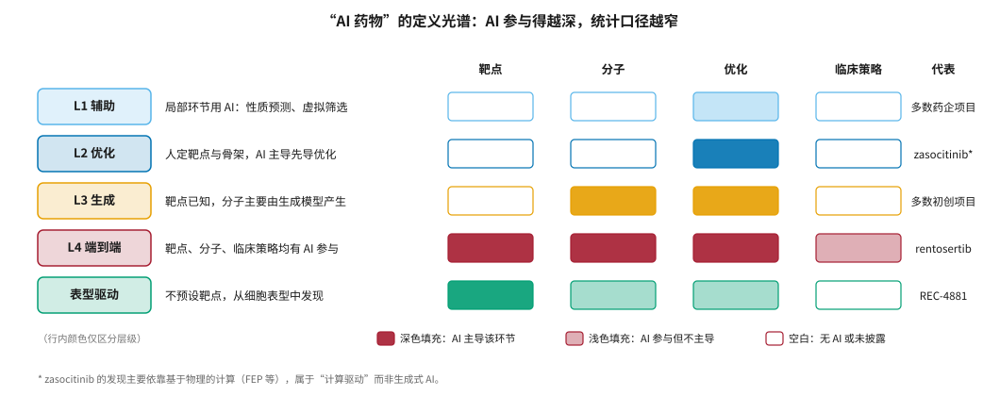
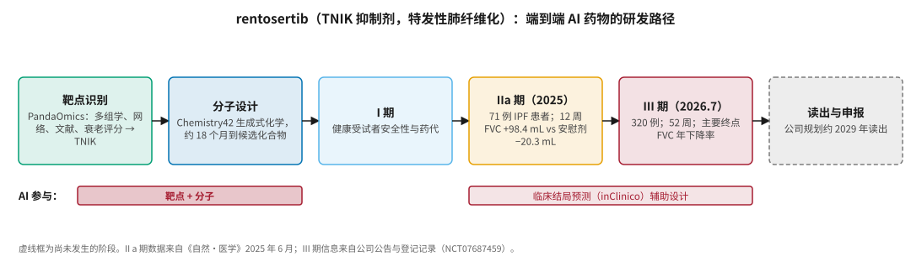
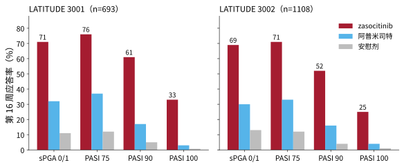
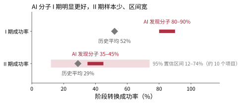

# 2026 年全球临床管线与标杆案例 {#sec-landscape}

## 本章目的 {.unnumbered .unlisted}

::: {.purpose-question}
170 多个 AI 药物项目进入临床、零个获批上市——这组数字究竟说明了什么？
:::

2026 年是 AI 制药从“技术演示”走向“临床检验”的一年。端到端 AI 药物第一次进入 III 期，一个以计算平台为核心发现手段的分子第一次进入美国上市审评，而资本市场给一家尚未让任何患者用药的公司开出了数百亿美元的估值。这些事件看起来指向同一个方向，实际上说明的是不同的事情。本章先厘清“AI 药物”的定义口径，再逐一剖析 2026 年最重要的几个标杆案例，然后用现有的临床数据回答“AI 药物是否更容易成功”，最后讨论资本节奏与临床证据之间的落差。读完本章，读者应能对任何一条“AI 药物里程碑”新闻做出自己的判断。

::: {.callout-learning-objectives}

- 说明“AI 药物”定义光谱的五个层级，并解释口径差异如何导致统计数字相差数倍
- 概括 rentosertib 从靶点发现到 III 期的研发路径，识别其中哪些环节有 AI 参与、哪些证据已经获得
- 解读 zasocitinib 的 III 期数据和上市审评状态，判断它在何种意义上属于“计算驱动药物”
- 比较 AI 发现分子与历史平均的分阶段成功率，并指出样本量和选择偏差对解读的影响
- 区分合作交易中的“总潜在价值”与已确认收入，评估资本节奏与临床证据之间的落差
- 列出 2026–2030 年用于检验 AI 药物的关键临床读出

:::

## 管线规模与“AI 药物”的定义之争 {#sec-landscape-definition}

### 数字 {#sec-landscape-numbers}

行业追踪机构的统计显示，处于临床开发阶段的 AI 设计药物项目从 2023 年底的约 24 个增长到 2026 年初的 173 个以上；另一项 2026 年的行业分析估计，2019 年以来约 600 亿美元流入 AI 药物发现领域，产生了约 175 个临床阶段项目，并据此称当下为“III 期清算时刻”[@intuitionlabs2026pipeline; @ai2work2026reckoning]。截至 2026 年 8 月，没有一款由 AI 发现或设计的药物在任何主要市场获批 [@pharmaletter2026evidence]。

这两组数字常被一起引用，但它们来自不同机构，使用各自的分类口径，彼此并没有对齐。

### 定义光谱 {#sec-landscape-spectrum}

“AI 药物”没有统一定义，可以把它想象成一条光谱（@fig-ai-spectrum）。

::: {#fig-ai-spectrum fig-cap="**“AI 药物”的定义光谱**：从 L1（AI 用于局部环节）到 L4（靶点、分子、临床策略均有 AI 参与），外加不预设靶点的表型驱动路线。方块的填充深浅表示 AI 在该环节的参与程度。口径越宽，统计数字越大，“第一个 AI 药物”的时间点也越早。代表项目的归类为作者基于公开信息的判断。" fig-alt="矩阵图，五行分别为 L1 辅助、L2 优化、L3 生成、L4 端到端、表型驱动，四列为靶点、分子、优化、临床策略，方块颜色深浅表示 AI 参与程度，右侧列出代表项目。"}

{width="100%"}

:::

::: {#dfn-landscape-ai-drug .callout-definition title="AI 药物"}

***AI 药物***\index{AI 药物!定义}在本书中指：在靶点选择、分子结构生成或优化、临床开发策略三个环节中，至少有一个环节由机器学习模型提供了**决定性**而非辅助性的输入，且这一贡献有公开资料可查的研发项目。

1.  **意义**：明确定义是比较的前提。按 L1 口径，几乎所有现代药物都是“AI 药物”；按 L4 口径，2026 年全世界只有少数几个公开案例。
2.  **区别**：“计算驱动药物”（如主要依靠 FEP 等物理计算发现的分子）与“生成式 AI 药物”是两类不同的证据：前者验证的是物理模拟平台，后者验证的是数据驱动的生成模型。
3.  **常见误区**：引用“173 个 AI 药物”时不说明口径，然后把它与“零获批”并列，得出“AI 药物全军覆没”或“AI 药物即将爆发”的结论。两种结论都忽略了大部分项目仍处在早期临床、按正常时间表尚不可能获批这一事实。

:::

本书讨论“AI 药物”时，尽量说明是哪个层级的参与；引用统计数字时注明出处和口径。

## 标杆案例一：rentosertib {#sec-landscape-rentosertib}

### 基本信息 {#sec-landscape-rentosertib-basics}

rentosertib（曾用名 ISM001-055、INS018_055）是英矽智能开发的口服小分子 TNIK 抑制剂，适应症为特发性肺纤维化（IPF）。IPF 全球约有 500 万患者，确诊后中位生存期约三到四年；现有疗法吡非尼酮和尼达尼布只能延缓肺功能下降，不能逆转 [@pulse2026aging]。

@fig-rentosertib-path 展示了它的研发路径。

::: {#fig-rentosertib-path fig-cap="**rentosertib 的研发路径**：靶点由 PandaOmics 平台识别，分子由 Chemistry42 生成式化学平台设计，约 18 个月推进到临床前候选化合物；IIa 期数据于 2025 年发表于《自然·医学》；320 例的 III 期于 2026 年 7 月启动，按公司规划约在 2029 年前后读出。下方色带标注 AI 参与的环节。" fig-alt="六个横向方框依次为靶点识别、分子设计、I 期、IIa 期、III 期、读出与申报，最后一个为虚线框；下方红色色带标注靶点加分子以及临床结局预测两段 AI 参与。"}

{width="100%"}

:::

### 靶点是怎么选出来的 {#sec-landscape-rentosertib-target}

据英矽智能披露，他们综合多组学数据、生物网络分析、因果推断、文献和专利信息，以及与衰老相关的靶点评分，把 TNIK 列为纤维化的高优先级靶点 [@biospectrum2026insilico]。TNIK 是一种丝氨酸/苏氨酸激酶，涉及 Wnt、TGF-β、Hippo/YAP-TAZ、JNK 和 NF-κB 等多条与纤维化、炎症相关的信号通路。此前 TNIK 并不是纤维化领域的热门靶点——这正是“AI 发现靶点”叙事的核心：算法找到了人类专家没有优先考虑的方向。当然，这一说法最终要由临床数据验证。

### 临床数据 {#sec-landscape-rentosertib-data}

**IIa 期**：这项随机、双盲、安慰剂对照试验纳入 71 例 IPF 患者，结果于 2025 年 6 月发表在《自然·医学》上 [@xu2025rentosertib]。12 周时，60 mg 每日一次组的用力肺活量（FVC）平均改善 98.4 mL（95% 置信区间 10.9–185.9），安慰剂组平均下降 20.3 mL。这是 AI 发现的药物第一次在患者身上显示出疗效信号，但样本量小、观察期短，属于概念验证性质。

**衰老生物标志物分析**：2026 年 9 月发表在《自然·生物技术》上的分析，用六个独立开发的蛋白质组衰老时钟检测了 IIa 期 42 名患者的 2841 种血清蛋白，发现治疗组的预测生物学年龄普遍下降，在第 4 周、30 mg 每日两次组信号最强 [@goeminne2026; @pulse2026aging]。研究者明确表示该结果是探索性的，不能证明 rentosertib 能延长寿命或逆转人类衰老。

**III 期设计**：2026 年 7 月 7 日，英矽智能宣布并登记了 320 人的 III 期研究（NCT07687459）。试验在中国开展，为期 52 周，每日一次口服给药，主要终点为 FVC 年下降率，关键次要终点为首次疾病进展事件的时间；试验同时收集蛋白质组数据，用于研究作用机制和探索其他适应症 [@biospectrum2026insilico; @cro2026insilico]。

::: {.callout-perspective title="一个“传统”的 III 期"}

有报道指出，尽管英矽智能在靶点发现、生成化学和机器人实验室方面高度创新，它的 III 期设计却相当传统 [@cro2026insilico]。这其实是好事：关键性试验的终点和统计设计越标准，结果就越有说服力，也越能干净地回答“AI 发现的药物是否真的有效”。如果在 III 期也大量引入尚未被监管认可的 AI 方法，一旦结果为阳性，反而难以说清功劳归于药物本身还是试验设计。

:::

### 为什么说它是“最干净的实验” {#sec-landscape-rentosertib-clean}

如果只能用一个项目来检验 AI 制药，rentosertib 几乎是最理想的选择：靶点、分子和临床策略都有 AI 参与，靶点又不是业界已验证的热门靶点 [@ai2work2026reckoning]。它成功，可以有力证明完整的 AI 技术栈能产出有疗效的新靶点药物；它失败，原因也相对清楚——最可能是靶点假设在更大规模、更长时间的人群中不成立。

创始人把 IPF 称为 rentosertib 的“入门适应症”，长期目标是扩展到与衰老相关的其他疾病 [@cro2026insilico]。这一战略的风险在于：衰老目前不被监管机构视为可以申请的适应症，相关终点的临床意义也存在争议（@sec-ethics 会讨论其中的伦理问题）。

## 标杆案例二：zasocitinib {#sec-landscape-zasocitinib}

### 基本信息 {#sec-landscape-zaso-basics}

zasocitinib（TAK-279）是一种口服、高选择性 TYK2 变构抑制剂，用于中重度斑块状银屑病。它最早由 Nimbus Therapeutics 发现；Nimbus 与薛定谔深度合作，大量使用基于物理的计算平台（包括 FEP）。2022 年底，武田以 40 亿美元首付款收购了该项目 [@fierce2025zaso]。

TYK2 属于 JAK 激酶家族，难点在于选择性：JAK1、JAK2、JAK3 与 TYK2 的催化结构域高度相似，非选择性抑制会带来已知的 JAK 类安全性问题。行业的解决思路是靶向 TYK2 独特的假激酶结构域（JH2）实现变构抑制。第一个上市的 TYK2 抑制剂是百时美施贵宝的 Sotyktu（2022 年获批）。

### III 期数据与监管状态 {#sec-landscape-zaso-data}

两项全球 III 期研究 LATITUDE PsO 3001 和 3002 分别入组 693 和 1108 名成人患者，覆盖 21 个国家，以安慰剂和阿普米司特为对照（@fig-zasocitinib）。两项研究的共同主要终点和全部 44 个排序次要终点均达到，没有发现新的安全性信号 [@takeda2026nda]。

::: {#fig-zasocitinib fig-cap="**zasocitinib 的两项 III 期研究（第 16 周）**：在两项研究的四个疗效终点上，zasocitinib 的应答率均明显高于阿普米司特和安慰剂。仅标注 zasocitinib 组数值。数据来源：武田 2026 年 9 月新闻稿 [@takeda2026nda]。" fig-alt="两个并排分组柱状图，分别为 LATITUDE 3001 和 3002，横轴为 sPGA 0/1、PASI 75、PASI 90、PASI 100，每组三根柱为 zasocitinib、阿普米司特、安慰剂；3001 中 zasocitinib 依次为 71、76、61、33，3002 中为 69、71、52、25。"}

{width="100%"}

:::

2026 年 9 月 14 日，FDA 以优先审评方式受理了 zasocitinib 的新药申请，PDUFA 目标日期在 2027 年第一季度；EMA 同时受理了上市许可申请 [@takeda2026nda]。武田此前估计，如果所有适应症都获批，其峰值销售额可达 30 亿至 60 亿美元 [@fierce2025zaso]。

### 它算“AI 药物”吗 {#sec-landscape-zaso-ai}

这取决于定义。zasocitinib 的发现主要依赖**基于物理的计算**，而不是深度学习生成模型；按 @dfn-landscape-ai-drug 的光谱，它更接近“计算驱动的 L2 优化”。它的意义在于：如果 2027 年获批，它很可能成为第一个以计算平台为核心发现手段、并在大规模 III 期中证明优于现有口服疗法的上市药物，从而为“计算优先”的药物发现模式提供第一份上市证据。但它不能直接证明生成式 AI 或“AI 发现靶点”的价值——TYK2 本身是已被验证的靶点。

## 其他值得关注的临床项目 {#sec-landscape-others}

@tbl-programs 列出 2026 年部分有公开进展的 AI 相关临床项目。

| 项目 | 公司 | 靶点 / 机制 | 适应症 | 2026 年状态 |
|:---|:---|:---|:---|:---|
| rentosertib | 英矽智能 | TNIK 抑制剂 | IPF | III 期（7 月启动） |
| ISM6331 | 英矽智能 | pan-TEAD 抑制剂 | 晚期间皮瘤 | 7 月获 FDA 快速通道资格，为该公司首个 |
| zasocitinib | 武田（源自 Nimbus） | TYK2 变构抑制剂 | 斑块状银屑病 | NDA 优先审评，PDUFA 2027 年第一季度 |
| REC-4881 | Recursion | MEK1/2 抑制剂 | 家族性腺瘤性息肉病（FAP） | II 期，与 FDA 讨论注册路径 |
| REC-1245 | Recursion | RBM39 降解剂 | 实体瘤 | I 期剂量爬坡，未见剂量限制性毒性 |
| REC-4539 | Recursion | 可逆、可入脑 LSD1 抑制剂 | 实体瘤、AML | I 期首例给药 |
| REC-7735 | Recursion | PI3Kα H1047R 突变选择性抑制剂 | 实体瘤 | IND 获批，下半年启动 I/II 期 |
| MDR-001 | 德睿智药 | 口服小分子 GLP-1 受体激动剂 | 肥胖 / 代谢 | III 期（据报道立项到 III 期约 4.5 年） |

: 2026 年部分 AI 相关临床项目（据公司公告与公开报道） {#tbl-programs}

关于 REC-4881，Recursion 披露的 II 期初步数据显示：12 名可评估患者中，4 mg 每日一次给药 12 周后，75% 的患者息肉总负荷下降，中位降幅 43% [@recursion2025fy]。FAP 目前没有获批的药物疗法。Recursion 把这一结果称为其平台从新颖表型洞察出发获得的首个临床验证，并于 2026 年上半年开始与 FDA 讨论注册路径 [@recursion2026q1]。需要注意的是，MEK1/2 是已有成熟抑制剂的靶点，平台的贡献在于为已知机制找到新适应症，更接近“老药新用”的逻辑（@sec-target）。

德睿智药的 MDR-001 据报道从立项到 III 期约用时 4.5 年、直接投入约 2300 万美元，而传统基准约为 8–12 年、3.1–4 亿美元；报道同时指出两者口径并不完全可比 [@21jingji2026licenseout]。

这些项目大多样本量很小，仍处于早期阶段。表中只列出已公开披露的信息，不代表对其前景的判断。

::: {.callout-checkpoint title="读懂一条里程碑新闻"}

- [ ] 对于“某 AI 药物进入 III 期”，你能指出它属于定义光谱的哪一层，以及 AI 参与了哪些环节吗？
- [ ] 你能说出 zasocitinib 获批与 rentosertib 获批分别能证明什么、不能证明什么吗？
- [ ] 对于“立项到 III 期只用 4.5 年”，你会追问哪些可比性问题？

:::

## I 期很好，II 期照旧 {#sec-landscape-success}

### 数据 {#sec-landscape-success-data}

被引用最多的定量分析来自 Jayatunga 等人 2024 年在 *Drug Discovery Today* 上发表的研究 [@jayatunga2024]。该研究考察了 AI 原生生物技术公司的临床管线，发现 AI 发现的分子 I 期成功率为 80%–90%，明显高于历史平均水平；II 期成功率约为 40%，与历史水平相近或略高，但样本很少；研究发表时还没有 AI 药物完成 III 期（@fig-ai-phase-success）。

::: {#fig-ai-phase-success fig-cap="**AI 发现分子与历史平均的阶段成功率**：深红色粗线为 AI 原生公司分子的成功率范围，灰色菱形为历史平均（BIO 2011–2020）。I 期差距明显。II 期的淡红色背景带是按正文“10 个项目、4 个成功”估算的 95% 置信区间（12%–74%），它完整地覆盖了 29% 的历史平均值——这正是“样本太少，尚不足以得出 AI 分子 II 期更好的结论”这一判断的来源。数据来源：Jayatunga 等 2024 [@jayatunga2024]、BIO 2021 [@bio2021]；II 期点区间为作者依据原文点估计与样本量给出的示意范围。" fig-alt="点区间图，两行分别为 I 期和 II 期成功率；I 期 AI 区间 80 到 90%，历史平均 52%；II 期 AI 区间 35 到 45%，历史平均 29%，其 95% 置信区间 12% 到 74% 的淡色背景带完全覆盖历史平均值。"}

{width="78%"}

:::

### 解读 {#sec-landscape-success-interpretation}

为什么会这样？@sec-economics-failure 的分析给出了线索。I 期主要检验安全性和药代动力学，这恰恰是 AI 模型最擅长优化的性质——ADMET 预测、选择性优化、毒性警示结构识别都能在设计阶段排除问题分子，所以 I 期成功率提高符合预期。II 期主要检验疗效，疗效取决于靶点与疾病的因果关系和动物模型的预测效度，现有 AI 方法对此帮助有限。

还有两个统计上的注意事项：

1. **样本小**：AI 药物进入并完成 II 期的项目总数仍然有限，成功率估计的置信区间很宽。按 10 个项目、4 个成功估算，95% 置信区间大约覆盖 12%–74%，几乎无法与历史平均区分。
2. **选择偏差**：早期进入临床的 AI 项目，很多选择了已验证的靶点（“me-too”或“fast-follower”策略）以降低风险。这会抬高 I 期成功率，也让结果很难推广到新靶点项目。

### 安全性导致的中止 {#sec-landscape-discontinuations}

并非所有项目都顺利。2026 年的行业回顾中就有因安全性原因中止的案例，例如薛定谔的 SGR-2921 和 BerGenBio 的 bemcentinib [@intuitionlabs2026pipeline]。计算优化能降低某些已知类型的风险，但不能消除药物在人体中的全部安全性风险。

## 资本的节奏 {#sec-landscape-capital}

### Isomorphic Labs：技术最强、证据最少 {#sec-landscape-isomorphic}

2026 年 AI 制药领域最引人注目的资本事件是 Isomorphic Labs 的 B 轮融资。5 月 12 日，Isomorphic 宣布完成 21 亿美元融资，由 Thrive Capital 领投，Alphabet、GV 跟投，新投资者包括 MGX、淡马锡、CapitalG 和英国主权 AI 基金；连同 2025 年 3 月的 6 亿美元 A 轮，累计融资约 26 亿美元 [@isomorphic2026seriesb]。10 月有报道称其正以至少 400 亿美元的估值寻求新一轮融资，此前估值约 175 亿美元 [@cryptobriefing2026iso]。与此同时，Isomorphic 尚未发布任何临床数据，也没有让任何患者用药；Hassabis 最初的目标是 2025 年底进入临床，后推迟到 2026 年底。

### 合作交易 {#sec-landscape-deals}

另一类资本流动是药企与 AI 公司的合作交易。2026 年最受关注的包括：礼来与英矽智能最高 27.5 亿美元的合作，首付款 1.15 亿美元 [@lilly_insilico2026]；晶泰科技与 DoveTree 潜在总价值约 60 亿美元的合作；Recursion 与赛诺菲的合作中，赛诺菲于 10 月行使首个开发候选物的选择权，触发 1000 万美元里程碑，合作累计已确认 1.44 亿美元 [@recursion2026oct]。@sec-capital 会详细拆解这些交易的结构。

::: {#ws-landscape-headline-value .callout-war-story title="“总潜在价值”的错觉"}

**现象**：AI 制药合作新闻的标题几乎总是“总额最高 X 十亿美元”。2026 年上半年，中国创新药对外 BD 交易总额约 997 亿美元，看上去规模惊人。

**结构**：同期的首付款总额约 50 亿美元；在中国交易中，确定性现金首付款仅占交易总额的约 6%，美国约 10% [@21jingji2026licenseout]。其余部分是研发里程碑、监管里程碑、商业化里程碑和销售分成，几乎全部取决于项目能否推进到后期并成功上市。

**教训**：按 @sec-economics-success 的历史成功率，一个处于临床前或 I 期的项目最终获批的概率不到 10%。对合作交易的合理估值，应对每一笔里程碑按其所在阶段的存活概率打折——这正是 @eq-rnpv 的逻辑。评估 AI 制药公司时，已确认收入、现金储备和合作方在关键节点的选择权行使，比“总潜在价值”更有意义。

:::

## 2026–2030 年的关键读出 {#sec-landscape-readouts}

如果要用一份清单检验 AI 制药的承诺，以下几项是最值得跟踪的（@tbl-readouts）。

| 时间（预计） | 事件 | 能检验什么 |
|:---|:---|:---|
| 2026 年底 | Isomorphic Labs 首个人体试验启动 | 结构预测优先路线能否按时产出临床候选物 |
| 2027 年第一季度 | zasocitinib FDA 审评结论 | 计算驱动发现的分子能否获批上市 |
| 2026–2027 年 | REC-4881 注册路径与更大样本数据 | 表型平台发现的新适应症能否走向注册 |
| 2026–2027 年 | 15–20 个 AI 相关项目的关键性试验读出（行业估计） | AI 项目的后期成功率是否不同于历史 |
| 约 2029 年 | rentosertib III 期读出 | “AI 发现新靶点”能否在关键性试验中成立 |

: 2026–2030 年值得跟踪的关键读出 {#tbl-readouts}

## 谬误与陷阱 {#sec-landscape-fallacies}

::: {.fallacy-pitfall}

**谬误**：*“173 个项目、零个获批”说明 AI 制药失败了。*

大部分 AI 项目在 2022 年以后才进入临床，按 @sec-economics-success 所述的正常时间表（I 期到获批平均约 10.5 年），它们中的绝大多数现在根本不可能获批。零获批是时间问题，不是结论。真正的检验是 2027–2030 年的后期读出。

:::

::: {.fallacy-pitfall}

**谬误**：*zasocitinib 获批就证明了生成式 AI 的价值。*

zasocitinib 主要依靠物理计算发现，靶点 TYK2 已被验证。它的获批能证明“计算优先”的先导优化可以产出更好的分子，但不能证明生成式模型或“AI 发现靶点”的价值。

:::

::: {.fallacy-pitfall}

**陷阱**：*用 I 期成功率推断累计成功率。*

I 期成功率 80%–90% 很诱人，但决定累计成功率的是 II 期。在 II 期数据积累到足以给出窄置信区间之前，任何“AI 药物成功率是传统药物两倍”的说法都缺乏依据。

:::

::: {.fallacy-pitfall}

**陷阱**：*把融资规模当作技术验证。*

21 亿美元的融资说明投资人相信团队和技术，但不能替代临床数据。AI 制药的估值逻辑与传统生物技术公司在本质上相同：最终由临床结果决定。

:::

## 小结 {#sec-landscape-summary}

2026 年的 AI 制药处在“期中考试刚刚开始”的位置：临床前效率提升和 I 期成功率提高已有数据支持；第一个端到端 AI 药物进入了 III 期，第一个计算驱动的分子进入了上市审评；AI 能否提高 II/III 期成功率、能否持续产出新靶点药物，要到 2027–2030 年才能回答；与此同时，资本投入远远领先于临床证据。

::: {.callout-takeaways title="期中考试刚刚开始"}

* **先问口径**：“AI 药物”有从 L1 到 L4 的定义光谱，统计数字和“第一个”的说法都取决于口径。
* **rentosertib 是最干净的检验**：靶点、分子、临床策略均有 AI 参与，靶点非热门；IIa 期有疗效信号，III 期约 2029 年读出。
* **zasocitinib 是计算驱动的检验**：两项 III 期全部终点达到，PDUFA 在 2027 年第一季度；它验证物理计算平台，而非生成式 AI 或 AI 发现靶点。
* **I 期很好，II 期照旧**：AI 分子 I 期成功率 80%–90%，II 期样本少、区间宽，尚不能说明 AI 改变了疗效层面的成功率。
* **资本领先证据**：一家尚无患者用药的公司估值数百亿美元；合作交易中真正到账的首付款只占总额的 6%–10%。

:::

::: {.callout-chapter-connection title="从项目到公司"}

本章从项目层面看 2026 年的现场。不同项目背后，是押注不同技术假设的公司：英矽押注“AI 能发现新靶点”，Recursion 押注“表型数据能揭示新生物学”，Isomorphic 押注“更精确的结构预测能带来更好的分子”。@sec-players 按五条技术路线介绍国际代表企业，分析它们的数据来源、商业模式和风险结构。

:::
