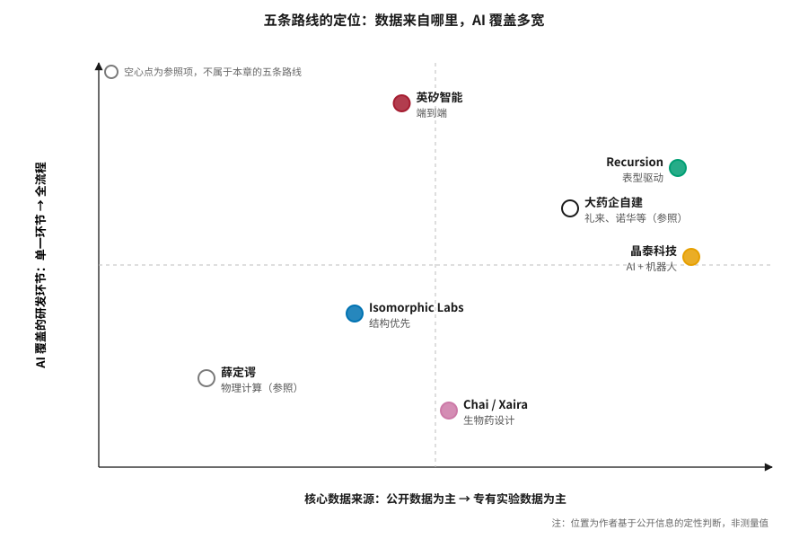
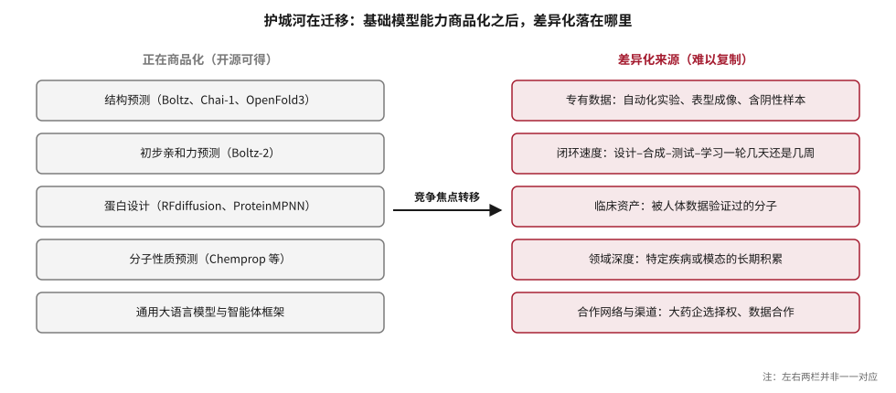
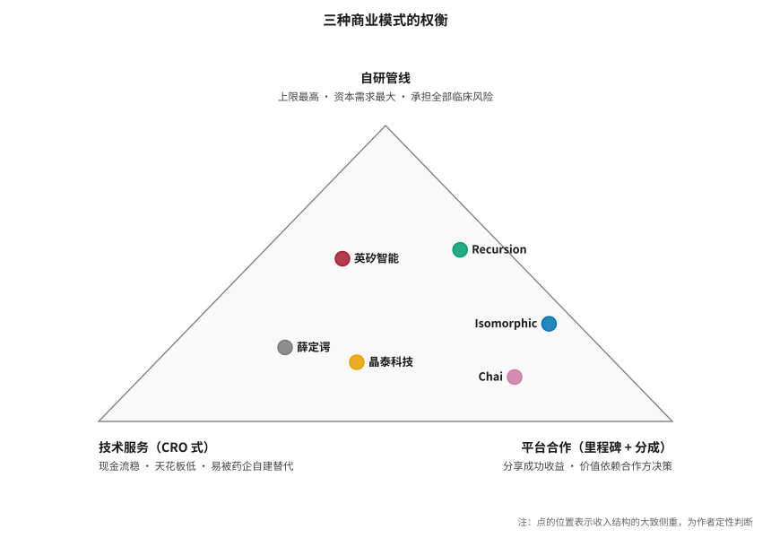

# 国际企业图谱：五条路线 {#sec-players}

## 本章目的 {.unnumbered .unlisted}

::: {.purpose-question}
同样叫“AI 制药公司”，为什么它们的风险、估值和成败标准完全不同？
:::

把所有 AI 制药公司放进同一个篮子，是理解这个行业时最常见的错误。一家以表型成像数据为核心的公司，与一家以结构预测模型为核心的公司，押注的科学假设不同，数据来源不同，赚钱方式不同，失败的方式也不同。本章按五条技术路线——端到端、表型驱动、结构优先、“AI + 机器人”、生物药设计——介绍国际代表企业，再讨论物理计算派、大药企自建和开源社区这三股同样重要的力量。最后，我们用三个问题来评估任何一家 AI 制药公司：它的核心数据从哪里来？它的 AI 覆盖哪些环节？它靠什么赚钱？

::: {.callout-learning-objectives}

- 用“数据来源、AI 覆盖环节、商业模式、分子类型”四个维度对 AI 制药公司分类
- 概括英矽智能、Recursion、Isomorphic Labs、晶泰科技和生物药设计公司各自押注的核心假设、关键资产与主要风险
- 说明物理计算平台（以薛定谔为代表）与数据驱动平台的差异和互补关系
- 解释大药企从“买服务”到“自建能力”的转变，以及联邦学习等新型数据协作模式
- 分析开源基础模型如何改变竞争格局，识别“护城河”正在迁移到哪里
- 比较技术服务、平台合作与自研管线三种商业模式的风险收益结构

:::

## 一张分类图 {#sec-players-taxonomy}

评估一家 AI 制药公司，可以先问四个问题：

1. **核心数据从哪里来？** 公开数据库（PDB、ChEMBL），自产的专有数据（自动化实验、表型成像），还是合作方提供的数据？
2. **AI 用在哪个环节？** 靶点、分子、临床，还是全流程？
3. **怎么赚钱？** 卖服务、收合作里程碑，还是自己把药做到上市？
4. **押注哪种分子类型？** 小分子、抗体、多肽还是核酸？

按前两个维度，可以把主要玩家放在一张定位图上（@fig-players-map）。

::: {#fig-players-map fig-cap="**五条路线的定位**：横轴为核心数据来源（左侧以公开数据为主，右侧以专有实验数据为主），纵轴为 AI 覆盖的研发环节宽度。英矽智能覆盖最宽，Recursion 和晶泰科技的数据专有程度最高，Isomorphic Labs 和薛定谔以模型或物理计算能力为核心，生物药设计公司聚焦单一模态。图中两个空心点（薛定谔、大药企自建）是用来标定坐标系的参照项，不属于本章讨论的五条路线。位置为作者基于公开信息的定性判断，不是测量值。" fig-alt="二维散点图，横轴为数据来源从公开到专有，纵轴为 AI 覆盖从单一环节到全流程；英矽智能位于中上，Recursion 和大药企自建位于右上，晶泰科技位于右中，Isomorphic Labs 位于中间偏左，薛定谔位于左下，Chai 和 Xaira 位于中下。"}

{width="80%"}

:::

> 说明：本章涉及的公司信息均来自公开资料，截至 2026 年 10 月。介绍某家公司不代表对其投资价值的判断。

## 端到端派：英矽智能 {#sec-players-insilico}

### 公司概况 {#sec-players-insilico-overview}

英矽智能（Insilico Medicine）成立于 2014 年，创始人为 Alex Zhavoronkov，在美国和中国均有研发运营。公司于 2025 年 12 月 30 日在港交所主板挂牌，发行价 24.05 港元，募资至多约 23 亿港元，IPO 市值约 134 亿港元；15 家基石投资者合计认购 1.15 亿美元，其中包括礼来和腾讯 [@insilico_ipo2025]。

### 技术平台：Pharma.AI {#sec-players-insilico-platform}

英矽的 Pharma.AI 平台由三个模块组成，正好对应研发的三大段（@tbl-pharmaai）。

| 模块 | 功能 | 对应阶段 |
|:---|:---|:---|
| PandaOmics | 整合多组学数据、文献、专利、临床试验信息，对靶点打分排序 | 靶点发现（@sec-target） |
| Chemistry42 | 组合多种生成模型和评分函数，设计并优化分子 | 分子设计（@sec-generative） |
| inClinico | 预测临床试验结局，辅助试验设计 | 临床开发（@sec-clinical） |

: 英矽智能 Pharma.AI 平台的三个模块 {#tbl-pharmaai}

此外，英矽建设了机器人实验室用于自动化合成和测试。据公司披露，其 2021–2024 年二十余个自研项目从立项到候选化合物平均用时 12–18 个月，单个项目合成测试 60–200 个分子 [@21jingji2026licenseout]。

### 管线、收入与交易 {#sec-players-insilico-pipeline}

招股时，英矽披露其管线覆盖 30 多个创新项目，涉及肿瘤、免疫、纤维化和代谢等领域；全球收入最高的 20 家药企中有 13 家与其有软件平台合作 [@insilico_ipo2025]。核心资产 rentosertib 于 2026 年 7 月进入 III 期（@sec-landscape-rentosertib），pan-TEAD 抑制剂 ISM6331 于 7 月获 FDA 快速通道资格。截至 2026 年 8 月底，公司在当年提名了 9 个开发候选物，在自研和合作项目中达成了 8 个临床里程碑 [@pulse2026aging]。

收入结构以授权为主。2022–2024 年营收分别约为 3015 万、5118 万和 8583 万美元，2024 年毛利率约 90.4% [@insilico_ipo2025]；2026 年上半年营收约 1.06 亿美元，同比增长 287%，并实现半年度盈利 [@pulse2026aging; @huxiu2026financing]。2026 年的主要交易包括：1 月与施维雅达成最高 8.88 亿美元的多年期研发合作；3 月与礼来达成最高 27.5 亿美元的合作，首付款 1.15 亿美元 [@lilly_insilico2026]。公司称 2026 年宣布的交易潜在合同总值约 73 亿美元，2021 年以来累计约 110 亿美元 [@pulse2026aging]。

### 独特战略：从疾病到衰老 {#sec-players-insilico-aging}

英矽的长期目标是**衰老**。公司在靶点发现中参考“衰老时钟”——基于甲基化、蛋白质组和转录组的生物学年龄估计模型——优先选择同时与疾病和衰老相关的靶点，把 IPF 视为 rentosertib 的“入门适应症”[@cro2026insilico]。这一战略有内在逻辑，也有风险：衰老目前不被监管机构视为可申请的适应症，相关终点的临床意义存在争议。

::: {.callout-perspective title="评价：英矽智能"}

**核心假设**：AI 能发现新靶点，并端到端地把它推进为有效药物。**优势**：迄今最完整的端到端案例；管线数量多；中美双边运营，研发成本较低；授权收入已能支撑运营。**风险**：rentosertib III 期结果将对公司估值和整个“AI 发现靶点”叙事产生决定性影响；收入高度依赖授权交易，波动大。

:::

## 表型派：Recursion {#sec-players-recursion}

### 核心思路：不预设靶点 {#sec-players-recursion-idea}

Recursion 成立于 2013 年，总部位于美国盐湖城，纳斯达克上市；2024 年 11 月与英国 AI 制药公司 Exscientia 合并，现任首席执行官为 Najat Khan。它的路线和多数公司不同：不从“已知靶点”出发，而从**细胞表型**出发——

1. 用 CRISPR 敲除基因或加入化合物，系统性地扰动人类细胞；
2. 用高内涵显微镜拍摄细胞图像，记录形态变化；
3. 用深度学习把图像转换为高维“表型嵌入”；
4. 在嵌入空间中寻找关系：如果某个化合物让细胞表型接近“敲除某疾病相关基因”的细胞，就提示它可能作用于该通路。

公司把这套体系整合为“Recursion OS”，称其为连接生物学、化学和临床开发的 AI 原生端到端平台；合并 Exscientia 后补入了生成式化学能力 [@recursion2026oct]。Recursion 还与 MIT 联合开发了开源结构生物学基础模型 Boltz-2，说明它在表型之外也在补强基于结构的能力 [@passaro2025boltz2]。

### 管线与合作 {#sec-players-recursion-pipeline}

2026 年，Recursion 把资源聚焦在 REC-4881（MEK1/2，FAP）、REC-1245（RBM39 降解剂，子宫内膜癌等实体瘤）、REC-4539（LSD1，实体瘤与血液肿瘤）、REC-7735（PI3Kα H1047R，实体瘤）和 REC-102（ENPP1，低磷酸酯酶症）上，并为 REC-617（CDK7）和 REC-3565（MALT1）寻求合作伙伴 [@recursion2026oct]。

合作方面：2026 年 10 月，赛诺菲行使了双方多项目合作中首个开发候选物的选择权——一个针对炎症性疾病中“难成药双靶点”的口服小分子，计划 2027 年进入 I 期——触发 1000 万美元里程碑，使该合作累计预付款与里程碑达到 1.44 亿美元，Recursion 仍有资格获得该项目超过 3 亿美元的后续里程碑 [@recursion2026oct]。基因泰克则把合作中首个神经科学靶点推进到联合早期发现项目，Recursion 认为这是其平台能产生经生物学验证的新靶点的早期证据 [@recursion2026q2]。截至 2026 年初，公司累计获得的预付款和进展里程碑超过 5 亿美元 [@recursion2025fy]。

### 财务 {#sec-players-recursion-finance}

截至 2026 年 9 月 30 日，Recursion 的现金及等价物约 5.61 亿美元（初步未审计）；10 月又宣布约 2 亿美元的承销发行，预计现金可支撑运营至 2029 年。公司在 8 月把 2026 年现金运营支出指引下调至 3.75 亿美元以下 [@recursion2026oct; @recursion2026q2]。

::: {.callout-perspective title="评价：Recursion"}

**核心假设**：大规模表型数据能揭示传统方法看不到的生物学。**优势**：数据规模和类型独特；表型路线可能发现新靶点或新适应症；合作方是一线大药企。**风险**：表型与临床疗效之间的转化链条长；历史上多次调整管线；现金消耗大，依赖持续融资。REC-4881 的注册路径是 2026–2027 年的关键看点。

:::

## 结构派：Isomorphic Labs {#sec-players-isomorphic}

### 核心资产：IsoDDE {#sec-players-isomorphic-isodde}

Isomorphic Labs 于 2021 年由 Alphabet 成立，从 Google DeepMind 分拆而来，首席执行官为 Demis Hassabis，总裁为 Max Jaderberg，总部位于伦敦，并在美国马萨诸塞州剑桥和瑞士洛桑设有办公室 [@isomorphic2026seriesb]。公司的核心是名为 **IsoDDE**（Isomorphic Labs Drug Design Engine）的统一 AI 药物设计引擎，由多个专有模型组成，宣称可以跨治疗领域和分子类型使用。2026 年 2 月，Isomorphic 发布了一份 27 页的技术报告，公开了 IsoDDE 的部分能力，重点展示其预测精度以及弥合“结构预测”与“真实药物发现”之间差距的新功能 [@isodde2026]。

IsoDDE 的技术基础是 AlphaFold 系列。可以把 Isomorphic 的工作理解为：在 AlphaFold3 的复合物结构预测之上，补上药物设计真正需要的能力——结合亲和力、构象动态、选择性和成药性（@sec-structure）。

### 资本、合作与临床 {#sec-players-isomorphic-capital}

Isomorphic 于 2025 年 3 月完成 6 亿美元 A 轮、2026 年 5 月完成 21 亿美元 B 轮，累计融资约 26 亿美元；与诺华、礼来、强生建立了战略合作 [@isomorphic2026seriesb]。截至 2026 年 10 月，Isomorphic 尚未披露临床候选药物，也没有让任何患者用药，计划于 2026 年底前启动首个人体试验，据报道首批候选药物以肿瘤领域为主。

::: {.callout-perspective title="评价：Isomorphic Labs"}

**核心假设**：更精确的结构和相互作用预测能带来更好的分子。**优势**：可能是全球最强的结构预测团队；资本极其充裕；与顶级药企合作。**风险**：尚无临床数据；估值几乎完全建立在技术能力和团队声誉上。正如 @pri-economics-biology-is-the-bottleneck 所述，临床失败的主因是生物学而非化学，而 Isomorphic 的强项主要在化学和结构层面。它是“技术最强、证据最少”的典型，其首批临床数据将直接检验“更好的结构预测能否带来更好的药物”。

:::

## “AI + 机器人”派：晶泰科技 {#sec-players-xtalpi}

### 核心思路 {#sec-players-xtalpi-idea}

晶泰科技（XtalPi）2015 年成立于深圳，2024 年 6 月在港交所主板上市（2228.HK）。它的技术栈有三层：以量子物理第一性原理计算起家（最早做药物晶型预测），发展出基于大语言模型、科学智能体和物理智能的 XtalPi Science 平台，并大规模建设自动化实验室。公司称其拥有 5000 平方米以上的 AI 自主实验室、300 多台持续运转的机器人，积累了 50 多万条真实实验记录，**其中约 80% 是业内稀缺的阴性样本**；全球团队超过 1000 人，是全球前 20 大药企中 17 家的深度合作伙伴 [@xtalpi_recruit2026]。

最后一点很关键。阴性数据的稀缺是 AI 药物模型的根本瓶颈之一（@sec-data-quality）：公开文献存在发表偏差，失败的实验很少被发表。自动化实验室可以系统地产出包括失败在内的完整数据，这可能是“AI + 机器人”路线最核心的护城河（@sec-synthesis）。

### 管线、财务与合作 {#sec-players-xtalpi-pipeline}

2026 年中期报告首次系统披露了自研管线：至少 10 条明确量化的自研管线，包括 3 条抗体、1 条小分子和 6 条 siRNA，另有分子胶和多肽项目；合作及自研管线中已有 3 条进入临床，10 余条处于 IND 获批或准备阶段，近 10 条达到临床前候选化合物阶段；公司规划到 2027 年合计近 40 条管线进入关键开发阶段 [@sina2026xtalpi]。

财务上，晶泰 2025 年营收约 8 亿元人民币，同比增长超过 200%，首次实现盈利（净利润约 2.58 亿元），现金超过 70 亿元 [@huxiu2026xtalpi]。但 2025 年收入中约 45% 来自与 DoveTree 的单笔大单，持续性存疑；自动化实验室业务则增长稳定，2024 年同比增长 87.8%，2025 年增长 62.6% 至 2.65 亿元，扣除大单后已是实际上的核心收入支柱 [@huxiu2026xtalpi]。这意味着晶泰已不再是一家轻资产的软件公司，而是“软硬件兼修”的 AI 基础设施供应商。2026 年上半年，剔除一次性授权项目影响后营收同比增长 73.8% [@sina2026xtalpi]。

2026 年的主要合作包括：1 月与东阳光药签署战略合作，拟成立合资公司，共建 AI + 机器人联合实验室和非临床药物大模型 [@xtalpi_hec2026]；6 月收到 DoveTree 合作的第二笔付款 1900 万美元，相关泛癌种管线进入 IND 阶段；9 月与翰思艾泰签署长期战略合作，探索抗体设计和 XDC 连接子–载荷设计（@sec-china）。

::: {.callout-perspective title="评价：晶泰科技"}

**核心假设**：高质量的专有实验数据是 AI 制药的最终护城河。**优势**：自产数据（尤其是阴性数据）的能力独特；已经盈利；现金充裕；多模态布局。**风险**：收入集中度高；重资产模式的规模效应和利润率有待验证；自研管线尚处早期。

:::

## 生物药设计派：Chai Discovery、Xaira 等 {#sec-players-biologics}

### 为什么蛋白设计跑得快 {#sec-players-biologics-why}

2023 年以后，蛋白质设计成为 AI 制药中进展最快的方向之一。它有几个天然优势：训练数据（PDB 结构和海量蛋白序列）质量高、规模大；设计空间是氨基酸序列，生成的分子一定“可合成”，用基因表达即可生产；湿实验验证相对快，酵母展示、噬菌体展示等技术可以并行测试大量设计（@sec-biologics）。

### 代表公司 {#sec-players-biologics-companies}

**Chai Discovery** 成立于 2024 年，总部位于旧金山，获 OpenAI 等支持，先后完成 7000 万美元和 1.3 亿美元融资。其 Chai-1（2024）是开源的复合物结构预测模型；Chai-2（2025）是零样本抗体与结合蛋白设计模型，只需输入靶点结构和表位就能从头设计 CDR。技术报告称，迷你蛋白设计在五个测试靶点上的湿实验命中率达到 68%，抗体–抗原复合物高精度预测（DockQ > 0.8）的比例为 34%，是 Chai-1 的两倍 [@chai2_report]。2026 年第一季度，礼来与 Chai 达成了生物药方向的合作 [@hlth2026q1]。

**Xaira Therapeutics** 由 David Baker 实验室的多名核心成员参与创立，2024 年成立时据报道获得超过 10 亿美元的融资承诺。Baker 实验室团队 2026 年 1 月在《自然》发表了用微调后的 RFdiffusion 从头设计抗体的工作，结合酵母展示筛选，生成了结构和表位都达到原子级精度的 VHH 和 scFv [@bennett2026]。

此外还有 Generate Biomedicines、Absci、EvolutionaryScale（ESM 系列开发者）、Cradle（2026 年与拜耳签订三年蛋白工程合作）等，各有侧重 [@hlth2026q1]。

::: {.callout-perspective title="评价：生物药设计派"}

**核心假设**：蛋白质的可设计性已经到达拐点。**优势**：数据好、设计空间明确、验证快，是 AI “设计能力”最接近实用的领域。**风险**：“能结合”只是第一步。一个抗体药物还需要满足亲和力、特异性、稳定性、可生产性和低免疫原性等一系列要求，从头设计把瓶颈转移到了可开发性上（@sec-biologics）。

:::

## 物理计算派：薛定谔与 Nimbus {#sec-players-physics}

在“AI 制药”的叙事中，基于物理的计算平台常被忽略，但它们迄今拿出了最接近上市的证据。薛定谔于 2020 年上市，业务由两部分组成：向药企和材料企业销售分子模拟软件（包括 FEP+），以及利用自身平台开展合作和自研项目。Nimbus Therapeutics 与薛定谔深度合作，用计算平台发现了 TYK2 变构抑制剂，2022 年以 40 亿美元首付款卖给武田，即今天进入上市审评的 zasocitinib（@sec-landscape-zasocitinib）。

物理计算派也有失败案例：薛定谔的自研项目 SGR-2921 于 2026 年因安全性原因中止 [@intuitionlabs2026pipeline]。这提醒我们：无论是物理计算还是数据驱动，计算方法都无法消除药物在人体中的全部风险。

物理与数据两条路线正在融合（@fig-two-lineages）：薛定谔在平台中加入了机器学习加速，Boltz-2 等数据驱动模型则把 FEP 作为对标基准。2026 年第一季度，薛定谔还加入了礼来主导的 TuneLab 联邦学习网络 [@hlth2026q1]。

## 大药企自建与新型数据协作 {#sec-players-pharma}

### 从“买服务”到“自建能力” {#sec-players-pharma-shift}

过去十年，大型药企对待 AI 的方式经历了两个阶段。约 2017–2021 年，主要通过与 AI 初创公司合作，购买平台服务或签订里程碑式合作；约 2022 年以后，开始大规模自建 AI 团队和算力。2026 年第一季度，这一趋势达到一个阈值：一季度内跨国药企与 AI 公司的重大合作有三十多项，覆盖从发现到生产和商业化的各个职能，多为多年期合作，伴随大额投资、重复合作和收购 [@hlth2026q1]。

**礼来**是最激进的例子：

- 2026 年 1 月，与英伟达宣布投资超过 10 亿美元共建 AI 联合创新实验室，并部署了由上千块 Blackwell GPU 组成的“AI 工厂”；
- 3 月，与英矽智能签订最高 27.5 亿美元的合作；同一季度还与 Chai Discovery、InduPro、Fauna Bio 等达成合作 [@hlth2026q1]；
- 2025 年 9 月推出 **TuneLab** 平台，向生物技术公司开放用其内部数据训练的 ADME、毒理、药代/药效和性质预测模型。礼来估计这些数据的生成成本超过 10 亿美元 [@tunelab2025]。

### 联邦学习：TuneLab 的机制 {#sec-players-pharma-tunelab}

TuneLab 的关键在于数据协作方式：合作方在不交换原始数据的前提下使用模型，训练和更新在本地运行，只共享加密的模型梯度，平台由第三方托管，合作方也可以安全地贡献自己的数据来改进共享模型 [@tunelab2025]。2026 年，Revvity、Benchling、薛定谔、BigHat 等加入了这一网络 [@hlth2026q1]。

::: {#dfn-players-federated .callout-definition title="联邦学习"}

***联邦学习***\index{联邦学习}（federated learning）是一种分布式机器学习方法：多个数据持有方在本地用各自的数据训练模型，只把模型参数或梯度（通常经过加密或差分隐私处理）发送给协调方聚合，原始数据始终不离开本地。

1.  **意义**：药企的专有数据是最宝贵、也最不可能公开的资产。联邦学习让多家机构的数据共同改进一个模型，而不必放弃数据所有权。
2.  **区别**：与“数据共享”不同，联邦学习不移动数据；与“模型授权”不同，参与方的数据会反过来改进共享模型。
3.  **常见误区**：认为联邦学习“天然保护隐私”。梯度本身可能泄露训练数据的信息，实际部署需要配合加密聚合、差分隐私和访问控制；此外，各方数据分布差异大（实验条件、化学空间不同）会显著降低联邦模型的效果（@sec-data-flywheel）。

:::

对 AI 初创公司而言，大药企自建能力有双重影响：一方面，药企成为更懂行的合作方，合作质量提高；另一方面，单纯提供“通用平台能力”的公司议价能力下降，必须拿出药企自己做不到的东西。

## 开源的拉平效应与护城河迁移 {#sec-players-open-source}

2024–2026 年，开源模型在关键能力上迅速追平闭源模型：结构预测有 Boltz-1、Chai-1、OpenFold3；亲和力预测有以 MIT 许可证开源模型、权重和训练流程的 Boltz-2；蛋白设计有 RFdiffusion、ProteinMPNN（@sec-toolchain）。结果是**基础模型能力正在商品化**——2026 年，一家 AI 制药公司仅凭“我们有一个好的结构预测模型”已很难建立护城河。差异化正在迁移（@fig-moat-shift）。

::: {#fig-moat-shift fig-cap="**护城河在迁移**：左侧能力已有高质量开源实现，正在商品化；右侧是难以复制的差异化来源——专有数据（尤其含阴性样本的系统性实验数据）、设计–合成–测试–学习闭环的速度、被人体数据验证过的临床资产、特定疾病或模态的长期积累，以及与大药企的合作网络。" fig-alt="左右两栏方框图，左栏灰色五项为结构预测、初步亲和力预测、蛋白设计、分子性质预测、通用大语言模型与智能体框架；右栏红色五项为专有数据、闭环速度、临床资产、领域深度、合作网络与渠道；中间箭头标注竞争焦点转移。"}

{width="100%"}

:::

::: {#pri-players-moat .callout-principle title="护城河在数据与闭环"}

**判断**：当基础模型能力可以开源获得时，AI 制药公司的长期竞争力取决于它能否持续产出别人没有的数据，以及把数据转化为更好决策的速度。

**含义**：评估一家公司时，应关注其数据的独特性（是否专有、是否含阴性样本、是否标准化）、闭环的迭代速度和临床资产，而不是模型架构本身。

:::

## 商业模式对比 {#sec-players-business-models}

把上述公司放在一起比较（@tbl-players-compare）：

| 维度 | 英矽智能 | Recursion | Isomorphic | 晶泰科技 | Chai / Xaira |
|:---|:---|:---|:---|:---|:---|
| 路线 | 端到端 | 表型驱动 | 结构优先 | 物理 + AI + 机器人 | 生物药设计 |
| 核心数据 | 多组学 + 公开数据 + 自有实验 | 专有表型成像数据 | 公开结构数据 + 专有数据 | 自动化实验数据（含大量阴性样本） | 结构与序列数据 + 湿实验 |
| 主要分子类型 | 小分子为主 | 小分子为主 | 小分子为主，跨模态 | 多模态 | 抗体、结合蛋白 |
| 收入来源 | 授权 + 合作 | 合作 + 融资 | 合作 + 融资 | 服务 + 实验室方案 + 授权 | 早期，融资为主 |
| 最领先临床阶段 | III 期 | II 期 | 尚未进入临床 | 早期临床 | 尚未进入临床 |
| 2026–2027 年看点 | rentosertib III 期 | REC-4881 注册路径 | 首个人体试验 | 自研管线推进 | 从头设计抗体进入开发 |

: 五条路线代表企业的比较 {#tbl-players-compare}

三种基本商业模式各有权衡（@fig-business-triangle）：**技术服务**（CRO 式）现金流稳定、风险低，但天花板低，容易被药企自建能力替代；**平台合作**（里程碑 + 分成）可以分享项目成功的收益，但大部分价值取决于合作方的决策和项目后期成败；**自研管线**价值上限最高，但资本需求最大、风险最高，要承担完整的临床开发风险。

::: {#fig-business-triangle fig-cap="**三种商业模式的权衡**：三角形的三个顶点分别代表技术服务、平台合作和自研管线，公司的位置表示其收入结构的大致侧重。多数 AI 制药公司在三者之间寻找平衡：用服务和合作收入支撑运营，用自研管线争取长期价值。位置为作者定性判断。" fig-alt="三角形图，顶点为自研管线，左下为技术服务，右下为平台合作；英矽智能靠近顶部偏左，Recursion 和 Isomorphic 位于右侧边附近，薛定谔和晶泰科技位于中下偏左，Chai 位于右下。"}

{width="75%"}

:::

这与传统生物技术公司没有本质区别：**AI 改变了产出候选分子的效率，但没有改变药物研发的风险结构和资本属性。**@sec-capital 会进一步拆解交易结构和估值逻辑。

::: {.callout-checkpoint title="评估一家 AI 制药公司"}

- [ ] 你能用“数据来源、AI 覆盖环节、商业模式、分子类型”四个维度描述一家你熟悉的 AI 制药公司吗？
- [ ] 你能说出 Isomorphic Labs 与晶泰科技押注的核心假设有何不同，以及各自最可能的失败方式吗？
- [ ] 当一家公司宣称其护城河是“领先的 AI 模型”时，你会追问什么？

:::

## 谬误与陷阱 {#sec-players-fallacies}

::: {.fallacy-pitfall}

**谬误**：*AI 制药公司是一类公司，可以用同一套标准评估。*

表型平台、结构预测平台、自动化实验室和生物药设计公司押注的科学假设不同，失败的方式也不同。用同一套指标（例如“管线数量”）横向比较，会掩盖真正的风险差异。

:::

::: {.fallacy-pitfall}

**谬误**：*模型越先进，公司越有价值。*

开源模型正在快速拉平基础能力。一家公司的长期价值更多取决于专有数据、闭环速度和临床资产（@pri-players-moat）。

:::

::: {.fallacy-pitfall}

**陷阱**：*忽视收入集中度。*

单笔大单可以让一家公司当年扭亏，但也可能在次年消失。晶泰科技 2025 年约 45% 的收入来自单一合作方，就是需要特别审视的例子。

:::

::: {.fallacy-pitfall}

**陷阱**：*把“与全球前 20 大药企中的 N 家有合作”当作商业成功的证据。*

合作可能只是软件许可或小规模试点。应关注合作的深度：是否有里程碑付款到账、合作方是否在关键节点行使了选择权、是否续约或扩大。

:::

## 小结 {#sec-players-summary}

到 2026 年，AI 制药已经从“一个技术概念”变成了“一个有清晰分层的产业”。英矽押注“AI 能发现新靶点”，Recursion 押注“表型数据能揭示新生物学”，Isomorphic 押注“更精确的结构预测能带来更好的分子”，晶泰押注“高质量的专有实验数据是最终护城河”，生物药设计公司押注“蛋白质的可设计性已经到达拐点”。这些假设并不互斥，未来几年的临床数据会分别检验它们。

::: {.callout-takeaways title="不同路线，不同赌注"}

* **四个维度分类**：数据来源、AI 覆盖环节、商业模式、分子类型决定了一家公司的风险结构。
* **五条路线五个假设**：端到端、表型、结构、AI + 机器人、生物药设计分别押注不同的科学命题，失败方式也不同。
* **物理计算派离上市最近**：zasocitinib 来自物理计算平台，这提醒我们不要把“AI 制药”等同于生成式 AI。
* **大药企正在自建**：礼来与英伟达的十亿美元级合作和 TuneLab 联邦学习网络，标志着药企从买服务转向建能力、建网络。
* **护城河在迁移**：基础模型能力正在开源化，差异化转向专有数据、闭环速度、临床资产和领域深度。
* **风险结构没变**：AI 改变了产出候选分子的效率，没有改变药物研发的风险结构和资本属性。

:::

::: {.callout-chapter-connection title="把视线转向中国"}

本章的企业大多是全球化运营的公司，但中国在 AI 制药中的位置值得单独讨论：中国有英矽智能、晶泰科技这样的上市公司，有深势科技、百图生科等 AI for Science 平台，有字节、腾讯、百度、华为等大厂，还有以成本和速度见长的创新药与 CXO 产业。@sec-china 专门分析中国 AI 制药生态的结构、优势与约束。

:::
