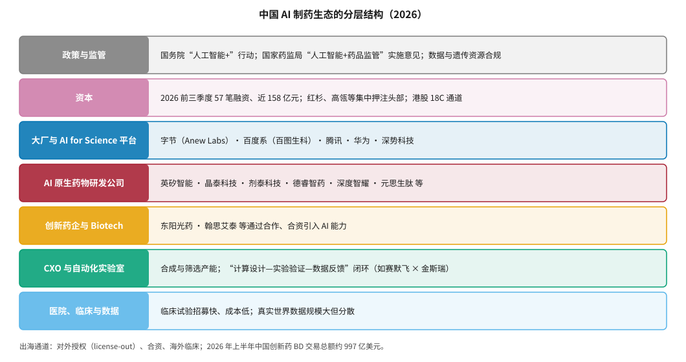
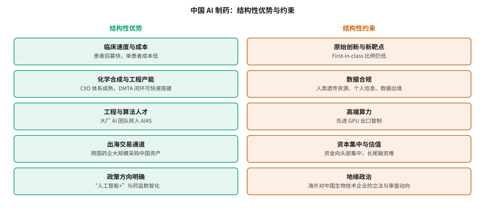

# 中国 AI 制药生态 {#sec-china}

## 本章目的 {.unnumbered .unlisted}

::: {.purpose-question}
中国在 AI 制药中拿的是“速度与成本”这张牌，这张牌能打多远？
:::

2026 年，中国 AI 制药出现了几个前所未有的信号：一家中国背景的公司把端到端 AI 药物推进到 III 期；国内 AI 制药赛道前三季度披露的融资额超过此前三年的总和；跨国药企在中国大规模采购创新药资产，其中不少带有 AI 标签；国家药监局把“人工智能 +”写进了监管现代化路线图。与此同时，原始创新不足、数据合规、高端算力和地缘政治等约束也越来越清晰。本章按“政策—资本—平台—公司—产业链—数据”的层次描绘中国 AI 制药生态，分析它的结构性优势与约束，并讨论“出海”如何成为中国 AI 制药公司的主要商业化通道。

::: {.callout-learning-objectives}

- 描述中国 AI 制药生态的七个层次，并为每一层举出代表性机构
- 概括英矽智能、晶泰科技、深势科技、百图生科和字节 Anew Labs 的定位与差异
- 解释中国在临床速度、合成产能和工程人才上的结构性优势，以及这些优势在 AI 制药中如何体现
- 分析原始创新、数据合规、算力、资本集中和地缘政治五类约束
- 说明对外授权浪潮的交易结构特点，以及 AI 制药公司在其中的位置
- 识别中国 AI 制药公司“卖水”与“自研”两种战略取向的转换逻辑

:::

## 生态全景 {#sec-china-overview}

中国 AI 制药生态可以分为七个层次（@fig-china-ecosystem）：上层是政策、监管与资本，中层是大厂与 AI for Science 平台、AI 原生药物研发公司、创新药企，下层是 CXO 与自动化实验室，以及医院、临床和数据。与美国相比，中国生态的特点是**中下层的工程与临床能力强，上游的原始生物学发现相对弱**。

::: {#fig-china-ecosystem fig-cap="**中国 AI 制药生态的分层结构（2026）**：从政策与监管、资本，到大厂与 AI for Science 平台、AI 原生药物研发公司、创新药企，再到 CXO 与自动化实验室、医院与临床数据。底部为出海通道。各层所列机构为代表性举例，不是完整名单。" fig-alt="七层横条图，自上而下为政策与监管、资本、大厂与 AI for Science 平台、AI 原生药物研发公司、创新药企与 Biotech、CXO 与自动化实验室、医院临床与数据，每层右侧列出代表机构或要点；底部一行说明出海通道。"}

{width="100%"}

:::

## 政策与监管 {#sec-china-policy}

### 国家层面 {#sec-china-policy-national}

2025 年 8 月，国务院发布《关于深入实施“人工智能 +”行动的意见》（国发〔2025〕11 号），提出到 2027 年新一代智能终端和智能体的应用普及率超过 70%，到 2030 年超过 90%，到 2035 年全面步入智能经济和智能社会发展新阶段。在“人工智能 + 科学技术”部分，文件提出加快科学发现“从 0 到 1”的进程，发展科学大模型，建设高质量、开放共享的科学数据集，并强化人工智能与生物制造等领域的协同 [@statecouncil2025aiplus]。值得注意的是，这份纲领性文件并没有专门展开“AI 药物研发”，相关产业政策更多由部委和地方层面落实。

### 药品监管 {#sec-china-policy-nmpa}

2026 年 4 月 2 日，国家药监局发布《关于“人工智能 + 药品监管”的实施意见》（国药监综〔2026〕6 号），提出到 2030 年初步构建药品监管与人工智能融合创新体系，形成满足监管智能化需要的高质量数据集、垂直大模型和智能体，使人工智能在审评审批、监督检查、检验监测和政务服务等场景中有效应用；到 2035 年基本形成“数智驱动、智能敏捷、自主可控、生态协同”的智慧化药品安全治理新格局 [@nmpa2026aiplus]。同年 10 月 20 日，国家药监局召开工作推进会，提出要“立规则、稳预期、强服务、育生态”，制定专项计划支持重点赛道率先突破，“把审评服务前移到创新源头”，营造“鼓励创新、包容审慎”的监管环境 [@cls2026nmpa]。

::: {.callout-perspective title="两类“AI + 监管”"}

监管文件中的“人工智能”有两层含义，需要区分。第一层是**监管机构自己用 AI**——用大模型和智能体辅助审评、检查和风险监测，这是国家药监局 2026 年意见的主体。第二层是**监管机构如何评价企业用 AI 产生的证据**——比如 AI 预测的毒性能否替代部分动物实验，AI 生成的对照组能否用于注册。后一层与 AI 制药公司的关系更直接，FDA 和 EMA 已在 2026 年 1 月发布联合原则（@sec-reg-west），中国在这方面的具体技术指导原则仍在形成中（@sec-reg-china）。

:::

### 地方层面 {#sec-china-policy-local}

北京、上海、深圳、杭州、苏州等地都出台了支持 AI 与生物医药融合的政策，形式包括算力补贴、数据开放平台、产业基金和专项项目。例如深势科技 2025 年 12 月的 C 轮融资中，就有北京市人工智能产业投资基金和北京市医药健康产业投资基金参与 [@qbitai2025dp]。地方政策的作用主要是降低早期公司的算力和场地成本，并引导国有资本进入。

## 资本 {#sec-china-capital}

据虎嗅统计，2026 年前三季度国内 AI 制药赛道共发生 57 笔融资，涉及 44 家企业，披露总额近 158 亿元人民币，是 2025 年全年的三倍多，也超过过去三年的总和 [@huxiu2026financing]。两个特征值得注意：

1. **向头部集中**：获投企业数量只从 38 家增至 44 家，总额却大幅增长；红杉中国、高瓴等几乎出现在每家头部公司的股东名单中，抬高了头部估值门槛。
2. **战略转向**：创业公司从高风险的自主管线开发，逐步转向平台服务和对外授权，即所谓“卖水”模式 [@huxiu2026financing]。

2026 年的代表性资本事件包括：字节跳动 AI 制药业务分拆为 Anew Labs 并完成 2.9 亿美元首轮融资；剂泰科技于 5 月登陆港交所，贝莱德以 5000 万美元领投基石；深度智耀在 2025 年底至 2026 年初完成三笔 D 轮系列融资，累计近 2 亿美元；百图生科据报道已秘密递交港股上市申请 [@huxiu2026financing; @thepaper2026anew; @kr36_2026biomap]。港交所的 18C 章（特专科技公司）和 18A 章（未盈利生物科技公司）为这些公司提供了上市通道。

## 大厂与 AI for Science 平台 {#sec-china-platforms}

### 深势科技 {#sec-china-dp}

深势科技以“AI for Science”为定位，早期以分子动力学与机器学习力场（DeePMD）和三维分子预训练模型 Uni-Mol 闻名（@sec-representation）。2025 年 12 月，公司完成超过 8 亿元的 C 轮融资，投资方包括达晨财智、京国瑞基金、北京市人工智能和医药健康产业投资基金、联想创投等 [@qbitai2025dp]。

深势的产品体系包括玻尔科研空间站（Bohrium，含科学导航、算力和“赛博实验室”）、微尺度研发软件 Hermite 和 Piloteye、科学智能体 SciMaster，以及面向药物和材料的领域智能体 PharmMaster 和 MatMaster。公司称其科学导航服务全球 1000 多所高校和机构的 300 多万名科研人员，企业客户超过 150 家，其中生命科学企业 70 多家、覆盖 100 多条研发管线 [@qbitai2025dp]。这些数据来自公司方面，未经独立核实。

深势的定位更接近“科学研究基础设施”，药物研发只是其应用方向之一，物质科学（电池、材料、能源）客户同样重要。这种多领域布局降低了对单一行业的依赖，但也意味着它在药物研发上的深度需要与专注型公司比较。

### 百图生科 {#sec-china-biomap}

百图生科（BioMap）成立于 2020 年 8 月，由李彦宏与前百度风投 CEO 刘维联合创立。核心产品是生命科学大模型 xTrimo，最新版本 xTrimoV4 参数规模达 2680 亿，以及行业解决方案 BioMapOS；公司称其已在 60 多个概念验证项目中完成验证，服务客户超过 800 家 [@kr36_2026biomap]。它与赛诺菲合作开发用于设计抗体和蛋白药的“蛋白质大模型”，由百图提供模型能力、赛诺菲提供蛋白质数据和开发经验。百图定位为“基础设施级”的行业底层大模型，2026 年据报道已秘密递表港股 [@kr36_2026biomap]。

### 字节跳动与 Anew Labs {#sec-china-anew}

字节跳动约在 2020 年开始内部的 AI 药物研发探索，2021 年正式组建团队。2026 年 6 月，该业务连同核心团队、算法平台和管线资产分拆为独立公司 Anew Labs（新生实验室），由刘凯领导，核心团队约 50 人，在上海、旧金山和新加坡设有办公室；9 月披露完成 2.9 亿美元首轮融资，高瓴、红杉中国、IDG、五源、纪源、春华等参与，多家国内医药产业集团作为战略投资者入股 [@thepaper2026anew]。据报道，其投后估值约 15 亿美元，字节保留多数股权 [@huxiu2026financing]。

Anew Labs 的技术资产包括分子结构预测模型 Protenix（2026 年升级到 v2，是 AlphaFold3 的开源复现与改进之一）、Seedfold、蛋白结合物设计工具 PXDesign，以及端到端 AI 药物研发平台；其临床前小分子 IL-17 抑制剂在 2026 年 4 月的美国免疫学家协会年会上公布，称可阻断 IL-17 家族多种二聚体形式 [@thepaper2026anew]。

### 其他大厂 {#sec-china-bigtech}

腾讯通过云服务和投资参与 AI 制药，并作为基石投资者参与了英矽智能 IPO [@insilico_ipo2025]；华为发布过面向药物分子的盘古大模型并与研究机构合作；百度系通过百图生科布局。大厂的共同优势是算力、算法人才和工程能力；共同短板是缺乏湿实验、药物化学和临床开发经验。字节把业务独立出来并引入医药产业资本，正是为了补上这块短板。

::: {.callout-perspective title="大厂做 AI 制药的两种方式"}

大厂进入 AI 制药大致有两种方式。一种是**做平台**：提供算力、模型和工具，服务药企和科研机构，商业模式类似云服务。另一种是**做药**：组建或孵化独立的药物研发公司，自己承担管线风险。前者现金流稳定但天花板低，容易被开源模型和药企自建能力挤压；后者天花板高但需要完全不同的组织能力。Anew Labs 的分拆说明，至少在字节看来，要真正做出药，需要一个独立于互联网公司体系的、医药化的组织。

:::

## AI 原生药物研发公司 {#sec-china-native}

除 @sec-players 介绍的英矽智能和晶泰科技外，中国还有一批各具特色的 AI 原生药物研发公司（@tbl-china-native）。

| 公司 | 侧重方向 | 2025–2026 年公开进展 |
|:---|:---|:---|
| 英矽智能 | 端到端小分子；衰老相关靶点 | 2025 年 12 月港股上市；rentosertib III 期；礼来、施维雅等大额合作（@sec-players-insilico） |
| 晶泰科技 | 量子物理 + AI + 机器人；多模态 | 2024 年港股上市；2025 年首次盈利；首次披露 10 条以上自研管线（@sec-players-xtalpi） |
| 剂泰科技 | AI + 纳米递送 | 2026 年 5 月港股上市，贝莱德领投基石 |
| 德睿智药 | AI 设计口服小分子 | 口服 GLP-1 受体激动剂 MDR-001 进入 III 期，据报道立项到 III 期约 4.5 年 |
| 深度智耀 | AI 驱动的临床与注册 | D 轮系列融资累计近 2 亿美元 |
| 元思生肽 | AI 多肽药物 | 据报道与阿斯利康达成价值数十亿美元的开发协议 |
| Earendil Labs | AI 生物药（双特异性抗体等） | 与赛诺菲累计达成超过 44 亿美元的授权合作，融资 7.87 亿美元 |

: 中国部分 AI 原生药物研发公司（据公开报道） {#tbl-china-native}

资料来源：@huxiu2026financing、@21jingji2026licenseout 及各公司公告。

这批公司有一个共同特征：**商业化路径高度依赖跨国药企**。礼来、赛诺菲、阿斯利康、施维雅等通过授权、合作研发和战略投资，成为中国 AI 制药公司的主要收入来源和价值确认方。

## 创新药企与 CXO {#sec-china-industry}

### 药企通过合作引入 AI {#sec-china-pharma}

国内创新药企多数尚未大规模自建 AI 团队，而是通过合作和合资引入能力。2026 年 1 月，东阳光药与晶泰科技签署战略合作，东阳光预计投入数亿元，双方拟成立合资公司，共建 AI + 机器人联合实验室和非临床药物大模型，构建“管线共创 + 技术共赢”的模式 [@xtalpi_hec2026]。9 月，港股上市公司翰思艾泰与晶泰科技签署长期战略合作和技术平台授权协议，探索抗体设计和 XDC 连接子–载荷设计；此前它还与瑞士 AI 公司合作引入数字孪生技术，并与高校共建 AI 药物研发联合实验室 [@eastmoney2026hansi]。

### CXO 与“计算—实验”闭环 {#sec-china-cxo}

中国 CXO（医药外包）体系在化学合成、筛选和药理实验上有全球领先的产能与成本优势，这是搭建“设计—合成—测试—学习”（DMTA）闭环的天然基础（@sec-synthesis）。2026 年，赛默飞宣布与金斯瑞围绕“计算设计—实验验证—数据反馈—迭代优化”闭环开展战略合作，并在头部 CRO 落地了超过 15 套 AI for Science 自动化系统 [@21jingji2026licenseout]。对 AI 公司而言，CXO 体系让“小团队 + 外包实验”的模式成为可能；对 CXO 而言，AI 带来了从“按工时收费”转向“按结果收费”的可能，但也威胁到传统的人力密集型业务。

## 出海：对外授权浪潮 {#sec-china-licensing}

### 规模与结构 {#sec-china-licensing-scale}

2024–2026 年，中国创新药对外授权（license-out）进入爆发期。医药魔方数据显示，2026 年上半年中国创新药 BD 出海交易总额约 997 亿美元，约为 2024 年全年的两倍，相当于 2025 年全年的 73%；全球前十大授权交易中，中国公司占了 8 席，前五大交易中有 4 笔是多项目或平台型合作 [@21jingji2026licenseout]。

但交易结构值得仔细看：2026 年上半年对外授权的首付款总额约 50 亿美元；在中国交易中，确定性现金首付款仅占交易总额的约 6%，美国约 10% [@21jingji2026licenseout]。多数交易价值取决于后续里程碑，而里程碑取决于开发执行质量。同一报道还提到一个案例：某药企在谈判一项资产的全球权益时，发现原研方的 CMC 数据不足以支持全球申报，交易结构因此从单纯授权调整为股权投资加共同开发。

### AI 制药公司在其中的位置 {#sec-china-licensing-ai}

AI 制药公司在这一浪潮中有两个独特位置。第一，**平台型合作**：礼来–英矽、赛诺菲–Earendil、施维雅–英矽等都是多项目或平台型合作，买方购买的不只是某个分子，而是持续产出分子的能力。第二，**速度证明**：AI 公司用“立项到候选化合物 12–18 个月”这样的速度数据，向买方证明它们能更快地补充管线。

::: {#ws-china-cmc .callout-war-story title="CMC 数据不足导致交易重构（2026）"}

**背景**：2026 年，一家跨国药企与一家中国创新药公司谈判一项资产的全球权益。

**问题**：尽调发现，原研方的化学、生产与控制（CMC）数据不足以支持在全球主要市场申报。药物分子本身的设计和早期临床数据都没有问题，但“能否稳定、合规地大规模生产”缺乏足够证据。

**结果**：交易结构从单纯授权调整为股权投资加共同开发，买方承担更多开发工作，卖方获得的前期现金相应减少 [@21jingji2026licenseout]。

**教训**：AI 可以加快分子的发现，却不能自动补上监管申报所需的全部证据链。对于以出海为目标的中国 AI 制药公司，工艺、质量和数据可追溯性（@sec-data-quality）与分子设计同样决定交易价值。

:::

## 结构性优势与约束 {#sec-china-swot}

把以上分析汇总，可以得到中国 AI 制药的结构性优势与约束（@fig-china-swot）。

::: {#fig-china-swot fig-cap="**中国 AI 制药的结构性优势与约束**：优势集中在临床速度与成本、合成与工程产能、算法人才、出海通道和政策方向；约束集中在原始创新与新靶点、数据合规、高端算力、资本集中和地缘政治。左右两栏的性质并不对称——左栏多为“执行层面”的优势，可以靠投入和组织迅速放大；右栏多为“前提层面”的约束，取决于制度、科学积累和外部环境，短期内难以靠企业自身努力消除。这解释了为什么中国企业在推进速度上领先，而在原创靶点上仍处追赶位置。" fig-alt="左右两栏方框图，左栏绿色五项为临床速度与成本、化学合成与工程产能、工程与算法人才、出海交易通道、政策方向明确；右栏橙色五项为原始创新与新靶点、数据合规、高端算力、资本集中与估值、地缘政治。"}

{width="100%"}

:::

### 优势 {#sec-china-strengths}

1. **临床速度与成本**：患者招募快、单患者成本低，同等规模的试验费用往往只有美国的几分之一。这一优势作用于研发中最贵的阶段（@sec-economics-cost-structure）。
2. **合成与工程产能**：CXO 体系成熟，DMTA 闭环可以快速搭建，自动化实验室建设成本也相对较低。
3. **算法与工程人才**：大厂 AI 团队正在向 AI for Science 流动，字节 Anew Labs 就是例子。
4. **出海通道**：跨国药企大规模采购中国资产，给 AI 公司提供了价值确认和现金来源。
5. **政策方向明确**：“人工智能 +”行动和药监数智化给出了清晰的方向信号。

### 约束 {#sec-china-constraints}

1. **原始创新与新靶点**：中国创新药中 first-in-class 的比例仍然偏低，大量项目集中在已验证靶点上的快速跟进。AI 能加速“做已知的事”，但“发现新生物学”需要基础研究的长期积累（@sec-target）。
2. **数据合规**：人类遗传资源管理、个人信息保护、重要数据与数据出境的规定，使跨境数据合作和联合建模面临较高的合规成本（@sec-reg-china）。
3. **高端算力**：先进 GPU 的出口管制限制了大规模模型训练，国内公司需要在国产算力、模型压缩和算法效率上投入更多。
4. **资本集中与估值**：资金向头部集中，长尾公司融资困难；头部估值抬高后，对后续临床兑现的要求也更高。
5. **地缘政治**：海外针对中国生物技术企业的立法和审查动向，可能影响跨境合作、数据流动和交易结构。

::: {#pri-china-speed .callout-principle title="速度是放大器，不是方向盘"}

**判断**：中国在临床速度和工程产能上的优势，能放大好决策的价值，也能放大坏决策的代价。

**含义**：速度优势的价值取决于选择的靶点和分子本身是否值得做（@sec-economics-rnpv）。如果 AI 只被用来更快地跟进已知靶点，中国公司会在拥挤的赛道里更快地互相竞争；如果 AI 能帮助识别新靶点和正确的患者人群，速度优势才能转化为真正的价值。

:::

::: {.callout-checkpoint title="中国生态"}

- [ ] 你能说出深势科技、百图生科、Anew Labs 三者在定位上的主要区别吗？
- [ ] 你能解释为什么“出海交易总额 997 亿美元”不等于中国 AI 制药公司获得了 997 亿美元的价值吗？
- [ ] 对于一家以出海为目标的中国 AI 制药公司，除了分子设计，你还会关注哪些能力？

:::

## 谬误与陷阱 {#sec-china-fallacies}

::: {.fallacy-pitfall}

**谬误**：*中国的临床速度优势意味着中国 AI 药物会更快获批、更容易成功。*

速度优势缩短的是时间，不改变成功概率。如果靶点假设错误，更快的临床只意味着更快地发现失败。速度是放大器，不是方向盘（@pri-china-speed）。

:::

::: {.fallacy-pitfall}

**谬误**：*融资总额创新高说明行业整体繁荣。*

2026 年的融资高度集中在少数头部公司。获投企业数量增长有限，长尾公司融资困难，行业正在经历分化而不是普涨。

:::

::: {.fallacy-pitfall}

**陷阱**：*只关注分子设计，忽视 CMC 与数据可追溯性。*

对外授权中，CMC 数据不足、实验数据不可追溯，都可能直接导致交易被重构或压价。对于以出海为目标的公司，监管级的数据和工艺能力是交易价值的一部分。

:::

::: {.fallacy-pitfall}

**陷阱**：*把大厂的算法能力直接等同于药物研发能力。*

结构预测和生成模型可以开源获得，药物研发需要的是湿实验、药化判断、临床开发和监管经验。字节把 AI 制药业务独立出来并引入医药产业资本，说明大厂自己也认识到了这一点。

:::

## 小结 {#sec-china-summary}

中国 AI 制药生态在 2026 年进入了一个新的阶段：头部公司上市或接近上市，跨国药企通过大额合作确认价值，大厂把 AI 制药业务医药化、独立化，监管机构把 AI 纳入现代化路线图。中国的优势集中在临床、合成和工程环节，这些环节恰好是研发中耗时最长、花钱最多的部分；中国的短板在原始生物学发现、数据合规与算力。

::: {.callout-takeaways title="速度与成本之外"}

* **分层生态**：政策、资本、平台、AI 原生公司、药企、CXO 与临床数据七层，中下层强、上游原始发现相对弱。
* **监管方向明确**：国务院“人工智能 +”行动和国家药监局 2026 年实施意见给出了方向，但评价企业 AI 证据的具体技术指导仍在形成中。
* **资本向头部集中**：前三季度近 158 亿元融资，获投企业数量增长有限，行业从“自研管线”向“平台服务 + 授权”转向。
* **大厂在医药化**：字节分拆 Anew Labs、百度系百图生科冲刺上市，说明做药需要独立于互联网体系的组织。
* **出海是主通道**：上半年 BD 交易总额约 997 亿美元，但确定性首付只占约 6%，价值兑现取决于后期开发和 CMC 等证据。
* **速度是放大器**：临床与工程速度能放大好决策的价值，也会放大坏决策的代价。

:::

::: {.callout-chapter-connection title="从生态到资本"}

本章和前一章描述了谁在做 AI 制药。但这个行业的走向在很大程度上由资本决定：谁出钱、以什么结构出钱、期待什么回报。@sec-capital 拆解 AI 制药的资本来源、交易结构和估值逻辑，并用 @eq-rnpv 的方法为合作交易“去水分”。

:::
