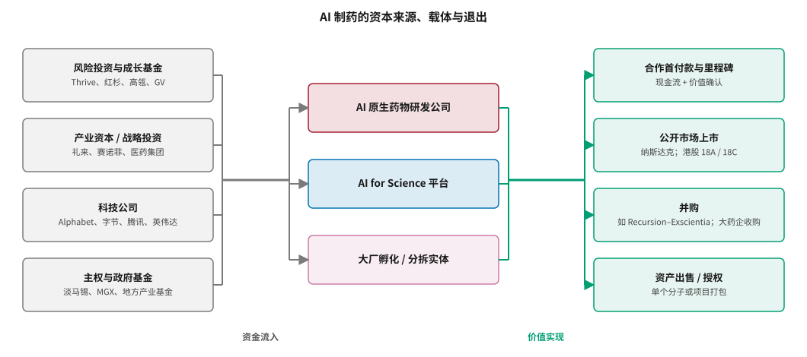
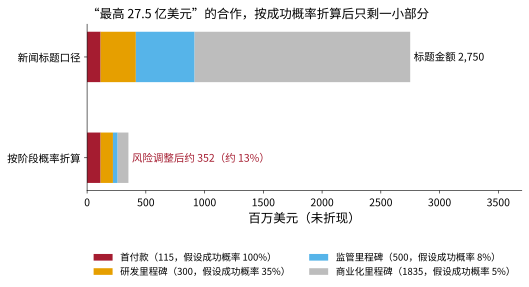
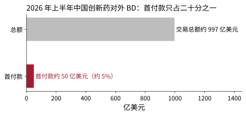
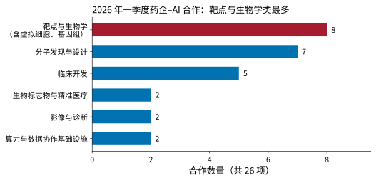

# 资本、交易与商业模式 {#sec-capital}

## 本章目的 {.unnumbered .unlisted}

::: {.purpose-question}
一笔“最高 27.5 亿美元”的合作，究竟值多少钱？
:::

AI 制药的走向在很大程度上由资本决定：谁出钱，以什么结构出钱，期待什么回报，在什么时间点要求兑现。2026 年，这个领域同时出现了史上最大的私募融资、最密集的药企合作和最显著的资本集中。本章先梳理资本的来源与流向，再拆解合作交易的典型结构，用 @eq-rnpv 的方法为“标题金额”去水分，然后讨论 AI 制药公司的估值逻辑和商业模式的演变。最后，我们给出一组评估 AI 制药公司的关键指标，帮助读者在新闻标题之外做出自己的判断。

::: {.callout-learning-objectives}

- 描述 AI 制药的四类资本来源、三类资金载体和四种价值实现方式
- 拆解药企–AI 合作交易的典型结构（首付款、里程碑、分成、选择权、股权、合资），并解释每一部分的风险含义
- 用阶段成功概率对合作交易的“标题金额”做风险调整，估算其期望价值
- 比较资产估值（rNPV）与平台估值（期权价值）两种逻辑，说明 AI 制药公司估值的特殊性
- 解读 2026 年一季度药企–AI 合作的职能分布及其含义
- 运用一组关键指标评估 AI 制药公司的商业质量

:::

## 资本从哪里来、到哪里去 {#sec-capital-flows}

AI 制药的资本流动可以概括为“四类来源、三类载体、四种出口”（@fig-capital-flows）。

::: {#fig-capital-flows fig-cap="**AI 制药的资本来源、载体与退出**：风险投资、产业资本、科技公司和主权与政府基金四类资本，流入 AI 原生药物研发公司、AI for Science 平台和大厂孵化或分拆实体三类载体；价值通过合作首付款与里程碑、公开市场上市、并购、资产出售或授权四种方式实现。值得注意的是，右侧四种退出方式中只有“合作首付款”能在临床读出之前产生现金，其余三种都要等待或依赖后期数据。这种时间错配是 AI 制药公司普遍采取“服务与合作养管线”策略的根本原因。" fig-alt="三栏流程图，左栏四个灰色方框为风险投资与成长基金、产业资本与战略投资、科技公司、主权与政府基金，经过括号汇合后分别流向中栏的 AI 原生药物研发公司、AI for Science 平台、大厂孵化与分拆实体，再经绿色括号流向右栏的合作首付款与里程碑、公开市场上市、并购、资产出售与授权。"}

{width="100%"}

:::

### 四类来源 {#sec-capital-sources}

1. **风险投资与成长基金**：仍是主力。2026 年的特点是头部集中——Thrive Capital 连续领投 Isomorphic 的 A、B 两轮，红杉中国、高瓴几乎出现在每一家中国头部 AI 制药公司的股东名单中 [@isomorphic2026seriesb; @huxiu2026financing]。
2. **产业资本与战略投资**：药企不仅通过合作付款，也直接入股。礼来作为基石投资者参与了英矽智能 IPO，赛诺菲直接参与了 Earendil Labs 的融资，国内医药产业集团作为战略投资者入股 Anew Labs [@insilico_ipo2025; @huxiu2026financing; @thepaper2026anew]。
3. **科技公司**：Alphabet 是 Isomorphic 的母公司和持续投资者，字节保留 Anew Labs 多数股权，英伟达与礼来共同投资超过 10 亿美元建设联合实验室 [@hlth2026q1]。
4. **主权与政府基金**：淡马锡、阿联酋 MGX 和英国主权 AI 基金参与了 Isomorphic 的 B 轮；中国地方产业基金参与了深势科技等公司的融资 [@isomorphic2026seriesb; @qbitai2025dp]。

### 规模 {#sec-capital-scale}

全球层面，各方估计 2019 年以来流入 AI 药物发现的资本约 600 亿美元 [@ai2work2026reckoning]。中国层面，2026 年前三季度 AI 制药赛道披露融资近 158 亿元人民币，是 2025 年全年的三倍多 [@huxiu2026financing]。单笔规模上，Isomorphic 的 21 亿美元 B 轮是 AI 制药史上最大的私募融资之一，Anew Labs 的 2.9 亿美元首轮是 2026 年中国 AI 制药最大的单笔融资 [@isomorphic2026seriesb; @thepaper2026anew]。

## 合作交易的结构 {#sec-capital-deal-structure}

### 典型组成 {#sec-capital-deal-components}

药企与 AI 公司的合作交易通常由以下部分组成（@tbl-deal-components）。

| 组成部分 | 含义 | 何时到账 | 风险含义 |
|:---|:---|:---|:---|
| 首付款（upfront） | 签约时支付的现金 | 签约后 | 确定性最高，是最可靠的价值信号 |
| 研究资助（research funding） | 合作期间按年支付的研发费用 | 合作期内 | 基本确定，但通常只覆盖成本 |
| 研发里程碑 | 候选化合物提名、IND、I/II/III 期启动等节点付款 | 达成节点时 | 取决于项目推进，早期里程碑概率较高 |
| 监管里程碑 | 申报、获批时付款 | 获批时 | 取决于累计成功率，通常低于 10% |
| 商业化里程碑 | 年销售额达到阈值时付款 | 上市多年后 | 概率最低，时间最远 |
| 销售分成（royalties） | 按净销售额的一定比例分成 | 上市后持续 | 取决于上市和市场表现 |
| 选择权（option） | 药企有权在某节点决定是否继续，行权时付款 | 行权时 | 药企保留“退出”权利，AI 公司承担早期风险 |
| 股权投资 | 药企以股东身份入股 | 签约时 | 与公司整体价值绑定 |
| 合资 / 新公司（NewCo） | 双方共同出资成立新实体 | 设立时 | 风险共担，治理复杂 |

: 药企–AI 合作交易的典型组成 {#tbl-deal-components}

### 选择权的意义 {#sec-capital-options}

选择权结构在 AI 平台合作中尤其常见：AI 公司负责早期发现，药企在某个节点（通常是候选化合物提名或 IND 前后）决定是否接手。2026 年 10 月，赛诺菲行使了与 Recursion 合作中首个开发候选物的选择权，触发 1000 万美元里程碑；截至当时，该合作累计确认的预付款和里程碑为 1.44 亿美元，项目后续还有超过 3 亿美元的潜在里程碑和两位数百分比的分成 [@recursion2026oct]。

选择权的经济含义是：**药企把早期失败的风险留给了 AI 公司**。药企只为成功推进到节点的项目付费，AI 公司则需要用首付款和研究资助覆盖所有项目（包括失败项目）的成本。因此，选择权被行使本身就是一个有价值的信号——它说明合作方在看到数据后仍然愿意继续投入。

## 为标题金额去水分 {#sec-capital-haircut}

### 方法 {#sec-capital-haircut-method}

把 @eq-rnpv 的逻辑应用到合作交易上：每一笔里程碑付款都乘以“项目推进到该节点的概率”，再加上首付款，就得到交易的期望价值（未折现）：

$$
E[V] = U + \sum_{k} p_k \cdot M_k
$$ {#eq-deal-ev}

其中 $U$ 是首付款，$M_k$ 是第 $k$ 笔里程碑，$p_k$ 是项目到达该节点的累计概率。若进一步考虑时间价值，还应对每笔付款按到账时间折现。

### 一个示意计算 {#sec-capital-haircut-example}

以 2026 年 3 月礼来与英矽智能的合作为例：首付款 1.15 亿美元，总额“最高 27.5 亿美元”，其余约 26.3 亿美元为开发、监管和商业化里程碑，另有分级销售分成 [@lilly_insilico2026]。公开资料没有披露里程碑的具体拆分。为说明方法，我们**假设**一种拆分并按 @sec-economics-success 的行业成功率给出各类里程碑的到达概率（@fig-deal-haircut）。

::: {#fig-deal-haircut fig-cap="**为“最高 27.5 亿美元”去水分（示意）**：上方为新闻标题口径，下方为按到达概率折算后的期望价值（未折现）。里程碑拆分与概率均为作者为说明方法而设的假设，并非交易实际条款：研发里程碑 3 亿美元（到达概率 35%）、监管里程碑 5 亿美元（8%）、商业化里程碑 18.35 亿美元（5%）。在这组假设下，期望价值约 3.5 亿美元，约为标题金额的 13%，其中三分之一是首付款。" fig-alt="两行堆叠条形图，上行为新闻标题口径 2750，由首付款 115、研发里程碑 300、监管里程碑 500、商业化里程碑 1835 组成；下行为按阶段概率折算后约 352，约 13%。"}

{width="90%"}

:::

在这组假设下，交易的期望价值约为 3.5 亿美元，约为标题金额的 13%；如果再考虑多年后才到账的时间价值，比例还会更低。不同的拆分和概率假设会给出不同的数字，但结论的方向是稳健的：**标题金额主要由低概率、远期的商业化里程碑构成，交易的确定性价值集中在首付款和早期里程碑上。**

### 宏观视角：中国对外授权 {#sec-capital-china-bd}

同样的逻辑也适用于宏观数据。2026 年上半年，中国创新药对外 BD 交易总额约 997 亿美元，首付款总额约 50 亿美元，约为总额的 5%（@fig-china-bd）[@21jingji2026licenseout]。

::: {#fig-china-bd fig-cap="**2026 年上半年中国创新药对外 BD 交易**：交易总额约 997 亿美元，首付款约 50 亿美元，约占 5%。两个数字相差近二十倍，说明“千亿美元出海”中真正落袋的现金只是很小一部分，其余要依次通过临床、注册和销售里程碑才能兑现——而这些里程碑的实现概率正是 @fig-deal-haircut 所折算的内容。读这类新闻时，首付款比总额更能反映交易的即期价值。数据来源：医药魔方，经 21 世纪经济报道 [@21jingji2026licenseout]。" fig-alt="两行水平条形图，上行总额约 997 亿美元，下行首付款约 50 亿美元，约 5%。"}

{width="78%"}

:::

::: {.callout-perspective title="为什么交易仍然重要"}

去水分并不是说这些交易没有价值。首付款是真金白银；大额合作表明顶级药企愿意为 AI 公司的能力付费，这本身就是一种市场验证；里程碑结构让 AI 公司在项目成功时分享收益。问题只在于：**不要把“最高金额”当作“已经实现的价值”**。对于投资者和管理者，应该分别看三个数字——已到账现金、风险调整后的期望价值、标题金额——而不是只看第三个。

:::

## 估值逻辑 {#sec-capital-valuation}

### 资产估值与平台估值 {#sec-capital-asset-vs-platform}

传统生物技术公司的估值主要基于**资产**：把每个管线项目用 rNPV 估值后加总，再扣除公司层面的成本。AI 制药公司的估值多了一层**平台**价值：市场为“持续产出新分子的能力”付费，这部分价值更像一个期权——它的价值取决于平台未来能产出多少个项目、每个项目的期望价值，以及这种能力能维持多久。

两种逻辑的差异可以用一个简化的式子表达：

$$
V_{\text{公司}} \approx \underbrace{\sum_{i} \text{rNPV}_i}_{\text{现有资产}} + \underbrace{\sum_{t} \frac{N_t \cdot \overline{\text{rNPV}}_t}{(1+r)^t}}_{\text{平台未来产出}} - \text{公司成本}
$$ {#eq-platform-value}

其中 $N_t$ 是第 $t$ 年平台新产出的项目数，$\overline{\text{rNPV}}_t$ 是这些项目的平均风险调整价值。平台估值对 $N_t$ 和 $\overline{\text{rNPV}}_t$ 的假设极其敏感：如果市场相信 AI 平台能把每个项目的平均成功率提高几个百分点（从而提高 $\overline{\text{rNPV}}$），或者能把产出速度提高数倍（从而提高 $N_t$），平台部分的价值就会远超现有资产。

### 2026 年的估值现象 {#sec-capital-valuation-2026}

这解释了 2026 年的几个估值现象：

- **Isomorphic Labs**：没有临床资产，估值几乎完全来自平台部分。据报道其估值从约 175 亿美元向至少 400 亿美元推进 [@cryptobriefing2026iso]，这反映的是市场对 $N_t$ 和 $\overline{\text{rNPV}}_t$ 的极高预期。
- **晶泰科技**：2025 年首次盈利、现金超过 70 亿元，二级市场反应却相当冷静 [@huxiu2026xtalpi]。原因之一是投资人担心单笔大单收入的不可持续性——市场在用“可重复的收入”而不是“一次性利润”来估值平台。
- **英矽智能**：IPO 市值约 134 亿港元 [@insilico_ipo2025]，其估值很大程度上取决于 rentosertib 这一核心资产的 III 期成败，以及它能否证明平台可以持续产出类似资产。

::: {#pri-capital-platform .callout-principle title="平台价值必须由资产兑现"}

**判断**：AI 制药公司的平台估值，最终必须通过平台产出的资产在临床和市场上的表现来兑现。

**含义**：在第一批平台产出的资产读出关键临床数据之前，平台估值本质上是对未来的期权定价，波动会很大。第一批后期临床结果（rentosertib、REC-4881 等）不仅决定单个资产的价值，也会改变市场对整个平台估值模型中 $\overline{\text{rNPV}}$ 的假设。

:::

::: {#ws-capital-exscientia .callout-war-story title="从明星到被合并：Exscientia（2021–2024）"}

**背景**：Exscientia 是最早一批 AI 制药明星公司之一。2021 年在纳斯达克上市时，它以“首个进入临床的 AI 设计药物”和与多家大药企的合作为卖点，市值一度在 30 亿美元左右。

**变化**：此后几年，其早期临床项目陆续被终止或调整，管理层发生变动，股价大幅下跌。2024 年 11 月，Exscientia 与 Recursion 完成合并。

**教训**：平台估值在缺乏后期临床资产支撑时极其脆弱。早期的速度纪录和合作数量可以支撑一段时间的估值，但如果平台产出的项目没有在临床上推进，市场会迅速重新定价。合并本身也说明，在资本收紧时，“平台 + 平台”的整合是一种常见的出路。

:::

## 合作在向哪里集中 {#sec-capital-where-deals-go}

2026 年一季度，HLTH 统计的药企–AI 重大合作有三十多项。按其点名的 26 项合作的职能分类（@fig-q1-partnerships），**靶点与生物学类合作最多**（8 项，含虚拟细胞、人群基因组和疾病模型），其次是分子发现与设计（7 项）和临床开发（5 项）[@hlth2026q1]。

::: {#fig-q1-partnerships fig-cap="**2026 年一季度药企–AI 合作的职能分布**：在 HLTH 点名的 26 项合作中，靶点与生物学类最多，其次是分子发现与设计和临床开发。合作的重心落在靶点一端，与 @fig-value-map 给出的判断一致——价值最高的环节恰是证据最少的环节，而大药企正是用合作而非自建的方式来承担这部分不确定性。样本只有一个季度、且来自单一会议的点名，不足以推广为长期趋势。分类为作者根据合作描述归纳。" fig-alt="水平条形图，六类分别为靶点与生物学 8、分子发现与设计 7、临床开发 5、生物标志物与精准医疗 2、影像与诊断 2、算力与数据协作基础设施 2。"}

{width="80%"}

:::

这个分布与 @fig-value-map 的价值地图形成了有意思的呼应：药企开始把钱投向“高价值、低证据”的象限——靶点生物学和临床开发——而不只是分子设计。默沙东与梅奥诊所的虚拟细胞合作、葛兰素史克与 Noetik 的肿瘤虚拟细胞合作、葛兰素史克与 Helix 的人群基因组合作、勃林格殷格翰与 Variant Bio 的肾病靶点发现合作，都属于这一类 [@hlth2026q1]。这说明药企对 AI 的期待正在从“更快地设计分子”转向“更准地选择生物学假设”——与 @pri-part1-decision-quality 的方向一致。

## 商业模式的演变 {#sec-capital-business-models}

### 五种模式 {#sec-capital-five-models}

在 @sec-players-business-models 三种基本模式的基础上，2026 年的 AI 制药商业模式可以细分为五种（@tbl-business-models）。

| 模式 | 收入方式 | 代表 | 主要风险 |
|:---|:---|:---|:---|
| 软件与模型许可 | 按年订阅、按用户或按计算量收费 | 薛定谔软件业务、深势科技、百图生科 | 开源模型挤压；药企自建 |
| 发现服务（按结果付费） | 按候选化合物、按里程碑收费 | 晶泰科技部分业务、各类 AI CRO | 收入波动；与传统 CRO 竞争 |
| 平台合作 | 首付款 + 研究资助 + 里程碑 + 分成 | 英矽–礼来、Recursion–赛诺菲 | 价值依赖合作方决策与项目后期成败 |
| 自研管线 + 对外授权 | 推进到某阶段后整体授权 | 英矽智能、晶泰自研管线 | 资本需求大；单一资产风险 |
| 基础设施 | 自动化实验室方案、算力与数据平台 | 晶泰实验室业务、英伟达–礼来、TuneLab | 重资产；规模效应待验证 |

: AI 制药的五种商业模式 {#tbl-business-models}

### 从“自研”到“卖水”，再到“兼顾” {#sec-capital-model-shift}

2026 年中国 AI 制药出现了一个明显的转向：创业公司从高风险的自主管线开发，逐步转向平台服务和对外授权的“卖水”模式 [@huxiu2026financing]。这一转向有其合理性：自研管线需要承担完整的临床风险，而 AI 公司的核心能力在早期发现；把早期资产授权给药企，可以更快地获得现金和价值确认。

但“卖水”也有边界。第一，基础模型能力正在开源化，单纯卖模型和软件的护城河越来越浅（@pri-players-moat）。第二，只做早期发现的公司，永远拿不到后期成功带来的大部分价值。第三，药企正在自建能力，对“通用服务”的需求会被压缩。因此，头部公司多采取“兼顾”策略：用服务和授权收入支撑运营，同时保留少数高价值资产自研到更后期——英矽智能把 rentosertib 自己推进到 III 期，就是典型例子。

## 评估 AI 制药公司的关键指标 {#sec-capital-kpis}

综合本篇的讨论，@tbl-kpis 给出一组评估 AI 制药公司商业质量的指标。

| 维度 | 指标 | 为什么重要 |
|:---|:---|:---|
| 现金与收入 | 已确认收入、首付款占比、现金储备与运营跑道 | 区分已实现价值与潜在价值 |
| 收入质量 | 收入集中度、可重复收入比例 | 识别对单笔大单的依赖 |
| 合作深度 | 选择权行使次数、合作续约与扩大、里程碑到账 | 合作方用真金白银投票 |
| 管线质量 | 临床阶段项目数、自研与合作比例、新靶点比例 | 区分“跟进已知靶点”与“发现新生物学” |
| 临床证据 | II 期及以后的疗效数据 | 唯一能兑现平台估值的证据 |
| 平台产出 | 每年提名的候选化合物数、立项到候选化合物的时间、单项目合成分子数 | 衡量平台的可重复性 |
| 数据资产 | 专有数据规模、是否含阴性样本、标准化程度 | 长期护城河（@pri-players-moat） |

: 评估 AI 制药公司的关键指标 {#tbl-kpis}

::: {.callout-checkpoint title="读懂一笔交易"}

- [ ] 面对一条“最高 X 十亿美元”的合作新闻，你会先找哪三个数字？
- [ ] 你能用 @eq-deal-ev 解释为什么选择权结构把早期风险留给了 AI 公司吗？
- [ ] 你能说出为什么 Isomorphic 的估值对“平台未来产出”的假设如此敏感吗？

:::

## 谬误与陷阱 {#sec-capital-fallacies}

::: {.fallacy-pitfall}

**谬误**：*交易总额越大，AI 公司越有价值。*

总额主要由远期、低概率的商业化里程碑构成。在 @fig-deal-haircut 的示意中，期望价值只有标题金额的约 13%。首付款、选择权行使和里程碑到账才是更可靠的价值信号。

:::

::: {.fallacy-pitfall}

**谬误**：*盈利的 AI 制药公司比亏损的更健康。*

如果利润来自一次性授权大单，第二年可能就会消失。可重复收入的比例和收入集中度，比某一年的利润更能说明商业质量。

:::

::: {.fallacy-pitfall}

**陷阱**：*用平台估值为没有资产支撑的公司定价，却不设兑现时间表。*

平台价值是对未来产出的期权。投资者和管理者应为平台设定可检验的兑现节点——例如在 N 年内有 M 个项目进入 II 期——并在节点未达成时重新评估。

:::

::: {.fallacy-pitfall}

**陷阱**：*把“卖水”当作没有风险的模式。*

软件和服务模式受到开源模型和药企自建能力的双重挤压；只做早期发现的公司拿不到后期成功的大部分价值。“卖水”降低了临床风险，但提高了竞争风险。

:::

## 小结 {#sec-capital-summary}

AI 制药的资本来自风险投资、产业资本、科技公司和主权基金，流向 AI 原生药物公司、AI for Science 平台和大厂孵化实体，通过合作付款、上市、并购和资产授权实现价值。合作交易的标题金额与期望价值之间存在数量级的差距；平台估值在第一批资产读出后期数据之前，本质上是对未来的期权定价。2026 年药企的合作开始向靶点生物学和临床开发集中，这与价值地图指向的方向一致。

::: {.callout-takeaways title="看现金、看概率、看兑现"}

* **四类资本，头部集中**：风险投资、产业资本、科技公司和主权基金共同推动，2026 年资金向少数头部公司集中。
* **交易要去水分**：用 @eq-deal-ev 按阶段概率折算，“最高 27.5 亿美元”的示意期望价值约为标题金额的 13%；中国上半年对外 BD 的首付款约占总额 5%。
* **选择权把早期风险留给 AI 公司**：被行使的选择权是有价值的信号。
* **平台估值必须由资产兑现**：在后期临床数据出现之前，平台估值是对未来的期权定价。
* **合作在向生物学集中**：2026 年一季度，靶点与生物学类合作数量最多，药企的期待正从“设计得更快”转向“选得更准”。
* **商业模式在兼顾**：从“自研”转向“卖水”有其合理性，但头部公司会保留少数高价值资产自研到后期。

:::

::: {.callout-chapter-connection title="从产业到技术"}

第一篇到此结束。我们已经知道 AI 制药的经济结构、发展历史、2026 年的现场、主要玩家、中国生态和资本逻辑。第二篇进入技术本身：AI 在研发每个环节用的是什么方法，这些方法为什么有效，又在哪里失效。我们从最基础的问题开始——@sec-representation 讨论计算机如何“看见”一个分子、一个蛋白和一个细胞。

:::
