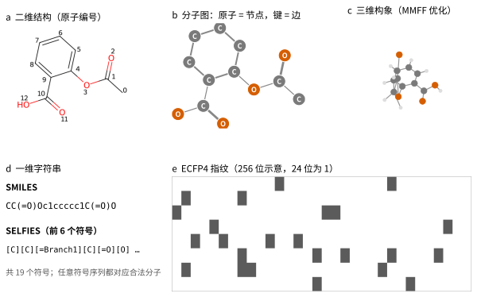
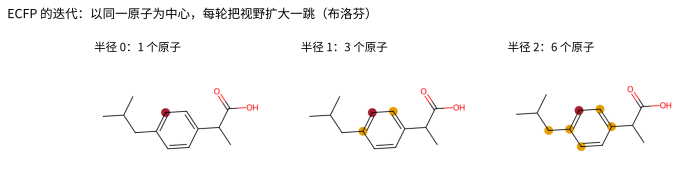
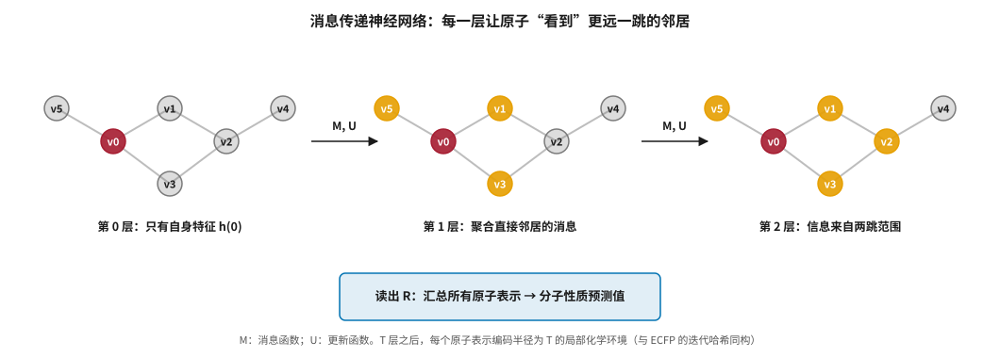
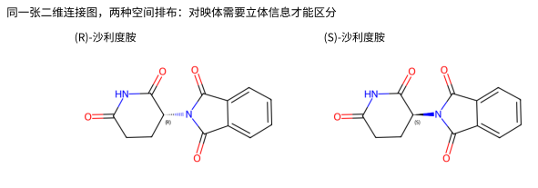
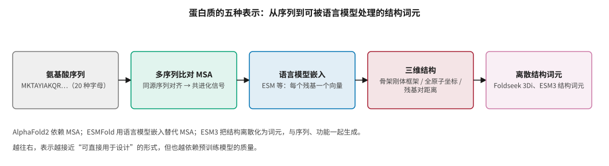

# 表示学习：分子、蛋白与细胞 {#sec-representation}

## 本章目的 {.unnumbered .unlisted}

::: {.purpose-question}
同一个阿司匹林分子，为什么在不同模型眼里是五种完全不同的东西？
:::

任何 AI 模型在处理分子之前，都要先把分子变成一串数字，这一步叫“表示”。表示选得好不好，决定了模型能学到什么、学不到什么：只把分子当成一串字符，模型很难理解它的三维形状；把蛋白质当成一串氨基酸字母，模型却能从数亿条序列中自己学会结构规律。本章依次介绍小分子的字符串、指纹、图和三维表示，预训练分子表示，蛋白质的序列、进化与结构表示，以及细胞层面的组学与成像表示，最后给出一份按任务选择表示的实用指南。本章的方法是第二篇其余各章的共同基础。

::: {.callout-note title="给非技术读者的摘要"}

AI 处理分子之前，要先把分子“翻译”成数字。可以翻译成一串字符（类似一句话），一张图（原子是点、化学键是线），一组三维坐标，或者一个由 0 和 1 组成的“指纹”。每种翻译都会保留一部分信息、丢掉另一部分。蛋白质同理：它可以是一串氨基酸字母，也可以是三维结构。近几年最重要的进展是“预训练”——先让模型在海量没有标签的分子或蛋白序列上自学规律，再用少量实验数据微调。它在蛋白质上效果显著，在小分子上收益并不稳定。**成熟度**：二维分子表示已经成熟；三维与预训练表示快速发展；细胞层面的表示仍处早期，简单方法往往难以被超越。

:::

::: {.callout-learning-objectives}

- 列出一个“好的分子表示”应满足的四个条件，并用它们评价 SMILES、SELFIES、指纹、分子图和三维坐标
- 解释 ECFP 指纹与消息传递神经网络之间的对应关系，并写出 MPNN 的消息与更新公式
- 说明三维表示需要满足的旋转平移不变性与等变性，并描述 EGNN 如何在结构上保证等变
- 评价分子预训练的收益与边界，说明为什么简单基线在分子任务上往往很强
- 概括蛋白质语言模型（ESM 系列）能学到和学不到的信息
- 描述单细胞基础模型和细胞成像表示的现状，以及“虚拟细胞”方向面临的基线问题
- 按任务类型选择合适的表示起点

:::

## 为什么表示是核心问题 {#sec-representation-why}

机器学习模型的能力在很大程度上取决于输入的表示方式。图像有天然的像素网格，文本有天然的词元序列；分子和蛋白质没有唯一的天然表示。同一个阿司匹林分子可以被看作一串字符、一张图、一组三维坐标或一个比特向量（@fig-aspirin-views）。

::: {#fig-aspirin-views fig-cap="**同一个分子的五种表示（阿司匹林）**：（a）带原子编号的二维结构；（b）分子图，原子为节点、化学键为边，线宽表示键级；（c）经 MMFF 力场优化的一个三维构象，灰色为碳、橙色为氧、浅灰为氢；（d）SMILES 与 SELFIES 字符串；（e）ECFP4 指纹，为便于显示折叠为 256 位。图由 RDKit 与 SELFIES 生成。" fig-alt="五个面板：a 为阿司匹林二维结构式并标注 0 到 12 的原子编号；b 为节点链接图，碳原子灰色、氧原子橙色；c 为三维球棍模型；d 为 SMILES 字符串 CC(=O)Oc1ccccc1C(=O)O 和 SELFIES 前六个符号；e 为 8 行 32 列的黑白方格，表示指纹比特。"}

{width="100%"}

:::

每种表示都保留了一部分信息，也丢掉了另一部分。一个好的表示应满足四个条件：

1. **完整性**：不同分子的表示不同，能区分同分异构体和立体异构体。
2. **不变性或等变性**：分子在空间中平移、旋转后仍是同一个分子，表示不应改变（不变），或按可预测的方式改变（等变）。
3. **与任务相关**：保留预测目标所需的信息。预测溶解度和预测与蛋白的结合，所需信息不同。
4. **可计算性**：能高效地批量计算。

## 小分子的一维表示：字符串 {#sec-representation-strings}

### SMILES {#sec-representation-smiles}

SMILES 由 Weininger 于 1988 年提出 [@weininger1988]，用一串 ASCII 字符描述分子图：字母代表原子，`=` 和 `#` 代表双键和三键，括号代表支链，数字代表环的闭合，小写字母代表芳香原子。阿司匹林写作 `CC(=O)Oc1ccccc1C(=O)O`。

SMILES 紧凑、人类可读，可以直接套用自然语言处理模型。它有三个问题：**非唯一性**——同一分子可以从不同原子开始遍历，得到多种写法，实践中用“规范化 SMILES”统一，也反过来把它用作数据增强；**语法脆弱**——随机改动一个字符很可能得到非法字符串；**局部性差**——在分子图上相邻的两个原子，在字符串里可能相距很远。

### SELFIES {#sec-representation-selfies}

SELFIES 由 Krenn 等于 2020 年提出 [@krenn2020]，设计目标是**任何符号序列都对应一个合法分子**。它通过状态机式的语法保证价态约束始终满足（@fig-aspirin-views d）。这对生成模型很有吸引力：模型不必“学会语法”，可以把能力集中在“学会化学”上。代价是可读性比 SMILES 差，在性质预测任务上也没有稳定优势。

### 化学语言模型 {#sec-representation-clm}

把 SMILES 当作“化学语言”，可以用 Transformer 在 ZINC、PubChem 等数亿分子上做掩码或自回归预训练，再在性质预测任务上微调，代表工作有 ChemBERTa、MolFormer 等。化学语言模型的另一个重要应用是反应预测和逆合成：把反应写成“反应物 → 产物”的翻译任务（@sec-synthesis）。

## 小分子的向量表示：指纹与描述符 {#sec-representation-fingerprints}

### ECFP {#sec-representation-ecfp}

扩展连通性指纹（ECFP）由 Rogers 和 Hahn 于 2010 年系统描述 [@rogers2010]，是工业界使用最广泛的分子指纹，至今仍是许多任务的强基线。它的算法如下：

1. 给每个原子赋一个初始标识符，基于原子类型、度、电荷、是否在环中等；
2. 每轮迭代，把每个原子的标识符与它邻居的标识符组合，哈希成新的标识符；
3. 迭代 $r$ 轮后，每个标识符代表以该原子为中心、半径为 $r$ 的子结构（@fig-ecfp-radius）；
4. 把所有标识符哈希到一个固定长度的比特向量，常用 1024 或 2048 位。

ECFP4 指直径为 4（半径为 2）的版本。

::: {#fig-ecfp-radius fig-cap="**ECFP 的迭代过程**：以布洛芬中的同一个芳香碳原子（深红）为中心，半径 0 只包含它本身，半径 1 加入直接相连的原子，半径 2 再向外扩一跳（橙色）。每个半径的局部子结构被哈希为一个整数标识符，所有标识符再折叠为比特向量。图由 RDKit 生成。" fig-alt="三幅布洛芬结构图，分别高亮半径 0、1、2 的原子环境，原子数依次为 1、3、6。"}

{width="100%"}

:::

::: {#dfn-representation-baseline .callout-definition title="强基线"}

***强基线***\index{强基线}指在特定任务上经过合理调参、实现简单、被广泛验证的方法。在分子性质预测中，ECFP 加随机森林或梯度提升树就是典型的强基线。

1.  **意义**：许多论文报告的“大幅提升”，是相对于未调参或不合适的基线得到的。与强基线认真比较，是判断一个新方法是否真的有用的最低要求。
2.  **区别**：强基线不等于“最好的方法”，而是“一个新方法若不能稳定超越它，就没有理由采用”的门槛。
3.  **常见误区**：只与其他深度学习方法比较，而忽略传统化学信息学方法。在中小规模数据（数百到数万样本）上，ECFP 加梯度提升树常与复杂的深度模型表现相当甚至更好（@sec-evaluation）。

:::

其他常用指纹包括 MACCS 键（166 个预定义子结构）、原子对指纹和药效团指纹。

### 物理化学描述符与类药规则 {#sec-representation-descriptors}

描述符是人工定义的分子性质：分子量、logP（脂水分配系数）、拓扑极性表面积（TPSA）、氢键供体和受体数、可旋转键数、芳香环数、sp³ 碳比例（Fsp3）等，RDKit 等开源工具可以计算两百多种。著名的 Lipinski 五规则就基于描述符：口服药物通常满足分子量 ≤ 500、logP ≤ 5、氢键供体 ≤ 5、氢键受体 ≤ 10 [@lipinski2001]。它是统计规律而非硬性门槛，@sec-admet 会讨论它的适用边界。

### 相似性度量 {#sec-representation-tanimoto}

基于指纹，常用 **Tanimoto 系数**衡量两个分子的相似性：

$$
T(A, B) = \frac{|A \cap B|}{|A \cup B|}
$$ {#eq-tanimoto}

其中 $A$、$B$ 是两个分子指纹中置为 1 的比特集合。Tanimoto 系数在 0 到 1 之间；对于 ECFP4，经验上大于约 0.4 通常认为结构相似。相似性搜索、聚类和“骨架划分”等评测协议都依赖这个度量（@sec-evaluation）。

## 小分子的图表示：图神经网络 {#sec-representation-gnn}

### 消息传递框架 {#sec-representation-mpnn}

把分子看成图 $G = (V, E)$：节点 $v \in V$ 是原子，带有特征 $x_v$（元素、杂化、电荷等）；边 $e_{vw} \in E$ 是化学键，带有特征（键级、是否在环中等）。消息传递神经网络（MPNN）把各种图神经网络统一为以下形式 [@gilmer2017]。在第 $t$ 层：

$$
m_v^{(t+1)} = \sum_{w \in \mathcal{N}(v)} M_t\left(h_v^{(t)}, h_w^{(t)}, e_{vw}\right), \qquad
h_v^{(t+1)} = U_t\left(h_v^{(t)}, m_v^{(t+1)}\right)
$$ {#eq-mpnn}

其中 $M_t$ 是消息函数，$U_t$ 是更新函数，$\mathcal{N}(v)$ 是 $v$ 的邻居集合。经过 $T$ 层后，用读出函数 $R$ 把所有节点表示汇总为分子表示：$\hat{y} = R\left(\{h_v^{(T)} \mid v \in V\}\right)$。

直观上，每一层消息传递让每个原子“看到”更远一跳的邻居（@fig-mpnn）。$T$ 层之后，每个原子的表示编码了以它为中心、半径为 $T$ 的局部化学环境。这与 ECFP 的迭代哈希几乎同构，区别在于 MPNN 的“哈希函数”是可学习的——这也解释了为什么 ECFP 是如此强的基线。

::: {#fig-mpnn fig-cap="**消息传递神经网络的感受野**：深红色为中心原子 v0，橙色为它在当前层已经“看到”的原子。第 1 层聚合直接邻居的消息，第 2 层的信息来自两跳范围。T 层之后由读出函数汇总为分子级预测。这一过程与 ECFP 的迭代（@fig-ecfp-radius）结构相同，只是把固定的哈希换成了可学习的函数。" fig-alt="三个小图并排，节点 v0 到 v5，第 0 层只有 v0 为红色，第 1 层 v1、v3、v5 为橙色，第 2 层再加上 v2；下方一个蓝色方框为读出 R。"}

{width="100%"}

:::

### 代表模型 {#sec-representation-gnn-models}

- **GCN、GIN**：通用图网络。GIN 在理论上与 Weisfeiler–Lehman 图同构测试的区分能力相当 [@xu2019gin]。
- **D-MPNN / Chemprop**：沿有向边传递消息，避免消息在两个原子之间来回“回荡”，是工业界最常用的开源性质预测工具之一 [@yang2019]。
- **AttentiveFP**：引入图注意力机制。
- **Graph Transformer**：用全局自注意力替代局部消息传递，直接捕捉远距离原子间的关系，通常结合最短路径距离、拉普拉斯特征向量等位置编码，Graphormer 是代表 [@ying2021graphormer]。

### 已知局限 {#sec-representation-gnn-limits}

1. **表达能力上限**：标准消息传递网络的区分能力不超过 1-WL 测试，无法区分某些结构不同的图，也难以准确计数环。
2. **过平滑**：层数太深时，所有节点的表示趋于相同。
3. **长程依赖**：分子中距离很远的原子之间的相互作用（如分子内氢键）很难通过局部消息传递捕捉。
4. **活性悬崖**：结构非常相似、活性却相差很大的分子对。图网络倾向于给相似结构相似的预测，因此在活性悬崖上表现很差 [@vantilborg2022]。
5. **对小扰动的稳定性**：药物优化的基本操作就是“改一个原子、换一个基团”。模型对这类小扰动的预测是否稳定、能否给出可认证的保证，与图神经网络和图 Transformer 的对抗鲁棒性研究直接相关，目前仍是开放问题。

::: {.callout-checkpoint title="二维表示"}

- [ ] 你能解释为什么 ECFP 与三层 MPNN 在“能看到的原子范围”上是一致的吗？
- [ ] 你能举出一个 SMILES 局部性差带来问题的例子吗？
- [ ] 面对一个只有 800 个样本的溶解度数据集，你会先尝试哪两种方法作为基线？

:::

## 三维表示：几何深度学习 {#sec-representation-3d}

### 为什么需要三维 {#sec-representation-3d-why}

许多性质——尤其是与蛋白的结合和量子化学性质——本质上取决于分子的三维结构。二维连接图无法区分某些立体异构体，比如手性分子的两个对映体，而它们的药理活性可能截然不同。经典例子是沙利度胺：一种对映体有镇静作用，另一种与致畸性有关（尽管两者在体内会相互转化）（@fig-thalidomide）。

::: {#fig-thalidomide fig-cap="**沙利度胺的两个对映体**：两者的原子连接方式完全相同，区别只在于手性中心上取代基的空间朝向（楔形实线与虚线）。不包含立体信息的二维表示会把它们视为同一个分子。图由 RDKit 生成，带立体化学标注。" fig-alt="左右两个沙利度胺结构式，左为 R 构型（虚楔形键），右为 S 构型（实楔形键），手性碳旁标注 R 和 S。"}

{width="85%"}

:::

### 对称性要求 {#sec-representation-symmetry}

设分子的原子坐标为 $X \in \mathbb{R}^{N \times 3}$，对任意旋转矩阵 $R$ 和平移向量 $t$：预测标量性质（能量、结合亲和力）时要求**不变性** $f(XR + t) = f(X)$；预测向量性质（受力、坐标）时要求**等变性** $f(XR + t) = f(X)R + t$ 或类似形式。把对称性写进模型结构，而不是靠数据增强去学，能显著提高数据效率。

### 代表方法 {#sec-representation-3d-models}

| 方法 | 年份 | 核心思路 |
|:---|:---|:---|
| SchNet [@schutt2017] | 2017 | 只用原子间距离作为输入，天然满足旋转平移不变性 |
| DimeNet | 2020 | 加入键角信息，表达能力更强 |
| EGNN [@satorras2021] | 2021 | 消息传递中同时更新特征和坐标，保持 E(n) 等变 |
| PaiNN | 2021 | 同时维护标量与向量特征 |
| NequIP、MACE [@batzner2022; @batatia2022] | 2021–2022 | 基于球谐函数的高阶张量特征，精度高，主要用于机器学习力场 |

: 三维几何深度学习的代表方法 {#tbl-3d-models}

以 EGNN 为例，它的一层更新可以写成：

$$
m_{ij} = \phi_e\left(h_i, h_j, \|x_i - x_j\|^2\right), \quad
x_i' = x_i + C\sum_{j \neq i}(x_i - x_j)\,\phi_x(m_{ij}), \quad
h_i' = \phi_h\left(h_i, \sum_{j} m_{ij}\right)
$$ {#eq-egnn}

消息只依赖距离（旋转平移不变），坐标更新只沿原子间相对位移的方向（因而等变）。这种“把对称性写进结构”的思想，也是 AlphaFold 系列和扩散生成模型的基础（@sec-structure、@sec-generative）。

### 构象问题 {#sec-representation-conformers}

三维表示有一个根本困难：**分子不是刚性的**。一个有多个可旋转键的小分子在溶液中会在许多构象之间切换。实践中常用 RDKit 生成一个或多个低能构象（@fig-aspirin-views c 就是其中之一），或者使用实验测得的结合态构象，或者把构象当作隐变量在多个构象上集成。这个问题在蛋白–配体相互作用中尤其关键（@sec-structure、@sec-screening）。

## 预训练分子表示 {#sec-representation-pretraining}

### 动机与策略 {#sec-representation-pretraining-strategies}

有标签的分子性质数据通常只有几百到几万个样本，无标签的分子结构却有数十亿个。和自然语言处理一样，可以先在海量无标签数据上预训练，再在少量有标签数据上微调。常见的预训练策略有四类：

1. **掩码预测**：遮住部分原子或子结构，让模型预测被遮的部分。
2. **对比学习**：把同一分子的不同“视图”拉近、不同分子推远，MolCLR 是代表 [@wang2022molclr]。
3. **三维去噪**：在坐标上加噪声，让模型恢复原始坐标——与扩散模型的训练目标密切相关。
4. **多模态对齐**：把分子结构与文本描述、质谱或性质对齐。

深势科技发布的 Uni-Mol 是三维预训练的代表：它在约 2 亿个分子构象和约 300 万个蛋白口袋上，用三维 Transformer 进行掩码原子预测和坐标去噪预训练，在多个性质预测和对接相关任务上表现良好 [@zhou2023unimol]。

### 预训练真的有用吗 {#sec-representation-pretraining-value}

这在学术界一直有争论。多项系统比较的结论大体一致：

- 在一些分子性质基准上，预训练模型相对精心调参的 ECFP 加梯度提升树或从头训练的 Chemprop，优势并不稳定；
- 预训练的收益在**数据极少**（几百个样本）和**分布外泛化**的场景下更明显；
- 预训练目标与下游任务的匹配程度很关键：三维预训练对量子化学性质帮助较大，对某些生物活性任务帮助有限。

::: {#pri-representation-data-bottleneck .callout-principle title="数据质量常常先于模型容量成为瓶颈"}

**判断**：在小分子性质预测上，“更大的模型 + 更多的预训练”尚未表现出像自然语言那样清晰、稳定的规模定律。一个主要原因是标签本身噪声大、覆盖窄，模型很快触到数据质量的天花板。

**含义**：在投入大规模预训练之前，先评估标签噪声和化学空间覆盖；提升数据质量（统一实验条件、补充阴性样本）往往比提升模型规模更有效（@sec-data-quality）。

:::

## 蛋白质的表示 {#sec-representation-proteins}

### 序列、多序列比对与结构 {#sec-representation-protein-basics}

蛋白质最基本的表示是由 20 种氨基酸字母组成的序列。把目标序列与同源序列对齐得到**多序列比对**（MSA），其中蕴含**共进化**信息：如果两个位置在进化中协同变化，它们很可能在三维结构中相互接触。AlphaFold2 的成功在很大程度上依赖从 MSA 中提取这种信号 [@jumper2021]。但 MSA 搜索计算开销大，而对于同源序列很少的蛋白——人工设计的蛋白、“孤儿”蛋白、高度可变的抗体 CDR 区——它提供的信息有限。@fig-protein-reps 总结了蛋白质的几种主要表示。

::: {#fig-protein-reps fig-cap="**蛋白质的五种表示**：从原始序列，到携带共进化信号的多序列比对，到语言模型给出的逐残基嵌入，到三维结构，再到可以像文字一样被语言模型处理的离散结构词元。越往右越接近可直接用于设计的形式，也越依赖预训练模型的质量。" fig-alt="五个横向方框依次为氨基酸序列、多序列比对、语言模型嵌入、三维结构、离散结构词元，方框间用箭头连接，下方两行说明文字。"}

{width="100%"}

:::

三维结构通常表示为：每个残基一个刚体框架（旋转加平移，AlphaFold2 和 RFdiffusion 采用这种表示）、全原子坐标、残基对之间的距离与方向矩阵，或者用向量量化方法离散化的结构词元，例如 Foldseek 的 3Di 字母表 [@vankempen2024] 和 ESM3 的结构词元 [@hayes2025]。

### 蛋白质语言模型 {#sec-representation-plm}

**核心思想**：把蛋白质序列当作“生命的语言”，在海量序列上训练语言模型，让模型自己学会进化规律、结构约束和功能特征。ESM 系列是代表（@tbl-esm）。

| 模型 | 年份 | 规模与数据 | 关键发现或能力 |
|:---|:---|:---|:---|
| ESM-1b [@rives2021] | 2019–2021 | 6.5 亿参数，UniRef50 约 2500 万条序列 | 注意力图中自发出现残基接触信息 |
| ESM-2 / ESMFold [@lin2023] | 2022–2023 | 800 万到 150 亿参数 | 规模越大结构信息越丰富；无需 MSA 即可预测结构，速度快一到两个数量级；预测约 6 亿个宏基因组蛋白结构 |
| ESM3 [@hayes2025] | 2024–2025 | 多模态（序列、结构、功能词元） | 可在任意模态上条件生成；生成了与已知荧光蛋白序列相似度很低的新型荧光蛋白 |

: ESM 系列蛋白质语言模型 {#tbl-esm}

研究表明，蛋白质语言模型的嵌入中编码了二级和三级结构（残基接触可以从注意力图中线性读出）、突变效应（野生型与突变型的对数似然比可以零样本预测突变对功能的影响，在 ProteinGym 基准上与专门训练的模型相当 [@notin2023]），以及酶类别、亚细胞定位等功能信息。它们**学不好**的包括：精确的三维坐标（需要额外的结构模块）、构象变化、与小分子相互作用的细节，以及训练集中很少出现的蛋白家族。

## 细胞与组学的表示 {#sec-representation-cells}

### 单细胞基础模型 {#sec-representation-single-cell}

单细胞 RNA 测序可以测量每个细胞中数千个基因的表达水平，一个细胞因此可以表示为一个高维稀疏向量。单细胞基础模型试图在数千万个细胞上预训练，学习细胞状态的通用表示：Geneformer 把每个细胞中的基因按表达量排序形成“基因序列”，在约 3000 万个单细胞转录组上做掩码预训练 [@theodoris2023]；scGPT 采用类似 GPT 的生成式预训练，支持细胞类型注释、扰动响应预测和批次整合等任务 [@cui2024scgpt]。

### 质疑：简单基线难以超越 {#sec-representation-virtual-cell}

单细胞基础模型同样面临“预训练是否有用”的质疑。在对药物研发最关键的任务——**扰动效应预测**，即预测“敲除某个基因或加入某个化合物后细胞会怎么变”——上，Ahlmann-Eltze 等人 2025 年在《自然·方法》上的系统比较发现，多种基于深度学习的模型并不比简单的线性基线更好，甚至不比直接取训练数据平均值的基线更好 [@ahlmann2025]。这一方向被称为“虚拟细胞”，是 2025–2026 年的研究热点，也是目前离实用最远的方向之一。值得注意的是，药企在 2026 年一季度已经开始为这一方向下注（@sec-capital-where-deals-go）。

::: {#ws-representation-virtual-cell .callout-war-story title="扰动预测：大模型输给平均值（2025）"}

**背景**：多个单细胞基础模型宣称能够预测基因扰动对细胞转录组的影响，这被视为“虚拟细胞”和 AI 靶点发现的核心能力。

**发现**：独立评估把这些模型与极其简单的基线放在同一套数据划分和指标下比较，包括“对所有扰动都预测训练集的平均变化”和简单线性模型。结果是，在预测未见过的扰动或扰动组合时，深度学习模型并没有稳定地超过这些基线 [@ahlmann2025]。

**教训**：这与 ECFP 在小分子任务上的地位如出一辙。一个领域在缺乏强基线和严格评测时，很容易高估复杂模型的能力。对任何“基础模型”的宣称，第一个问题都应该是：它与最简单的合理基线相比如何？

:::

### 细胞成像 {#sec-representation-imaging}

Recursion 的表型平台使用另一种细胞表示：**显微图像**。Cell Painting 实验用多种荧光染料标记细胞的不同细胞器，拍摄多通道图像 [@bray2016]，再用卷积网络或视觉 Transformer 提取高维表型特征（@sec-players-recursion）。这种表示的优势是通量高、成本低，可以系统地覆盖大量基因敲除和化合物处理；劣势是表型特征的生物学解释性较弱，与临床疗效之间的转化链条长。

## 按任务选择表示 {#sec-representation-guide}

@tbl-representation-guide 给出一份实用指南。

| 任务 | 推荐的起点 | 说明 |
|:---|:---|:---|
| 中小数据量的分子性质预测 | ECFP + 梯度提升树；Chemprop | 先建立强基线（@dfn-representation-baseline） |
| 大数据量或需要迁移的性质预测 | 预训练图网络 / 三维模型 | 必须与强基线认真比较 |
| 量子化学性质、机器学习力场 | 等变三维网络（如 MACE） | 对称性至关重要 |
| 分子生成 | SMILES/SELFIES 语言模型；图生成；三维扩散 | 取决于是否以靶点结构为条件（@sec-generative） |
| 蛋白功能和突变效应 | 蛋白质语言模型嵌入 | 零样本即可作为基线 |
| 蛋白结构预测 | MSA + 结构模型，或语言模型 + 结构模块 | @sec-structure |
| 细胞状态与扰动预测 | 先试线性与平均值基线，再试基础模型 | 基础模型优势尚未得到稳定证明 |

: 按任务选择表示的实用指南 {#tbl-representation-guide}

## 谬误与陷阱 {#sec-representation-fallacies}

::: {.fallacy-pitfall}

**谬误**：*表示越复杂，模型越好。*

三维、预训练、多模态表示在某些任务上确实更好，但在大量中小数据任务上，ECFP 加梯度提升树仍与之相当。复杂表示带来的额外信息，只有在任务需要、数据足以支撑时才转化为性能。

:::

::: {.fallacy-pitfall}

**谬误**：*蛋白质语言模型的成功意味着“分子语言模型”同样会成功。*

蛋白质序列有数亿条，且受同一套进化压力约束；小分子化学空间更加离散，标签数据稀缺且噪声大。两者的数据条件不同，规模化收益不能直接类推（@pri-representation-data-bottleneck）。

:::

::: {.fallacy-pitfall}

**陷阱**：*忽略立体化学与构象。*

用不含立体信息的二维表示处理手性药物，会把对映体当成同一分子；只用单一构象做三维预测，可能遗漏真正的结合构象。处理三维相关任务时，应明确记录立体信息和构象生成方法。

:::

::: {.fallacy-pitfall}

**陷阱**：*用随机划分评估分子表示。*

随机划分让结构相似的分子同时出现在训练和测试集中，会系统性高估所有表示的泛化能力，并掩盖它们在新骨架上的差异。应使用骨架划分或时间划分（@sec-evaluation）。

:::

## 小结 {#sec-representation-summary}

表示是 AI 制药的地基。字符串让分子可以借用自然语言处理的方法，指纹和图让模型理解化学连接，三维表示带来几何和物理信息，蛋白质语言模型展示了“从海量序列中自学结构规律”的可能。贯穿本章的一个主题是：**简单基线往往很强，复杂模型的优势需要认真验证**——从 ECFP 之于图神经网络，到平均值基线之于单细胞基础模型，都是如此。

::: {.callout-takeaways title="先选对表示，再选模型"}

* **没有唯一的分子表示**：字符串、指纹、图、三维坐标各有取舍，应按完整性、对称性、任务相关性和可计算性选择。
* **ECFP 与 MPNN 同构**：两者都在迭代聚合局部化学环境，区别是固定哈希与可学习函数，这解释了 ECFP 为何是强基线。
* **把对称性写进结构**：EGNN 等等变网络用距离构造消息、沿相对位移更新坐标，是三维建模和扩散生成的共同基础。
* **小分子预训练收益不稳定**：在数据极少和分布外场景下有帮助，在常规基准上相对强基线优势有限，数据质量常先于模型容量成为瓶颈。
* **蛋白质语言模型很强**：ESM 系列从序列中学到了接触、突变效应和功能信息，但学不好精确坐标、构象变化和小分子相互作用。
* **虚拟细胞尚未过基线关**：扰动预测上，深度模型尚未稳定超过线性和平均值基线。

:::

::: {.callout-chapter-connection title="从表示到靶点"}

有了表示，就可以把模型用于研发的第一步，也是最难的一步：选择靶点。@sec-target 讨论如何整合人类遗传学、多组学、知识图谱和大语言模型，从数万个基因中找出与疾病存在因果关系、又能成药的那一个——以及为什么这一环节的能力最难被评估。

:::
