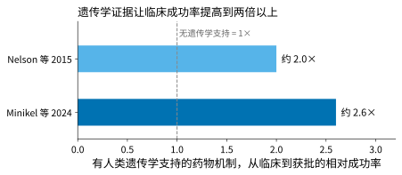
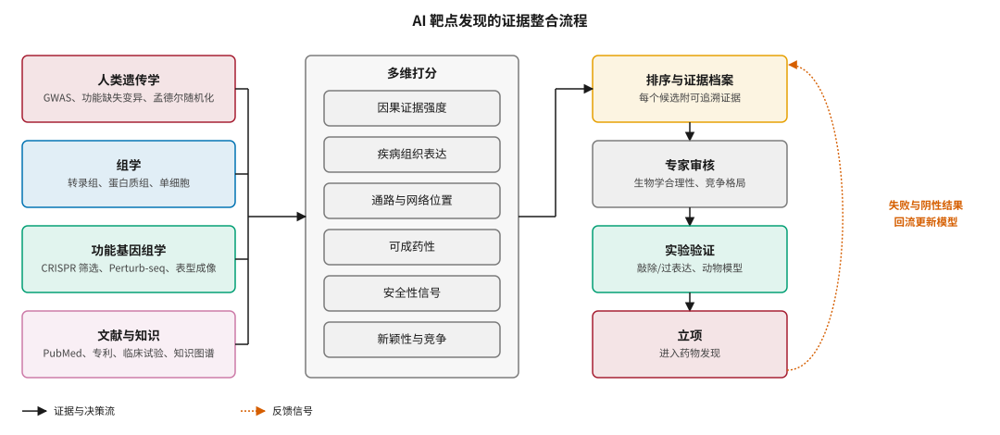
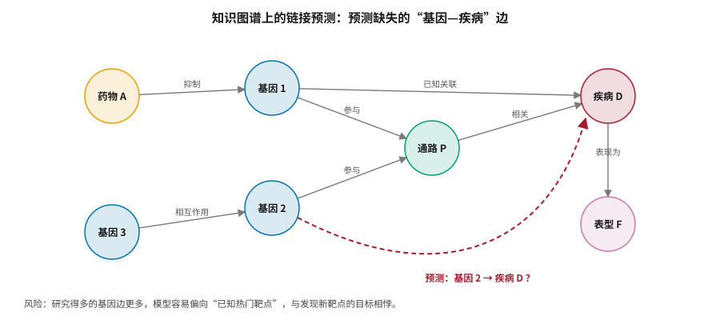
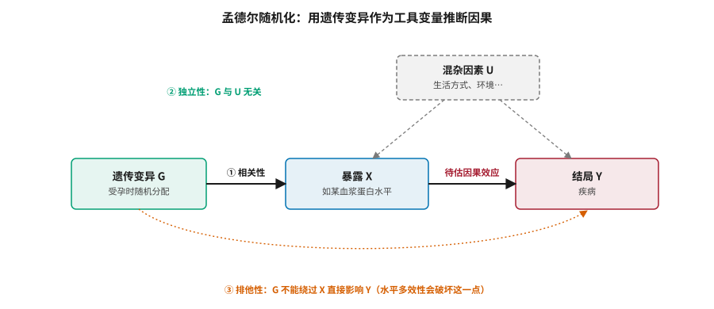
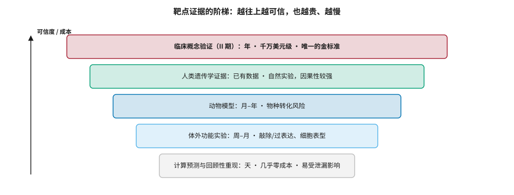

# 靶点发现：遗传学、多组学、知识图谱与因果推断 {#sec-target}

## 本章目的 {.unnumbered .unlisted}

::: {.purpose-question}
在两万个蛋白编码基因中，怎样找出那个“调控它就能改变病程”的基因——又怎样知道自己找对了？
:::

靶点是药物要作用的分子，通常是一个蛋白质。选对靶点，后面的工作才有意义；选错了，分子设计得再好也无济于事。@sec-economics 说明，临床失败的首要原因是“药物没有疗效”，根源往往就在靶点选择。AI 在这一环节的作用，是从基因、蛋白、文献和临床数据中找出与疾病最可能存在因果关系、又能成药的分子。本章介绍靶点发现的数据源与四类主要方法——多组学打分、知识图谱、因果推断和大语言模型——并重点讨论这一环节最棘手的问题：如何评估一个靶点发现系统。

::: {.callout-note title="给非技术读者的摘要"}

一个好靶点要同时满足：调控它确实能改变疾病（因果性），药物能结合它（可成药性），调控它不会带来严重副作用（安全性）。过去十年最重要的发现之一是：**有人类遗传学证据支持的靶点，临床成功率是没有支持的两倍以上**——人群中天然存在的基因变异，相当于大自然替我们做了实验。AI 的价值在于更快、更系统地整合这类证据。但这一环节“对不对”最终只能由临床试验回答，因此它是 AI 制药中**价值最高、也最难验证**的环节。**成熟度**：遗传学证据和知识图谱已被广泛使用；AI 发现新靶点的临床验证案例极少，rentosertib 是最受关注的一个。

:::

::: {.callout-learning-objectives}

- 列出评价一个药物靶点的五个维度，并解释人类遗传学证据为什么能显著提高临床成功率
- 描述靶点发现的四类数据源：遗传学、组学、功能基因组学、文献与知识
- 解释多组学打分、知识图谱链接预测、孟德尔随机化和大语言模型四类方法的原理与局限
- 写出孟德尔随机化的三个工具变量假设，并说明水平多效性如何破坏因果推断
- 识别知识图谱方法中的“度偏差”和评测泄漏问题
- 设计一个区分“重新发现已知靶点”与“发现新靶点”的评估方案

:::

## 什么是好靶点 {#sec-target-good-target}

一个好的药物靶点大致需要满足五个条件（@tbl-target-criteria）。

| 维度 | 要回答的问题 |
|:---|:---|
| 因果性 | 调控这个靶点，是否真的能改变疾病进程？还是它只是疾病的伴随现象？ |
| 可成药性 | 能否找到分子结合并调控它？有没有合适的口袋，是否位于细胞表面？ |
| 安全性 | 调控它会不会在正常组织中引起严重副作用？ |
| 可转化性 | 有没有可靠的动物模型或生物标志物，能在早期判断药物是否起效？ |
| 差异化 | 与现有疗法相比有没有独特价值？竞争格局如何？ |

: 评价药物靶点的五个维度 {#tbl-target-criteria}

### 遗传学证据：大自然做过的实验 {#sec-target-genetics-evidence}

药物研发领域近十年最重要的发现之一，是**有人类遗传学证据支持的靶点，临床成功率明显更高**。Nelson 等人 2015 年的分析发现，有遗传学关联支持的靶点–适应症组合，从临床到获批的成功率约为没有支持的两倍 [@nelson2015]；Minikel 等人 2024 年用更大规模的数据更新了这一分析，相对成功率约为 2.6 倍，而且证据越直接——来自孟德尔遗传病或功能缺失突变，而非常见变异的全基因组关联——倍数越高（@fig-genetic-support）[@minikel2024]。

::: {#fig-genetic-support fig-cap="**遗传学证据与临床成功率**：有人类遗传学支持的药物机制，从临床到获批的成功率约为无支持的 2 倍（Nelson 等 2015 [@nelson2015]）到 2.6 倍（Minikel 等 2024 [@minikel2024]）。虚线为无遗传学支持的基准。" fig-alt="水平条形图，两行分别为 Nelson 等 2015 约 2.0 倍，Minikel 等 2024 约 2.6 倍，竖虚线标注无遗传学支持等于 1 倍。"}

{width="75%"}

:::

这一发现对 AI 制药的启示是：**最可靠的靶点证据，往往来自“自然界已经做过的实验”**——人群中天然存在的基因变异。AI 如果能更好地整合和解读这类证据，就有可能实实在在地提高临床成功率。

::: {#lh-target-pcsk9 .callout-lighthouse title="PCSK9：从遗传学到药物"}

2006 年，Cohen 等人在《新英格兰医学杂志》上报告：携带 PCSK9 功能缺失变异的人群，低密度脂蛋白胆固醇（LDL-C）显著降低，冠心病风险也随之降低 [@cohen2006]。这相当于一项持续终生的“天然随机试验”：它同时提示了靶点的因果作用（降低 PCSK9 活性 → 降低 LDL-C → 降低冠心病风险）和安全性（终生缺失该基因功能的人总体健康）。不到十年后，PCSK9 单克隆抗体获批上市。

PCSK9 是遗传学驱动靶点发现的教科书案例，它说明了“遗传学证据”同时回答了 @tbl-target-criteria 中的两个问题：因果性和安全性。

:::

## 数据源 {#sec-target-data}

AI 靶点发现的第一步，是汇集和整合多种数据（@fig-target-pipeline 左栏）。

### 遗传学数据 {#sec-target-data-genetics}

- **全基因组关联研究（GWAS）**：在大规模人群中寻找与疾病相关的常见遗传变异，GWAS Catalog 收录了数十万个变异–性状关联。
- **大型生物样本库**：英国生物银行约有 50 万名参与者，包含测序、生化、影像和电子病历；芬兰的 FinnGen、美国的 All of Us 也是重要来源。英国生物银行药企蛋白质组计划已对五万余名参与者测量了约三千种血浆蛋白 [@sun2023ukbppp]。
- **功能缺失变异**：如果天然缺失某基因功能的人对某种疾病有保护作用，就是该基因作为抑制剂靶点的强证据（如 PCSK9）。
- **孟德尔随机化**：利用遗传变异作为工具变量推断因果关系（@sec-target-mr）。

### 组学数据 {#sec-target-data-omics}

- **转录组**：疾病组织与健康组织之间的基因表达差异，来源包括 GTEx、TCGA、GEO 等。
- **蛋白质组**：Olink、SomaScan 等平台使大规模人群蛋白质组研究成为可能。
- **单细胞组学**：揭示疾病中具体是哪类细胞发生了变化。
- **表观基因组、代谢组**等。

### 功能基因组学数据 {#sec-target-data-functional}

- **CRISPR 筛选**：系统地敲除每个基因，观察对细胞表型的影响。DepMap 项目在上千种癌细胞系中做了全基因组 CRISPR 筛选，揭示了哪些基因对哪类癌细胞的存活至关重要 [@tsherniak2017]。
- **Perturb-seq**：把 CRISPR 扰动与单细胞测序结合，在单细胞水平读出每个扰动对整个转录组的影响 [@replogle2022]。
- **表型成像**：Recursion 等公司用 Cell Painting 大规模记录扰动后的细胞形态变化（@sec-representation-imaging）。

功能基因组学数据本身是**干预性**数据：研究者主动扰动某个基因再观察下游变化，这比观察性数据更适合因果推断。

### 文献与知识 {#sec-target-data-knowledge}

PubMed 收录了三千多万篇文献摘要；专利中蕴含大量未在论文中发表的信息；ClinicalTrials.gov 记录了数十万项临床试验；UniProt、Reactome、KEGG、DrugBank、ChEMBL 等是结构化知识库；Open Targets 平台把遗传学、组学、文献和药物信息整合为“靶点–疾病”关联证据 [@ochoa2023]。

## 方法一：多组学打分与排序 {#sec-target-scoring}

最直接的 AI 靶点发现方法，是对每个候选靶点从多个维度打分，再综合排序（@fig-target-pipeline）。

::: {#fig-target-pipeline fig-cap="**AI 靶点发现的证据整合流程**：四类数据源汇入多维打分（因果证据、疾病组织表达、通路与网络位置、可成药性、安全性信号、新颖性与竞争），形成附带可追溯证据的排序结果，经专家审核和实验验证后立项。实验中的失败与阴性结果应回流，用于更新打分模型。" fig-alt="三栏流程图，左栏四个数据源方框，中栏多维打分的六个子项，右栏依次为排序与证据档案、专家审核、实验验证、立项；右侧一条橙色虚线从立项回到排序，标注失败与阴性结果回流更新模型。"}

{width="100%"}

:::

典型流程是：定义疾病和患者数据集；从约两万个蛋白编码基因中初筛候选；对每个候选计算遗传学关联强度、疾病组织表达差异、网络中心性、文献热度与新颖性、可成药性、安全性等分数；用加权组合或学习一个排序模型得出优先级；最后由专家审核并做实验验证。

英矽智能的 PandaOmics 是这类方法的代表。在 rentosertib 项目中，公司综合多组学数据、生物网络分析、因果推断、文献和专利信息，以及衰老相关评分，把 TNIK 确定为纤维化的高优先级靶点（@sec-landscape-rentosertib）。这类方法的价值在于**系统性和速度**，局限同样明显：

- **权重的主观性**：各维度权重如何设定？不同权重给出不同排序。
- **相关不等于因果**：表达差异和网络位置提示的大多是相关性。
- **验证困难**：很难用历史数据严格评估一个打分系统的预测能力（@sec-target-evaluation）。

## 方法二：知识图谱与链接预测 {#sec-target-kg}

### 生物医学知识图谱 {#sec-target-kg-basics}

知识图谱把生物医学知识表示为一张由实体（基因、蛋白、疾病、药物、通路、表型、细胞类型）和关系（“基因 A 与疾病 B 相关”、“药物 C 抑制蛋白 D”）组成的大图。代表性的开源图谱包括 Hetionet [@himmelstein2017]、PrimeKG [@chandak2023] 等，通常整合数十个数据库、包含数百万条边。

### 链接预测 {#sec-target-link-prediction}

靶点发现可以表述为**链接预测**：在图中预测缺失的“基因–疾病”边（@fig-kg-link）。常用方法包括：

- **知识图谱嵌入**：把实体和关系映射到向量空间，用向量运算衡量三元组 $(h, r, t)$ 的合理性。以 TransE 为例 [@bordes2013]，它要求 $\mathbf{h} + \mathbf{r} \approx \mathbf{t}$，并用距离 $\|\mathbf{h} + \mathbf{r} - \mathbf{t}\|$ 作为打分函数；RotatE、ComplEx 等是其改进。
- **图神经网络**：R-GCN、CompGCN 等在异构图上做消息传递（@eq-mpnn 的异构版本）。
- **基于路径的方法**：枚举从基因到疾病的元路径，例如“基因 → 参与 → 通路 ← 参与 ← 已知疾病基因 → 关联 → 疾病”，并学习不同路径类型的权重。

::: {#fig-kg-link fig-cap="**知识图谱上的链接预测**：图中实线为已知关系，红色虚线为模型预测的缺失边“基因 2 → 疾病 D”。模型的依据是基因 2 与已知疾病基因（基因 1）共同参与通路 P。底部注明了这类方法的系统性风险。" fig-alt="节点链接图，节点为药物 A、基因 1、基因 2、基因 3、通路 P、疾病 D、表型 F，灰色实线为已知关系，红色虚线弧从基因 2 指向疾病 D 并标注预测。"}

{width="85%"}

:::

### 知识图谱的三个问题 {#sec-target-kg-problems}

::: {#dfn-target-degree-bias .callout-definition title="度偏差"}

***度偏差***\index{度偏差}指在知识图谱中，被研究得越多的节点（如 TP53、TNF）拥有越多的边，链接预测模型因而倾向于给这些高度数节点打出更高的分数。

1.  **意义**：模型可能只是学到了“热门基因更容易有新关联”这一平凡规律，系统性地偏向已被充分研究的靶点——这与发现新靶点的目标背道而驰。
2.  **区别**：度偏差不是模型错误，而是数据中研究热度不均衡的反映；它让模型在回顾性评测中看起来很好，在前瞻性发现新靶点时却价值有限。
3.  **常见误区**：用整体排序指标（如 AUC）评价模型而不控制节点度数。至少应报告“按度数分层”的性能，或与“只按度数排序”的平凡基线比较。

:::

另外两个问题是：**边的质量参差**——许多边来自文本挖掘或单个小样本研究，噪声很大；**评测泄漏**——随机划分边做训练和测试时，测试集中的“新”边常可以从训练集的冗余边推出。更严格的做法是**时间划分**：用某年之前的知识预测之后才被发现的关联。

## 方法三：因果推断 {#sec-target-causal}

### 为什么需要因果 {#sec-target-why-causal}

疾病组织中表达升高的基因，可能是疾病的**原因**，也可能是疾病的**结果**（如组织损伤后的修复反应），还可能只是与疾病共同受某个第三因素影响。只有因果上游的分子，才是合适的药物靶点。

### 孟德尔随机化 {#sec-target-mr}

孟德尔随机化（MR）是目前在人类数据中最常用的因果推断工具 [@daveysmith2003]。由于基因型在受孕时随机分配，遗传变异可以充当“天然随机化”的工具变量（@fig-mendelian-randomization）。

::: {#fig-mendelian-randomization fig-cap="**孟德尔随机化的因果结构与三个假设**：遗传变异 G 影响暴露 X（如某血浆蛋白水平），X 影响结局 Y（疾病）。① 相关性：G 与 X 强相关；② 独立性：G 与混杂因素 U 无关；③ 排他性：G 只能通过 X 影响 Y。若 G 通过其他路径影响 Y（水平多效性，图中橙色虚线），因果估计就会有偏。" fig-alt="因果图，三个方框遗传变异 G、暴露 X、结局 Y 从左到右用实线箭头连接，上方虚线框混杂因素 U 指向 X 和 Y，下方橙色虚线弧从 G 指向 Y 表示违反排他性的路径。"}

{width="85%"}

:::

在最简单的单工具变量情形下，因果效应可以用 Wald 比估计：

$$
\hat{\beta}_{X \to Y} = \frac{\hat{\beta}_{G \to Y}}{\hat{\beta}_{G \to X}}
$$ {#eq-wald}

多个工具变量时，常用逆方差加权（IVW）合并；为了应对多效性，又发展出 MR-Egger、加权中位数、MR-PRESSO 等稳健方法。三个假设中，**排他性**最难保证，因为一个基因变异可能同时影响多种性状。

**蛋白质组孟德尔随机化**是近年的热点：把大规模血浆蛋白质组数据与 GWAS 结合，系统评估数千种蛋白与数百种疾病之间的因果关系 [@zheng2020; @sun2023ukbppp]。这为靶点发现提供了一份“有因果证据支持的候选清单”。

::: {.callout-perspective title="回看 torcetrapib"}

@sec-economics 的案例中，torcetrapib 升高 HDL-C 却没有带来心血管获益。2012 年，Voight 等人用孟德尔随机化分析发现：遗传上 HDL-C 较高的人群，心肌梗死风险并没有更低 [@voight2012]。换句话说，“HDL-C 越高越好”是相关而非因果。如果这类分析能在项目立项前完成，CETP 抑制剂的风险或许能被更早识别。这正是因果推断在靶点发现中的价值：它不能告诉你一定会成功，但能帮你避开一部分注定失败的方向。

:::

### 从扰动数据中学习因果 {#sec-target-perturbation}

CRISPR 筛选和 Perturb-seq 等干预性数据更适合因果推断。机器学习研究者正在尝试从中学习基因调控网络的因果结构，并预测从未实验过的扰动组合会产生什么效应——这正是“虚拟细胞”方向的核心问题。如 @sec-representation-virtual-cell 所述，目前深度模型在这一任务上尚未稳定超越简单基线。

### 因果推断的局限 {#sec-target-causal-limits}

- **细胞系与人体**：体外细胞中观察到的因果关系，未必能推广到人体复杂的组织环境。
- **线性与可加性假设**：许多方法假设效应线性、可加，而生物系统普遍存在非线性和相互作用。
- **因果不等于可成药**：一个基因可能在因果上很重要，但如果它是缺乏口袋的转录因子，就很难开发成药物。

## 方法四：大语言模型与文献挖掘 {#sec-target-llm}

大语言模型在靶点发现中主要有五类用途：快速阅读大量文献并提取“基因–疾病–机制”三元组；基于已有知识提出新假设；从文本中自动抽取实体和关系扩充知识图谱；把遗传学、组学和文献证据整合成可读的“靶点档案”；作为智能体调用数据库查询、孟德尔随机化等统计工具（@sec-agents）。

它们的风险同样突出：

- **幻觉**：可能编造不存在的文献引用或实验结果，在靶点发现中可能导致研究方向的严重误判。
- **偏向主流观点**：模型从语料中学到的是“文献里说得多的东西”，可能强化已有偏见，与度偏差同源。
- **新颖性与正确性难以兼得**：模型提出的新假设，大多数可能是错的，筛选仍需要实验。

因此，大语言模型更适合作为提高研究人员效率的工具，而不是独立的靶点发现引擎；所有关键判断都应有可追溯的原始证据支持。

::: {.callout-checkpoint title="四类方法"}

- [ ] 你能说出孟德尔随机化的三个假设中哪一个最难满足，以及为什么吗？
- [ ] 一个知识图谱模型在回顾性测试中 AUC 很高，你会做哪两项检查来排除度偏差和评测泄漏？
- [ ] 对于大语言模型生成的“靶点档案”，你会要求它提供哪些可核查的信息？

:::

## 如何评估靶点发现系统 {#sec-target-evaluation}

这是 AI 靶点发现中最棘手的问题。一个靶点“对不对”，最终要靠临床试验验证，而临床试验需要数年时间和巨额资金。常见的评估方法构成了一道证据阶梯（@fig-evidence-ladder）。

::: {#fig-evidence-ladder fig-cap="**靶点证据的阶梯**：从计算预测与回顾性重现，到体外功能实验、动物模型、人类遗传学证据，再到临床概念验证。越往上越可信，也越贵、越慢。人类遗传学证据是唯一“已经存在、无需新实验”的高可信证据，这也是它价值巨大的原因。" fig-alt="五层阶梯图，自下而上为计算预测与回顾性重现、体外功能实验、动物模型、人类遗传学证据、临床概念验证 II 期，每层标注时间成本和特点，左侧向上箭头标注可信度与成本。"}

{width="90%"}

:::

1. **回顾性验证**：用某个时间点之前的数据训练模型，看它能否“预测”之后才被验证的靶点。问题是很容易发生信息泄漏——后来的研究会影响数据库中的标注和文献，训练数据可能间接包含这些信息。
2. **与已知靶点的重叠**：看排名靠前的候选中有多少是已获批药物的靶点。问题是这衡量的是“重新发现已知靶点”的能力，而不是发现新靶点的能力。
3. **实验验证**：对推荐的新靶点做敲除、过表达或动物实验。问题是体外和动物实验阳性不能保证人体有效。
4. **临床成功率**：长期跟踪推荐靶点的药物临床结局。问题是周期太长、样本太少。

::: {#pri-target-new-vs-known .callout-principle title="区分重新发现与新发现"}

**判断**：对靶点发现系统的大多数评估，衡量的是它“重新发现已知靶点”的能力；而 AI 的价值主张是“发现新靶点”。两者需要不同的评估方法。

**含义**：评估时应把候选靶点按“已有临床验证 / 有遗传学支持但未开发 / 全新”分层报告；关注推荐是否附带可独立验证的证据链，而不只是一个分数；在有足够多的新靶点项目完成 II 期之前，对“AI 能发现更好的靶点”保持开放而谨慎的态度。

:::

## 两种路线的对比 {#sec-target-cases}

@tbl-target-cases 比较了 2026 年最受关注的两个 AI 靶点相关项目。

| 维度 | 英矽智能：rentosertib / TNIK | Recursion：REC-4881 / MEK1/2 |
|:---|:---|:---|
| 起点 | 多组学数据 + 文献 + 知识整合 | 细胞表型成像数据 |
| 靶点类型 | 新颖靶点（TNIK 在纤维化领域此前关注不多） | 已知靶点（MEK1/2），新适应症 |
| AI 的贡献 | 识别靶点–疾病关联并排序 | 从表型数据中发现 MEK 抑制可能逆转 FAP 相关表型 |
| 临床阶段 | III 期 | II 期 |
| 若成功，验证的是 | “AI 发现新靶点”的能力 | “表型数据发现新适应症”的能力 |

: 两种 AI 靶点路线的对比 {#tbl-target-cases}

REC-4881 的靶点 MEK1/2 已有成熟抑制剂（用于黑色素瘤等），平台的贡献在于为已知机制找到新适应症，本质上更接近“老药新用”——与 @sec-history 中巴瑞替尼的案例同属一类。这两个案例代表了两种风险水平：发现全新的靶点–疾病关联，风险更高、潜在价值更大；为已知靶点找到新适应症，风险更低、更容易成功。

::: {#ws-target-bace .callout-war-story title="BACE 抑制剂：一个“合理”靶点的集体失败（2017–2019）"}

**背景**：β-分泌酶（BACE1）负责切割淀粉样前体蛋白、产生 β-淀粉样蛋白。基于“淀粉样蛋白级联假说”，以及携带降低 BACE 切割的 APP 突变的人群阿尔茨海默病风险较低的遗传学线索，多家大药企在 2010 年代投入巨资开发口服 BACE 抑制剂。这些分子能大幅降低脑脊液中的 β-淀粉样蛋白水平——化学和药理层面都“成功”了。

**结果**：2017–2019 年，默沙东的 verubecestat、礼来与阿斯利康的 lanabecestat 等多项 III 期试验相继因无效而终止，部分试验中治疗组的认知功能反而轻度恶化 [@egan2018]。

**教训**：遗传学线索提示的是“终生降低 β-淀粉样蛋白产生”可能有益，而 III 期试验检验的是“在已有症状或早期病变的患者中、成年后降低”是否有益——时机、程度和脱靶效应都不同。这说明遗传学证据也需要谨慎外推：它回答“这个机制在终生尺度上是否有因果作用”，但不直接回答“在疾病的这个阶段、用这种方式干预是否有效”。

:::

## 谬误与陷阱 {#sec-target-fallacies}

::: {.fallacy-pitfall}

**谬误**：*AI 打分最高的靶点就是最好的靶点。*

打分系统的权重带有主观性，且大多反映相关而非因果。一个好的推荐应附带清晰、可独立验证的证据链，尤其是遗传学和干预性数据。

:::

::: {.fallacy-pitfall}

**谬误**：*有遗传学证据就一定会成功。*

遗传学证据把成功率提高到两倍以上，但仍远非确定。BACE 抑制剂的教训说明，遗传学提示的机制与临床干预的时机、程度和方式之间可能存在差距。

:::

::: {.fallacy-pitfall}

**陷阱**：*用“重新发现已知靶点”的能力为“发现新靶点”背书。*

回顾性评估中模型能把已获批药物的靶点排在前面，并不能说明它能发现新靶点——尤其在存在度偏差和时间泄漏的情况下（@dfn-target-degree-bias）。

:::

::: {.fallacy-pitfall}

**陷阱**：*让大语言模型直接给出靶点结论。*

大语言模型可以加速文献梳理和假设生成，但它会编造引用、偏向主流观点。任何进入立项决策的结论都应回到原始数据和文献核实。

:::

## 小结 {#sec-target-summary}

靶点发现是 AI 制药中最具挑战性、也最具潜在价值的环节。人类遗传学证据是目前已知最可靠的靶点信号，能把临床成功率提高到两倍以上。多组学打分、知识图谱、因果推断和大语言模型正在扩展我们整合与解读证据的能力，但它们各有明显局限：相关与因果难以区分，已知偏差容易被放大，真实预测能力难以评估。

::: {.callout-takeaways title="选靶点就是选因果"}

* **遗传学证据最可靠**：有遗传学支持的药物机制，临床成功率约为无支持的 2–2.6 倍；PCSK9 是典型案例。
* **四类数据，四类方法**：遗传学、组学、功能基因组学、文献知识，分别支撑多组学打分、知识图谱、因果推断和大语言模型。
* **知识图谱有度偏差**：热门基因边多，模型易偏向已知靶点；应按度数分层评估并使用时间划分。
* **孟德尔随机化看三个假设**：相关性、独立性、排他性，其中排他性最难保证。
* **评估要分层**：区分“重新发现”与“新发现”，关注证据链而非单一分数。
* **rentosertib 是首个关键检验**：它的 III 期结果将第一次在关键性试验层面回答“AI 能否发现新的、有效的靶点”。

:::

::: {.callout-chapter-connection title="从靶点到结构"}

选定靶点之后，下一步是了解它的三维形状，才能设计与之结合的分子。@sec-structure 进入 AI 制药中技术进步最显著的领域：从 AlphaFold2 到 AlphaFold3，再到联合预测结构与亲和力的 Boltz-2。

:::
