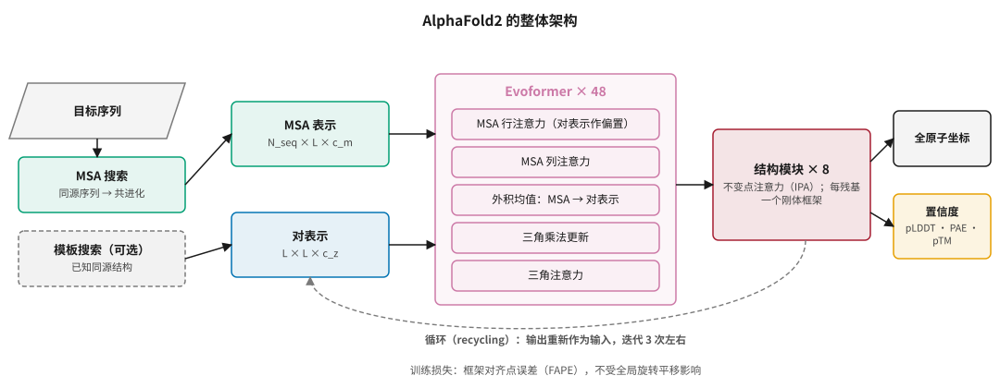
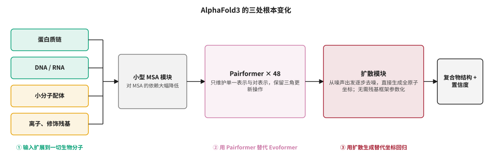
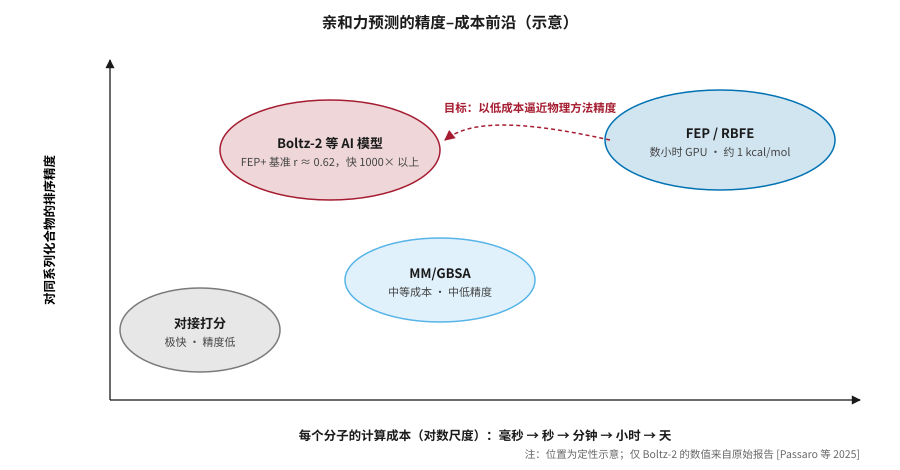
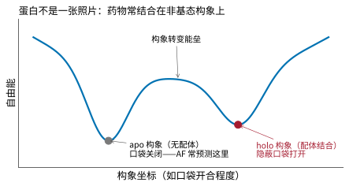
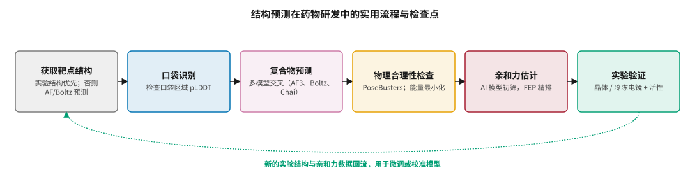

# 结构预测：AlphaFold、共折叠模型与 Boltz-2 {#sec-structure}

## 本章目的 {.unnumbered .unlisted}

::: {.purpose-question}
既然 AlphaFold 已经“解决了蛋白质折叠”，为什么药物设计里的结构问题还远没有解决？
:::

药物要起作用，通常要与靶点蛋白“严丝合缝”地结合，就像钥匙插进锁孔。要设计钥匙，先得知道锁的形状。过去，确定一个蛋白的三维结构需要数月到数年的实验；AlphaFold 等模型把这件事缩短到了几分钟。新一代共折叠模型更进一步，能预测药物分子与蛋白结合在一起的样子，甚至估计结合得有多紧。本章先介绍 AI 模型的“老师”——实验结构生物学，然后剖析 AlphaFold2 和 AlphaFold3 的关键设计，介绍 Boltz、Chai、Protenix、OpenFold3 等开源替代，重点讨论 Boltz-2 的结构–亲和力联合建模，最后系统梳理结构预测在药物研发中的五类局限和实用工作流。

::: {.callout-note title="给非技术读者的摘要"}

AlphaFold2（2020）能从氨基酸序列预测单个蛋白的三维结构，精度接近实验；AlphaFold3（2024）扩展到蛋白与小分子、核酸组成的复合物；开源的 Boltz-2（2025）还能估计药物与蛋白结合得有多紧，精度接近传统物理模拟，速度快一千倍以上。这是 AI 在药物研发中技术进步最扎实、最可验证的领域。但蛋白不是一张静止的照片——它会运动，药物常常结合在它“不常见”的形状上；模型在新颖靶点和新颖分子上的表现也明显变差。**成熟度**：单个蛋白结构预测已基本成熟；蛋白–小分子复合物预测进入实用阶段但有明显局限；构象动态和亲和力预测仍在快速发展。

:::

::: {.callout-learning-objectives}

- 比较 X 射线晶体学、核磁共振和冷冻电镜的特点，并说明 PDB 数据分布如何决定模型的能力边界
- 描述 AlphaFold2 的三大部分（输入嵌入、Evoformer、结构模块），解释三角更新、不变点注意力和 FAPE 损失的作用
- 解读 pLDDT、PAE 和 pTM/ipTM 置信度指标，并据此判断预测结构的可用区域
- 说明 AlphaFold3 的三处根本变化及扩散生成带来的“幻觉”问题
- 概括开源共折叠模型的生态，以及 Boltz-2 联合预测结构与亲和力的方法和证据
- 识别结构预测在药物研发中的五类局限，并设计一个包含物理检查和实验验证的使用流程

:::

## 实验结构生物学：AI 的“老师” {#sec-structure-experimental}

AI 结构预测模型的训练数据几乎全部来自实验测定的结构（@tbl-exp-methods）。

| 方法 | 原理 | 优势 | 局限 |
|:---|:---|:---|:---|
| X 射线晶体学 | 让蛋白结晶，由衍射图谱反推原子位置 | 分辨率高，PDB 中大部分结构来自此法 | 很多蛋白难以结晶；晶体环境可能改变构象 |
| 核磁共振（NMR） | 利用原子核在磁场中的共振信号推算原子间距离 | 可研究溶液中的动态结构 | 一般只适用于较小的蛋白 |
| 冷冻电镜（Cryo-EM） | 快速冷冻样品，拍摄大量单颗粒图像并三维重建 | 适用于大型复合物、膜蛋白 | 小蛋白难以解析；数据处理复杂 |

: 三种实验结构测定方法 {#tbl-exp-methods}

**蛋白质数据库**（PDB）是这些实验结构的公共仓库，目前收录了超过 20 万个结构。这一数据来源决定了模型的能力边界：

- 模型擅长预测**与 PDB 中已有结构相似**的蛋白；
- 模型学到的是**晶体或冷冻电镜条件下的构象**，未必是生理条件下的真实状态；
- PDB 中某些类别的数据很少——膜蛋白、无序蛋白、某些复合物类型——模型在这些地方的表现也相应较差。

## AlphaFold2：技术解析 {#sec-structure-af2}

@sec-history-alphafold 介绍了 AlphaFold2 的历史意义，本节深入其技术细节 [@jumper2021]。

### 整体架构 {#sec-structure-af2-arch}

AlphaFold2 的输入是目标序列、多序列比对（MSA）和可选的模板结构，输出是全原子三维坐标和置信度评分（@fig-af2-arch）。

::: {#fig-af2-arch fig-cap="**AlphaFold2 的整体架构**：序列经 MSA 搜索和可选的模板搜索，嵌入为 MSA 表示和残基对表示；48 个 Evoformer 模块在两种表示之间反复交换信息；8 层结构模块用不变点注意力把对表示转化为每个残基的刚体框架和全原子坐标，并输出置信度。输出会循环回输入，迭代约 3 次。" fig-alt="架构图，左侧目标序列经 MSA 搜索和虚线框的模板搜索，进入 MSA 表示和对表示两个方框；中间紫色大框为 Evoformer 乘 48，内含五个子操作；右侧红色方框为结构模块乘 8，输出全原子坐标和置信度；底部一条灰色虚线弧表示循环。"}

{width="100%"}

:::

### Evoformer 的关键操作 {#sec-structure-evoformer}

Evoformer 的设计体现了“把几何约束写进架构”的思想：

- **MSA 行注意力**：在同一条序列的残基之间做注意力，并用对表示作为偏置；
- **MSA 列注意力**：在同一位置的不同序列之间做注意力，捕捉进化信息；
- **外积均值**：把 MSA 信息投影到对表示中，更新残基对之间的关系；
- **三角乘法更新与三角注意力**：最具特色的设计。如果残基 $i$ 与 $j$ 的关系已知、$j$ 与 $k$ 的关系也已知，那么 $i$ 与 $k$ 的关系应受到约束，类似三角不等式。三角更新沿着“$i \to k \to j$”的路径聚合信息，让对表示满足几何一致性。

### 结构模块与 FAPE {#sec-structure-ipa}

结构模块把每个残基表示为一个刚体框架 $T_i = (R_i, \vec{t}_i)$，代表骨架原子的位置和朝向。其核心是**不变点注意力**（IPA）：在每个残基的局部坐标系中生成“查询点”和“键点”，变换到全局坐标系中计算距离作为注意力的一部分，使注意力对整体旋转平移保持不变。

主要训练损失是**框架对齐点误差**（FAPE）：以每个残基的预测框架为参考系，计算所有原子预测位置与真实位置的距离：

$$
\mathcal{L}_{\text{FAPE}} = \frac{1}{N_{\text{frames}} N_{\text{atoms}}} \sum_{i,j} \min\left(d_{\text{clamp}},\ \left\| T_i^{-1} \vec{x}_j - T_i^{\text{true}\,-1} \vec{x}_j^{\text{true}} \right\|\right)
$$ {#eq-fape}

与简单的坐标均方误差不同，FAPE 不受全局旋转平移的影响，且对局部结构错误更敏感；截断 $d_{\text{clamp}}$ 防止少数远距离误差主导训练。

### 置信度评分 {#sec-structure-confidence}

置信度评分在实践中极为重要：一个模型的预测是否可用，很大程度上取决于它能否准确告诉你“哪里可信、哪里不可信”。

::: {#dfn-structure-plddt .callout-definition title="pLDDT 与 PAE"}

***pLDDT***\index{pLDDT}（预测局部距离差异测试）为每个残基给出 0–100 的分数，衡量局部结构的可信度；***PAE***\index{PAE}（预测对齐误差）是一个 $L \times L$ 矩阵，衡量以残基 $i$ 为参考时残基 $j$ 的位置误差。pTM 和 ipTM 则分别估计全局和界面的模板建模分数。

1.  **意义**：pLDDT > 90 通常为高可信，< 50 往往对应无序区域；PAE 可以判断两个结构域之间的相对位置是否可信；ipTM 常用于评估复合物界面预测质量。
2.  **区别**：pLDDT 衡量局部，PAE 衡量相对位置。一个蛋白的两个结构域可能各自 pLDDT 很高，但 PAE 显示它们的相对朝向完全不确定。
3.  **常见误区**：只看平均 pLDDT 就判断“结构可用”。药物设计关心的是**口袋区域**的置信度和配体所在界面的 ipTM，而不是全蛋白平均值。

:::

## AlphaFold3：从蛋白到一切生物分子 {#sec-structure-af3}

2024 年 5 月发表的 AlphaFold3 相对 AlphaFold2 有三处根本变化（@fig-af3-changes）[@abramson2024]。

::: {#fig-af3-changes fig-cap="**AlphaFold3 的三处根本变化**：① 输入扩展到蛋白质、DNA/RNA、小分子配体、离子和修饰残基；② 用只维护单一表示与对表示的 Pairformer 替代 Evoformer，大幅降低对 MSA 的依赖；③ 用扩散模块直接生成全原子坐标，替代结构模块的坐标回归。三处变化指向同一个目标：从“预测一条蛋白链怎么折叠”转向“预测一个复合物长什么样”。代价是扩散生成会产生幻觉式的结构细节（尤其在无序区），因此 AlphaFold3 的输出比 AlphaFold2 更依赖置信度指标来判断可用性。" fig-alt="流程图，左侧四个输入方框蛋白质链、DNA RNA、小分子配体、离子修饰残基，汇入小型 MSA 模块，再进入紫色 Pairformer 乘 48，再进入红色扩散模块，输出复合物结构加置信度；下方三行彩色文字分别标注三处变化。"}

{width="100%"}

:::

**扩散生成**。AlphaFold3 不再直接回归坐标，而是训练一个去噪网络：在真实原子坐标上加入不同程度的高斯噪声，学习预测去噪后的坐标；推理时从纯噪声出发逐步去噪。扩散模块直接在原子坐标上操作，不再需要残基框架和扭转角等蛋白专用参数化，因而可以统一处理各种分子类型。

**扩散的副作用：幻觉**。扩散模型倾向于在无序区域生成“看起来有序”的结构。AlphaFold2 对无序区域往往输出低置信度的“面条状”结构，这其实正确反映了不确定性；AlphaFold3 的解决办法是用 AlphaFold2 的预测做交叉蒸馏，让它学习 AlphaFold2 在无序区域的输出方式。

**性能**。在 PoseBusters 基准上，AlphaFold3 的蛋白–配体位姿正确率（配体 RMSD < 2 Å）显著高于 AutoDock Vina 等传统对接方法，而且是在**不输入蛋白结构**的情况下取得的；蛋白–核酸复合物大幅超过此前的专门方法；抗体–抗原复合物相比此前有明显提升，但仍是相对困难的类别 [@abramson2024]。

**开放性**。AlphaFold3 发表时没有公开代码，引发了科学界强烈反弹；2024 年 11 月 DeepMind 向学术用户开放代码和权重，但不允许商业使用。这一决定直接推动了开源替代的快速发展 [@gen2025boltz2]。

## 开源替代 {#sec-structure-open}

@tbl-open-models 列出了 2024–2026 年主要的开源共折叠模型。

| 模型 | 开发者 | 发布 | 特点 |
|:---|:---|:---|:---|
| RoseTTAFold All-Atom [@krishna2024rfaa] | Baker 实验室 | 2023–2024 | 早期的全原子复合物预测，与 RFdiffusion 设计生态衔接 |
| Chai-1 [@chai2024] | Chai Discovery | 2024 年 9 月 | 可在无 MSA 的单序列模式下运行 |
| Boltz-1 [@wohlwend2024boltz1] | MIT Jameel Clinic | 2024 年 11 月 | 首个精度接近 AlphaFold3 的完全开源模型（MIT 许可） |
| Protenix [@protenix2025] | 字节跳动 | 2024–2026 | AlphaFold3 的复现与改进，2026 年升级至 v2 |
| OpenFold3 | OpenFold 联盟 | 2025 | 学术界与工业界联合推动的开源复现 |
| Boltz-2 [@passaro2025boltz2] | MIT + Recursion | 2025 年 6 月 | 联合预测结构与结合亲和力；模型、权重和训练流程以 MIT 许可开源 |

: 主要开源共折叠模型 {#tbl-open-models}

这些模型大多采用与 AlphaFold3 相似的整体架构（Pairformer 加扩散模块），在训练数据、推理效率和功能上各有改进。

## Boltz-2：结构与亲和力的联合建模 {#sec-structure-boltz2}

### 为什么亲和力重要 {#sec-structure-why-affinity}

结构预测告诉你分子“怎么结合”，药物研发真正需要知道的是“结合得有多紧”。结合亲和力是早期研发中测量最频繁的性质，相关实验是时间和成本的重要瓶颈。过去，可靠的计算亲和力只能依靠 FEP 等物理模拟，耗时长、成本高（@sec-screening-fep）。

### 数据与方法 {#sec-structure-boltz2-method}

为了学会预测亲和力，Boltz-2 把训练数据从 PDB 扩展到分子动力学模拟数据（MISATO、mdCATH、ATLAS）和实验亲和力数据库（PubChem、ChEMBL），亲和力模块在数百万条真实实验测量上训练，并建立在结构预测模块的表示之上，因而不需要预先提供实验复合物结构 [@passaro2025boltz2; @gen2025boltz2]。

它提供两种输出，对应两种不同场景：

- **亲和力数值**（以 log10(IC50) 表示，IC50 单位为 μM）：用于苗头到先导、先导优化阶段对同系列化合物排序；
- **结合概率**：用于苗头发现阶段区分结合物与非结合物。

两者的训练数据和监督方式不同，应在不同场景中使用。

### 证据 {#sec-structure-boltz2-evidence}

- 在训练中未见过靶点的 FEP+ 基准上，Boltz-2 的平均皮尔逊相关系数达到 0.62，与广泛使用的开源 FEP 流程 OpenFE 相当，速度快 1000 倍以上；
- 在 CASP16 亲和力挑战的 140 个复合物上，表现超过所有提交的方法；
- 在一项前瞻性 TYK2 筛选中，生成的前 10 个化合物经绝对结合自由能（ABFE）模拟验证全部被预测能结合 [@passaro2025boltz2]。

@fig-affinity-frontier 把 Boltz-2 放在亲和力方法的精度–成本坐标中。

::: {#fig-affinity-frontier fig-cap="**亲和力预测的精度–成本前沿（示意）**：对接打分极快但精度低；MM/GBSA 成本与精度居中；FEP/RBFE 精度最高但每对分子需数小时 GPU 时间。Boltz-2 等数据驱动模型的目标，是以接近对接的成本逼近物理方法的精度。位置为定性示意，仅 Boltz-2 的数值来自原始报告 [@passaro2025boltz2]。" fig-alt="二维示意图，横轴为每分子计算成本对数尺度，纵轴为对同系列化合物的排序精度；四个椭圆分别为左下对接打分、中下 MM/GBSA、右上 FEP/RBFE、左上 Boltz-2 等 AI 模型；一条红色虚线箭头从 FEP 指向 Boltz-2，标注目标。"}

{width="85%"}

:::

::: {.callout-perspective title="皮尔逊 0.62 意味着什么"}

FEP+ 基准主要由同系列化合物组成。0.62 的相关系数意味着模型对系列内排序有参考价值——能把明显更好和明显更差的分子分开——但离“精确预测每个分子的亲和力”还有距离。真实项目中的新颖靶点和骨架通常比基准更难。更重要的是，亲和力只是药物性质之一：高亲和力分子未必有好的选择性、药代和安全性（@sec-admet）。

:::

### 开源的意义 {#sec-structure-open-meaning}

Boltz 团队的成员指出，就在闭源模型似乎注定主导这一领域时，许多学术界和工业界研究者选择为开源项目贡献力量 [@gen2025boltz2]。开源模型的普及带来三个后果：**基础能力商品化**，结构预测和初步亲和力预测不再是少数公司的专有能力；**可定制**，企业可以用专有数据微调开源模型，适配特定靶点家族；**竞争焦点转移**，差异化转向专有数据、实验闭环和临床资产（@pri-players-moat）。

## 结构预测的五类局限 {#sec-structure-limits}

### 局限一：静态结构与动态构象 {#sec-structure-dynamics}

蛋白质在溶液中不断运动，在不同构象之间切换，而许多药物的作用机制恰恰依赖构象变化（@fig-conformational-landscape）：**变构抑制剂**结合在活性位点以外，通过改变构象调控活性（zasocitinib 结合 TYK2 的假激酶结构域就是例子）；**隐蔽口袋**在基态构象中不存在，只在特定构象或配体诱导下打开；**诱导契合**指配体结合会改变蛋白构象。

::: {#fig-conformational-landscape fig-cap="**构象自由能面示意**：蛋白在多个构象之间切换。结构预测模型通常给出能量最低、在 PDB 中最常见的构象（灰点），而药物可能结合在另一个能量略高、口袋打开的构象上（红点）。两者之间隔着构象转变能垒。" fig-alt="一条双势阱曲线，左侧较深的谷底灰点标注 apo 构象口袋关闭，右侧较浅的谷底红点标注 holo 构象隐蔽口袋打开，中间峰标注构象转变能垒。"}

{width="80%"}

:::

AlphaFold 系列主要预测一个“最可能”的构象，难以系统采样构象系综。研究者尝试了对 MSA 做子采样或聚类、结合分子动力学模拟、训练专门的构象生成模型等方法，但这仍是开放问题。

### 局限二：apo 与 holo 的差异 {#sec-structure-apo-holo}

模型预测的口袋可能是未结合配体的 apo 构象，也可能是已结合配体的 holo 构象，取决于训练数据中该蛋白家族的结构分布。用 apo 构象做虚拟筛选，可能错过需要口袋重排才能结合的配体。AlphaFold3 类模型把配体作为输入共同预测，在一定程度上缓解了这个问题，但效果依赖于配体与训练集中已知配体的相似程度。

### 局限三：记忆还是泛化 {#sec-structure-memorization}

这些模型在多大程度上在“理解物理化学规律”，又在多大程度上在“记忆训练数据中的相似结构”？多项分析发现：当测试复合物与训练集相似度较低——配体骨架新颖、口袋不同——位姿预测精度会显著下降 [@buttenschoen2024]；一些“对抗性”测试把口袋中的关键残基突变为甘氨酸，从物理上消除结合，模型有时仍把配体放在原来的位置，说明它学到的部分是统计模式而非物理相互作用 [@masters2024]。

::: {#pri-structure-novelty .callout-principle title="新颖性越高，越要依赖实验"}

**判断**：结构预测模型在已知靶点家族和已知化学空间中最可靠；面对新靶点、新骨架和新结合模式时，可靠性显著下降，且置信度评分不一定能如实反映这种下降。

**含义**：项目越新颖，越应把预测结构当作“假设”而非“结论”——多模型交叉验证、做物理合理性检查，并尽早获得实验结构。

:::

### 局限四：物理合理性 {#sec-structure-physical-validity}

PoseBusters 是 2023 年提出的基准和检查工具，用于评估预测的蛋白–配体复合物是否物理合理：键长键角、立体化学、原子间是否有不合理碰撞、配体是否穿过蛋白等 [@buttenschoen2024]。研究发现，早期深度学习对接方法虽然在 RMSD 指标上表现不错，但相当比例的预测存在物理不合理之处；AlphaFold3 类模型有明显改善，但并未完全消除问题。实践中常对 AI 预测结构做能量最小化或物理检查后处理。

### 局限五：特定类别的困难 {#sec-structure-hard-classes}

- **固有无序蛋白**：约三分之一的人类蛋白含有较长的无序区域，模型只能给出低置信度。
- **膜蛋白**：在 PDB 中占比偏低，但在药物靶点中占比很高（如 GPCR 和离子通道）。
- **抗体–抗原界面**：CDR 环的高变性和缺乏进化信息，使这一类复合物的精度仍明显低于普通蛋白复合物（@sec-biologics）。
- **共价结合、金属配位**等特殊化学。

::: {#ws-structure-glycine .callout-war-story title="把口袋“拆掉”，配体还在原位"}

**测试**：为了检验共折叠模型是否真正理解蛋白–配体相互作用，研究者对已知复合物做“对抗性”修改：把结合口袋中与配体形成关键相互作用的残基全部突变为甘氨酸。物理上，这会消除配体结合所依赖的侧链。

**结果**：模型在一部分案例中仍然把配体放在与原来几乎相同的位置 [@masters2024]。

**教训**：模型的部分“能力”来自对训练数据中相似复合物的记忆，而不是对物理相互作用的建模。这正是 @pri-structure-novelty 的根据：在训练数据覆盖不到的地方，预测看起来合理并不等于预测可信。

:::

::: {.callout-checkpoint title="结构预测的边界"}

- [ ] 一个预测结构的平均 pLDDT 为 88，你还需要看哪两项信息才能决定是否用它做虚拟筛选？
- [ ] 你能解释 AlphaFold3 的扩散模块为什么会在无序区域产生“幻觉”，以及它是如何缓解的吗？
- [ ] 对于一个变构抑制剂项目，你会如何应对“模型只给出基态构象”的问题？

:::

## 结构预测的实用流程 {#sec-structure-workflow}

@fig-structure-workflow 给出一个在药物研发中使用结构预测的实用流程。

::: {#fig-structure-workflow fig-cap="**结构预测在药物研发中的实用流程与检查点**：优先使用实验结构；在预测结构上识别口袋并检查口袋区域置信度；用多个模型交叉预测复合物；用 PoseBusters 和能量最小化做物理合理性检查；用 AI 模型初筛亲和力、用 FEP 精排关键分子；最后以晶体或冷冻电镜结构及活性实验验证，并把新数据回流用于校准模型。" fig-alt="六个横向方框依次为获取靶点结构、口袋识别、复合物预测、物理合理性检查、亲和力估计、实验验证，底部一条绿色虚线弧从实验验证回到第一步。"}

{width="100%"}

:::

几条使用建议：

1. **永远检查置信度**：不要直接使用口袋区域 pLDDT 低的结构（@dfn-structure-plddt）。
2. **多模型交叉验证**：用 AlphaFold3、Boltz、Chai 等预测同一体系，观察结果是否一致。
3. **结合物理方法**：对关键结论，用分子动力学检验结合模式的稳定性。
4. **警惕新颖性陷阱**：越新颖的靶点和骨架，越依赖实验验证（@pri-structure-novelty）。
5. **实验结构是金标准**：只要能获得实验结构，就优先使用。

## Isomorphic Labs 与 IsoDDE {#sec-structure-isodde}

作为 AlphaFold 的“嫡系”，Isomorphic Labs 的 IsoDDE 被视为结构预测技术在药物研发中的前沿应用（@sec-players-isomorphic）。从 2026 年 2 月发布的技术报告看，IsoDDE 的发展方向与开源社区大体一致：从结构预测扩展到亲和力、选择性、构象动态等药物设计真正需要的性质 [@isodde2026]。区别在于 Isomorphic 拥有更多专有数据、算力和来自大药企合作的反馈。IsoDDE 能否带来临床层面的优势，有待其首批临床项目的数据检验。

## 谬误与陷阱 {#sec-structure-fallacies}

::: {.fallacy-pitfall}

**谬误**：*AlphaFold 解决了蛋白质折叠，药物设计的结构问题也就解决了。*

AlphaFold2 解决的是“从序列预测单一、静态的折叠构象”。药物设计需要的是结合态口袋构象、构象变化、变构位点和结合亲和力，这些仍是开放问题。

:::

::: {.fallacy-pitfall}

**谬误**：*RMSD 低的位姿就是好位姿。*

PoseBusters 的研究表明，许多 RMSD 低于 2 Å 的预测仍存在原子碰撞、键长异常等物理不合理之处。位姿评价应同时检查几何精度和物理合理性。

:::

::: {.fallacy-pitfall}

**陷阱**：*在新颖靶点上把 AI 亲和力预测当作最终答案。*

Boltz-2 在 FEP+ 基准上表现接近 OpenFE，但基准主要是同系列化合物；在新靶点、新骨架上的可靠性需要实验和物理方法校准。

:::

::: {.fallacy-pitfall}

**陷阱**：*只看平均置信度。*

全蛋白平均 pLDDT 可能很高，而口袋区域、结构域相对位置或配体界面恰恰不可信。应查看口袋区域 pLDDT、PAE 和 ipTM。

:::

## 小结 {#sec-structure-summary}

从 AlphaFold2 到 AlphaFold3，再到 Boltz-2，结构预测在短短五年间从“单个蛋白的静态结构”走到了“任意生物分子复合物的结构与亲和力”。这是 AI 在药物研发中最扎实、最可验证的技术进步，开源模型也让这些能力迅速商品化。但结构只是药物研发链条中的一环：一个分子能紧紧结合靶点，并不意味着它是一个好药。

::: {.callout-takeaways title="结构是起点，不是终点"}

* **PDB 决定边界**：模型擅长与已有结构相似的蛋白，学到的是晶体条件下的构象，在膜蛋白、无序蛋白上较弱。
* **AlphaFold2 的三个关键**：三角更新保证几何一致性，不变点注意力处理旋转平移，FAPE 损失关注局部结构。
* **AlphaFold3 的三处变化**：输入扩展到一切生物分子、Pairformer 替代 Evoformer、扩散生成替代坐标回归。
* **Boltz-2 联合结构与亲和力**：FEP+ 基准皮尔逊 0.62，与 OpenFE 相当、快 1000 倍以上，并以 MIT 许可完全开源。
* **五类局限**：静态与动态、apo 与 holo、记忆与泛化、物理合理性、特定困难类别。
* **新颖性越高越依赖实验**：多模型交叉、物理检查、尽早获得实验结构。

:::

::: {.callout-chapter-connection title="从结构到筛选"}

有了靶点结构，下一步是从海量化学空间中找到能与之结合的分子。@sec-screening 讨论虚拟筛选的演进——从分子对接到数十亿级按需合成库的超大规模筛选，再到机器学习代理模型和自由能计算——以及这一领域最顽固的问题：评测中的数据泄漏。

:::
