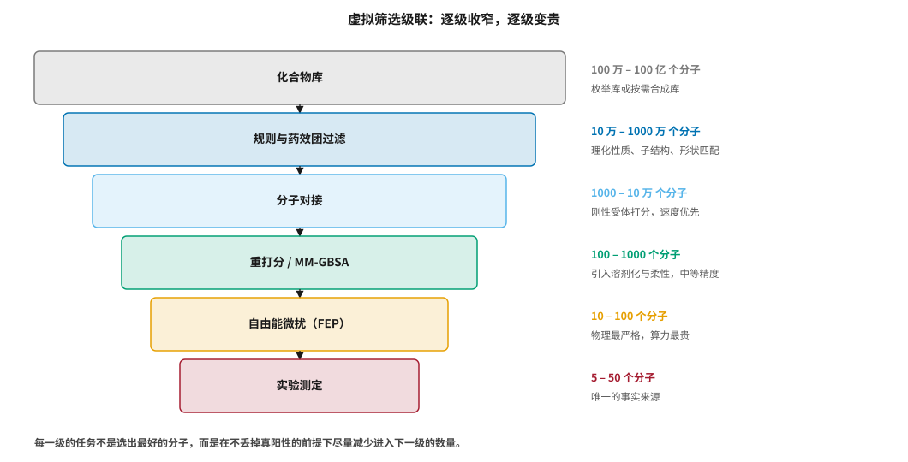
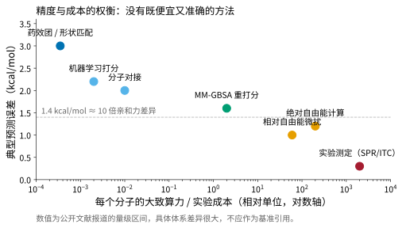
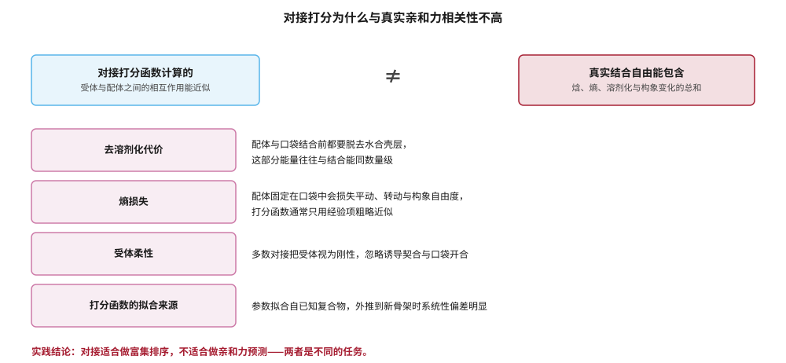
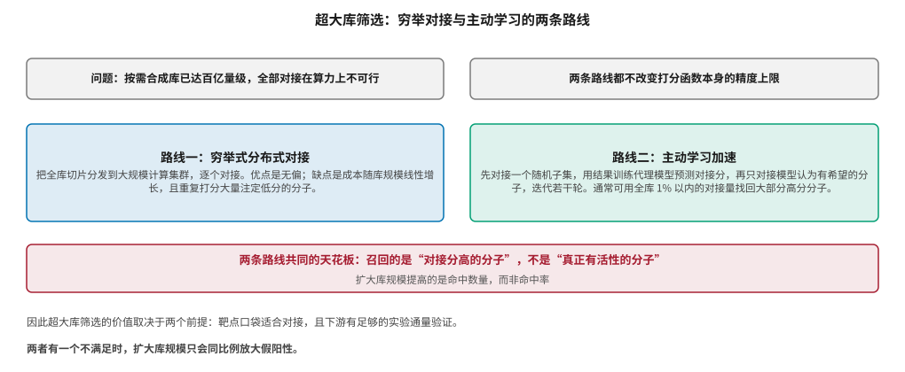

# 虚拟筛选与结合亲和力预测 {#sec-screening}

## 本章目的 {.unnumbered .unlisted}

::: {.purpose-question}
在数十亿个分子里找出能结合靶点的那几个，计算能帮到什么程度？
:::

@sec-structure 解决的是“蛋白长什么样”，本章解决的是“哪个分子能结合上去”。这是计算药物化学历史最久、工业应用最深、同时也是**期望与现实落差最大**的领域。虚拟筛选的基本逻辑很简单：用便宜的计算替代昂贵的实验，把化合物库从数十亿收窄到几十个再去做实验。困难在于，这个过程中使用的物理近似在每一级都会损失精度，而最便宜的方法恰好最不准确。本章沿着筛选级联逐级展开，重点说明每一级**实际能做什么、不能做什么**，以及工业界如何在精度与成本之间取舍。

::: {.callout-note title="给非技术读者的摘要"}

要找一个能治病的分子，候选数量是天文数字——商业可得的化合物库已经有上百亿个分子。一个一个做实验显然不可能，所以先用计算机筛。计算方法分几档：最便宜的靠分子形状和基本规则排除大多数，中间一档叫“分子对接”，模拟分子怎么塞进蛋白的口袋并打个分，最贵的叫“自由能计算”，用物理方法算出结合的强度。规律是：**便宜的不准，准的很贵**，没有例外。最常见的误解是把对接的分数当作活性强度——它其实只适合用来排序，告诉你“哪些值得先试”，不能告诉你“这个分子有多强”。**成熟度**：排序用途高；定量预测中等偏低。

:::

::: {.callout-learning-objectives}

- 描述虚拟筛选级联的各级方法，并说明每一级的收窄比例与成本量级
- 解释对接打分与真实结合自由能之间的四类系统性差异
- 区分富集排序与亲和力预测两种任务，并说明为什么同一个分数不能同时胜任
- 说明自由能微扰的适用条件与典型精度，以及它为什么不能用于大规模筛选
- 评估超大库筛选的价值边界，并解释主动学习为什么能降低成本却不能提高命中率
- 识别虚拟筛选基准测试中的常见偏差来源

:::

## 筛选级联 {#sec-screening-cascade}

@fig-screening-funnel 给出工业界常用的级联结构。它的设计原则不是“每一级都选出最好的”，而是**在可接受的假阴性率下，尽量减少进入下一级的数量**——因为下一级的单位成本通常高出一到两个数量级。

::: {#fig-screening-funnel fig-cap="**虚拟筛选级联**：从百亿量级的化合物库逐级收窄到几十个进入实验测定的分子。每下降一级，方法的物理严格性提高、单位成本上升一到两个数量级、处理的分子数量下降一到两个数量级。各级的任务是在不丢掉真阳性的前提下尽量减少下一级的输入量。" fig-alt="漏斗形流程图，自上而下六层方框依次为化合物库、规则与药效团过滤、分子对接、重打分与 MM-GBSA、自由能微扰、实验测定，宽度逐层收窄；右侧标注各层处理的分子数量量级与方法特征。"}

{width="100%"}

:::

@fig-accuracy-cost 把同一组方法放在精度—成本平面上。图中最值得注意的是：**没有点落在左下角**。精度与成本的权衡是这个领域的基本约束，所有工程努力都是在这条曲线上移动位置，而不是打破它。

::: {#fig-accuracy-cost fig-cap="**结合亲和力预测方法的精度与成本**：横轴为每个分子的大致计算或实验成本（对数轴），纵轴为典型预测误差。虚线标出 1.4 kcal/mol，约对应 10 倍的亲和力差异。没有方法落在左下角——既便宜又准确的方法不存在。数值为公开文献报道的量级区间，具体体系差异很大。" fig-alt="散点图，横轴为对数成本轴，纵轴为预测误差。药效团匹配位于左上角（便宜但误差大），自由能计算位于右下方（昂贵但误差小），实验测定位于最右下角，整体呈现自左上向右下的递减趋势。"}

{width="95%"}

:::

### 第一级：规则与形状过滤 {#sec-screening-filter}

最廉价的一级依靠不需要靶点结构的判据：分子量、脂水分配系数、氢键供受体数等理化性质（@sec-admet 会讨论这些规则的来源与局限）、不希望出现的子结构（PAINS、反应性基团），以及基于已知活性分子的形状与药效团匹配。

这一级的作用常被低估。它处理的分子数量最多，而**每排除一个分子节省的下游成本最大**。但它也引入了整个流程中最早、因此传播最广的偏差：如果规则来源于历史上成功的小分子药物，它会系统性排除新型模态的分子骨架。

### 第二级：分子对接 {#sec-screening-docking}

::: {#dfn-docking .callout-definition title="分子对接"}

***分子对接***\index{分子对接}（molecular docking）指在给定蛋白结构的前提下，搜索配体在结合口袋中的可能摆放方式（构象与取向），并用打分函数对每种摆放方式给出一个数值评价。它包含两个可分离的子任务：**姿态预测**（配体摆在哪里）与**打分**（结合得有多强）。

1.  **意义**：对接是唯一能在数百万到数十亿分子规模上运行的结构依赖方法，因此是级联的主力环节。
2.  **区别**：姿态预测与打分的成功率差别很大。主流程序在有共晶结构参照时，姿态预测的成功率可达七成左右；而打分与实验亲和力的相关系数通常只有 0.4–0.6，且高度依赖体系。
3.  **常见误区**：把对接分数当作结合自由能。打分函数的量纲常写成 kcal/mol，但它是拟合出的经验量，不是热力学量。

:::

对接程序之间的横向比较早有系统研究。Warren 等人用十种对接程序、三十余个打分函数在八个蛋白体系上做了大规模评测，结论是：**姿态预测普遍可用，而打分与活性的相关性普遍很差，且没有哪个程序在所有体系上占优** [@warren2006dockingcomparison]。二十年过去，这一结论的主体部分仍然成立。

@fig-docking-gap 解释了这种差距的来源。打分函数计算的是受体与配体之间的相互作用能近似，而真实的结合自由能是一个包含焓、熵、溶剂化与构象变化的总和。

::: {#fig-docking-gap fig-cap="**对接打分与真实结合自由能的四类系统性差异**：去溶剂化代价、熵损失、受体柔性与打分函数的拟合来源。这四项不是实现上的瑕疵，而是为了达到筛选所需速度而主动做出的近似。实践结论是对接适合做富集排序而非亲和力预测。" fig-alt="图上方两个方框以不等号相连，左侧为对接打分函数计算的相互作用能近似，右侧为真实结合自由能的完整构成；下方四行列出去溶剂化代价、熵损失、受体柔性与打分函数拟合来源四项差异及其说明。"}

{width="90%"}

:::

::: {#pri-screening-rank .callout-principle title="排序与定量是两个任务"}

虚拟筛选的目标是**富集**：让真阳性在排序靠前的部分中出现得比随机抽样更密集。这与**定量预测**结合亲和力是不同的任务，需要的精度也完全不同。一个分数可以在富集上表现良好（把活性分子排在前面）而在定量上毫无用处（分数与 pK~i~ 几乎不相关），反之亦然。混淆这两个目标，是虚拟筛选项目最常见的方法学错误。

:::

### 第三级：重打分与端点法 {#sec-screening-rescore}

对接之后的一级通常用计算量更大的方法重新评价前几千个分子。MM-GBSA/MM-PBSA 属于端点法：分别计算结合态与自由态的能量，用隐式溶剂模型处理溶剂化。它比对接打分引入了更完整的物理项，但仍然对构象采样和介电常数等参数敏感，**不同体系之间的可比性较差**。

机器学习打分函数是近年的另一条路线。它们在标准基准上往往取得显著优于传统打分函数的指标，但这些指标的可靠性受到数据集构造方式的严重影响——Chen 等人证明，DUD-E 数据集中活性分子与诱饵分子存在系统性的理化性质差异，深度学习模型可以靠这些与结合无关的特征取得高分，而在去除该偏差后性能大幅下降 [@chen2019hiddenbias]。这一发现是 @sec-evaluation 将系统讨论的基准可信度问题在本领域的代表案例。

::: {.fallacy-pitfall}

**谬误**：*在基准数据集上超越对接，就意味着在真实项目中更有用。*

虚拟筛选基准的构造方式决定了它衡量的是什么。如果诱饵分子的选取方式让活性与非活性在理化性质上可分，那么任何能学到理化性质的模型都会得到高分，而这与“能否识别结合”无关。判断一个打分方法是否真正有用，需要前瞻性验证：在模型没有见过的新体系上做预测，然后实际测。

:::

近年的几何深度学习对接方法（如 DiffDock [@corso2023diffdock]）在姿态预测的基准指标上表现亮眼，但 PoseBusters 的评测指出一个重要问题：这类方法生成的姿态中有相当比例**在物理上不合法**——键长键角异常、与蛋白原子穿插、立体化学错误，而传统基准指标（只看配体 RMSD）不会惩罚这些错误 [@buttenschoen2024posebusters]。这提醒我们，评测指标的选择本身会塑造方法的发展方向。

## 自由能微扰 {#sec-screening-fep}

::: {#dfn-fep .callout-definition title="自由能微扰"}

***自由能微扰***\index{自由能微扰}（free energy perturbation, FEP）通过分子动力学模拟，沿一条非物理的热力学路径把一个配体“变形”为另一个配体，由此计算两者结合自由能之差（即相对自由能，ΔΔG）。它建立在严格的统计力学基础上，不依赖经验拟合的打分项。

1.  **意义**：FEP 是目前在工业项目中精度最高的计算方法，报道的典型误差约 1 kcal/mol 量级 [@wang2015fep]，接近实验重复测定的误差范围。
2.  **区别**：FEP 通常计算的是**相对**自由能，即同一系列中两个结构相近的分子谁更强，而非绝对亲和力。这正好匹配先导优化阶段的实际需求。
3.  **常见误区**：以为 FEP 可以用于筛选。单个微扰计算的耗时以 GPU 小时计，且要求两个分子结构足够相似、结合模式一致——这两个条件在筛选阶段都不满足。

:::

FEP 的适用条件相当苛刻：需要可靠的复合物结构、配体之间有共同骨架、结合模式不发生改变、关键水分子位置处理得当。在这些条件满足时，它能把先导优化中“合成哪个类似物”的决策质量显著提高。Schindler 等人在默克的多个真实项目上做了大规模前瞻性评估，报告了在合适体系上接近 1 kcal/mol 的精度，同时也明确指出了失败案例的特征——主要是结合模式变化和蛋白构象重排 [@schindler2020fepindustry]。

把 FEP 放在级联的正确位置很重要：它不是筛选工具，而是**先导优化阶段的决策支持工具**。在筛选阶段使用 FEP 既不可行（算力），也无意义（候选之间结构差异太大，超出方法适用域）。

## 超大库筛选 {#sec-screening-ultralarge}

2019 年以后，可购买化合物库的规模从千万级跃升到百亿级。驱动力是**按需合成库**（make-on-demand library）的商业模式：供应商不预先合成分子，而是枚举由可靠反应与现货砌块组合出的所有产物，接到订单后再合成。

Lyu 等人用 1.38 亿个分子对接 AmpC β-内酰胺酶与 D4 多巴胺受体，报告在超大库中发现了命中率更高、亲和力更强的新骨架 [@lyu2019ultralarge]。VirtualFlow 把这一规模推到十亿级并开源了分布式流程 [@gorgulla2020virtualflow]。Sadybekov 等人则提出基于砌块的模块化搜索策略，在 110 亿分子的虚拟库中避免了全量枚举 [@sadybekov2022synthon]。

@fig-ultralarge 对比了两条技术路线，并指出它们共同的天花板。

::: {#fig-ultralarge fig-cap="**超大库筛选的两条路线**：穷举式分布式对接与主动学习加速。前者无偏但成本随库规模线性增长；后者通常可用全库 1% 以内的对接量找回大部分高分分子。两者共同的天花板在于召回的是对接分高的分子，而非真正有活性的分子——扩大库规模提高的是命中数量，而非命中率。" fig-alt="左右两个方框分别说明穷举式分布式对接与主动学习加速两条路线的做法与优缺点，下方红色横条标注两者共同的天花板。"}

{width="100%"}

:::

主动学习是降低成本的主要手段：先对接一个随机子集，用结果训练一个廉价代理模型预测对接分，再只对接模型认为有希望的分子，迭代若干轮。Graff 等人证明这一策略可在对接量减少两个数量级的情况下找回大部分高分分子 [@graff2021activelearning]。

但需要清醒认识它优化的目标：**代理模型学的是对接分数，不是实验活性**。主动学习提高的是筛选流程的效率，而非打分函数的准确性。如果打分函数在某个靶点上本来就不可靠，主动学习只会更快地找到一批高分假阳性。

::: {#ws-screening-scale .callout-war-story title="库越大，命中率不一定越高"}

超大库筛选的早期报道中，一个被反复引用的观察是：库规模扩大后，排名靠前分子的实验命中率有所上升。这一观察被部分解读为“库越大越好”。

但更仔细的分析指出其中存在混杂因素。第一，超大库筛选通常由方法学团队在**对接表现良好的靶点**上做（口袋深、刚性、带电相互作用明确），这类靶点本身命中率就高。第二，这些研究普遍对对接结果做了人工检视，排除了姿态明显不合理的分子——这部分人工判断的贡献很难与库规模的贡献分开。第三，阴性结果的发表率远低于阳性结果，公开报道的案例集本身是有偏的。

实践上的结论是：扩大库规模确实能增加**找到的新骨架数量**，但这主要来自绝对数量的增加，而非打分可靠性的提高。在对接本来就不可靠的靶点（浅口袋、高度柔性、以疏水作用为主）上，扩大库规模不会改善结果。

:::

## 工业实践中的取舍 {#sec-screening-practice}

把上述内容收敛到可操作的判断上，有几条在工业项目中反复验证的经验。

**先判断靶点是否适合对接。** 口袋明确、刚性较强、存在关键的极性相互作用时，对接的富集能力较好；浅口袋、高度柔性、以非特异疏水作用为主，或结合涉及显著的诱导契合时，对接的价值很有限。这个判断应在投入算力之前完成。

**用富集指标而非相关系数评价筛选。** 对接的价值体现在排序靠前部分的富集程度，因此应当用 EF~1%~（前 1% 中活性分子的富集倍数）或 BEDROC 这类加权指标，而不是全体分子上的相关系数。

**保留实验验证的通量预算。** 虚拟筛选的输出是待验证的假设列表，其价值取决于下游能验证多少。没有配套实验通量的虚拟筛选，无论算了多少分子，都不产生信息。

**明确区分流程中的两次收窄。** 从库到对接前的收窄依靠配体性质（不需要结构），从对接到实验的收窄依靠结构打分。两者的失败模式不同，应分别评估。

::: {#chk-screening .callout-checkpoint}

1. 为什么说对接的姿态预测与打分是两个成功率差别很大的子任务？
2. 列举对接打分与真实结合自由能之间的四类系统性差异，并说明它们为什么是主动做出的近似。
3. 为什么 FEP 不能用于筛选阶段？它的两个核心适用条件是什么？
4. DUD-E 数据集的偏差是如何让深度学习打分函数取得虚高性能的？
5. 主动学习加速超大库筛选时，代理模型学习的目标是什么？这对结果的解读有什么含义？
6. 评价虚拟筛选时，为什么富集指标比相关系数更合适？

:::

::: {.fallacy-pitfall}

**陷阱**：*把对接分数当作可比较的能量值。*

不同对接程序的分数之间没有可比性，同一程序在不同靶点之间的分数也不可比。分数只在同一靶点、同一程序、同一准备流程的一次运行内部具有排序意义。跨靶点比较“哪个分子的对接分更好”是没有意义的操作。

:::

## 小结 {#sec-screening-summary}

虚拟筛选是计算药物化学中应用最广、也最容易被误用的工具。它的真实能力边界相当清晰：在合适的靶点上，它能把实验筛选的起点从随机变成有偏向的，这一价值是实在的；但它不能给出可信的亲和力数值，也不能让不适合结构方法的靶点变得适合。精度与成本的权衡是硬约束，级联设计的全部意义就是在这条曲线上合理分配预算。超大库与机器学习打分都降低了单位成本，却都没有改变打分函数的精度上限——理解这一点，是判断本领域各类宣称的基本前提。

::: {.callout-takeaways title="富集不是定量，排序不是预测"}

* **级联的逻辑是成本分配**：每一级的任务是在可接受假阴性率下减少下一级的输入量。
* **精度与成本无法同时优化**：没有既便宜又准确的方法，这是物理近似带来的硬约束。
* **对接适合富集，不适合定量**：打分函数量纲像能量，但不是热力学量。
* **FEP 属于先导优化而非筛选**：需要共同骨架、一致结合模式与可靠结构，算力以 GPU 小时计。
* **超大库提高命中数量而非命中率**：扩大规模不改变打分函数的精度上限。
* **基准可能在测别的东西**：数据集构造偏差会让模型靠与结合无关的特征取得高分。

:::

::: {.callout-chapter-connection title="从筛选已有的到设计没有的"}

虚拟筛选的前提是候选分子已经存在于某个库中。但化学空间的规模远超任何库的覆盖范围，而真正新颖的骨架往往不在现成库里。@sec-generative 转向另一条路线：不从库中挑选，而是直接生成分子——以及这条路线带来的新问题，包括生成的分子能否合成、评价指标是否可信，以及优化目标被钻空子的风险。

:::
