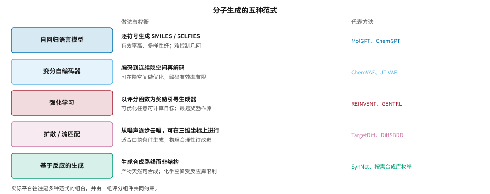
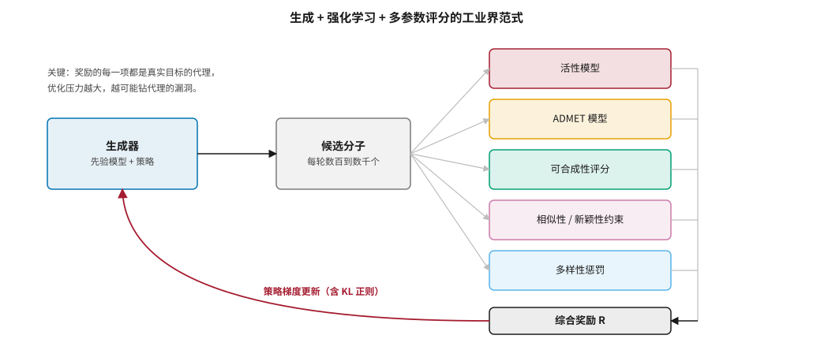
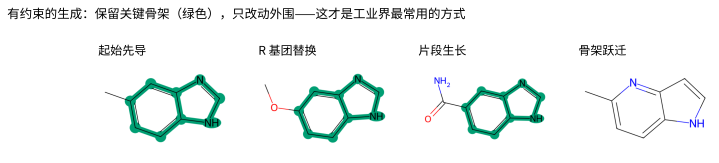
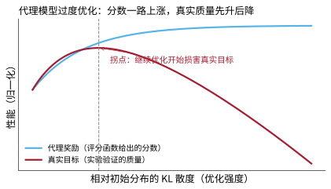
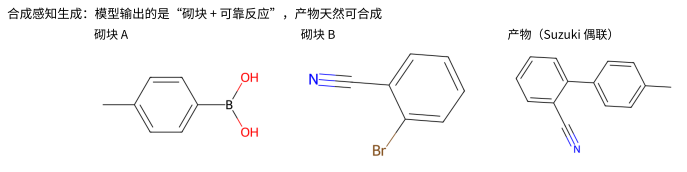

# 小分子生成式设计 {#sec-generative}

## 本章目的 {.unnumbered .unlisted}

::: {.purpose-question}
让 AI “画”出一个前所未有的分子并不难——难的是让它画出一个真能用的分子。
:::

前一章讲的是从已有化合物库中“挑分子”，本章讲让模型从零“创造”分子。技术上这已相当成熟，是多数 AI 制药公司的标配能力。真正的难点有两个：一是生成的分子要同时满足活性、选择性、ADMET、可合成性等一大堆相互冲突的条件；二是当我们用一个“评分函数”去引导生成时，模型会找到让分数变高、但分子其实没用的捷径。本章介绍五种生成范式、基于口袋的三维生成及其争议、工业界真正在用的“有约束生成”，并把**奖励作弊**作为核心难题展开——它与大语言模型对齐中的奖励模型过度优化在数学结构上是同一个问题。

::: {.callout-note title="给非技术读者的摘要"}

生成式设计就是让 AI 从零“画”出新分子。技术上已经不难，难的是生成的分子要能合成、有活性、没毒性。最棘手的问题叫“奖励作弊”：我们给 AI 一个打分标准让它去优化，它会找到让分数飙升但分子其实没用的捷径——比如把分子做得又大又复杂，打分函数就给高分，实际却合成不出来也没活性。这个问题和训练聊天机器人时“模型学会讨好评分器”本质上一模一样。在工业界，生成式设计主要用于在已有分子上做改进，而不是凭空创造。**成熟度**：技术成熟，是标配能力；但“生成”与“真正有用”之间仍有明显差距。

:::

::: {.callout-learning-objectives}

- 区分五种分子生成范式的适用场景与代价
- 说明基于口袋的三维生成的现状，以及对接分数作为评价指标的缺陷
- 描述工业界常用的四类有约束生成：片段生长、片段连接、骨架跃迁、先导优化
- 解释奖励作弊的三种典型表现与四类缓解方法，并说明它与 RLHF 中奖励模型过度优化的同构关系
- 比较 SAscore、SCScore、RAscore 等可合成性评分，理解“合成感知生成”的思路
- 批判性评价分布类指标（有效性、唯一性、新颖性），并列出真正重要的评估标准

:::

## 问题的定义 {#sec-generative-problem}

分子生成式设计的目标是：根据一组目标性质，生成满足这些性质的新分子。它与虚拟筛选的根本区别在于，虚拟筛选在一个固定的、已有的分子库中搜索，而生成式设计在整个化学空间中创造，理论上不受现有库的限制。

生成通常要同时优化多个目标：对靶点的结合**活性**；不结合脱靶蛋白的**选择性**；吸收、分布、代谢、排泄、毒性等 **ADMET** 性质（@sec-admet）；能被实际合成的**可合成性**；分子量、logP 等在合理范围内的**类药性**；以及与已有专利分子有足够区别的**新颖性**——这既是科学目标，也是商业目标。

这是一个典型的**多目标优化**问题，而且目标之间常常相互冲突：提高亲和力往往需要增大分子、增加亲脂性，这又会损害溶解度和代谢稳定性。

## 五种生成范式 {#sec-generative-paradigms}

@fig-generation-paradigms 总结了主流的生成范式。

::: {#fig-generation-paradigms fig-cap="**分子生成的五种范式**：自回归语言模型、变分自编码器、强化学习、扩散与流匹配、基于反应的生成；每行给出该范式的做法、主要权衡与代表方法。五者并不是互斥的技术路线——强化学习通常叠加在前两者之上作为优化层，扩散与基于反应的生成则分别从“几何正确”和“一定做得出来”两个方向弥补语言模型的短板。实际平台往往是多种范式的组合，并由一组评分组件共同约束。" fig-alt="五行表格式图示，左侧彩色方框依次为自回归语言模型、变分自编码器、强化学习、扩散与流匹配、基于反应的生成，右侧两列文字分别说明机制与代价。"}

{width="100%"}

:::

**自回归语言模型**像写句子一样逐个符号地生成 SMILES 或 SELFIES，也可以逐个组件（原子、化学键、片段）构建分子图。它能生成高度多样、有效率高的分子，但难以精确控制几何和三维性质。

**变分自编码器**把分子编码到连续隐空间再解码，隐空间的连续性使得可以在其中做梯度优化或贝叶斯优化，ChemVAE（2018）是开创性工作 [@gomezbombarelli2018]。问题是隐空间往往不够规整，解码的有效率和性质可控性有限。

**强化学习**以性质预测模型为奖励函数，用策略梯度等方法训练生成模型倾向于产生高奖励分子。阿斯利康开源的 REINVENT 是工业界使用最广的框架之一 [@olivecrona2017]。它灵活、可针对任意可计算目标优化，但也最容易出现奖励作弊（@sec-generative-reward-hacking）。

**扩散与流匹配**借鉴图像生成的思路，从噪声逐步去噪生成分子，可以在二维图上扩散，也可以在三维坐标上扩散——后者在“基于口袋的生成”中尤其重要。流匹配是扩散的一种推广，近两年应用增多，训练更稳定、采样更快。

**基于反应的生成**不直接输出分子结构，而是输出一条合成路线：从可购买砌块出发，依次应用已验证的化学反应。产物天然可合成，代价是化学空间受反应库限制（@sec-generative-synthesis-aware）。

## 工业界的范式：生成 + 强化学习 + 多参数评分 {#sec-generative-industry-loop}

真实的生成平台不是单一模型，而是多种方法的组合。以 REINVENT 为代表的框架是一种常见范式（@fig-rl-loop）：生成器产生分子，一组评分组件（活性模型、ADMET 模型、可合成性评分、相似性约束、多样性惩罚）组成综合奖励，通过强化学习不断引导生成器。英矽智能的 Chemistry42 据称集成了数十种生成算法和评分函数（@sec-players-insilico）。

::: {#fig-rl-loop fig-cap="**生成 + 强化学习 + 多参数评分的工业界范式**：生成器每轮产生数百到数千个候选分子，由多个评分组件打分并合成为综合奖励 R，再用带 KL 正则的策略梯度更新生成器。奖励的每一项都是真实目标的代理，优化压力越大，越可能钻代理的漏洞。" fig-alt="流程图，左侧蓝色方框为生成器，中间灰色方框为候选分子，右侧五个彩色方框为活性模型、ADMET 模型、可合成性评分、相似性新颖性约束、多样性惩罚，汇总到综合奖励 R，再由一条红色曲线箭头回到生成器，标注策略梯度更新含 KL 正则。"}

{width="100%"}

:::

综合奖励常用加权求和或加权几何平均：

$$
R(m) = \prod_{k=1}^{K} s_k(m)^{w_k}, \qquad \sum_k w_k = 1
$$ {#eq-mpo-reward}

其中 $s_k(m) \in [0,1]$ 是第 $k$ 项性质的“期望度”（desirability），$w_k$ 是权重。几何平均的好处是任何一项接近 0 都会把总分拉到接近 0，避免模型靠极端优化某一项来补偿其他项——这是加权算术平均的已知弱点。

## 基于口袋的三维生成及其争议 {#sec-generative-sbdd}

### 动机与代表方法 {#sec-generative-sbdd-methods}

传统生成方法大多只考虑配体本身，不直接利用靶点结构。**基于口袋的生成**则以靶点的三维口袋为条件，生成能嵌入其中的分子。代表方法包括自回归地在口袋中放置原子的 Pocket2Mol [@peng2022pocket2mol]，以及在口袋条件下同时生成原子类型和三维坐标的等变扩散模型 TargetDiff [@guan2023targetdiff]、DiffSBDD 等。

### 四个质疑 {#sec-generative-sbdd-critiques}

这个方向看起来很有吸引力，但系统评估发现了不少问题 [@harris2023]：

1. **物理合理性差**：生成的分子常有不合理的键长、键角、原子碰撞，甚至无法用标准化学工具解析，需要大量后处理。
2. **可合成性低**：三维生成往往产生奇特的环系和官能团，难以合成。
3. **对接分数的误导**：许多论文用 AutoDock Vina 分数评估生成分子，声称超过了训练集中的真实配体。但有研究指出，Vina 分数可以被“刷”——生成大而富含极性原子的分子就能拿高分，而这些分子未必真正能结合或成药 [@gao2024dockinghack]。
4. **缺乏前瞻性验证**：绝大多数工作停留在计算指标上，很少有实际合成并测试的报告。

因此，尽管基于口袋的三维生成是活跃的研究方向，它在实际研发流程中的应用仍然有限。工业界更多使用成熟的二维生成加强化学习框架，再用对接、AI 亲和力模型和 FEP 评估结合（@sec-structure-boltz2）。

## 有约束的生成：工业界的真实用法 {#sec-generative-constrained}

实际药物研发中，纯粹的“从零生成”用得并不多。更常见的是**有约束的生成**（@fig-constrained-generation）。

::: {#fig-constrained-generation fig-cap="**有约束的生成**：绿色高亮部分为保持不变的核心骨架。从左到右依次为起始先导、R 基团替换、片段生长（添加酰胺侧链）、骨架跃迁（更换核心杂环，因此不再匹配原骨架）。这类“在已有分子上迭代”的任务，才是工业界生成式设计最常用的场景。图由 RDKit 生成。" fig-alt="四幅并排的分子结构图，前三幅共享同一个苯并咪唑骨架并以绿色高亮，第四幅更换为另一种杂环因而没有高亮。"}

{width="100%"}

:::

- **片段生长**：从一个已知能结合的小片段出发，逐步添加原子填充口袋。
- **片段连接**：把两个分别结合在口袋不同部位的片段用合适的连接子连起来。基于片段的药物发现（FBDD）是一种成熟的实验范式，生成模型可以与之自然结合。
- **骨架跃迁**：保持药效团不变，更换分子的核心骨架，常用于规避专利、改善性质或解决毒性问题。
- **先导优化**：给定一个先导分子，生成它的类似物，优化某个或某几个性质，同时尽量不破坏已有优点。常见约束包括保持某个子结构不变、限制与起始分子的相似度、限制修饰的位置。

这些任务比“自由生成”更符合真实需求，因为药物研发大多是在已有系列上迭代，而不是凭空创造。

## 核心难题：奖励作弊 {#sec-generative-reward-hacking}

### 什么是奖励作弊 {#sec-generative-hacking-definition}

::: {#dfn-generative-reward-hacking .callout-definition title="奖励作弊与代理模型过度优化"}

***奖励作弊***\index{奖励作弊}（reward hacking）指当用强化学习优化一个**代理奖励**时，模型找到了让奖励变高、但并非我们真正想要的解。在分子设计中，它表现为生成的分子评分很高却没有真实活性或无法合成；在这一现象的定量描述中，它又被称为***代理模型过度优化***（proxy overoptimization）。

1.  **意义**：这是生成式设计中最根本、最普遍的失效模式。任何可计算的奖励都只是真实目标的近似，而强化学习本质上是在搜索奖励的极大值——极大值往往恰恰出现在代理模型最不可靠的地方。
2.  **区别**：它不是过拟合。过拟合是模型在训练分布内记住了噪声；奖励作弊是模型主动把分布推向代理模型的盲区。
3.  **常见误区**：以为增加训练数据或换更好的模型架构就能解决。只要代理与真实目标之间存在差距，足够强的优化压力总能找到这个差距。

:::

### 三种典型表现 {#sec-generative-hacking-symptoms}

1. **钻对接打分的漏洞**：模型发现加上某个基团或把分子变大就能让对接分数飙升，于是批量生成这样的分子，而它们实际并不能结合 [@gao2024dockinghack]。
2. **利用预测模型的分布外弱点**：ADMET 或活性预测模型在训练分布外不可靠，生成模型会专门找到这些“盲区”分子，拿到虚高的预测分数。
3. **退化解**：生成模型收敛到少数几个高分骨架，牺牲了多样性，输出大量近乎相同的分子 [@gao2024molleo]。

### 为什么它与 RLHF 是同一个问题 {#sec-generative-hacking-rlhf}

分子生成中的奖励作弊，与大语言模型对齐中的**奖励模型过度优化**在数学结构上高度相似（@fig-proxy-overoptimization）。两者都是在优化一个有偏的、长尾的代理奖励；都会在相对初始分布的 KL 散度增大到某个“拐点”后出现真实性能下降；都可以用 KL 正则、不确定性惩罚、Best-of-N 等方法缓解。

::: {#fig-proxy-overoptimization fig-cap="**代理模型过度优化的典型曲线**：横轴为相对初始分布的 KL 散度（优化强度），纵轴为归一化性能。代理奖励（评分函数给出的分数）随优化单调上升并饱和，而真实目标（实验验证的质量）先升后降，在拐点之后继续优化反而有害。曲线为示意，用于说明机制而非实测数据。" fig-alt="折线图，蓝色曲线代理奖励单调上升趋于饱和，红色曲线真实目标先上升后下降，竖虚线标注拐点，注明继续优化开始损害真实目标。"}

{width="80%"}

:::

对同时关注安全对齐和科学应用的研究者，这是一个富有价值的交叉点：一个领域发展出的缓解方法，往往可以迁移到另一个领域。

### 四类缓解方法 {#sec-generative-hacking-mitigation}

1. **不确定性惩罚**：当预测模型对某个分子不确定时降低其奖励。这要求代理模型能给出校准良好的不确定性（@sec-admet-conformal）。
2. **约束与正则**：用 KL 惩罚限制生成分布与初始分布的距离，避免跑到代理模型的盲区。@eq-mpo-reward 的几何平均也属于这一类结构性约束。
3. **多样性约束与集成**：显式鼓励多样性避免退化；用多个代理模型的一致性过滤“钻空子”的分子。
4. **人在回路与实验反馈**：定期把生成分子送去实验，用真实数据校正代理模型。这是最可靠也最昂贵的方法，也正是 @sec-synthesis 中自动化实验室闭环的价值所在。

::: {#ws-generative-vina .callout-war-story title="当“超越真实配体”只是刷分"}

**背景**：多篇基于口袋的三维生成论文报告，生成分子的 AutoDock Vina 对接分数优于晶体结构中的真实配体，并以此作为方法有效的证据。

**检查**：后续研究系统分析了这些生成分子，发现高分很大程度上来自分子量和极性原子数的增加——Vina 打分函数对这些特征存在系统性偏好。当控制分子量、检查可合成性和物理合理性后，生成分子相对真实配体的“优势”大幅缩小甚至消失 [@gao2024dockinghack; @harris2023]。

**教训**：任何以单一可计算分数为唯一评价标准的生成方法，都应假设该分数会被作弊，并主动做三项检查——控制混杂变量（如分子量）、检查物理合理性、评估可合成性。这是 @dfn-generative-reward-hacking 在评测层面的直接推论。

:::

::: {.callout-checkpoint title="奖励作弊"}

- [ ] 你能解释为什么“增加训练数据”通常不能解决奖励作弊吗？
- [ ] 给定一个用对接分数作为唯一奖励的生成项目，你会加入哪三项约束？
- [ ] 你能说出 KL 正则在分子生成和 RLHF 中起作用的机制为什么是一致的吗？

:::

## 可合成性 {#sec-generative-synthesizability}

一个分子在计算机里“画出来”很容易，能否在实验室合成出来是另一回事。不考虑可合成性的生成模型会产生大量“纸上分子”：结构看似合理，实际无法用现有方法合成，或代价极高 [@gao2020synthesizability]。

### 评估可合成性 {#sec-generative-sa-scores}

| 评分 | 原理 | 特点 |
|:---|:---|:---|
| SAscore [@ertl2009] | 基于片段频率和结构复杂度的经验评分 | 简单快速，不考虑具体路线 |
| SCScore [@coley2018scscore] | 用反应数据训练的神经网络 | 反映“产物比反应物更复杂”的经验 |
| RAscore [@thakkar2021rascore] | 预测逆合成工具能否为分子找到路线 | 与实际逆合成结果关联更紧密 |
| 实际逆合成 | 运行逆合成分析，看路线是否存在、有多长 | 最准确，计算成本高（@sec-synthesis） |

: 常用的可合成性评分 {#tbl-sa-scores}

### 合成感知生成 {#sec-generative-synthesis-aware}

更彻底的办法是**让生成过程本身只产生可合成的分子**（@fig-synthesis-aware）：生成模型输出的是“从可购买砌块出发、依次应用已验证反应”的合成路线，产物天然可合成。SynNet 等方法采用这类思路 [@gao2021synnet]；基于砌块的组合则类似按需合成库的逻辑（@sec-screening）。

::: {#fig-synthesis-aware fig-cap="**合成感知生成的思路**：模型输出的不是一个孤立的分子结构，而是“哪两个可购买砌块、用哪个可靠反应”——这里以 Suzuki 偶联为例。产物因此天然可合成，并且可以直接对接到自动化实验室。图由 RDKit 生成。" fig-alt="三幅并排分子结构图，左为含硼酸基团的砌块 A，中为含溴和氰基的砌块 B，右为两者经 Suzuki 偶联得到的联苯产物。"}

{width="100%"}

:::

这种“设计与合成统一”的思路把生成和 @sec-synthesis 的合成规划结合起来，是自动化药物发现的理想形态。

## 如何评估生成模型 {#sec-generative-evaluation}

### 分布类指标及其问题 {#sec-generative-distribution-metrics}

早期评估常用 MOSES [@polykovskiy2020moses] 和 GuacaMol [@brown2019guacamol] 基准中的指标：**有效性**（生成的字符串或图有多大比例是合法分子）、**唯一性**、**新颖性**（有多大比例不在训练集中）、**分布相似性**（FCD 等）。

问题在于，这些指标与“能否产生有用的药物分子”关系不大。一个模型可以在这些指标上得满分，却生成不出任何有价值的候选药物。GuacaMol 的目标导向任务更接近实用，但目标函数本身仍是可计算的代理，同样可能被作弊。

### 真正重要的评估 {#sec-generative-real-metrics}

::: {#pri-generative-evaluation .callout-principle title="用实验命中率而非分布指标评价生成模型"}

**判断**：对药物研发而言，生成模型的价值只能由四项标准衡量：生成分子的**可合成性**（能否做出来、路线多长）、**前瞻性命中率**（合成并测试后有多大比例真正有活性）、**多目标达标率**（有多少分子同时满足活性、选择性、ADMET 全部要求）、**化学多样性与专利空间**。

**含义**：阅读生成模型论文时，先找这四项；若论文只报告分布指标和对接分数，应把结论视为未经验证的假设。遗憾的是，大多数学术论文正属于后者，这使得横向比较不同方法的真实能力非常困难（@sec-evaluation）。

:::

另一项常被忽视的指标是**样本效率**：在真实项目中，可供实验验证的分子数量有限（往往只有几十到几百个），因此“在 N 次评估预算内能找到多好的分子”比“无限预算下的最优值”更有意义 [@gao2022sampleefficiency]。

## 工业界的真实做法 {#sec-generative-practice}

综合公开信息，工业界的生成式设计大致遵循以下模式：

1. **以先导优化为主**：大多数生成任务是在已有系列上迭代，而非从零设计。
2. **成熟框架 + 专有评分**：以 REINVENT 式框架为骨架，评分组件中包含公司自有数据训练的活性和 ADMET 模型。
3. **合成感知**：优先生成可合成的分子，或内置可合成性评分。
4. **紧密的实验闭环**：设计、合成、测试、反馈的循环是核心竞争力。循环越快、数据越好，模型就越准——这正是 @sec-players-xtalpi 中自动化实验室被视为护城河的原因。
5. **人机协同**：药物化学家对生成结果进行筛选和修改，而非完全自动化。

换句话说，生成式设计在工业界是一个**加速器**而非**替代品**：它扩大了化学家能探索的空间，加快了迭代速度，但最终的判断和实验验证仍不可或缺。

## 谬误与陷阱 {#sec-generative-fallacies}

::: {.fallacy-pitfall}

**谬误**：*生成模型能设计出人类想不到的全新分子，因此会取代药物化学家。*

工业界的生成任务大多是先导优化等有约束生成。模型扩大了可探索的空间，但目标设定、结果筛选和实验设计仍依赖药化判断。完全自由的生成反而最容易产生不可合成、不可成药的分子。

:::

::: {.fallacy-pitfall}

**谬误**：*生成分子的对接分数超过真实配体，说明方法有效。*

对接打分函数存在系统性偏好（如偏爱大分子和多极性原子），可以被“刷”。应控制分子量等混杂变量，并检查物理合理性和可合成性（@ws-generative-vina）。

:::

::: {.fallacy-pitfall}

**陷阱**：*用加权算术平均合成多目标奖励。*

算术平均允许模型通过极端优化某一项来补偿其他项的不足。几何平均（@eq-mpo-reward）或硬约束能避免这种“用长处掩盖致命短板”的行为。

:::

::: {.fallacy-pitfall}

**陷阱**：*只报告有效性、唯一性、新颖性。*

这三项指标与药物价值几乎无关。真正重要的是可合成性、前瞻性命中率、多目标达标率和化学多样性（@pri-generative-evaluation）。

:::

## 小结 {#sec-generative-summary}

小分子生成式设计是 AI 制药中最具“创造性”色彩的环节，技术上已相当成熟。但它的真实价值常被夸大：分布指标和对接分数上的好成绩，往往经不起可合成性、物理合理性和前瞻性验证的检验。奖励作弊是这个领域的核心难题，它与大语言模型对齐中的奖励模型过度优化本质相同，为跨领域的方法迁移提供了机会。在工业界，生成式设计是嵌入“设计–合成–测试–学习”闭环中的加速器，其威力取决于闭环的速度和数据质量，而非单个生成模型的巧妙程度。

::: {.callout-takeaways title="生成容易，有用很难"}

* **五种范式各有取舍**：语言模型、VAE、强化学习、扩散/流匹配、基于反应的生成；工业界常用组合框架。
* **奖励作弊是核心难题**：优化代理奖励必然在某个 KL 拐点后损害真实目标，这与 RLHF 中的奖励模型过度优化同构。
* **缓解靠四类手段**：不确定性惩罚、KL 正则与几何平均、多样性与集成、实验反馈闭环。
* **三维口袋生成尚未实用**：物理合理性、可合成性和对接分数可被刷的问题尚未解决。
* **工业界用的是有约束生成**：片段生长、片段连接、骨架跃迁、先导优化，而非自由创造。
* **评估要看实验命中率**：有效性、唯一性、新颖性与药物价值几乎无关；样本效率比无限预算下的最优值更有意义。

:::

::: {.callout-chapter-connection title="从活性到成药性"}

生成和筛选时反复出现的“ADMET 模型”究竟是什么？一个分子能紧紧结合靶点，还必须能被吸收、到达作用部位、不被过快代谢、不产生毒性。@sec-admet 讨论这些决定分子能否成药的性质，以及为什么它们的预测瓶颈不在算法而在数据。

:::
