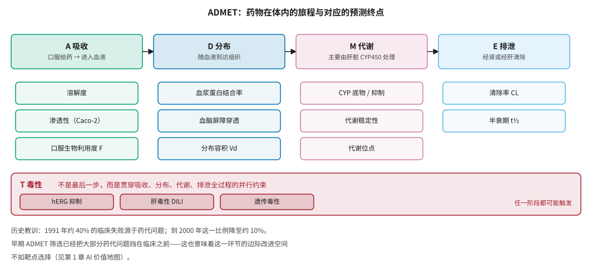
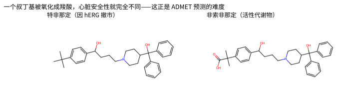
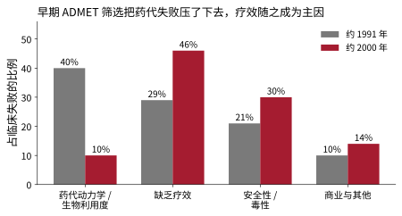
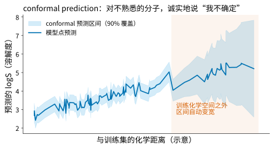
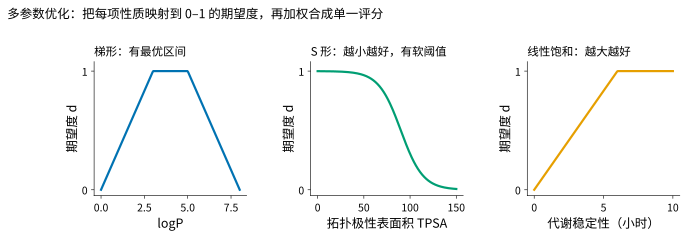

# ADMET 与成药性预测 {#sec-admet}

## 本章目的 {.unnumbered .unlisted}

::: {.purpose-question}
为什么 ADMET 预测的瓶颈不在算法，而在数据？
:::

一个分子能牢牢结合靶点，只是成药的第一步。它还得能被人体吸收、到达该去的地方、不被过快代谢掉、不产生毒性，最后安全排出。这些性质合称 ADMET。历史上，很多候选药物不是败在“没活性”，而是败在这些性质上——尤其在 1990 年代。AI 预测 ADMET 的意义，是在合成分子之前就把注定会出问题的分子筛掉。本章逐一解析关键终点、介绍预测方法、分析数据稀缺这一根本瓶颈，并重点讨论 **conformal prediction** 如何让预测真正服务于决策。

::: {.callout-note title="给非技术读者的摘要"}

ADMET 是吸收、分布、代谢、排泄、毒性五个英文词的首字母。药物不仅要“有效”，还要能进得去、待得住、排得出、不伤人。1990 年代，约四成临床失败源于这类问题；行业大规模采用早期筛选后，这一比例降到了约一成——这说明 ADMET 问题**基本可控**，也意味着 AI 在这里的边际改进空间不如靶点选择大。这一环节最大的困难是数据：许多指标的公开数据只有几百到几千条，不同实验室测出来的数值可能相差一个数量级，失败的实验又几乎不会被发表。**成熟度**：溶解度等简单性质预测较可靠；代谢、毒性等复杂终点仍然困难。

:::

::: {.callout-learning-objectives}

- 列举 ADMET 五类性质下的关键终点，并说明 hERG、DILI 等安全性关卡为何特别重要
- 用 Kola–Landis 数据解释“化学问题已部分解决、生物学问题成为主因”的历史转变
- 比较规则、QSAR、图神经网络、多任务学习和 PBPK 混合方法的适用场景
- 说明 ADMET 数据稀缺的四个具体表现及其对模型泛化的后果
- 解释 conformal prediction 如何提供分布无关的覆盖保证，以及它为何适合药物研发决策
- 用多参数优化（MPO）把多个 ADMET 终点合成为单一评分，并指出“类药规则”的适用边界

:::

## ADMET 是什么 {#sec-admet-what}

ADMET 由五类性质构成，它们共同决定药物的**药代动力学**（药物在体内随时间的浓度变化）和**安全性窗口**（有效剂量与中毒剂量之间的距离）（@fig-admet-map）。

::: {#fig-admet-map fig-cap="**ADMET 的五个环节与对应的预测终点**：吸收、分布、代谢、排泄依次构成药物在体内的旅程，每个环节下列出主要的可预测终点；毒性不是最后一步，而是贯穿全过程的并行约束。底部注明了早期 ADMET 筛选带来的历史性转变。" fig-alt="流程图，上排四个彩色方框依次为 A 吸收、D 分布、M 代谢、E 排泄，用箭头串联；每个方框下方列出该环节的预测终点；底部一条红色横条为 T 毒性，横跨四个阶段，内含 hERG 抑制、肝毒性、遗传毒性三个终点，说明毒性是并行约束而非最后一步。"}

{width="100%"}

:::

### 关键终点逐一解析 {#sec-admet-endpoints}

**吸收**相关的核心终点是**溶解度**（水溶性差的分子难以吸收，这是最常预测也相对可靠的性质）、**渗透性**（常用 Caco-2 细胞实验或 PAMPA 测定）和**口服生物利用度 F**（最终进入血液的口服剂量比例，受多因素影响，是最难预测的综合性质之一）。

**分布**相关的终点包括**血浆蛋白结合率**（只有游离药物才有活性）、**血脑屏障穿透**（中枢药物必需，外周药物则希望避免）和**分布容积 Vd**。

**代谢**是 ADMET 中机制最复杂的部分。细胞色素 P450（CYP450）家族负责大部分药物代谢，关心两个问题：药物被哪些 CYP 亚型代谢（影响代谢速度和个体差异），以及药物是否抑制或诱导 CYP（影响药物相互作用）。**代谢稳定性**常用肝微粒体或肝细胞实验测定，决定药物半衰期；**代谢位点预测**则指导化学家做“代谢封堵”修饰。

**排泄**相关的是**清除率 CL** 和**半衰期 t½**，后者决定给药频率。

**毒性**是最关键也最难的部分：

- **hERG 抑制**：hERG 是心脏中的一种钾离子通道，抑制它会导致 QT 间期延长，可能引发致命性心律失常 [@sanguinetti2006]。这是药物研发中最重要的安全性关卡之一。
- **肝毒性（DILI）**：药物性肝损伤是药物撤市的首要原因之一，机制复杂、难以预测。
- **遗传毒性/致突变性**：Ames 试验是标准测试，数据较多，预测相对可行。
- **心脏毒性、肾毒性、免疫毒性**，以及药物意外结合其他蛋白导致的**脱靶效应**。

::: {#ws-admet-terfenadine .callout-war-story title="特非那定：一个基团决定心脏安全性"}

**背景**：特非那定是 1980 年代广泛使用的抗组胺药。它本身是前药，口服后几乎全部被肝脏 CYP3A4 代谢为活性代谢物非索非那定，后者才是真正的抗组胺成分。

**问题**：特非那定原型分子是强效的 hERG 阻断剂。正常情况下它在肝脏被迅速清除、血药浓度极低，因此安全；但当患者同时服用 CYP3A4 抑制剂（如酮康唑、红霉素）或大量饮用西柚汁时，特非那定蓄积，引发 QT 间期延长和致命性室性心律失常 [@woosley1993]。1997 年该药撤市，取而代之的正是它的活性代谢物非索非那定（@fig-herg-example）。

**教训**：三点。第一，ADMET 的各个环节相互耦合——代谢（CYP3A4）、药物相互作用和心脏毒性（hERG）共同决定了结局，单看任何一项都不足以发现风险。第二，一个叔丁基被氧化成羧酸，分子的极性、分布和 hERG 结合能力就全然不同，这正是 @sec-representation 中“活性悬崖”问题在安全性上的体现。第三，这类风险在今天会被常规的 hERG 和 CYP 抑制筛选提前发现——这正是早期 ADMET 筛选的价值。

:::

::: {#fig-herg-example fig-cap="**特非那定与非索非那定**：两者只差一个基团（左侧的叔丁基被氧化为右侧的羧酸）。左侧分子是强效 hERG 阻断剂，在代谢受阻时可致命；右侧是它的活性代谢物，极性更高、不阻断 hERG，后来直接作为药物上市。图由 RDKit 生成。" fig-alt="两个并排的分子结构式，左侧为特非那定，右端为叔丁基；右侧为非索非那定，对应位置为羧酸基团。"}

{width="100%"}

:::

## 历史教训：化学问题已部分解决 {#sec-admet-history}

Prentis 等人 1988 年的分析显示，1964–1985 年间英国七家药企的候选药物中，约 40% 的临床失败源于药代动力学和生物利用度问题 [@prentis1988]。Kola 和 Landis 2004 年的更新显示，到 2000 年这一比例已降到约 10% [@kola2004]（@fig-attrition-shift）。

::: {#fig-attrition-shift fig-cap="**临床失败原因的历史转变**：约 1991 年，药代动力学与生物利用度问题占临床失败的约 40%；到约 2000 年降至约 10%，而缺乏疗效和安全性成为主因。数据来源：Prentis 等 1988 [@prentis1988]、Kola 与 Landis 2004 [@kola2004]；两组数据口径不完全一致，用于展示趋势而非精确比较。" fig-alt="分组柱状图，四组分别为药代动力学与生物利用度、缺乏疗效、安全性与毒性、商业与其他；1991 年灰色柱依次为 40%、29%、21%、10%，2000 年红色柱依次为 10%、46%、30%、14%。"}

{width="85%"}

:::

原因是行业大规模采用了早期 ADMET 筛选，把药代问题挡在了临床之前。这组数字揭示了两件事：

1. **ADMET 问题可以通过早期筛选大幅缓解**——这是一个被实践验证过的成功案例。
2. **正因为已经被管住，ADMET 预测的边际价值不如靶点选择**。这正是 @sec-economics 价值地图中 ADMET 被归为“中等价值”的原因（@fig-value-map）。

## 预测方法 {#sec-admet-methods}

### 从规则到深度学习 {#sec-admet-method-spectrum}

**规则**：Lipinski 五规则 [@lipinski2001]、Veber 规则（可旋转键数、极性表面积）等经验规则，用于快速过滤。

**QSAR**：针对单个终点，用分子描述符或指纹加传统机器学习（随机森林、梯度提升、SVM）建模。如 @dfn-representation-baseline 所述，这类方法至今仍是许多 ADMET 终点的强基线。

**图神经网络**：Chemprop 等在多个 ADMET 终点上表现良好 [@yang2019]。

**多任务学习**：同时预测多个相关终点。因为不同 ADMET 性质之间存在相关性，多任务学习可以在数据稀缺的终点上借用其他终点的信息。

**预训练 + 微调**：先在大规模无标签分子上预训练再微调，对小数据终点可能有帮助——但如 @pri-representation-data-bottleneck 所述，收益并不总是稳定。

### 机理模型与混合方法 {#sec-admet-pbpk}

**PBPK（基于生理的药代动力学）模型**用一组微分方程描述药物在各器官间的转运和代谢，参数有明确的生理意义，可以从体外数据和理化性质外推体内药代，是监管机构认可的工具 [@jones2015pbpk]。

**机器学习 + PBPK 混合**：用机器学习预测 PBPK 所需的输入参数（如渗透性、代谢清除率），再用 PBPK 模型外推体内行为。这种混合方法结合了数据驱动的灵活性和机理约束的可解释性，在监管沟通中也更容易被接受（@sec-reg-west）。

### 数据资源 {#sec-admet-data-resources}

**Therapeutics Data Commons（TDC）**是目前最常用的 ADMET 机器学习基准平台，包含几十个相关任务并提供统一的数据划分和评测 [@huang2021tdc]；**MoleculeNet** 是较早的分子机器学习基准 [@wu2018moleculenet]；ChEMBL、PubChem 等大规模数据库也含有部分 ADMET 数据。

近年出现了专门针对数据瓶颈的协作项目。**OpenADMET** 通过系统性实验产生并公开高质量 ADMET 数据，据其公开更新，项目已产生约 15 万条测量、覆盖三万余个化合物，并把某些靶点的公开共晶结构数据扩充到原来的约三倍；它还组织盲测挑战，每次吸引三百多个团队参加 [@openadmet2026]。这类“产生数据而非只建模型”的项目，正是针对下节讨论的瓶颈。

## 数据稀缺：根本瓶颈 {#sec-admet-data-bottleneck}

::: {#pri-admet-data .callout-principle title="ADMET 的瓶颈是数据而非算法"}

**判断**：在大多数 ADMET 终点上，换用更复杂的模型带来的提升，远小于增加高质量、标准化数据带来的提升。

**含义**：评估一个 ADMET 建模项目时，首先问数据而非模型：有多少样本？来自几个实验室？实验条件是否统一？是否包含阴性和失败数据？覆盖了多大的化学空间？这些问题的答案，比模型架构更能预测项目的成败。

:::

与图像、文本相比，ADMET 数据有四个根本困难：

1. **数据量小**：许多终点的公开数据只有几百到几千个样本；即使是大药企，单个终点的高质量数据也往往只有几万个。
2. **实验噪声大**：同一分子在不同实验室、不同条件下测得的数值可能相差很大。溶解度测量的实验室间差异可达半个到一个数量级——这意味着模型的误差下限已经被实验噪声锁定。
3. **数据分布有偏**：公开数据往往集中在少数化学系列上，覆盖的化学空间有限。
4. **缺乏阴性和失败数据**：发表偏差使得“失败”的数据很少公开，而这些数据对训练可靠模型同样重要。这正是 @sec-players-xtalpi 中晶泰科技强调其实验记录中约 80% 为阴性样本的价值所在。

后果是三重的：**分布外泛化差**（模型在训练化学空间内表现尚可，遇到新颖骨架就不可靠，而药物研发恰恰需要探索新颖骨架）；**天花板由数据决定**；**评测乐观偏差**（如果测试集与训练集化学相似，评测指标会系统性偏高，见 @sec-evaluation）。

应对方向包括：数据标准化与整合（建立统一实验标准，显式建模实验室间差异）；**主动学习**（用模型指导“下一个该测哪个分子”，在有限预算下最大化信息增益）；迁移学习与多任务；以及自动化实验室的数据闭环（@sec-synthesis）。

## 不确定性与 conformal prediction {#sec-admet-conformal}

### 为什么不确定性至关重要 {#sec-admet-why-uncertainty}

ADMET 预测用于决策：“这个分子该不该合成？”“这批分子里哪些值得测 hERG？”一个没有不确定性估计的点预测在决策中是危险的：模型对一个分布外分子可能给出一个看似合理、实则毫无根据的数值。

### conformal prediction {#sec-admet-cp-method}

::: {#dfn-admet-conformal .callout-definition title="conformal prediction"}

***conformal prediction***\index{conformal prediction}（保形预测）是一种为任意模型提供**有限样本、分布无关的覆盖保证**的框架 [@vovk2005]。它不输出单个数值，而是输出一个预测区间（回归）或预测集合（分类），并保证在给定置信水平下真实值落在其中的概率不低于设定值。

1.  **意义**：它把“模型有多确定”变成了一个有数学保证的量。对分布外分子，区间会自动变宽，等于诚实地说“我不确定”。
2.  **区别**：与贝叶斯方法不同，它不需要对模型或数据分布做假设；与深度集成、MC dropout 等启发式方法不同，它的覆盖率有理论保证。
3.  **常见误区**：以为覆盖保证是“条件”的。标准 conformal prediction 只保证**边际**覆盖率（在整个测试分布上平均成立），不保证对每个子群体都成立。Mondrian conformal prediction 等变体可以在不同化学类别上分别保证覆盖率。

:::

其基本做法是：在一个**校准集**上计算模型的预测误差（不符合度分数）$\alpha_i = |y_i - \hat{y}_i|$；取这些误差的 $\lceil (n+1)(1-\varepsilon) \rceil$ 分位数 $q$；对新样本输出区间 $[\hat{y} - q, \hat{y} + q]$。只要数据满足可交换性假设，就能保证：

$$
\mathbb{P}\left(y_{\text{new}} \in \hat{C}(x_{\text{new}})\right) \geq 1 - \varepsilon
$$ {#eq-conformal}

用一个随输入变化的尺度因子对误差做归一化，就能得到宽度自适应的区间（@fig-conformal）。

::: {#fig-conformal fig-cap="**conformal prediction 在 ADMET 预测中的行为（示意）**：横轴为分子与训练集的化学距离，纵轴为预测的溶解度。阴影为 90% 覆盖的预测区间：在训练化学空间内区间较窄，越往分布外区间越宽，等于明确告诉使用者“这个预测不可信”。曲线为示意数据，用于说明机制。" fig-alt="折线图，蓝色曲线为模型点预测，浅蓝色阴影带为预测区间；左侧区间窄，右侧橙色阴影区域内区间显著变宽，标注训练化学空间之外区间自动变宽。"}

{width="85%"}

:::

### 三类实际价值 {#sec-admet-cp-value}

1. **诚实的不确定性**：对分布外分子自动放宽区间，避免被虚高的点预测误导 [@alvarsson2021]。
2. **风险可控的筛选**：可以设定“只要那些有把握满足某性质的分子”，从而控制假阳性率——这在资源有限的实验安排中直接转化为成本节省。
3. **与主动学习结合**：预测区间宽的分子，正是最值得去实验测量的分子。

这也是对 @sec-generative 中奖励作弊问题的一个直接应对：用校准良好的不确定性惩罚生成模型的奖励，可以阻止它跑到代理模型的盲区。

::: {.callout-checkpoint title="ADMET 与不确定性"}

- [ ] 你能解释特非那定的例子中，代谢、药物相互作用和心脏毒性三者是如何耦合的吗？
- [ ] 给定一个 800 样本、来自三个实验室的渗透性数据集，你会优先做哪三件事？
- [ ] conformal prediction 保证的是边际覆盖率，这在实践中可能带来什么问题？

:::

## 成药性的综合判断 {#sec-admet-druglikeness}

### 多参数优化 {#sec-admet-mpo}

实际项目中不会孤立地看单个性质，而是把多个性质综合成一个**成药性评分**。常见做法是**多参数优化（MPO）**：对每个性质定义一个“期望度函数”，把实际值映射到 0–1，再加权合成（@fig-mpo）。这与 @eq-mpo-reward 中生成模型的奖励函数是同一套机制。

::: {#fig-mpo fig-cap="**多参数优化中的三种期望度函数**：梯形（有最优区间，如 logP）、S 形（越小越好并有软阈值，如 TPSA）、线性饱和（越大越好，如代谢稳定性）。把每项性质映射到 0–1 后再加权合成单一评分，便于排序和与化学家沟通。" fig-alt="三个并排折线图，左为梯形曲线对应 logP，中为 S 形下降曲线对应拓扑极性表面积，右为线性上升后饱和的曲线对应代谢稳定性，纵轴均为期望度 d。"}

{width="100%"}

:::

辉瑞提出的 **CNS MPO** 评分是一个著名例子，它综合 logP、logD、分子量、极性表面积、氢键供体数、碱性六个参数，用于评估中枢神经系统药物的成药性 [@wager2016]。MPO 的优点是直观、可解释、便于与化学家沟通；缺点是权重和期望度函数的设定带有主观性，而且简单加权可能掩盖某一维度的致命缺陷——这正是 @sec-generative 中建议用几何平均替代算术平均的原因。

### “类药性”的适用边界 {#sec-admet-ro5}

Lipinski 五规则影响深远，但也常被误用。它们是**统计规律**而非硬性门槛，许多成功药物违反其中一条或多条；对于天然产物衍生物、大环化合物、PROTAC 等“超越 Rule of 5”（bRo5）的分子，传统规则并不适用 [@doak2014]；过度依赖这些规则，可能过早排除有价值的分子。因此成药性判断应该是灵活的、依赖于具体药物类别和给药途径的。

## 新模态的 ADMET 挑战 {#sec-admet-modalities}

本章主要讨论小分子。对新兴药物模态，ADMET 的内涵和挑战都不同（@tbl-modality-admet）。

| 模态 | 主要 ADMET 挑战 | 现状 |
|:---|:---|:---|
| PROTAC、分子胶 | 分子大、超越 Rule of 5，渗透性和口服吸收 | 传统模型往往不适用 |
| 多肽 | 易被蛋白酶降解、半衰期短、口服生物利用度低 | 需要专门的稳定性与渗透性预测 |
| 寡核苷酸（siRNA、ASO） | 药代由化学修饰和递送系统决定 | 与小分子完全不同的建模框架 |
| 抗体 | FcRn 循环、靶点介导清除；免疫原性是关键安全性问题 | 见 @sec-biologics |

: 新模态的 ADMET 挑战 {#tbl-modality-admet}

这些模态的数据比小分子更稀缺，AI 预测也更不成熟。随着晶泰科技等公司布局多肽、siRNA 等多模态管线（@sec-players-xtalpi），这些方向的 ADMET 建模需求正在上升。

## 谬误与陷阱 {#sec-admet-fallacies}

::: {.fallacy-pitfall}

**谬误**：*ADMET 预测准确率高，所以可以替代实验。*

多数 ADMET 模型的误差下限已被实验噪声锁定（溶解度的实验室间差异可达一个数量级）。模型的作用是**排序和分流**——决定先测哪些分子——而不是替代测量。

:::

::: {.fallacy-pitfall}

**谬误**：*违反 Lipinski 五规则的分子不值得做。*

五规则是统计规律而非门槛。PROTAC、大环肽等 bRo5 分子有自己的成药空间，机械套用规则会过早排除有价值的方向。

:::

::: {.fallacy-pitfall}

**陷阱**：*用点预测做“去/留”决策。*

没有不确定性的点预测在分布外分子上可能完全失真。至少应提供校准的区间或置信集合，并对高不确定性分子优先安排实验（@dfn-admet-conformal）。

:::

::: {.fallacy-pitfall}

**陷阱**：*忽视终点之间的耦合。*

特非那定的教训是，代谢、药物相互作用和心脏毒性共同决定结局。孤立优化单个终点可能在另一个终点上制造问题；MPO 的几何平均结构正是为了避免这一点。

:::

## 小结 {#sec-admet-summary}

ADMET 预测是药物研发的“守门员”，价值在于尽早淘汰注定失败的分子。历史证明，早期 ADMET 筛选能有效降低药代相关的临床失败——这也意味着这一环节已经相对成熟，边际改进空间不如靶点选择。它最大的瓶颈不是算法，而是数据：量小、噪声大、分布有偏、缺乏失败样本。不确定性量化，尤其是 conformal prediction，正成为让 ADMET 预测真正服务于决策的关键工具。

::: {.callout-takeaways title="算法之外，先看数据"}

* **五类性质，多个耦合终点**：hERG 和 DILI 是最关键的安全性关卡；特非那定说明代谢、相互作用与毒性相互耦合。
* **历史转变已经发生**：药代导致的临床失败从约 40% 降到约 10%，ADMET 是一个被验证过的成功案例，也因此边际价值有限。
* **瓶颈在数据**：样本少、噪声大、分布有偏、缺阴性数据；增加高质量数据的收益通常大于换模型。
* **conformal prediction 提供诚实的不确定性**：分布无关的覆盖保证、对分布外分子自动放宽区间、天然适配主动学习。
* **MPO 要用几何结构**：期望度函数加几何平均，避免用长处掩盖致命短板。
* **类药规则有边界**：bRo5 分子有自己的成药空间，规则是统计规律而非门槛。

:::

::: {.callout-chapter-connection title="从预测到合成"}

设计出一个性质优良的分子之后，还得真正把它做出来。@sec-synthesis 讨论逆合成规划与自动化实验室——以及为什么“设计–合成–测试–学习”闭环的速度和数据质量，才是 AI 制药公司真正的护城河。

:::
