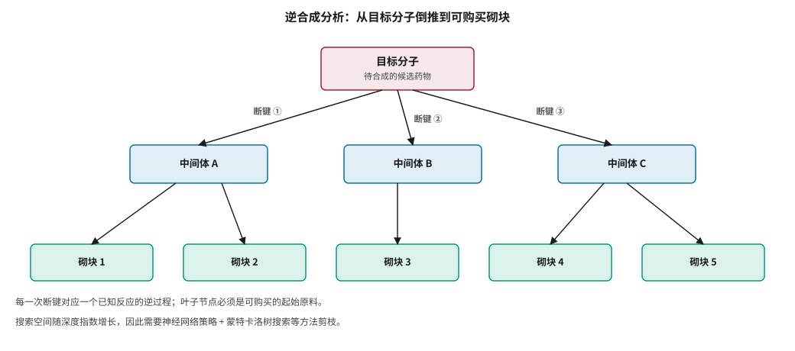
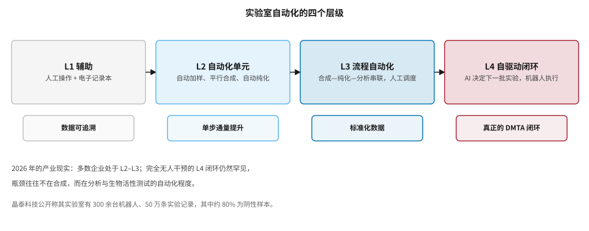
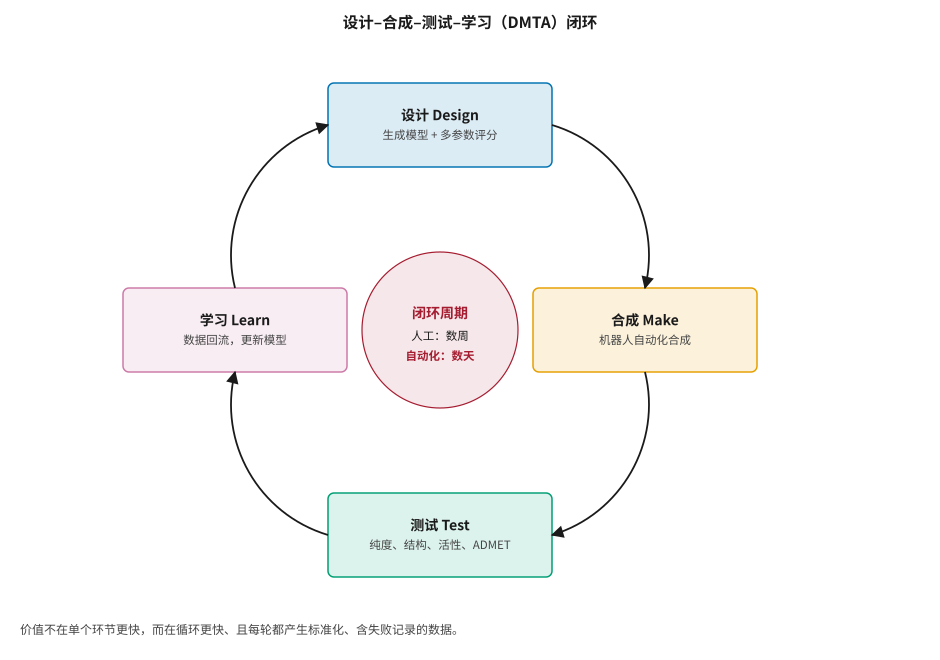
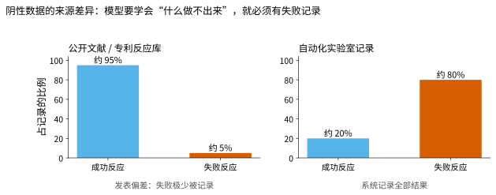

# 合成规划与自动化实验室 {#sec-synthesis}

## 本章目的 {.unnumbered .unlisted}

::: {.purpose-question}
为什么“闭环转得多快”比“模型有多聪明”更能决定一家 AI 制药公司的命运？
:::

设计出一个分子，还得真正把它做出来。合成一个复杂分子像从简单零件一步步拼装，每一步都是一个化学反应，顺序和条件都有讲究。AI 可以帮化学家规划这条拼装路线，这叫逆合成分析；更进一步，把 AI 规划、机器人操作和自动分析连成流水线，就得到“自动化实验室”。本章讨论逆合成的两个子问题与现有方法的真实局限，分析反应数据中的发表偏差，介绍实验室自动化的四个层级，并论证本书反复出现的一个判断：**自动化实验室真正的价值不是省人力，而是产生别人没有的数据——尤其是失败数据**。

::: {.callout-note title="给非技术读者的摘要"}

逆合成就是从目标分子倒着推：这个分子可以由哪两个更简单的分子反应得到？这两个又分别从哪来？一直推到能直接买到的原料为止。AI 在这件事上已经是实用的助手，但它给出的建议常常缺少关键信息——用什么催化剂、什么温度、能做出多少——因为这些数据很少被公开发表。自动化实验室把“设计—合成—测试—学习”连成一个循环，让机器人自己做实验。它最大的价值不是省人力，而是会**老老实实记录失败**：公开文献里几乎只有成功的反应，而模型要学会判断“什么做不出来”，恰恰需要失败的记录。**成熟度**：逆合成工具已实用但需专家把关；完全无人干预的闭环仍然罕见。

:::

::: {.callout-learning-objectives}

- 区分逆合成的两个子问题（单步预测与多步路线搜索），并说明三类单步方法的取舍
- 解释蒙特卡洛树搜索如何与神经网络策略结合，用于多步路线规划
- 列出逆合成 AI 的五类局限，重点说明反应条件与产率预测为何特别困难
- 分析反应数据中发表偏差的来源与后果，并说明高通量实验数据为何也不能完全解决问题
- 描述实验室自动化的四个层级，判断一家企业处于哪一级
- 论证自动化实验室的核心价值在于产生标准化、含阴性样本的专有数据

:::

## 逆合成分析 {#sec-synthesis-retro}

### 基本思想 {#sec-synthesis-retro-idea}

逆合成分析由 E. J. Corey 在 1960 年代系统化，他因此获得 1990 年诺贝尔化学奖 [@corey1991]。其思想是**从目标分子倒推**：把目标分子在某个化学键处“切断”，得到更简单的前体分子，再对前体继续切断，直到所有前体都是可购买的起始原料（@fig-retro-tree）。

::: {#fig-retro-tree fig-cap="**逆合成分析的树状结构**：根节点是目标分子，每一次“断键”对应一个已知反应的逆过程，叶子节点必须是可购买的砌块。搜索空间随深度指数增长，因此需要神经网络策略与树搜索方法剪枝。" fig-alt="树状图，顶部红色方框为目标分子，向下分出三个蓝色中间体方框，再向下分出五个绿色砌块方框，连线标注断键。"}

{width="100%"}

:::

这一过程可以拆成两个子问题：**单步逆合成**（给定一个分子，预测它可以由哪些反应、哪些前体一步合成得到）和**多步路线搜索**（把单步预测组合起来，搜索从目标分子到可购买砌块的完整路线）。

### 单步逆合成的三类方法 {#sec-synthesis-single-step}

| 方法 | 原理 | 优势 | 局限 |
|:---|:---|:---|:---|
| 基于模板 | 从反应数据库提取“反应模板”（描述键如何变化的规则），把逆合成看作模板选择问题 | 产物化学合理，可解释 | 无法超出已知模板 |
| 无模板（序列到序列） | 把逆合成当作翻译任务：“产物 SMILES → 反应物 SMILES” | 灵活，可发现新颖断键方式 | 可能生成无效或不合理的反应 |
| 半模板 | 先预测反应中心，再生成前体 | 兼顾两者优点 | 实现较复杂 |

: 单步逆合成的三类方法 {#tbl-retro-methods}

训练数据主要来自 USPTO 反应数据集（从美国专利中提取的数百万条反应）和商业数据库（Reaxys、CAS）。

### 多步路线搜索 {#sec-synthesis-multistep}

多步搜索是一个树搜索问题，搜索空间巨大。Segler 等人 2018 年在《自然》上的工作是里程碑：把**蒙特卡洛树搜索**（MCTS）与三个神经网络结合——一个策略网络提议可能的断键方式，一个网络过滤化学上不合理的反应，一个价值网络估计中间体的“可合成程度”——使合成规划的速度比传统方法快约 30 倍，且化学家在双盲评估中无法区分 AI 规划的路线与文献路线 [@segler2018]。

阿斯利康开源的 **AiZynthFinder** 是工业界使用最广的逆合成工具之一，基于模板和树搜索 [@genheden2020]。商业系统如 Synthia（原 Chematica）凝聚了专家编码的规则和算法，在复杂天然产物的全合成路线设计上有令人印象深刻的表现 [@szymkuc2016]。

## 逆合成 AI 的五类局限 {#sec-synthesis-limits}

1. **反应条件缺失**：模型预测了“用什么反应、什么前体”，但往往不包括催化剂、配体、碱、溶剂、温度、时间——而这些对反应能否成功至关重要。
2. **选择性问题**：当分子有多个反应位点时，模型难以准确预测区域选择性和立体选择性。
3. **数据的发表偏差**：训练数据来自已发表反应，成功的、常用的反应多，失败的、罕见的反应少。模型因此倾向于预测“流行”反应。
4. **缺乏负样本**：几乎没有“这个反应不会成功”的数据，模型难以学会判断反应是否可行。
5. **产率预测不准**：预测反应产率是一个独立的难题，现有模型可靠性有限。

因此，逆合成 AI 目前主要作为化学家的**建议工具**：它提供候选路线，化学家凭经验判断和选择。它尚不能独立规划出可靠的合成路线。

### 反应预测与条件推荐 {#sec-synthesis-forward}

逆合成的“正向”对应问题同样重要。**正向反应预测**（给定反应物和条件预测产物）可用于验证逆合成路线的每一步是否真的会得到期望产物；Molecular Transformer 把反应预测表述为序列到序列翻译，并能给出校准的不确定性 [@schwaller2019]。**反应条件推荐**是实际合成中最需要经验的部分，也是 AI 数据最稀缺的部分。**产率预测**则依赖高通量实验数据。

::: {#ws-synthesis-buchwald .callout-war-story title="高通量数据也会骗人：C–N 偶联产率预测之争（2018）"}

**背景**：2018 年，Ahneman 等人在《科学》上报告，用高通量实验产生的 Buchwald–Hartwig C–N 偶联数据集（数千个反应）训练随机森林模型，能较好地预测反应产率，并外推到新的底物 [@ahneman2018]。这被视为机器学习进入反应优化的标志性工作。

**质疑**：同年，Chuang 和 Keiser 在《科学》上发表评论指出：当用**随机特征**（与化学无关的随机数）替代真实的化学描述符时，模型的表现几乎同样好 [@chuang2018]。这说明模型的预测能力很大程度上来自数据集的结构——反应被组织成规整的网格，模型只需学会“这一行/这一列的反应大致是什么水平”，而非真正理解化学。

**教训**：这是 @sec-evaluation 将系统讨论的评测失真问题在合成领域的典型案例。它给出两条可操作的建议：第一，任何声称“模型学到了化学”的工作，都应该做**随机特征对照**；第二，高通量实验数据虽然干净，但其设计（固定的底物网格）本身会引入可被模型利用的捷径。干净的数据不等于无偏的数据。

:::

## 自动化实验室 {#sec-synthesis-automation}

### 四个层级 {#sec-synthesis-levels}

::: {#fig-automation-levels fig-cap="**实验室自动化的四个层级**：从人工操作加电子记录本（L1），到自动化单元（L2）、流程自动化（L3），再到由 AI 决定下一批实验的自驱动闭环（L4）。每一级的核心产出标注在下方。2026 年的产业现实是多数企业处于 L2–L3。" fig-alt="四个横向方框依次为 L1 辅助、L2 自动化单元、L3 流程自动化、L4 自驱动闭环，用箭头连接，每个方框下方有一个标注核心产出的小方框。"}

{width="100%"}

:::

学术界已经展示了 L4 的可行性：Burger 等人 2020 年在《自然》上报告了一个“移动机器人化学家”，在八天内自主完成了 688 次实验，用贝叶斯优化寻找光催化产氢的最优配方 [@burger2020]；Coley 等人 2019 年把 AI 合成规划与流动化学机器人平台连接，实现了从路线规划到自动合成的端到端流程 [@coley2019robotic]；A-Lab 则在无机材料合成中展示了类似的闭环 [@szymanski2023]。这些工作被系统综述为“自驱动实验室”方向 [@tom2024]。

### DMTA 闭环 {#sec-synthesis-dmta}

自动化实验室的核心是把**设计–合成–测试–学习**（Design–Make–Test–Analyze，DMTA）连成闭环（@fig-dmta）。

::: {#fig-dmta fig-cap="**DMTA 闭环**：生成模型设计分子，机器人合成，自动化系统测试纯度、结构、活性与 ADMET，数据回流更新模型。人工流程的一轮循环通常需要数周，自动化可缩短到数天。价值不在单个环节更快，而在循环更快且每轮产生标准化、含失败记录的数据。" fig-alt="环形图，四个方框设计 Design、合成 Make、测试 Test、学习 Learn 按顺时针排列并由弧形箭头连接，中心圆圈标注闭环周期人工数周、自动化数天。"}

{width="85%"}

:::

### 为什么闭环的价值主要在数据 {#sec-synthesis-why-data}

::: {#pri-synthesis-negative-data .callout-principle title="阴性数据是自动化实验室最被低估的产出"}

**判断**：自动化实验室的首要价值不是降低人力成本，而是**系统性地产生标准化、含失败记录的专有数据**——这类数据在公开文献中几乎不存在，却是训练可靠模型的必需品。

**含义**：评估一家公司的自动化实验室投入时，应问：它产生的数据是否标准化（同一条件下可比）？是否记录失败？是否回流到模型？只做“机器人替代人手”而不改变数据结构的自动化，经济价值有限。

:::

@fig-negative-data 说明了问题的根源。

::: {#fig-negative-data fig-cap="**阴性数据的来源差异**：公开文献与专利中记录的几乎都是成功反应，失败极少被发表；自动化实验室则会系统记录全部结果，包括失败。模型若要学会判断“什么做不出来”，就必须有失败记录。两侧比例为示意，用于说明结构性差异。" fig-alt="两个并排柱状图，左侧公开文献约 95% 成功、5% 失败；右侧自动化实验室记录约 20% 成功、80% 失败。"}

{width="90%"}

:::

这正是 @sec-players-xtalpi 中晶泰科技强调“50 万条实验记录中约 80% 为阴性样本”的原因，也解释了为什么 @pri-players-moat 把专有数据和闭环速度列为基础模型商品化之后的主要差异化来源。

### 真实的挑战 {#sec-synthesis-challenges}

1. **合成的通用性**：机器人擅长执行标准化、模块化的反应，但复杂分子的合成常需要非标准操作，难以完全自动化。
2. **分析是真正的瓶颈**：合成可以自动化，但活性测试和 ADMET 测试的自动化程度参差不齐，往往成为闭环的卡点。
3. **重资产**：建设和维护投入巨大。如 @sec-players-xtalpi 所述，这使晶泰科技从“轻资产软件公司”变成“软硬件兼修的基础设施供应商”，改变了其商业模式和估值逻辑。
4. **自主程度有限**：真正“无人干预”的闭环发现仍然罕见，大多数系统仍需化学家在关键节点介入。

::: {.callout-checkpoint title="闭环与数据"}

- [ ] 你能解释为什么逆合成模型给出的路线常常缺少反应条件吗？
- [ ] 面对一个声称“机器学习准确预测反应产率”的工作，你会要求看哪一项对照实验？
- [ ] 一家公司宣称建成了“AI 自动化实验室”，你会用哪三个问题判断它处于 L2 还是 L4？

:::

## 合成感知生成：把设计和合成统一 {#sec-synthesis-aware}

@sec-generative-synthesis-aware 提到，一个重要方向是让生成模型从源头只产生可合成的分子。这实际上把分子生成和合成规划**统一**起来：生成模型不直接输出分子结构，而是输出一条合成路线（从可购买砌块出发的反应序列），产物天然可合成；如果这条路线直接对应机器人可执行的操作，就能实现“AI 设计 → 自动合成”的无缝衔接。

这种统一是自动化药物发现的理想形态：模型设计的每一个分子都能被立即合成和测试，结果立即反馈。虽然离完全实现还有距离，但它指明了方向，也解释了为什么基于反应的生成在工业界受到越来越多关注。

## CMC 与工艺放大 {#sec-synthesis-cmc}

药物研发还有一个常被忽视但极其重要的环节：**CMC**（化学、生产与控制），即如何把实验室里几毫克的合成放大到公斤乃至吨级的稳定生产。AI 在 CMC 中的应用包括：用贝叶斯优化和实验设计优化反应条件，提高产率和纯度；**晶型预测**（预测药物分子的固态晶型，直接影响溶解度、稳定性和可生产性——晶泰科技正是以此起家）；以及 AI 辅助的过程分析技术用于连续制造的实时监控。

CMC 虽然不像靶点发现或分子设计那样引人注目，但它是药物能否真正量产上市的关键。@ws-china-cmc 中那笔因 CMC 数据不足而被重构的交易，说明了它的商业分量。它也是一个数据相对规整、AI 价值明确的领域。

## 谬误与陷阱 {#sec-synthesis-fallacies}

::: {.fallacy-pitfall}

**谬误**：*逆合成 AI 已经可以独立规划合成路线。*

现有工具能给出合理的断键建议，但普遍缺少反应条件、选择性判断和产率预测。它们是化学家的建议工具，路线的可行性仍需专家判断和实验验证。

:::

::: {.fallacy-pitfall}

**谬误**：*自动化实验室的价值是替代化学家、降低人力成本。*

人力成本只占研发成本的一小部分。真正的价值在于产生标准化、含阴性样本的专有数据，并缩短 DMTA 循环周期（@pri-synthesis-negative-data）。

:::

::: {.fallacy-pitfall}

**陷阱**：*用高通量实验数据训练模型却不做随机特征对照。*

Buchwald–Hartwig 的案例表明，规整的实验设计本身会引入可被模型利用的捷径。随机特征对照是成本极低、信息量极高的健全性检查（@ws-synthesis-buchwald）。

:::

::: {.fallacy-pitfall}

**陷阱**：*只自动化合成，不自动化测试。*

分析与活性测试常常是闭环的真正瓶颈。合成速度提高十倍而测试仍需数周，整个循环的周期不会明显缩短。

:::

## 小结 {#sec-synthesis-summary}

合成规划把“计算机里的分子”变成“瓶子里的分子”。逆合成 AI 已经是实用的建议工具，但受限于数据偏差、条件预测和负样本缺失，尚不能独立完成可靠的路线规划。自动化实验室把设计、合成、测试、学习连成闭环，其真正价值在于产生高质量、标准化、包含失败案例的数据，从而让模型持续改进——这正是基础模型能力商品化之后，AI 制药公司最主要的差异化来源。

::: {.callout-takeaways title="闭环比模型重要"}

* **逆合成分两步**：单步预测（模板、无模板、半模板）与多步搜索（神经网络策略 + 蒙特卡洛树搜索）。
* **五类局限**：缺反应条件、选择性难、发表偏差、缺负样本、产率预测不准。
* **干净数据不等于无偏数据**：高通量实验的规整网格设计可被模型利用，随机特征对照是必要的健全性检查。
* **自动化分四级**：多数企业处于 L2–L3，L4 自驱动闭环仍罕见；瓶颈常在分析而非合成。
* **阴性数据是核心产出**：公开文献几乎只有成功反应，而模型需要失败记录才能学会判断可行性。
* **CMC 不容忽视**：晶型预测与工艺放大直接决定药物能否量产，也直接影响对外授权交易的价值。

:::

::: {.callout-chapter-connection title="从小分子到生物药"}

到此为止，第二篇讨论的都是小分子。但全球处方药销售额中生物药已接近一半，在研管线中新模态的比例还在上升。@sec-biologics 转向蛋白、抗体、多肽与核酸的 AI 设计——这是 AI “设计能力”最接近实用的领域，也是瓶颈转移得最快的领域。

:::
