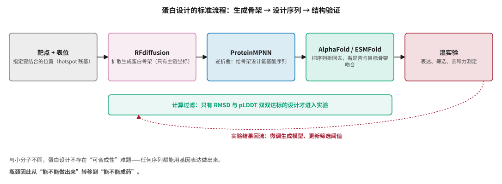
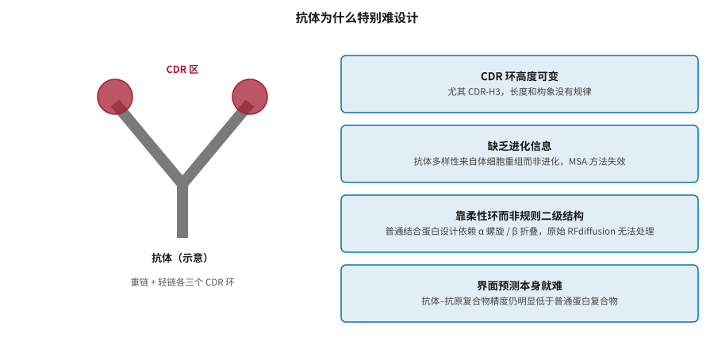
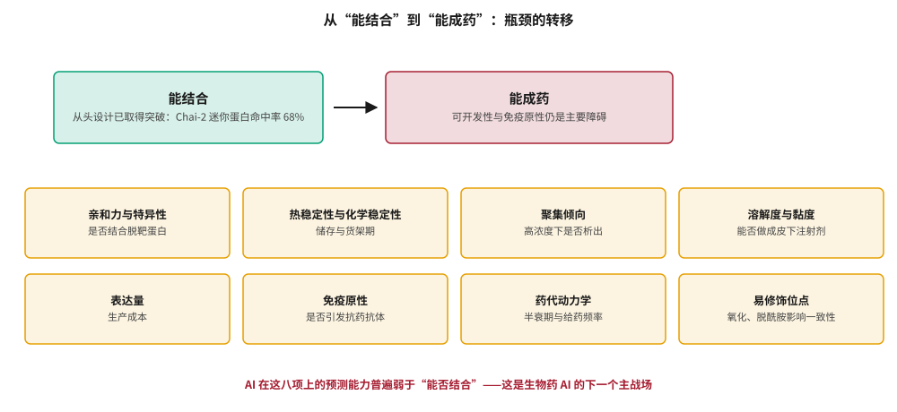
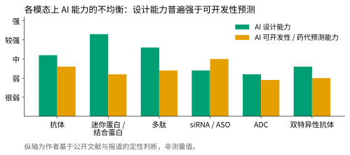

# 生物药设计：蛋白、抗体、多肽与核酸 {#sec-biologics}

## 本章目的 {.unnumbered .unlisted}

::: {.purpose-question}
蛋白设计是 AI 最接近“真正设计”的领域——那为什么设计出来的蛋白还是很难成为药物？
:::

前七章讨论的都是小分子。但全球处方药销售额中生物药已接近一半，在研管线中新模态的比例还在上升。生物药在几个方面比小分子更“适合”AI：数据多、质量高，设计空间离散且明确，生成的序列一定能用基因表达做出来，而且有 AlphaFold 这样强大的“验证器”。2025–2026 年，从头设计抗体这件曾被认为极难的事取得了多项实验验证的突破。本章介绍蛋白设计的标准流程、抗体设计的特殊困难与最新进展，然后论证本章的核心判断：**从头设计把“获得结合物”变容易了，却把瓶颈转移到了可开发性和免疫原性上**。

::: {.callout-note title="给非技术读者的摘要"}

生物药是指抗体、蛋白、多肽、核酸这类大分子药物，靠注射给药、由生物系统生产。AI 在这里进展特别快，原因有三：蛋白质的公开数据又多又好；设计出的序列一定能做出来（用基因表达即可，不像小分子还要愁怎么合成）；而且有 AlphaFold 可以当“验卷老师”。现在给定一个靶点和要结合的位置，AI 已经能从零设计出能结合的蛋白，命中率相当可观。但“能结合”离“能当药”还很远——药物还要稳定、不聚集、能高浓度配制、不引发免疫反应、半衰期合适。这些性质的 AI 预测能力，明显弱于“能否结合”。**成熟度**：蛋白结构预测与结合蛋白设计相对成熟；从头抗体设计刚突破；可开发性预测仍是瓶颈。

:::

::: {.callout-learning-objectives}

- 说明生物药为什么比小分子更适合 AI 设计的四个原因
- 描述“RFdiffusion → ProteinMPNN → 结构验证”流程中每一步的作用与输出
- 解释抗体设计的四类特殊困难，以及 2025–2026 年的突破如何逐一应对
- 正确解读“命中率 68%”这类指标的含义与边界
- 列举抗体可开发性的八项性质，说明为何它们构成新的瓶颈
- 比较抗体、多肽、寡核苷酸、ADC 等模态在 AI 设计与可开发性预测上的能力差异

:::

## 为什么生物药适合 AI {#sec-biologics-why}

1. **数据丰富且高质量**：PDB 有超过 20 万个结构，UniProt 有数亿条序列。相比之下，小分子的高质量活性和 ADMET 数据要稀缺得多（@pri-admet-data）。
2. **设计空间离散且明确**：蛋白由 20 种氨基酸组成，设计就是在序列空间里选择。生成的任何序列都对应一个可以用基因编码、用细胞表达的真实蛋白——**不存在小分子那样的可合成性难题**（@sec-generative-synthesizability）。
3. **结构可预测**：AlphaFold 等模型能可靠预测蛋白结构，为设计提供了强大的内置“验证器”（@sec-structure）。
4. **进化信息可用**：海量天然序列蕴含着关于什么序列能稳定折叠的丰富信息（@sec-representation-plm）。

这四点共同解释了为什么蛋白设计成为 AI 制药中进展最快的方向。

## 蛋白设计的标准流程 {#sec-biologics-pipeline}

当前蛋白设计的主流流程由三个工具组成，形成“生成–设计–验证”的链条（@fig-protein-design-pipeline）。

::: {#fig-protein-design-pipeline fig-cap="**蛋白设计的标准流程**：给定靶点与表位，RFdiffusion 扩散生成蛋白骨架，ProteinMPNN 为骨架设计氨基酸序列，再用 AlphaFold 或 ESMFold 把序列折回去检验是否与目标骨架吻合；只有计算过滤达标的设计才进入湿实验，实验结果再回流用于改进模型。" fig-alt="五个横向方框依次为靶点加表位、RFdiffusion、ProteinMPNN、AlphaFold ESMFold、湿实验，用箭头连接；下方一条绿色横条说明计算过滤，再下方一条红色虚线弧表示实验结果回流。"}

{width="100%"}

:::

**RFdiffusion** 是在 RoseTTAFold 结构预测网络基础上微调的扩散模型，从随机噪声出发逐步去噪，生成蛋白质的三维**骨架**（主链坐标）[@watson2023]。它可以在多种约束下工作：无条件生成全新折叠；给定靶点结构和希望结合的表位（hotspot 残基）生成结合蛋白骨架；给定一个功能基序生成围绕它的支架；生成具有特定对称性的寡聚体。

**ProteinMPNN** 解决“逆折叠”问题：给定骨架结构，设计能折叠成该结构的氨基酸序列 [@dauparas2022]。它是一个消息传递图网络（@eq-mpnn 的结构化版本），在 PDB 结构上训练，速度快、成功率高，已成为事实标准。

**结构预测作为验证器**：把设计的序列输入 AlphaFold2 或 ESMFold，看预测结构是否与目标骨架吻合（看 RMSD 和 pLDDT）。这一步作为**计算过滤器**，在实验验证之前筛掉大部分不合格的设计。

这个流程在设计结合蛋白、迷你蛋白、酶等方面已有大量实验验证的成功案例。David Baker 实验室和由其成员创立的 Xaira 等公司是主要推动者（@sec-players-biologics）。

::: {#dfn-biologics-inverse-folding .callout-definition title="逆折叠"}

***逆折叠***\index{逆折叠}（inverse folding）指给定一个目标三维骨架结构，设计出能稳定折叠成该结构的氨基酸序列。它是结构预测的逆问题。

1.  **意义**：它把“设计一个蛋白”拆解为两个可独立攻克的子问题——先决定形状（RFdiffusion），再决定序列（ProteinMPNN）。这种分解大幅降低了难度。
2.  **区别**：结构预测是“序列 → 结构”的多对一映射；逆折叠是“结构 → 序列”的一对多映射，通常存在许多序列都能折叠成同一结构，这反而给了设计者优化其他性质（如稳定性、表达量）的自由度。
3.  **常见误区**：以为逆折叠输出的序列一定会折叠成目标结构。它只给出高概率的候选，必须用结构预测回验，而回验本身也会出错（@pri-structure-novelty）。

:::

## 从头抗体设计：2025–2026 的突破 {#sec-biologics-antibody}

### 抗体为什么特别难 {#sec-biologics-antibody-hard}

抗体是免疫系统产生的 Y 形蛋白，通过顶端的**互补决定区**（CDR），特别是变化最大的 CDR-H3 环，识别并结合抗原。抗体药物是生物药中最大的类别，但用 AI 从头设计抗体一直特别困难（@fig-antibody-difficulty）。

::: {#fig-antibody-difficulty fig-cap="**抗体设计的四类特殊困难**：CDR 环（尤其 CDR-H3）长度和构象高度可变；抗体多样性来自体细胞重组而非进化，使依赖多序列比对的方法失效；抗体靠柔性环而非规则二级结构与抗原作用，原始 RFdiffusion 无法处理；抗体–抗原复合物的结构预测精度本身就低于普通蛋白复合物。" fig-alt="左侧为 Y 形抗体示意图，顶端两个红色圆圈标注 CDR 区；右侧四个蓝色方框分别说明 CDR 环高度可变、缺乏进化信息、靠柔性环而非规则二级结构、界面预测本身就难。"}

{width="85%"}

:::

### 两条突破路径 {#sec-biologics-antibody-breakthroughs}

**RFdiffusion 用于抗体**。2026 年 1 月，Baker 实验室在《自然》上发表了用 RFdiffusion 从头设计原子级精确抗体的工作 [@bennett2026]。他们对 RFdiffusion 进行了专门微调，使其能够设计 CDR 介导的结合界面，结合酵母展示筛选，成功从头生成了针对指定表位的 VHH（单域抗体）和 scFv（单链可变片段），并通过结构和表位两个层面验证了原子级精度，还展示了针对 TcdB 和 PHOX2B 肽–MHC 复合物的 scFv 设计。

**Chai-2 的零样本设计**。Chai Discovery 的 Chai-2 结合全原子结构建模和生成设计，只需输入靶点结构和表位就能从头设计 CDR，不依赖已有抗体模板。技术报告称，迷你蛋白设计在五个测试靶点上的命中率达到 68%（均经湿实验验证），抗体–抗原复合物高精度结构预测（DockQ > 0.8）的比例达到 34%，是 Chai-1 的两倍；其标志性说法是“在一块 24 孔板里完成抗体发现”[@chai2_report]。

此外还有基于扩散的 CDR 设计方法（如 DiffAb [@jin2022diffab]）和把生成式 AI 用于抗体发现的工业界工作 [@shanehsazzadeh2023]。

::: {#pri-biologics-hit-rate .callout-principle title="正确解读“命中率”"}

**判断**：生物药设计论文中的“命中率”通常指**在实验中能检测到结合的设计所占比例**，而不是“可以成药的比例”。

**含义**：读到“命中率 68%”时要追问三件事：第一，靶点和表位是如何选择的？早期验证往往选择相对容易的表位。第二，结合强度如何？纳摩尔级与微摩尔级的差别巨大。第三，这些结合物在可开发性上表现如何？下一节说明，这才是真正的关卡。

:::

## 从“能结合”到“能成药” {#sec-biologics-developability}

一个能结合抗原的抗体，离一个能上市的抗体药物还有很长的路（@fig-developability）。

::: {#fig-developability fig-cap="**瓶颈的转移**：从头设计已在“能结合”上取得突破，但“能成药”需要同时满足八项可开发性与药代性质。AI 在这八项上的预测能力普遍弱于“能否结合”，这是生物药 AI 的下一个主战场。" fig-alt="上方两个方框，左侧绿色能结合、右侧红色能成药，用箭头连接；下方八个橙色方框分别为亲和力与特异性、热稳定性与化学稳定性、聚集倾向、溶解度与黏度、表达量、免疫原性、药代动力学、易修饰位点。"}

{width="95%"}

:::

::: {#dfn-biologics-developability .callout-definition title="可开发性"}

***可开发性***\index{可开发性}（developability）指一个生物分子除了结合活性之外，能够被顺利开发成药品的全部性质：稳定性、聚集倾向、溶解度与黏度、表达量、免疫原性、药代动力学、易修饰位点等。

1.  **意义**：Jain 等人分析了临床阶段抗体的生物物理性质，发现相当比例的临床候选抗体在至少一项可开发性指标上处于不利区间——说明这些问题在真实管线中普遍存在 [@jain2017]。
2.  **区别**：可开发性与活性正交。一个亲和力极高的抗体可能因为在高浓度下聚集而无法做成皮下注射剂。
3.  **常见误区**：把可开发性当作“后期工程问题”推迟处理。实际上它很难在后期补救——分子的序列一旦确定，大部分可开发性性质就确定了，因此应在设计阶段就纳入优化目标。

:::

AI 在这些性质上的进展有限：

- **聚集与稳定性预测**：有一些基于序列和结构的模型和经验规则（如 TAP 的五条计算可开发性准则 [@raybould2019]），但准确性有限。
- **免疫原性预测**：预测 T 细胞表位（MHC 结合肽）有相对成熟的工具，但整体免疫原性涉及抗原呈递、T 细胞识别、B 细胞激活等复杂免疫学过程，预测仍然困难。
- **可开发性综合评分**：类似小分子的 MPO（@sec-admet-mpo），把多个指标综合起来，但缺乏公认标准。

**关键认识**：从头设计让“获得结合物”变得更容易，但这把瓶颈**转移**到了可开发性上。一个 AI 设计的抗体很可能结合很好，却因为聚集、免疫原性或表达问题而无法成药。因此，可开发性预测正成为生物药 AI 的下一个主战场。

::: {#ws-biologics-affinity-trap .callout-war-story title="亲和力陷阱：优化单一指标的代价"}

**现象**：在抗体工程中，一个反复出现的模式是：通过亲和力成熟把 KD 从纳摩尔推进到皮摩尔级，CDR 区往往被引入更多带电或疏水残基；这些改动在提高亲和力的同时，常常同步提高了聚集倾向、降低了溶解度，有时还增加了免疫原性风险。

**机制**：亲和力来自结合界面的紧密互补，而增强互补的最直接手段——增加疏水接触、引入电荷互补——恰恰也是促进非特异性自聚集的手段。两者共享同一套物理基础。

**教训**：这是 @sec-generative 中“多目标冲突”在生物药上的体现，也是 @eq-mpo-reward 建议用几何平均而非算术平均的另一个理由。实践上的含义是：**亲和力成熟必须与可开发性筛选同步进行**，而不是先做到极致再回头补救。

:::

## 多肽、核酸与复杂模态 {#sec-biologics-modalities}

### 多肽 {#sec-biologics-peptides}

多肽介于小分子和蛋白之间，分子量通常在几百到几千道尔顿。多肽药物在代谢、内分泌等领域有重要应用（如 GLP-1 类药物）[@muttenthaler2021]。AI 的应用包括用 RFdiffusion 等工具设计结合肽；环化设计（提高稳定性和成药性）；引入非天然氨基酸改善性质；以及优化稳定性和渗透性——多肽的主要成药障碍是易被蛋白酶降解、半衰期短、口服生物利用度低（@tbl-modality-admet）。晶泰科技等公司已把多肽纳入多模态管线布局（@sec-players-xtalpi）。

### 寡核苷酸 {#sec-biologics-oligos}

小干扰 RNA（siRNA）和反义寡核苷酸（ASO）通过序列互补调控基因表达 [@setten2019]。它们的“设计”主要是序列选择和化学修饰：机器学习可用于预测 siRNA 的沉默效率和脱靶风险；而药代和递送由化学修饰（2'-OMe、硫代磷酸酯等）和递送系统（GalNAc 偶联、脂质纳米粒）决定——这与小分子和抗体都不同。晶泰科技披露的自研管线中 siRNA 占了相当比例（@sec-players-xtalpi）。

### ADC 与双特异性抗体 {#sec-biologics-adc}

**抗体偶联药物（ADC）**把抗体与细胞毒性小分子通过连接子偶联，兼具抗体的靶向性和小分子的杀伤力。AI 可辅助连接子设计、偶联位点选择和载荷匹配——翰思艾泰与晶泰科技合作探索的 XDC 连接子–载荷设计正属此类（@sec-china-pharma）。**双特异性抗体**能同时结合两个靶点，设计挑战在于保持两个结合臂的功能、避免链错配、保证稳定性。

### 蛋白质语言模型用于设计 {#sec-biologics-plm-design}

除了“RFdiffusion + ProteinMPNN”流程，蛋白质语言模型也可直接用于设计：ESM3 能在序列、结构、功能三种模态上有条件生成 [@hayes2025]；ProGen 等自回归模型可生成特定家族的功能蛋白，并经实验验证具有天然酶相当的活性 [@madani2023progen]；语言模型的突变效应预测能力则可用于**蛋白质工程**，即优化已有蛋白的稳定性和活性（@sec-representation-plm）。

### 各模态的能力对比 {#sec-biologics-comparison}

::: {#fig-modality-capability fig-cap="**各模态上 AI 能力的不均衡**：绿色为设计能力（能否产生有活性的候选），橙色为可开发性与药代预测能力。在所有模态上，设计能力都强于可开发性预测；迷你蛋白与结合蛋白的设计能力最强，ADC 和双特异性抗体因结构复杂而两项都较弱。纵轴为作者基于公开文献与报道的定性判断，非测量值。" fig-alt="分组柱状图，六个模态抗体、迷你蛋白与结合蛋白、多肽、siRNA 与 ASO、ADC、双特异性抗体，每组两根柱分别为 AI 设计能力和可开发性预测能力，前者普遍高于后者。"}

{width="95%"}

:::

::: {.callout-checkpoint title="生物药设计"}

- [ ] 你能说出“RFdiffusion → ProteinMPNN → AlphaFold”三步各自的输入和输出吗？
- [ ] 为什么逆折叠的“一对多”性质反而是一种优势？
- [ ] 面对一篇报告“从头设计抗体命中率 50%”的论文，你会追问哪三个问题？

:::

## 产业格局 {#sec-biologics-industry}

生物药 AI 的主要玩家包括：专注蛋白设计的 Chai Discovery 和 Xaira（@sec-players-biologics）；ESM 系列的开发者 EvolutionaryScale；多模态布局的晶泰科技；以及 Generate Biomedicines、Absci、Cradle 等各有侧重的公司。Isomorphic Labs 的 IsoDDE 也定位为跨模态引擎（@sec-players-isomorphic）。

竞争同样遵循 @pri-players-moat 的规律：基础模型能力（结构预测、序列设计）正在开源化和商品化，差异化越来越依赖专有的实验数据——尤其是**可开发性和功能数据**——以及湿实验闭环的速度。换句话说，生物药 AI 的护城河正在从“设计算法”转向“可开发性数据”。

## 谬误与陷阱 {#sec-biologics-fallacies}

::: {.fallacy-pitfall}

**谬误**：*从头设计抗体已经解决，抗体发现可以不做筛选了。*

现有突破是在给定靶点和表位的条件下获得结合物，仍需酵母展示等实验筛选来挑选。而且“能结合”只是第一步，可开发性和免疫原性仍需大量实验。

:::

::: {.fallacy-pitfall}

**谬误**：*蛋白设计没有可合成性问题，所以比小分子简单。*

确实没有合成难题，但多了可开发性、免疫原性和生产工艺（表达量、纯化、稳定性）的约束。瓶颈不是消失了，而是转移了。

:::

::: {.fallacy-pitfall}

**陷阱**：*先把亲和力做到极致，再考虑可开发性。*

亲和力与聚集倾向共享同一套物理基础，极致优化亲和力常常同步恶化可开发性，且后期难以补救（@ws-biologics-affinity-trap）。应同步筛选。

:::

::: {.fallacy-pitfall}

**陷阱**：*用小分子的 ADMET 经验直接套用到生物药。*

抗体的药代由 FcRn 循环和靶点介导清除决定，寡核苷酸的药代由化学修饰和递送系统决定，与小分子的吸收–代谢框架完全不同（@tbl-modality-admet）。

:::

## 小结 {#sec-biologics-summary}

生物药，尤其是蛋白设计，是 AI 制药中进展最快、最令人振奋的方向。数据丰富、设计空间明确、天然可“合成”，再加上 AlphaFold 式的强大验证器，使“RFdiffusion + ProteinMPNN + 结构验证”流程在结合蛋白设计上取得了扎实成果；2025–2026 年，从头抗体设计也有了多项实验验证的突破。但本章的核心提醒是：**“能结合”不等于“能成药”**。从头设计把获得结合物变容易了，却把瓶颈转移到了可开发性和免疫原性上，而这些性质的 AI 预测仍然不成熟。

::: {.callout-takeaways title="瓶颈转移，而非消失"}

* **四个有利条件**：数据多且好、设计空间离散、天然可表达、有强验证器——这解释了生物药 AI 为何跑得快。
* **标准流程三步走**：RFdiffusion 生成骨架、ProteinMPNN 设计序列、结构预测回验，只有双双达标才进实验。
* **抗体的四类特殊困难**：CDR 高变、缺进化信息、靠柔性环结合、界面预测难；2025–2026 年的工作逐一应对。
* **命中率要会读**：它指“能检测到结合”的比例，不是“能成药”的比例；要追问靶点难度、结合强度和可开发性。
* **瓶颈已转移到可开发性**：八项性质中，AI 的预测能力普遍弱于“能否结合”。
* **亲和力与可开发性要同步优化**：两者共享物理基础，极致优化亲和力常恶化可开发性。

:::

::: {.callout-chapter-connection title="从分子到患者"}

到此为止，第二篇讨论的都是“如何做出一个分子”。但 @sec-economics 反复指出，决定成败的是临床阶段。@sec-clinical 转向 AI 在临床开发中的应用：试验设计、患者招募、数字孪生对照组和临床运营——这是价值地图上价值最高、证据却最少的象限之一。

:::
