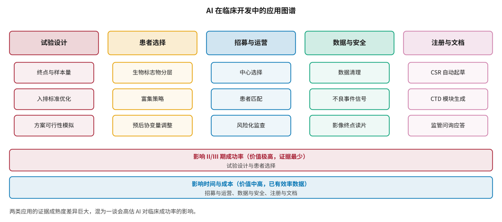
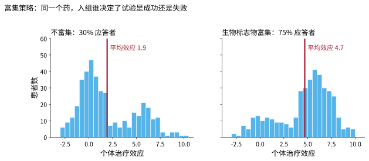
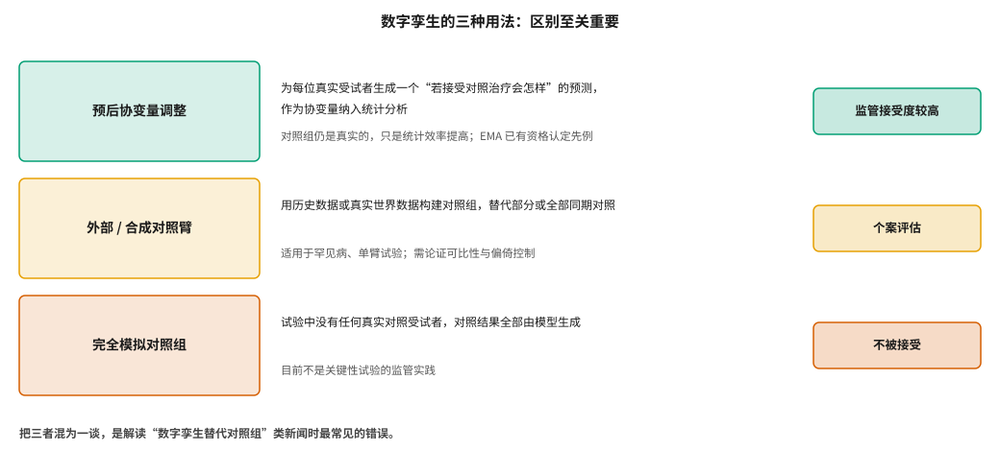
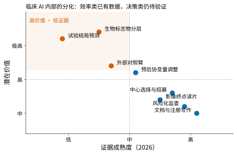

# 临床开发中的 AI：试验设计、患者招募与数字孪生 {#sec-clinical}

## 本章目的 {.unnumbered .unlisted}

::: {.purpose-question}
AI 在临床阶段的应用，哪些已经被证明有用，哪些还只是宣传？
:::

@sec-economics 的价值地图指出一个核心矛盾：证据最充分的环节价值中等，价值最高的环节证据最少。临床开发正是后者的典型——III 期占直接研发支出的三分之一以上，II 期是漏斗最窄处，任何能提高后期成功率的方法都有巨大价值，但目前的硬证据非常有限。本章把临床 AI 拆成两类：**影响时间与成本的效率类应用**（已有可观测数据）和**影响成功率的决策类应用**（价值极高、证据最少），并重点厘清“数字孪生”这个最容易被误读的概念——它的三种用法在监管上的地位截然不同。

::: {.callout-note title="给非技术读者的摘要"}

临床试验是新药研发里最贵、最慢的部分。AI 在这里有两类完全不同的用处。第一类是提高效率：帮忙找合适的试验中心和患者、自动清理数据、起草申报文档——这类应用已经有实打实的时间和成本数据。第二类是改善决策：帮忙决定该入组哪些患者、试验该怎么设计——这类价值大得多，但证据少得多。还有一个常被误读的概念叫“数字孪生”：它最靠谱的用法不是“用虚拟病人替代真人对照组”，而是为每个真实受试者预测一个“如果用对照治疗会怎样”的结果，当作统计分析的辅助信息——对照组仍然是真人。**成熟度**：效率类中等偏上；决策类低到中。

:::

::: {.callout-learning-objectives}

- 区分临床 AI 的效率类与决策类应用，并说明两者证据成熟度的差异
- 解释富集策略如何通过改变入组人群提高试验的统计功效
- 区分数字孪生的三种用法，说明各自的监管地位
- 解释预后协变量调整的统计原理，以及它为什么不改变随机化的有效性
- 评估“AI 缩短试验周期 N 周”这类效率指标的可信度与适用边界
- 列出判断一项临床 AI 应用是否可信的关键问题

:::

## 临床 AI 的应用图谱 {#sec-clinical-map}

@fig-clinical-map 把临床 AI 的应用分成五类，并按影响的变量归入两组。

::: {#fig-clinical-map fig-cap="**AI 在临床开发中的应用图谱**：五类应用按影响的变量分为两组——试验设计与患者选择影响 II/III 期成功率（价值极高、证据最少），招募与运营、数据与安全、注册与文档影响时间与成本（价值中高、已有效率数据）。把两类混为一谈会高估 AI 对临床成功率的影响。" fig-alt="五列方框，列标题依次为试验设计、患者选择、招募与运营、数据与安全、注册与文档，每列下方三个子项；底部两条横条分别标注影响成功率和影响时间成本两类应用。"}

{width="100%"}

:::

### 为什么临床阶段值得关注 {#sec-clinical-why}

回顾 @sec-economics 的三组数字：III 期占直接研发支出的 35%–45%；II 期成功率仅约 29%；临床失败中超过一半源于缺乏疗效，而“患者人群过于异质”是其中一类重要原因。Fogel 的综述分析了临床试验失败的因素，指出除了药物本身无效之外，试验设计缺陷、入组人群选择不当和运营执行问题同样是重要原因 [@fogel2018]。这意味着，**即使药物本身没变，更好的试验设计和患者选择也能改变试验结局**——这正是临床 AI 价值的来源。

## 决策类应用：价值极高，证据最少 {#sec-clinical-decision}

### 患者富集 {#sec-clinical-enrichment}

::: {#dfn-clinical-enrichment .callout-definition title="富集策略"}

***富集***\index{富集策略}（enrichment）指通过入排标准选择更可能从治疗中获益的患者人群，从而提高试验检测到治疗效应的能力。常见手段包括生物标志物筛选、疾病阶段限定和既往治疗史限定。

1.  **意义**：富集不改变药物本身，只改变入组的人群分布。它可以在相同样本量下提高统计功效，或在相同功效下减少样本量——两者都直接降低试验成本和失败风险（@fig-enrichment）。
2.  **区别**：富集不同于事后亚组分析。富集在方案中预先规定，受试者按此标准入组；事后亚组分析则是在数据出来后寻找有效的子人群，统计效力和可信度都低得多。
3.  **常见误区**：以为富集总是有利。过度富集会缩小适应症人群、延长招募时间，还可能让药物在更广泛人群中的效果无从得知。

:::

::: {#fig-enrichment fig-cap="**富集策略的统计意义（模拟）**：左图为不富集的人群，30% 是应答者，平均治疗效应被大量无应答者稀释；右图经生物标志物富集后，75% 是应答者，平均效应显著提高。同一个药物，入组谁决定了试验是成功还是失败。数据为模拟，用于说明机制。" fig-alt="两个并排直方图，左图分布呈双峰且大部分集中在接近零处，平均效应较低；右图大部分集中在高效应处，平均效应明显更高，红色竖线标注平均值。"}

{width="95%"}

:::

@sec-economics-ta 提到，BIO 的统计显示使用生物标志物筛选患者的项目成功率显著高于不使用的项目。AI 在这里的作用是从多组学、影像和电子病历数据中识别预测性生物标志物，并构建患者分层模型。这是临床 AI 中潜在价值最高的应用——也是证据最少的：绝大多数分层模型尚未在前瞻性试验中验证。

### 试验设计与结局预测 {#sec-clinical-trial-design}

AI 可以用于模拟不同试验设计（样本量、随访时长、终点选择）下的成功概率，辅助方案优化。英矽智能的 inClinico 平台就属于这一类（@sec-players-insilico）。主方案试验（master protocol）——篮式、伞式、平台试验——也越来越多地借助数据驱动方法做自适应决策 [@woodcock2017]。

但试验结局预测面临一个根本困难：**训练数据极度稀缺且有偏**。历史试验数量有限，失败试验的详细数据往往不公开，而成功与失败的判定又受当时的监管环境、竞争格局影响。这使得这类模型很难被严格验证——它在 @fig-clinical-evidence-gap 中位于证据成熟度最低的位置。

## 数字孪生：三种用法，三种地位 {#sec-clinical-digital-twin}

“数字孪生”是临床 AI 中最容易被误读的概念。关键在于区分三种用法（@fig-digital-twin）。

::: {#fig-digital-twin fig-cap="**数字孪生的三种用法**：预后协变量调整为每位真实受试者生成“若接受对照治疗会怎样”的预测并作为协变量，对照组仍是真实的，监管接受度较高；外部或合成对照臂用历史或真实世界数据替代部分同期对照，需个案评估；完全由模型生成对照结果的试验，目前不是关键性试验的监管实践。" fig-alt="三行方框，左侧依次为预后协变量调整、外部合成对照臂、完全模拟对照组，中间为说明文字，右侧为监管地位标签：监管接受度较高、个案评估、不被接受。"}

{width="100%"}

:::

### 预后协变量调整 {#sec-clinical-procova}

这是目前最成熟、监管接受度最高的用法。做法是：用历史对照数据训练一个预后模型，为每位入组受试者生成一个“若接受对照治疗，其结局会如何”的预测值；把这个预测值作为**协变量**纳入主要分析的统计模型。

关键点在于：**对照组仍然是真实的、随机分配的**。模型只是提供了一个与治疗分配无关的、信息量高的基线协变量，从而降低结局方差、提高统计效率。由于协变量调整在随机化框架内进行，治疗效应估计仍然无偏。

欧洲药品管理局（EMA）已对这一方法给出资格认定意见 [@ema2022procova]。对阿尔茨海默病等进展可预测的疾病，这类预后模型可以显著提高效率 [@fisher2020]。

### 外部与合成对照臂 {#sec-clinical-external-control}

用历史数据或真实世界数据构建对照组，替代部分或全部同期对照。这在罕见病、单臂试验和伦理上难以设置安慰剂组的场景中有实际价值 [@unlearn2026]。但它面临严重的方法学挑战：历史对照与当前受试者在诊断标准、支持治疗、结局测量方式上可能不可比，残余混杂难以排除。监管机构通常个案评估，要求申办方详细论证可比性和偏倚控制。

### 完全模拟对照组 {#sec-clinical-fully-simulated}

即试验中没有任何真实对照受试者，对照结果全部由模型生成。**这不是关键性试验的现行监管实践**。所有已公开的先例都是用数字孪生**增强或缩小**真实对照组，而非完全消除它 [@intuitionlabs2026dt]。

::: {#pri-clinical-twin .callout-principle title="数字孪生不替代随机化"}

**判断**：数字孪生在临床试验中的可信用法，是在随机化框架**内部**提高统计效率，而不是替代随机化。

**含义**：读到“数字孪生替代对照组”的说法时，应追问它属于三种用法中的哪一种。把预后协变量调整的监管先例，用来为“完全模拟对照组”背书，是这一领域最常见的误导。

:::

::: {#ws-clinical-twin-hype .callout-war-story title="一句话的三种读法"}

**现象**：2026 年的行业报道中，经常出现“AI 生成的数字孪生可以大幅缩短 II/III 期试验时长、降低罕见病招募门槛”这类表述 [@astrix2026]。

**拆解**：同一句话对应三种截然不同的技术主张。如果指的是预后协变量调整，它成立且有监管先例，但效果是“同等功效下对照组可以略小”，而非“不需要对照组”；如果指的是外部对照臂，它在特定场景成立，但需要逐案论证；如果指的是完全模拟对照组，它目前不成立。

**教训**：面对临床 AI 的宣传，第一个问题永远是“具体在统计上做了什么”。@fig-digital-twin 的三分法，可以用来快速定位任何一条相关新闻。

:::

## 效率类应用：已有可观测数据 {#sec-clinical-efficiency}

### 招募与中心选择 {#sec-clinical-recruitment}

患者招募是临床试验最常见的延误原因。AI 的应用包括：分析电子病历和真实世界数据，识别符合入排标准的潜在受试者；基于历史入组速度、疾病流行病学和竞争试验情况预测各中心的入组能力；优化入排标准，在科学性与可行性之间取得平衡（过于严格的标准会让招募无法完成）。

### 运营、监查与数据 {#sec-clinical-operations}

**风险化监查**用模型识别数据异常和高风险中心，把现场核查资源集中到最需要的地方；**数据清理**自动识别逻辑矛盾和离群值；**不良事件信号检测**从病例报告和真实世界数据中发现安全性信号；**影像终点读片**用深度学习自动量化病灶、测量肺功能相关影像指标等——勃林格殷格翰与 Brainomix 的合作就把 AI 影像作为肺纤维化 III 期试验的共同主要终点（@sec-capital-where-deals-go）。

### 注册与医学写作 {#sec-clinical-regulatory-writing}

生成式 AI 用于自动起草临床研究报告（CSR）、通用技术文档（CTD）模块和监管问询应答，是 2026 年落地最快的应用之一。它的吸引力在于：任务定义清晰、有大量历史文档作为参考、输出由人类审核，风险相对可控。

### 效率数据怎么读 {#sec-clinical-efficiency-evidence}

@sec-china 提到，赛默飞的临床试验预测工具平均可将试验交付周期缩短约 12 周 [@21jingji2026licenseout]。这类数字有参考价值，但需注意三点：它们大多来自供应商自身披露；“缩短 12 周”的比较基线往往不明确；周期缩短不等于成功率提高。效率类应用的价值是真实的，但它作用于 @eq-rnpv 中的时间变量，而非成功率变量——按 @fig-rnpv-scenarios 的分析，前者的价值上限明显低于后者。

## 证据成熟度的内部分化 {#sec-clinical-evidence}

@fig-clinical-evidence-gap 把临床 AI 的八类应用放在“证据成熟度–潜在价值”坐标中。

::: {#fig-clinical-evidence-gap fig-cap="**临床 AI 内部的分化**：文档写作、风险化监查、中心选择等效率类应用证据较成熟但价值中等；生物标志物分层和试验结局预测价值极高却证据最少（红色区域）。预后协变量调整是少数兼具较高价值和监管先例的应用。位置为作者基于公开资料的定性判断。" fig-alt="二维散点图，横轴证据成熟度，纵轴潜在价值；左上红色区域内为试验结局预测、生物标志物分层、外部对照臂；右下为文档与注册写作、风险化监查、影像终点读片等。"}

{width="80%"}

:::

这张图是 @fig-value-map 在临床环节内部的放大。它说明一个容易被忽视的事实：**“临床 AI”本身不是一个同质的类别**。用文档自动化的成功案例，为患者分层模型的价值背书，是一种常见的论证跳跃。

::: {.callout-checkpoint title="临床 AI"}

- [ ] 你能解释为什么预后协变量调整不会破坏随机化的无偏性吗？
- [ ] 面对“AI 把试验周期缩短了 12 周”的说法，你会追问哪两个问题？
- [ ] 为什么过度富集也可能有害？

:::

## 监管视角 {#sec-clinical-regulatory}

临床阶段的 AI 应用直接受药品监管规则约束，这与药物发现阶段很不相同。@sec-reg-west 会详细讨论 FDA 2025 年关于 AI 支持监管决策的指导原则草案，以及 FDA 与 EMA 2026 年 1 月联合发布的十项原则。这里只强调一点：**监管框架的核心是“使用场景”（context of use）和“模型风险”**——同一个模型，用于内部优先级排序和用于支持注册决策，所需的可信度证据完全不同。药物发现阶段的 AI 大多不在药品监管的直接范围内，而临床阶段的 AI 一旦用于支持有效性或安全性结论，就必须接受可信度评估。

## 谬误与陷阱 {#sec-clinical-fallacies}

::: {.fallacy-pitfall}

**谬误**：*数字孪生可以替代对照组，让试验不再需要安慰剂。*

现行监管实践中，数字孪生用于在随机化框架内提高统计效率（预后协变量调整），或在特定场景构建外部对照。完全由模型生成对照结果的关键性试验不是现行实践（@pri-clinical-twin）。

:::

::: {.fallacy-pitfall}

**谬误**：*AI 缩短了试验周期，所以提高了研发成功率。*

周期和成功率是两个独立变量。按 @fig-rnpv-scenarios，缩短时间的价值取决于项目本身是否值得做，而提高成功率的价值随市场规模放大。效率改善不等于决策改善。

:::

::: {.fallacy-pitfall}

**陷阱**：*用效率类应用的成熟度，为决策类应用背书。*

文档自动化和风险化监查已有实际数据，患者分层和结局预测则缺乏前瞻性验证。两者的证据成熟度相差很大（@fig-clinical-evidence-gap）。

:::

::: {.fallacy-pitfall}

**陷阱**：*把事后亚组分析当作富集。*

富集必须在方案中预先规定。数据出来后寻找有效亚组，统计效力和可信度都大幅降低，监管机构通常只接受其作为探索性结果。

:::

## 小结 {#sec-clinical-summary}

临床开发是 AI 价值地图上价值最高、证据最少的象限之一。效率类应用——招募、监查、数据清理、文档写作——已有可观测的时间和成本数据，但它们作用于时间变量，价值上限有限。决策类应用——患者富集、试验设计、结局预测——潜在价值极高，却缺乏前瞻性验证。数字孪生是其中最容易被误读的概念：它可信的用法是在随机化框架内提高统计效率，而非替代随机化。

::: {.callout-takeaways title="先分清是提效率还是改决策"}

* **两类应用，两种证据**：效率类（时间与成本）已有数据；决策类（成功率）证据最少。
* **富集是最有力的杠杆**：同一个药，入组谁可能决定成败；但必须预先规定，且过度富集也有代价。
* **数字孪生分三种**：预后协变量调整（监管接受度较高）、外部对照臂（个案评估）、完全模拟（不是现行实践）。
* **协变量调整不破坏随机化**：对照组仍是真实的，模型只提供与治疗分配无关的基线信息。
* **效率数字要看基线**：多数来自供应商披露，且周期缩短不等于成功率提高。
* **监管看使用场景**：同一模型用于内部排序与用于支持注册结论，所需证据完全不同。

:::

::: {.callout-chapter-connection title="从专用模型到通用智能体"}

前面各章讨论的都是为特定任务训练的专用模型。2023 年以后，通用大语言模型和科研智能体开始进入药物研发的各个环节——从文献挖掘到工具调用，再到自动化实验的编排。@sec-agents 讨论这类系统能做什么、不能做什么，以及它们带来的新风险。

:::
