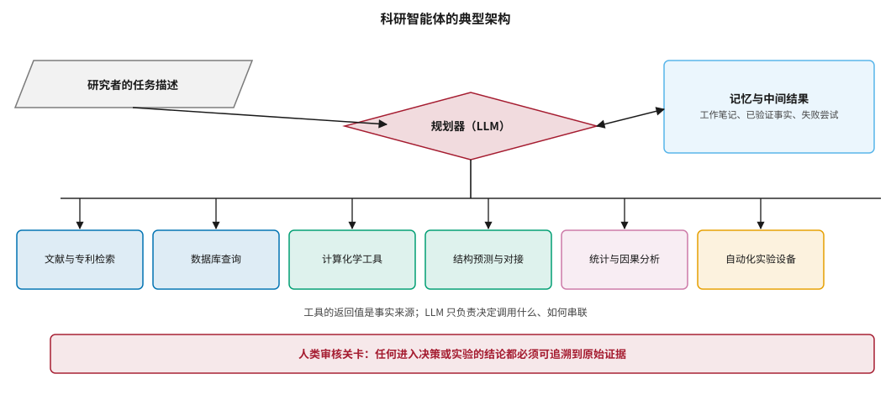
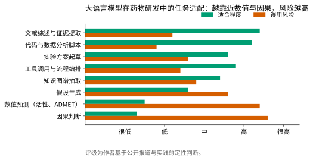
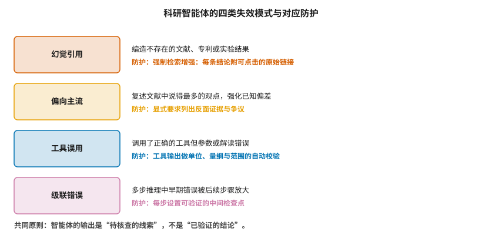

# 大语言模型与科研智能体 {#sec-agents}

## 本章目的 {.unnumbered .unlisted}

::: {.purpose-question}
通用大模型能替研究者做哪些事，又在哪些地方最容易把人带偏？
:::

前面九章讨论的都是**专用模型**：为分子性质预测、结构预测、逆合成、抗体设计等单一任务训练的系统。它们的共同特点是输入输出定义清晰、评测指标明确、失败方式相对可预测。2023 年以后出现的是另一类系统——以大语言模型为核心、能调用外部工具、能把多步工作串联起来的**科研智能体**。它们不直接做出预测，而是决定该调用哪个工具、如何解读返回值、下一步做什么。这改变了人机分工的边界，也带来了专用模型没有的失效模式。本章的立场是：智能体在**流程层**的价值被低估，在**科学判断层**的能力被严重高估，而区分这两层正是用好它们的前提。

::: {.callout-note title="给非技术读者的摘要"}

这一章讲的是 ChatGPT 这类通用 AI 在药物研发里能干什么。简单说：它擅长读文献、写代码、整理资料、把几个专业软件串起来跑——这些是“流程活”，能实实在在省时间。它不擅长的是给出数字（这个分子的活性是多少）和判断因果（这个靶点是不是致病原因）——这些恰恰是研发中最关键的判断，而它在这些地方会编得很自信。最危险的不是它答错，而是它答错时和答对时看起来一模一样。因此行业共识是：智能体的输出是**待核查的线索**，不是**已验证的结论**。**成熟度**：文献与代码类高；自主科学发现类低。

:::

::: {.callout-learning-objectives}

- 说明科研智能体的典型架构，以及规划器、工具层与记忆层各自的职责
- 区分智能体适合与不适合的任务类型，并解释背后的原因
- 解释检索增强为什么能缓解幻觉引用，以及它为什么不能完全消除幻觉
- 列举科研智能体的四类失效模式与对应的工程防护
- 评估“AI 自主完成科学发现”类宣称的可信度，并指出其中的人类参与环节
- 说明智能体在实验室自动化中的角色，以及由此带来的安全与生物安保考量

:::

## 智能体的架构 {#sec-agents-arch}

::: {#dfn-agent .callout-definition title="科研智能体"}

***科研智能体***\index{科研智能体}（research agent）指以大语言模型为规划核心、能够调用外部工具并根据返回结果决定后续动作的系统。它与单次问答的区别在于：存在**多步循环**（观察—决策—行动—再观察），且其中至少一步会改变外部状态（检索数据库、运行计算、操作设备）。

1.  **意义**：智能体把“知道怎么做”与“实际做”连接起来。研究者不必亲自调用每个工具并在格式之间转换，这在工具链碎片化的计算药物化学中价值明显（@sec-toolchain）。
2.  **区别**：智能体不是更大的模型，而是模型加上工具与循环。它的科学能力上限由**工具的能力**决定，不由语言模型的参数量决定。
3.  **常见误区**：以为智能体能“自己想出”新的科学结论。它能重组已有知识、提出可检验的假设，但验证假设仍然依赖湿实验或独立计算。

:::

@fig-agent-arch 给出典型架构。四个部分缺一不可：规划器负责决定下一步，工具层提供事实来源，记忆层保存中间结果以避免在长任务中遗忘或自相矛盾，而人类审核关卡决定哪些结论可以进入下游决策。

::: {#fig-agent-arch fig-cap="**科研智能体的典型架构**：研究者给出任务描述，大语言模型作为规划器决定调用哪些工具，工具返回的结果与中间笔记存入记忆层并影响后续决策。关键设计是最下方的人类审核关卡——任何进入决策或实验的结论都必须可追溯到原始证据，而不是模型的复述。" fig-alt="流程图，左侧平行四边形为研究者任务描述，指向中部菱形的规划器 LLM；规划器右侧双向连接记忆与中间结果方框；规划器下方一条主干线连到横向总线，总线向下分出六个工具方框；底部为红色人类审核关卡横条。"}

{width="100%"}

:::

### 规划器：决定做什么，而不是知道答案 {#sec-agents-planner}

规划器的职责是**任务分解**与**工具选择**，不是提供事实。这一区分在工程上至关重要：如果一个数值来自模型的记忆而非工具的返回值，它就是不可信的。ChemCrow 是这一思路的早期代表——它把十余个化学工具（反应预测、名称转换、安全性查询、文献检索）包装成大语言模型可调用的接口，让模型负责编排而非计算 [@bran2024chemcrow]。作者在论文中明确指出，这种设计的收益不在于模型更聪明，而在于把模型最弱的环节（精确计算、化学结构操作）交给了确定性工具。

Coscientist 把同样的思路推到了实验台：系统能够检索文献、编写控制代码、驱动液体处理工作站，完成了若干已知偶联反应的自主优化 [@boiko2023coscientist]。值得注意的是其完成的任务类型——都是**目标明确、评价标准客观、搜索空间有限**的优化问题，而不是开放式的科学发现。

::: {#pri-agent-tools .callout-principle title="事实来自工具，编排来自模型"}

在科研智能体中，任何会影响下游决策的数值、引用或结构，都必须来自可追溯的工具调用，而不是语言模型的生成。语言模型的职责是决定调用什么、如何串联、如何解释；一旦让它直接产出事实，整个系统的可信度就退化到单个模型的幻觉率水平。

:::

## 哪些任务适合交给智能体 {#sec-agents-fit}

@fig-task-suitability 按两个维度给八类任务打分：适合程度与误用风险。这两条曲线大致是镜像关系，而分界线出现在一个有意义的位置——**任务越接近数值预测与因果判断，模型越不可靠，而研究者越倾向于相信它**。

::: {#fig-task-suitability fig-cap="**大语言模型在药物研发中的任务适配**：横轴为定性评级。文献综述、代码撰写、流程编排这类任务适合程度高而误用风险低；数值预测与因果判断则相反。规律是：越靠近需要精确数值或因果推断的任务，模型的可靠性越低。评级为作者基于公开报道与实践的定性判断，非测量值。" fig-alt="水平双条形图，八类任务从上到下为文献综述与证据提取、代码与数据分析脚本、实验方案起草、工具调用与流程编排、知识图谱抽取、假设生成、数值预测、因果判断；绿色条代表适合程度自上而下递减，橙色条代表误用风险自上而下递增。"}

{width="95%"}

:::

### 高价值区：文献、代码与编排 {#sec-agents-high}

**文献与证据提取**是目前最成熟的应用。药物研发的一个长期痛点是文献体量远超任何团队的阅读能力：单是 PubMed 每年新增论文就以百万计，加上专利、临床试验登记、监管审评报告，没有人能穷尽一个靶点的既有证据。大模型在这里的优势不是“读得更懂”，而是**读得更全**——它可以在可接受的成本内把一个靶点的几千篇相关文献都过一遍，抽取出结构化的证据表。这与 @sec-target 讨论的靶点证据链建设直接相关。

**代码与数据分析**同样成熟。计算药物化学的日常工作中有大量一次性脚本——格式转换、批量处理、结果汇总、画图。这类代码的特点是正确性可以通过运行结果立即验证，因此模型出错的代价很低。

**工具调用与流程编排**是智能体相对于单纯对话模型的真正增量。@sec-toolchain 会讨论计算化学工具链的碎片化问题：不同工具的输入格式、坐标约定、单位体系各不相同，研究者的大量时间花在格式转换而非科学判断上。智能体恰好擅长这类有明确规则但繁琐的衔接工作。

### 低价值区：数值与因果 {#sec-agents-low}

**数值预测**是最明确的禁区。当被问到“这个分子对 EGFR 的 IC~50~ 大约是多少”时，大语言模型会给出一个看起来合理的数字，但这个数字既不来自计算也不来自查询，而是来自训练语料中类似表述的统计模式。@sec-admet 讨论的专用预测模型尽管也不精确，至少有已知的误差分布和适用域；语言模型给出的数值则连误差都无从估计。

**因果判断**是更深层的问题。@sec-target 讨论过，区分“与疾病相关”和“是疾病原因”需要孟德尔随机化、基因敲除或临床干预证据。语言模型学到的是文献中的**共现模式**，而文献中的共现本身就包含大量相关不等于因果的陈述。模型因此倾向于把被频繁提及的关联复述为因果关系——这恰恰放大了 @sec-data-quality 将讨论的文献偏差。

::: {.fallacy-pitfall}

**谬误**：*模型能读懂文献，就能判断文献中的证据强度。*

读懂一句话的字面含义，与判断这句话背后的实验设计是否支持其结论，是两种不同的能力。模型在前者上接近人类水平，在后者上远未达到——它无法可靠地区分一项有十万人队列支持的关联与一项基于三十例病例报告的关联，除非这种差异在文本中被明确表述。

:::

## 四类失效模式 {#sec-agents-failures}

@fig-failure-modes 归纳了科研场景下最常见的四类失效及对应防护。它们的共同特点是：**失败时的输出与成功时在形式上无法区分**——都是语气确定、格式规整、看起来专业的文本。

::: {#fig-failure-modes fig-cap="**科研智能体的四类失效模式与对应防护**：幻觉引用、偏向主流、工具误用、级联错误。四者的共同特征是失败输出与正确输出在形式上无法区分，因此防护手段都指向同一个方向——建立输出与原始证据之间的可追溯链接。" fig-alt="四行结构，每行左侧为彩色方框标注失效模式名称，右侧两行文字分别说明失效表现与对应的工程防护措施。"}

{width="90%"}

:::

### 幻觉引用 {#sec-agents-hallucination}

模型编造不存在的文献、作者或实验数据，是科研场景中最危险的失效。危险之处不在于频率，而在于**可信外观**：编造的引用通常有合理的期刊名、合理的年份、合理的作者组合，只有实际去查才会发现它不存在。关于幻觉的成因与分类已有系统综述 [@huang2025hallucination]，其核心结论之一是：幻觉不是可以通过增大模型完全消除的缺陷，而是自回归生成机制的固有属性。

检索增强生成（retrieval-augmented generation, RAG）是当前主流的缓解手段：先检索真实文档，再让模型基于检索到的内容作答 [@lewis2020rag]。它显著降低了编造引用的概率，但有两个无法消除的残余风险。其一，模型可能**错误综合**真实文档——每个引用都存在，但把两篇文章的结论拼接成了原文没有的论断。其二，检索本身可能失败，而模型在检索结果不相关时仍会尝试作答。

工程上的应对不是追求零幻觉，而是**让核查成本足够低**：每条结论旁边附可点击的原始链接，使研究者能在几秒内验证，而不是重新做一遍检索。

### 偏向主流 {#sec-agents-mainstream}

模型的输出反映训练语料的分布，而文献的分布本身是高度偏斜的。@sec-data-quality 会详细讨论这一点：热门靶点的文献量可能是冷门靶点的数百倍，阳性结果的发表率远高于阴性结果。当研究者问“这个靶点有什么证据”时，模型给出的是**被谈论最多的证据**，而不是**最强的证据**，也几乎不会主动提及该领域内的失败尝试与争议。

这种偏差在知识图谱抽取中同样存在，并与 @sec-target 讨论的度偏差（degree bias）叠加：文献多的节点在图中连接更密，图算法与语言模型会一致地偏向它们。缓解手段是在提示中显式要求列出反面证据、争议点与阴性结果，并对冷门靶点降低对模型输出完整性的预期。

### 工具误用 {#sec-agents-misuse}

智能体调用了正确的工具，但参数设置或结果解读错误。典型例子包括：对接计算中盒子中心设在错误的位置、把 K~i~ 当作 IC~50~ 比较、混淆 μM 与 nM、把预测置信度当作预测准确度。这类错误比幻觉更隐蔽，因为整个流程是真实执行的，只有最终数值无意义。

有效的防护是在工具层而非模型层做校验：对返回值做单位、量纲与合理范围的自动检查，让物理上不可能的结果（负的溶解度、超出已知化学空间的分子量）在进入下一步前就被拦截。

### 级联错误 {#sec-agents-cascade}

多步任务中，早期步骤的小错误会被后续步骤放大。如果第一步把靶点识别错了，后续的结构检索、对接、分子设计都会在错误的前提上进行，而每一步看起来都执行得很规范。随着智能体执行步数增加，端到端正确率会随步数近似呈几何衰减——这是对智能体自主性设限的最直接理由。

防护手段是在流程中设置**可验证的中间检查点**：每个关键步骤产出一个可以独立核对的中间结果（靶点的 UniProt 编号、结构的 PDB 编号、分子的 InChIKey），让错误在传播之前被发现。

## 自主科学发现：宣称与现实 {#sec-agents-autonomy}

2024 年以后出现了一批以“自主科学家”为名的系统。The AI Scientist 宣称能端到端完成机器学习研究——提出想法、写代码、跑实验、写论文 [@lu2024aiscientist]；Google 的 AI co-scientist 面向生物医学假设生成，采用多智能体辩论与排序机制 [@gottweis2025coscientist]；斯坦福的 Virtual Lab 用多个扮演不同专业角色的智能体协作设计纳米抗体，并报告了经实验验证的候选物 [@swanson2025virtuallab]。

这些工作是真实的进展，但解读时需要注意三点。

**第一，人类参与的环节往往被叙述压缩。** 在几乎所有这类工作中，任务边界的设定、工具的选择与接入、输出的筛选、以及最终的实验验证，都由人类完成。Virtual Lab 的纳米抗体最终需要湿实验表征，而实验设计与执行并非由智能体完成。

**第二，成功案例的任务结构有共同特征。** 它们大多是**评价函数明确、搜索空间有界、反馈循环快**的问题。Coscientist 优化的偶联反应有客观产率指标；蛋白设计有 @sec-biologics 讨论的计算过滤指标。相比之下，“这个靶点值不值得立项”这类判断没有即时反馈，也没有客观评分函数，智能体在其中的表现无法被同样地验证。

**第三，评测本身尚不成熟。** 科学任务的评测基准（如 SciBench [@wang2024scibench]）主要覆盖有标准答案的问题求解，而真实研究中最难的部分恰恰是没有标准答案的判断。@sec-evaluation 会讨论这一评测缺口的普遍性。

::: {#ws-agents-review .callout-war-story title="当智能体进入同行评审流程"}

2024 年以后，多家期刊与会议报告收到了明显由大模型生成或大幅改写的投稿与审稿意见，引发了一系列政策调整——多数主流出版机构随后明确要求披露 AI 使用情况，并禁止将审稿稿件上传至第三方模型服务。

这件事对药物研发的启示不在于学术伦理本身，而在于它暴露了一个结构性问题：**当生成内容的成本趋近于零，而核查成本不变时，任何依赖人工核查的质量控制体系都会被压垮**。药物研发中的文献综述、尽职调查、监管文档撰写面临同样的压力。应对方式不能只是“要求披露”，而必须是让核查本身可自动化——这正是强制检索增强与可追溯链接的价值所在。

:::

## 实验室自动化与安全边界 {#sec-agents-safety}

智能体与自动化实验设备结合后，错误不再只停留在文档里，而会变成真实的物质操作。这带来两类新的考量。

**操作安全**层面，需要在设备驱动层设置独立于模型的硬约束：温度、压力、试剂组合的物理上限不应由模型判断，而应由设备控制系统强制执行。这与工业控制系统的安全设计原则一致——安全联锁不能依赖上层逻辑的正确性。

**生物安保**层面，Urbina 等人的工作提出了一个被广泛引用的警示：用于毒性最小化的生成模型，只需反转优化目标就能用于设计高毒性化合物 [@urbina2022dualuse]。这一两用性问题在智能体时代更加突出，因为智能体降低了把“设计”转化为“合成路线”再转化为“实验操作”的门槛。@sec-ip-biosecurity 会系统讨论相关的治理框架与行业实践，包括序列筛查、云实验室的客户尽职调查以及模型层面的能力限制。

::: {#chk-agents .callout-checkpoint}

1. 为什么说智能体的科学能力上限由工具决定而非模型规模决定？
2. 检索增强能消除哪一类幻觉，又无法消除哪一类？
3. 为什么级联错误随步数增加会迅速放大，这对智能体自主性设计意味着什么？
4. 自主科学发现的成功案例有哪三个共同的任务特征？
5. 若要把智能体接入自动化实验平台，安全约束应当放在模型层还是设备层，为什么？

:::

::: {.fallacy-pitfall}

**陷阱**：*用智能体的流畅程度判断其可靠性。*

语言模型的流畅性与其内容正确性几乎不相关。一段措辞谨慎、引用齐全、逻辑连贯的分析，可能建立在一篇不存在的文献上。判断可靠性的唯一方法是抽样核查原始证据，而不是阅读体验。

:::

## 小结 {#sec-agents-summary}

科研智能体改变的是研究者与工具之间的接口，而不是科学判断的来源。它们在文献综合、代码撰写与流程编排上提供了可观的效率增益，这些增益是真实且可度量的。但在数值预测与因果判断上，它们的输出不应被当作证据——不是因为它们错得多，而是因为它们错得不可区分。把智能体定位为“降低核查成本的助手”而非“替代判断的专家”，是目前唯一经得起检验的用法。

::: {.callout-takeaways title="智能体的输出是线索，不是结论"}

* **事实来自工具，编排来自模型**：任何影响决策的数值或引用都必须可追溯到工具调用。
* **能力上限由工具决定**：接入更好的预测模型比换更大的语言模型更能提升科学能力。
* **适配规律**：越靠近精确数值与因果推断，可靠性越低、误用风险越高。
* **四类失效**：幻觉引用、偏向主流、工具误用、级联错误——共同特征是失败输出与正确输出形式上无法区分。
* **自主发现的现实边界**：成功案例都具备明确评价函数、有界搜索空间与快速反馈，三者缺一则无法验证。
* **安全约束下沉**：接入实验设备时，物理安全边界必须由设备控制系统强制，不能依赖模型判断。

:::

::: {.callout-chapter-connection title="从模型回到数据"}

第二篇讨论的所有技术——分子表示、靶点发现、结构预测、虚拟筛选、生成设计、ADMET 预测、逆合成、生物药设计、临床应用与智能体——都建立在同一个前提上：有足够多、足够好的数据。第三篇转向这个前提本身：@sec-data-resources 梳理可用的公共与商业数据资源，@sec-data-quality 讨论这些数据中的系统性偏差，@sec-data-flywheel 讨论企业如何构建自有数据的正反馈循环。

:::
