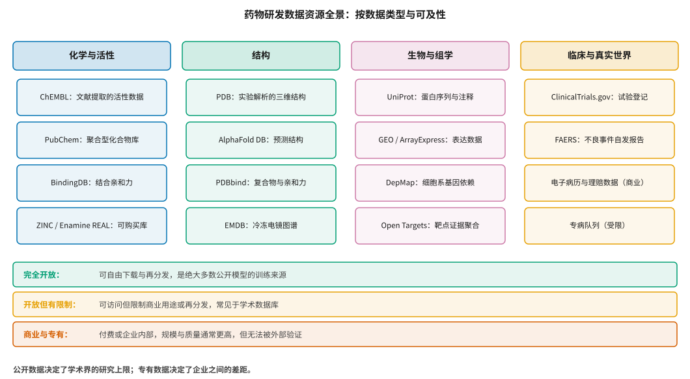
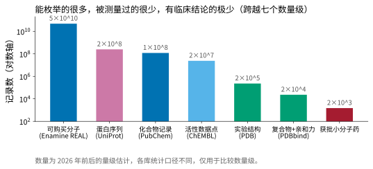
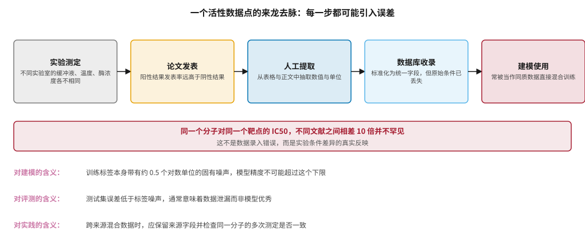

# 数据资源全景：公开、商业与专有 {#sec-data-resources}

## 本章目的 {.unnumbered .unlisted}

::: {.purpose-question}
AI 药物研发究竟有多少数据可用，这些数据是从哪里来的，又各自能回答什么问题？
:::

第二篇讨论的所有模型都建立在同一个前提上：有数据可训。但药物研发的数据状况，与推动了语言模型和图像模型的那种“互联网级数据”完全不同。它的规模小了好几个数量级，获取成本高出同样的数量级，而且——这是最关键的一点——**越接近决定项目成败的问题，数据越稀缺**。

本章做三件事。首先盘点可用的数据资源，说明每一类数据的来源、规模与隐含的限制，使读者在选择训练数据时知道自己拿到的究竟是什么。其次刻画数据量沿研发价值链的衰减结构，并说明这一结构如何反过来决定了建模策略的选择。最后解释一个在建模实践中反复出现、却很少被明确讨论的事实：公开活性数据本身带有不可消除的测量噪声，这一噪声为所有基于它训练的模型设定了精度天花板。

::: {.callout-note title="给非技术读者的摘要"}

训练 AI 需要数据。药物研发的数据有三类来源：公开数据库（学术界整理的，任何人都可以下载）、商业数据库（花钱买的，比如覆盖大量患者的电子病历）、以及企业自己做实验产生的数据（最值钱，也最保密）。

公开数据的问题集中在两点。第一是少：能买到的分子有几百亿个，但真正被测过活性的只有两千多万条记录，有三维结构的只有二十多万个，最终获批上市的药不到两千个——越往产业链后端走，数据越少。第二是杂：同一个分子的同一项实验，不同实验室做出来的结果可能相差十倍，因为缓冲液、温度、细胞批次这些条件并不相同。

这两点合起来意味着：用这些数据训练出的模型，精度有一个由数据本身决定的上限，再好的算法也突破不了。认识到这个上限在哪里，是判断一切性能宣称的起点。**成熟度**：数据可及性高；数据质量中等偏低。

:::

::: {.callout-learning-objectives}

- 按数据类型与可及性列举药物研发的主要数据资源，并说明各自的规模量级与适用场景
- 解释数据量沿研发价值链衰减的原因，以及这一结构对建模策略的三项具体影响
- 追溯一个公开活性数据点的完整产生过程，识别其中各环节引入的误差类型
- 说明公开活性数据的固有噪声水平，以及它如何构成模型精度的理论上限
- 区分公开数据、商业数据与专有数据在竞争格局中的不同作用，并解释专有数据价值的真正来源
- 解释 FAIR 原则的四项内容，并评估它们在药物研发数据中各自的落实程度

:::

## 数据资源图谱 {#sec-data-map}

@fig-data-landscape 按两个维度盘点主要资源：数据类型（化学与活性、结构、生物与组学、临床与真实世界）和可及性（完全开放、开放但有限制、商业与专有）。这两个维度的交叉决定了一项资源在实践中的地位——数据类型决定它能回答什么问题，可及性决定谁能用它、以及用它得到的结论能否被外部验证。

::: {#fig-data-landscape fig-cap="**药物研发数据资源全景**：四类数据与三级可及性。公开数据决定了学术界的研究上限——几乎所有公开模型都训练于这些资源；专有数据则决定了企业之间的差距，因为它无法被外部复现或验证。" fig-alt="四列方框，列标题依次为化学与活性、结构、生物与组学、临床与真实世界，每列下方四个代表性数据库；下方三条横带分别标注完全开放、开放但有限制、商业与专有三级可及性及其含义。"}

{width="100%"}

:::

### 化学与活性数据 {#sec-data-chem}

**ChEMBL** 是最重要的公开活性数据库，由欧洲生物信息研究所维护，内容来自人工从医药化学文献中提取的活性测定结果，涵盖两千余万条活性记录 [@zdrazil2024chembl]。它是几乎所有公开 QSAR 与性质预测模型的训练来源。

ChEMBL 的价值不只在于规模，更在于它的数据组织方式已经成为事实标准：每条记录是一个“分子—测定—靶点”三元组，并附带测定类型（`IC50`、`Ki`、`EC50`、`Kd` 等）、测定关系符（`=`、`>`、`<`）、单位、以及指向原始文献的引用。这些字段看起来琐碎，却是后续判断数据可用性的唯一依据。特别值得注意的是两个经常被建模者忽略的字段：**测定置信度评分**（confidence score）标记该测定与所声称靶点的对应关系有多确定——评分低意味着文献中的靶点归属本身存疑；**活性注释**（activity comment）则用自由文本记录了诸如“无活性”“细胞毒性干扰”之类的限定条件。直接按数值字段拉取数据而不读这两个字段，是公开数据误用中最常见的一种。

**PubChem** 规模更大但性质不同：它是聚合型数据库，汇集了数百个来源的化合物与生物活性数据 [@kim2025pubchem]。它的 BioAssay 部分包含大量高通量筛选的原始结果，这是 ChEMBL 所没有的——因为高通量筛选数据通常不以论文形式发表，而是直接提交。规模优势伴随着异质性：不同来源的质控标准差异很大，同一个“活性”标签背后的实验设计可能完全不同。把 PubChem 当作 ChEMBL 的放大版直接混用，是另一种常见误用。

**BindingDB** 专注于结合亲和力测定，对需要定量标签的任务（如 @sec-screening 讨论的打分函数训练）尤其重要。**ZINC** 与各供应商的按需合成库（如 Enamine REAL）提供可购买分子的枚举 [@irwin2020zinc20]。这里需要一个明确的区分：后者是**可合成性的枚举**而非测量数据——库里的分子绝大多数从未被合成，更谈不上被测试过。把库规模当作数据量，是本领域最普遍的概念混淆之一，它会让人严重高估可用于监督学习的样本量。

### 结构数据 {#sec-data-struct}

**PDB** 收录了实验解析的生物大分子三维结构，是结构生物学五十余年积累的成果 [@berman2000pdb]。它的规模（二十余万条）与化学数据相比小了两到三个数量级，而这一差距正是 @sec-structure 讨论的结构预测模型之所以重要的原因：如果实验结构足够多，就不需要预测。

使用 PDB 数据时有两个常被忽略的技术细节。其一是**冗余**：同一个蛋白可能有数百条结构记录（不同配体、不同分辨率、不同晶型），按条数统计会严重高估独立样本量，因此按序列相似度去冗余是训练前的必要步骤。其二是**分辨率与建模质量**：低分辨率结构中侧链位置的不确定性很大，把 1.5 Å 和 3.5 Å 的结构同等对待会引入可观的标签噪声。

**AlphaFold DB** 提供了覆盖两亿余条蛋白序列的预测结构 [@varadi2024afdb]，极大扩展了可用结构的覆盖面。但必须始终记住这些是**预测值而非测量值**：把它们与 PDB 的实验结构不加区分地混入训练集，模型学到的将是预测模型的系统性偏差，而非真实的结构规律。实践中的通行做法是保留 pLDDT 置信度字段，只使用高置信区域，并在数据来源字段中明确区分两类结构。

**PDBbind** 等复合物—亲和力配对数据集是结构依赖打分函数的训练基础，规模仅两万余条。@sec-screening 讨论的打分函数精度困境，很大程度上就源于这个数据量级——用两万条样本去拟合一个涉及焓、熵、溶剂化的复杂物理过程，本身就超出了数据所能支撑的范围。

### 生物与组学数据 {#sec-data-bio}

这一类数据回答的是“干预哪个基因或蛋白会产生什么后果”，因而直接服务于 @sec-target 讨论的靶点发现。

**UniProt** 是蛋白序列与功能注释的核心资源 [@uniprot2025]，同时承担着标识符枢纽的角色——跨库整合时，UniProt 编号通常是最可靠的对齐键。**Open Targets** 把遗传学、基因组学、文献与药理学证据聚合成靶点—疾病的证据评分 [@ochoa2023opentargets]，是靶点证据链建设的主要公开工具。**DepMap** 系统地在上千个癌细胞系中做基因敲除，给出基因依赖性图谱 [@tsherniak2017depmap]，提供了难得的大规模**干预**数据——这一点很重要，因为 @sec-science-gaps 会说明，观察数据无法替代干预数据来建立因果关系。**LINCS/L1000** 提供了百万级的扰动转录组特征 [@subramanian2017lincs]，常被用于作用机制推断与药物重定位。

这类数据的共同特点是**覆盖不均**：研究热点区域的数据密度远高于冷门区域。更麻烦的是，这种不均衡不是随机的，而是沿着历史研究兴趣的路径累积形成的，因而会被模型系统性地学走。@sec-data-quality 将详细讨论这一偏差的来源与后果。

### 临床与真实世界数据 {#sec-data-clinical}

ClinicalTrials.gov 提供试验登记信息，FAERS 收集上市后不良事件的自发报告。两者都是开放的，但都有严重且性质不同的结构性局限。

试验登记的问题是**结果上报不完整**：相当比例的已完成试验从未上报结果，而未上报的试验中失败者占比更高，因此单纯统计登记库会高估成功率。自发报告系统的问题更根本——它**没有分母**：我们知道有多少人报告了某个不良事件，却不知道有多少人用了药而没有报告。这决定了 FAERS 只能用于信号发现（“这个组合值得关注”），不能用于发生率估计（“这个药导致 X 的概率是多少”）。把自发报告数据当作发生率数据使用，是药物警戒领域的经典错误。

真正有价值的真实世界数据——电子病历、理赔数据、专病队列——基本都是商业或受限的。这一领域还存在一个额外的技术门槛：不同来源的数据结构差异极大，因此产生了 OMOP 等通用数据模型，把异构数据映射到统一的概念体系上。没有这层映射，跨数据源的分析几乎无法进行。这既是公开数据与专有数据分野最明显的领域，也是 @sec-reg-china 将讨论的数据合规问题最集中的领域。

## 数据量沿价值链衰减 {#sec-data-decay}

@fig-data-scale-gap 把上述资源放在同一张对数坐标图上。从可枚举的分子到最终获批的药物，数量跨越约七个数量级，而且衰减方向与**决策重要性**的方向正好相反——数据最多的地方对最终成败影响最小，数据最少的地方影响最大。

::: {#fig-data-scale-gap fig-cap="**数据量沿价值链的衰减**：纵轴为对数坐标的记录数。可购买分子达百亿量级，但被实际测过活性的只有千万量级，有实验结构的是十万量级，有结构—亲和力配对的是万量级，最终获批的小分子药不足两千个。越接近临床结论，数据越稀缺。数量为 2026 年前后的量级估计，各库统计口径不同。" fig-alt="对数纵轴柱状图，七根柱自左向右依次降低，分别为可购买分子、蛋白序列、化合物记录、活性数据点、实验结构、复合物与亲和力、获批小分子药，跨越约七个数量级。"}

{width="95%"}

:::

这个衰减结构不是统计上的巧合，而是成本结构的直接反映：枚举一个分子的成本接近于零，合成它要几百到几千美元，测一次活性要几十到几百美元，解析一个复合物结构要数周人力，而做完一次 III 期试验要数亿美元。数据量与单位获取成本大致成反比，这一关系在可预见的未来不会改变。

该结构有三个直接后果，它们共同决定了本领域建模策略的基本形态。

**第一，越重要的任务越只能用小样本方法。** 预测分子的理化性质可以用几万到几十万条数据训练深度模型；预测一个项目能否通过 II 期，全世界的历史样本总共也只有几千例，而且每例的协变量维度极高（靶点、适应症、人群、剂量、终点设计……）。样本量与特征维度的这种倒挂，使得深度学习在终点预测上几乎没有发挥空间。这解释了为什么 @sec-clinical 讨论的决策类应用证据最少——不是研究者不够努力，而是样本量不允许。相应地，这类任务上更合适的工具是小样本统计方法、贝叶斯分层模型与因果推断框架，而非更大的神经网络。

**第二，迁移学习与预训练在这个领域格外重要。** 既然终点数据稀缺，可行的路径就是从数据丰富的近端任务（分子结构、蛋白序列）中学习通用表示，再迁移到数据稀缺的远端任务。@sec-representation 讨论的分子预训练模型正是沿这条路径展开。但需要注意迁移的边界：预训练能传递的是“什么样的分子结构是合理的”这类结构性知识，无法传递“这个靶点在人体中是否成立”这类生物学知识，因为后者在预训练数据中根本不存在。

**第三，数据增量的价值极不均匀。** 再增加一千万个可购买分子的枚举，对建模几乎没有价值，因为这只是扩大了未标注的候选池；而增加一千条高质量的临床终点数据，价值难以估量。这一点对企业的数据投资决策有直接含义：投资方向应当瞄准数据稀缺且对决策影响大的环节，而不是继续扩充本来就充裕的部分。@sec-data-flywheel 会展开讨论这一判断如何转化为具体的建设优先级。

## 一个数据点的来龙去脉 {#sec-data-provenance}

理解数据质量，最有效的方式是追溯单个数据点的产生过程。一条 ChEMBL 活性记录在成为训练标签之前，要经过五个环节，每个环节都会引入不同性质的误差（@fig-data-provenance）。

::: {#fig-data-provenance fig-cap="**一条公开活性数据的产生过程**：实验测定、论文发表、人工提取、数据库收录、建模使用。每一环节引入不同性质的误差，而最终用于训练时这些差异已不可见。核心事实是：同一分子对同一靶点的 IC~50~，不同文献之间相差十倍并不罕见——这不是录入错误，而是实验条件差异的真实反映。" fig-alt="五个方框自左向右用箭头相连，依次为实验测定、论文发表、人工提取、数据库收录、建模使用，每个方框下方标注该环节的误差来源；下方红色横条说明文献间 IC50 的十倍差异，再下方三行分别说明对建模、评测与实践的含义。"}

{width="100%"}

:::

**实验测定**环节引入的是条件差异。同一个酶抑制实验，不同实验室使用的缓冲液组成、温度、酶浓度、底物浓度、预孵育时间都可能不同，而这些条件会实质性地改变测得的数值。尤其是底物浓度：对竞争性抑制剂而言，`IC50` 随底物浓度升高而升高，这是米氏动力学的直接推论，不是误差。换言之，两个相差三倍的 `IC50` 可能都是正确的测量结果，只是测定条件不同。

**论文发表**环节引入的是选择偏差。阳性结果的发表率远高于阴性结果，因此文献中记录的活性分布系统性地偏向高活性一侧。这一偏差会直接传导到训练集的标签分布上。

**人工提取**环节引入的是转录误差与信息损失。提取者需要从表格、正文甚至图注中识别数值与单位，判断测定类型，并把靶点对应到标准标识符。这一过程不可能零差错，更重要的是会丢失原文中大量的限定条件。

**数据库收录**环节引入的是标准化损失。为了让数据可查询，各种异构的实验描述被映射到统一字段，而无法被字段表达的条件信息在此处永久丢失。

**建模使用**环节则往往把前面所有差异一笔勾销——数据被当作同质样本直接混合训练，而上述四类差异此时已经完全不可见。

::: {#dfn-label-noise .callout-definition title="标签噪声"}

***标签噪声***\index{标签噪声}指训练数据中目标变量本身的不确定性，即同一输入在重复测量下得到的结果差异。在生物活性数据中，它主要来自实验条件（缓冲体系、温度、底物与酶浓度、细胞系批次）的差异，而非记录错误。

1.  **意义**：标签噪声构成模型精度的**理论下限**。无论模型多好，它的预测误差不可能系统性地低于标签本身的不确定性——因为“真值”本身就不是一个确定的数。
2.  **区别**：标签噪声不同于模型误差与数据缺失。它无法通过增加数据量消除，因为新增的数据带有同样的噪声；也无法通过改进算法消除，因为问题出在标签而非拟合。
3.  **常见误区**：看到测试集误差低于标签噪声水平就认为模型优秀。更合理的解释是数据泄漏——测试集中的分子与训练集高度相似，甚至来自同一篇文献的同一次测定，因此共享了同样的条件偏移。

:::

这一现象已有定量研究。Kramer 等人在 ChEMBL 中找出同一化合物—靶点配对的多次独立测定，统计它们之间的差异，得到的标准差约为 0.54 个对数单位 [@kramer2012experimental]。后续针对 `IC50` 的分析给出了更大的数值（约 0.68 个对数单位），原因正如前面所说——`IC50` 比 `Ki` 更依赖测定条件，而 `Ki` 在理论上已经对底物浓度做了校正 [@kalliokoski2013comparability]。

::: {#pri-data-noise-floor .callout-principle title="标签噪声是精度的硬下限"}

**判断**：公开活性数据的固有不确定性约为 0.5–0.7 个对数单位。任何在这类数据上训练和评测的模型，其可信的预测精度不可能优于这一水平。报告出的更高精度，几乎总是来自数据泄漏、测试集与训练集的相似性过高，或评测划分方式不当。

**含义**：评估一个活性预测模型时，先问它的测试误差与 0.5 个对数单位相比如何。接近这个水平已经是很好的结果；显著优于它则需要解释划分方式。这条标尺同样适用于评估自己的模型——当内部评测突然“变好”时，首先应当怀疑的是流程而不是模型。

:::

::: {.fallacy-pitfall}

**谬误**：*数据越多，模型越好。*

在标签噪声主导的区间，增加同等质量的数据带来的收益会迅速饱和——因为限制精度的不是样本量，而是标签本身的不确定性。此时更有价值的做法是提高数据质量：保留实验条件字段、对同一分子的多次测定做一致性检查、按来源可靠性加权。一万条条件明确、来源一致的数据，往往优于十万条来源混杂的数据。这一判断对企业的数据策略有直接含义：与其购买更多的公开数据聚合产品，不如投入资源把自有数据的条件记录做扎实。

:::

## 公开、商业与专有的分野 {#sec-data-tiers}

三级可及性对应三种完全不同的竞争逻辑，混淆它们会导致对企业数据资产的严重误判。

**公开数据**定义了行业的共同起点。它最大的价值在于可复现：任何人都能在同样的数据上验证一个方法是否真的有效，这是 @sec-evaluation 讨论的评测可信度的基础。它的局限也正在于此——所有人都有，因此在公开数据上训练的模型本身不构成竞争壁垒。一家公司如果宣称自己的优势来自“用公开数据训练了更好的模型”，这个优势在方法公开后就会消失。

**商业数据**（购买的真实世界数据、专利数据库、合成路线数据库）提供有限的差异化。它需要持续付费，且竞争对手同样可以购买，因此构成的是成本门槛而非能力门槛。它真正的价值往往不在数据本身，而在于使用这些数据的内部能力——同样一份理赔数据，有成熟分析团队的企业能从中得到的结论远多于没有的企业。

**专有数据**是真正的壁垒，主要来自企业自己的实验产出。它的价值不仅在于独占，更在于**条件一致**：同一实验室、同一方案、同一批试剂产生的数据，标签噪声远低于跨来源的公开数据。回到 @dfn-label-noise 的框架——如果公开数据的噪声下限是 0.5–0.7 个对数单位，而内部数据能做到 0.2–0.3，那么基于内部数据训练的模型，其可达精度上限就高出一截。这是一个常被低估的结构性优势，也解释了为什么许多 AI 制药公司选择自建湿实验室，而不是单纯采购数据。@sec-data-flywheel 会讨论这一优势如何通过闭环迭代进一步放大。

::: {#ws-data-chembl .callout-war-story title="同一个数据集的两种划分，两种结论"}

一个在方法学文献中反复出现的现象：同一个公开活性数据集，用随机划分与用骨架划分（scaffold split）评测，得到的模型性能可以相差很大。在随机划分下表现优异的模型，改用骨架划分（确保测试集的分子骨架不出现在训练集中）后，性能常常大幅下降。

原因并不神秘，而是医药化学的工作方式决定的。文献中的分子以**系列**形式出现——一篇论文通常报告同一骨架的几十个类似物，系统性地改变取代基。随机划分会把同一系列的分子分到训练集和测试集两边，于是模型只需要识别出“这是那个系列的分子”，就能给出接近的预测值，而无需真正学到结构与活性之间的关系。

这个教训的普适性超出本领域：**评测划分方式隐含了对模型用途的假设**。如果模型将用于优化已知系列（在已有骨架上做取代基微调），随机划分的结果有参考价值；如果将用于评价全新骨架，则只有骨架划分甚至时间划分的结果才有意义。两种用途对应两种不同的能力，而同一个数字无法同时回答。报告性能时不说明划分方式，等于没有报告性能。

:::

## FAIR 原则与现实 {#sec-data-fair}

FAIR 原则——可发现（Findable）、可访问（Accessible）、可互操作（Interoperable）、可重用（Reusable）——为科学数据管理提供了被广泛接受的框架 [@wilkinson2016fair]。药物研发数据在这四项上的落实程度很不均衡，而这种不均衡本身就说明了问题所在。

**可发现与可访问方面，主要公开数据库做得相当好**：有持久标识符、有稳定的 API、有定期发布的版本化快照。研究者要找到并下载 ChEMBL 或 PDB 的某个特定版本，是一件几分钟就能完成的事。

**可互操作方面则困难得多。** 核心障碍是标识符体系林立：同一个化合物可能同时拥有 ChEMBL ID、PubChem CID、CAS 号、供应商目录号和企业内部编号；同一个靶点可能有 UniProt 编号、基因名、多个历史别名和若干同工型。更麻烦的是化学结构本身的表示不唯一——互变异构、盐型、立体化学标注、芳香性感知方式的差异，都会让“同一个分子”在不同系统中得到不同的标准化结果，进而导致 InChIKey 不一致。跨库整合因此需要大量的实体对齐工作，而这项工作至今没有通用解法。

**可重用方面最弱。** 原始实验条件在收录过程中大量丢失，而这些条件恰恰是判断数据能否用于某个特定目的的依据。一条记录告诉你某分子的 `IC50` 是 50 nM，却没告诉你底物浓度是多少——于是你无法判断它能否与另一条 500 nM 的记录放在一起训练。可重用性的缺失，本质上就是本章前面讨论的标签噪声问题在元数据层面的表现。

企业内部数据的 FAIR 化是 @sec-platform 讨论的平台建设的核心内容之一，其难度通常被严重低估。它看起来像技术问题，实际上是治理问题：需要一套权威的内部标识符体系、一个负责维护它的团队，以及所有系统都必须通过它注册新实体的流程纪律。缺少最后一项，前两项都会在几个月内失效。

::: {#chk-data-resources .callout-checkpoint}

1. 为什么说可购买化合物库的规模不等于可用的训练数据量？这一混淆会导致什么具体的错误判断？
2. 数据量沿研发价值链衰减的方向与决策重要性的方向有什么关系？这一关系对建模方法的选择有什么含义？
3. 公开活性数据的标签噪声大约是多少？为什么它无法通过增加数据量或改进算法消除？
4. 为什么同一个竞争性抑制剂在不同实验室测得的 `IC50` 可能相差三倍，而两个结果都是正确的？
5. 随机划分与骨架划分为什么会给出差别很大的模型性能？各自适合评价什么用途？
6. AlphaFold DB 的预测结构与 PDB 的实验结构混用时，主要风险是什么？实践中如何规避？
7. 专有数据的价值除了独占性之外还来自什么？这一点如何与标签噪声的概念联系起来？

:::

## 小结 {#sec-data-resources-summary}

药物研发的数据困境不是总量不足，而是**结构性错配**：数据最多的地方（可枚举的分子、预测的结构）对决策影响最小，数据最少的地方（临床终点、人体药效）对决策影响最大。这一错配源于各环节获取成本的巨大差异，因而不会随技术进步自行改善。

公开数据库在可发现性和可访问性上做得相当好，但在可互操作性和可重用性上存在系统性缺陷——标识符体系林立使跨库整合困难，原始实验条件的丢失使数据的适用边界无从判断。更根本的是，公开活性数据约 0.5–0.7 个对数单位的标签噪声，为整个领域的模型精度设定了一条天花板。这条天花板既是判断性能宣称的尺子，也解释了专有数据的真正价值所在：它的优势不仅是独占，更是条件一致因而噪声更低。

下一章转向这些数据中更深层的问题：它们不只是少和有噪声，还是**有系统性方向**的。

::: {.callout-takeaways title="数据的问题不是量，是结构"}

* **七个数量级的衰减**：从可购买分子到获批药物，数据量沿价值链急剧减少，方向与决策重要性相反，根源是各环节获取成本的差异。
* **枚举不等于测量**：百亿规模的按需合成库里，绝大多数分子从未被合成或测试，不能计入监督学习的样本量。
* **标签噪声是硬下限**：公开活性数据的固有不确定性约 0.5–0.7 个对数单位，模型精度不可能系统性优于它；这一噪声来自实验条件差异，而非记录错误。
* **元数据决定可用性**：测定置信度、活性注释、底物浓度这些字段，是判断数据能否合并使用的唯一依据，忽略它们是公开数据误用的主要形式。
* **划分方式决定结论**：随机划分与骨架划分评价的是不同能力，不说明划分方式的性能报告没有意义。
* **专有数据的价值在于条件一致**：同一实验室的数据噪声远低于跨来源混合的公开数据，因而可达的精度上限更高。

:::

::: {.callout-chapter-connection title="从有多少数据到数据偏在哪"}

本章盘点了数据的数量与来源，但数量只是问题的一半。公开数据不只是少和有噪声，它还是**系统性偏斜**的：热门靶点的数据量是冷门靶点的数百倍，阳性结果的发表率远高于阴性结果，而这些偏差会被模型忠实地学走并通过反馈回路放大。@sec-data-quality 讨论这些偏差的来源、后果与可行的缓解手段，并说明为什么其中大部分无法靠增加数据量解决。

:::
