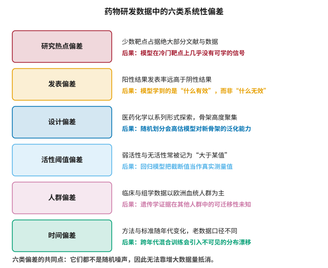
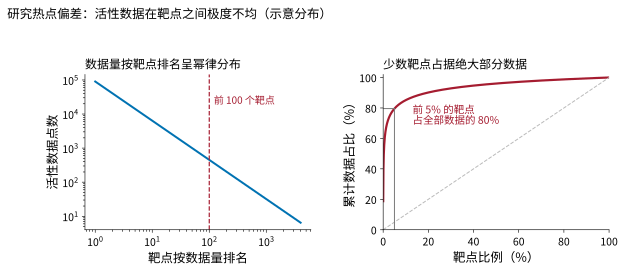
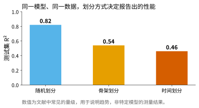
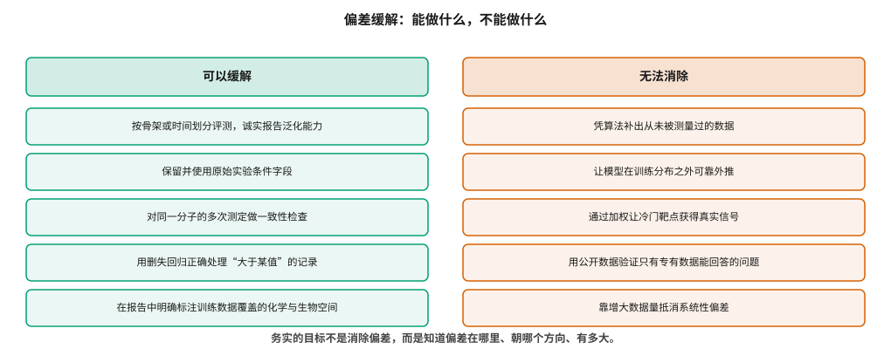

# 数据质量、偏差与治理 {#sec-data-quality}

## 本章目的 {.unnumbered .unlisted}

::: {.purpose-question}
数据不只是少和有噪声，它还偏向哪里，模型又会把这种偏向放大成什么？
:::

@sec-data-resources 说明了数据在**数量**上的困境。本章讨论更棘手的另一半：**方向**。

公开数据不是从化学空间和生物空间中随机抽样得到的，而是历史上的研究兴趣、实验可行性、发表激励和人群可及性共同筛选的结果。这意味着数据中的空白不是随机的空白，模型在这些空白处的失败也不是随机的失败——它们是可预测的，而且总是朝着同一个方向。

本章把这些偏差归为六类，逐一说明每类的来源与后果；接着分析一个容易被忽略的动力学机制——偏差如何通过信任与资源的反馈回路被放大；最后给出一套务实的立场：**目标不是消除偏差（那不可能），而是知道偏差在哪里、朝哪个方向、有多大**，并据此诚实地报告模型的适用边界。

::: {.callout-note title="给非技术读者的摘要"}

AI 学的是它看到的数据。问题在于，药物研发的数据不是对世界的公平取样。

举几个例子：全世界的研究者高度集中在少数几个“热门”基因上，另外上万个基因几乎无人问津；实验做成功了的容易发表，做失败的常常不发表；遗传学研究的参与者绝大多数是欧洲血统的人；同一个实验二十年前和今天的做法已经不一样了。

模型会原封不动地学走这些偏向，还会把它放大——因为它在数据多的地方表现好，研究者于是更信任它，于是更多资源投向那些地方，于是产生更多数据。数据少的地方则相反，陷入越不准越没人用、越没人用越没数据的循环。

本章讲这些偏向是怎么来的、会造成什么后果，以及什么办法真的有用、什么办法只是看起来有用。**成熟度**：问题认识清楚；缓解手段有限。

:::

::: {.callout-learning-objectives}

- 列举药物研发数据中的六类系统性偏差，说明各自的来源机制与对建模的具体后果
- 解释为什么系统性偏差无法通过增大数据量消除，以及它与标签噪声在数学性质上的区别
- 比较随机划分、骨架划分与时间划分的评测含义，并为给定用途选择合适的划分方式
- 说明删失数据的正确处理方式，以及两种常见错误处理各自造成的扭曲
- 描述偏差放大的反馈机制，并解释为什么它难以通过技术手段纠正
- 运用“遮蔽关键输入”这一通用诊断方法，判断模型实际依赖的是什么信息
- 列出一份可操作的数据治理检查清单，并区分哪些措施有效、哪些只是形式

:::

## 六类系统性偏差 {#sec-bias-taxonomy}

@fig-bias-taxonomy 归纳了六类偏差。它们的共同特征是**有方向**——不是围绕真值的随机抖动，而是系统性地偏向一侧。这是它们与 @sec-data-resources 讨论的标签噪声最重要的区别，而这个区别决定了两者需要完全不同的应对方式。

::: {#fig-bias-taxonomy fig-cap="**药物研发数据中的六类系统性偏差**：研究热点偏差、发表偏差、设计偏差、活性阈值偏差、人群偏差与时间偏差。每类偏差都有明确的来源与可预期的后果。共同点在于它们都不是随机噪声，因此无法靠增大数据量抵消。" fig-alt="六行结构，每行左侧为彩色方框标注偏差类型名称，右侧两行文字分别说明该偏差的表现与对建模的后果。"}

{width="62%"}

:::

::: {#dfn-systematic-bias .callout-definition title="系统性偏差"}

***系统性偏差***\index{系统性偏差}指数据的采集过程使得样本分布系统性地偏离目标总体分布，因而基于样本的估计会朝某个确定方向偏离真值。

1.  **意义**：与随机噪声不同，系统性偏差的期望不为零。增加样本量只会让偏离的估计更**精确**，而不会让它更**正确**——换句话说，置信区间会变窄，但区间的中心仍然偏离真值。
2.  **区别**：标签噪声影响精度（precision），系统性偏差影响准确度（accuracy）与适用域。一个模型完全可以在训练分布内表现优异，同时在分布外给出自信而错误的预测，而这两种情形在常规评测中看起来是一样的。
3.  **常见误区**：以为交叉验证能发现偏差。交叉验证的各折都抽自同一个有偏的数据集，因此会一致地报告出乐观的结果——它衡量的是模型在这个有偏分布上的稳定性，而不是这个分布本身是否可信。

:::

### 研究热点偏差 {#sec-bias-hotspot}

生物医学研究的注意力分布极度不均。Edwards 等人早在 2011 年就指出，人类蛋白质组中的研究关注度高度集中，大量蛋白几乎没有任何功能研究 [@edwards2011toomany]。Stoeger 等人随后系统分析了“被忽视基因”的成因，得到一个值得深思的结论：决定一个基因被研究多少的，很大程度上不是它的生物学重要性，而是历史路径依赖——早期是否有可用的抗体和实验工具、首批论文发表在什么级别的期刊、以及随之而来的经费集中 [@stoeger2018ignorome]。

换言之，这个分布反映的是**研究史**，而不是**生物学**。一个基因数据少，不代表它不重要，只代表没人研究过它。

@fig-target-longtail 用幂律分布刻画这一现象的形状。其后果对建模是直接的：在数据充裕的头部靶点上，模型可以学到有意义的结构—活性关系；而在长尾靶点上，训练数据往往只有几十条，此时模型输出的本质是**先验而非学习结果**——它反映的是训练集整体的平均倾向，而非这个特定靶点的性质。危险在于，模型不会因为数据少就降低输出的置信度，除非显式地建模不确定性（@sec-platform）。

::: {#fig-target-longtail fig-cap="**研究热点偏差的形状**：左图为活性数据量按靶点排名的幂律分布（双对数坐标）；右图为累计占比曲线，前 5% 的靶点占据了约 80% 的数据。这意味着模型在绝大多数靶点上实际可用的训练数据极少。图为示意分布，用于说明量级关系。" fig-alt="左右两个面板。左侧双对数坐标下的直线下降曲线，标注前 100 个靶点的位置；右侧累计占比曲线急剧上升后趋于平缓，标注前 5% 的靶点占全部数据的 80%，并与对角线对比。"}

{width="100%"}

:::

这种偏差与 @sec-target 讨论的知识图谱度偏差，是同一现象在两种数据结构上的表现：文献多的节点在图中连接更密，于是图算法与语言模型会一致地偏向它们。最具迷惑性的地方在于，这种偏向在输出中看起来像是“证据更强”——节点连接多、相关文献多、模型置信度高，三者同时出现，很容易被解读为该靶点确实更有前景。

### 发表偏差 {#sec-bias-publication}

阳性结果的发表率远高于阴性结果，这一点在医学研究中已有大量实证。它对药物研发数据的影响分两层，而第二层比第一层更难处理。

第一层是**缺失的阴性数据**。ChEMBL 中记录的绝大多数是有活性的分子，因为无活性的化合物通常不会被写进论文。这造成两个后果：分类模型的训练集天然失衡，需要人工构造或采样负例；更重要的是，“什么结构不起作用”这一同样有价值的知识无从学起。对医药化学家而言，知道哪条路走不通往往和知道哪条路走得通同等重要，但这部分知识在公开数据中系统性缺席。

第二层更微妙：**已发表的阳性结果中也有相当比例无法复现**。Prinz 等人报告，拜耳内部对已发表靶点研究的复现尝试中，只有约四分之一的结果能被完全或大部分重复 [@prinz2011believe]；Begley 与 Ellis 在安进的肿瘤学复现工作中给出了类似量级的结论 [@begley2012reproducibility]。这意味着文献中的“证据”本身需要按可靠性加权，而数据库在收录时无法做这种加权——它只能记录“某文献报告了某数值”，无法记录“这个数值有多可信”。

两层叠加的结果是：训练数据不仅缺少阴性样本，其阳性样本中还混有相当比例的假阳性，而且两者都朝同一个方向偏移。

### 设计偏差 {#sec-bias-design}

医药化学的探索方式决定了数据的结构。研究者的工作模式是围绕一个有希望的骨架合成几十个类似物，系统性地改变取代基，观察活性如何变化。这种做法在化学上完全合理——它是构效关系研究的标准范式——但它使得化学数据在骨架维度上高度聚集，而不是在化学空间中均匀铺开。

@fig-split-effect 展示了这一偏差在评测中的直接后果。同一个模型、同一份数据，仅仅改变训练—测试的划分方式，报告出的性能就会有显著差异。

::: {#fig-split-effect fig-cap="**划分方式决定报告出的性能**：随机划分、骨架划分与时间划分下的典型测试集 R²。随机划分会把同一系列的类似物分到两边，模型只需识别系列即可给出接近的预测；骨架划分与时间划分则要求模型真正外推。数值为文献中常见的量级，用于说明趋势。" fig-alt="三根柱状条，自左向右分别为随机划分、骨架划分、时间划分，高度依次降低，顶部标注对应的 R² 数值。"}

{width="70%"}

:::

Sheridan 较早系统论证了时间划分（用某个时间点之前的数据训练、之后的数据测试）最接近真实的前瞻性预测场景——因为真实项目中，你永远是用已知的去预测未知的，而“未知”在时间上总是更晚 [@sheridan2013timesplit]。Walters 与 Barzilay 在对 AI 制药的批判性评估中，把划分方式列为最常见的方法学问题之一 [@walters2020critical]。

::: {#pri-split-defines-claim .callout-principle title="划分方式定义了性能宣称的含义"}

**判断**：一个性能数字离开划分方式就没有意义。随机划分回答的是“在已知系列内插值有多准”，骨架划分回答的是“对新骨架外推有多准”，时间划分回答的是“用历史数据预测未来项目有多准”。三者评价的是三种不同的能力，数值之间不可直接比较。

**实践含义**：读到性能数字时，第一个问题永远是划分方式；看不到划分方式说明的报告，应当视为未报告性能。反过来，在自己的项目中选择划分方式时，判据是“这个模型将被用来做什么”——用于已知系列的取代基优化，随机划分有参考价值；用于评估全新骨架，只有骨架划分的结果可信。

:::

### 活性阈值偏差 {#sec-bias-censoring}

实验测定有检测范围。当一个化合物在最高测试浓度下仍然没有表现出活性时，记录通常写作「`IC50` > 10 μM」——这是一条**删失数据**（censored data），它告诉我们真值位于某个区间内，而非某个具体值。

这类记录在数据库中占比不低，而常见的两种处理方式都是错的。

**直接丢弃**会丢掉阴性信息，进一步加剧发表偏差造成的失衡——本来阴性样本就少，再丢掉一批，训练集就几乎只剩活性分子了。

**当作精确值**（把「> 10 μM」当作 10 μM）后果更严重：它会在检测上限处堆积出一个本不存在的尖峰。回归模型看到大量分子的活性“恰好”是 10 μM，会把这个人为的聚集当作真实的分布特征去拟合，从而系统性地扭曲整个预测函数。

正确的做法是使用**删失回归**（Tobit 模型或等价的似然构造）：对精确观测值使用常规的似然项，对删失观测值使用累积分布函数给出的区间概率。这样模型就“知道”这些点只提供了一个单边约束。这一处理在统计学上完全标准，在药物研发建模实践中却经常被省略——原因通常不是不懂，而是主流机器学习框架的默认损失函数不支持它，需要额外实现。

### 人群偏差 {#sec-bias-population}

遗传学研究的参与者构成长期以欧洲血统人群为主。Sirugo 等人系统记录了这一失衡及其后果 [@sieber2022diversity]：基于此类数据得到的遗传关联、多基因风险评分乃至药物基因组学结论，在其他人群中的可迁移性往往显著下降。原因既有生物学的（等位基因频率、连锁不平衡结构在人群间不同），也有统计学的（在一个人群中达到显著性的位点，在另一人群中可能因频率过低而无法检出）。

这一偏差对 @sec-target 讨论的人类遗传学证据有直接影响。遗传学支持被认为是最强的靶点证据之一——@sec-science-gaps 会给出它把成功率约提高一倍的量化结果——但这种支持的强度本身依赖于研究人群。对于以非欧洲人群为主要患者群体的适应症，证据链的可靠性需要单独评估，不能直接援引基于欧洲人群的结论。

中国的大规模队列建设正在部分改变这一格局，而这既是科学机会也带来合规要求，@sec-reg-china 会结合人类遗传资源管理的具体规则讨论。

### 时间偏差 {#sec-bias-temporal}

二十年前的高通量筛选数据与今天的数据，在测定方法、质控标准、化合物纯度要求上都不相同。把它们混合训练，等于假设这些差异可以忽略。Landrum 与 Riniker 的分析指出，跨来源合并 `IC50` 与 `Ki` 数据本身就是显著的噪声来源 [@landrum2024adme]——而跨年代合并则在此之上又叠加了一层方法学漂移。

更隐蔽的是**化学空间随时间的漂移**。行业关注的分子类型在持续变化：从传统的类药小分子，到大环化合物、共价抑制剂、分子胶与蛋白降解剂。老数据对这些新模态几乎没有覆盖，因此一个在历史数据上训练的模型，面对新模态时实际处于分布外状态——而它不会主动告诉你这一点。

## 偏差的放大机制 {#sec-bias-amplification}

偏差不只是被模型被动地学走，还会被主动放大。机制是一个自我强化的反馈回路：

数据多的区域 → 模型在该区域预测更准 → 研究者更信任模型在该区域的输出 → 更多项目投向该区域 → 产生更多数据 → 回到起点。

与此同时，数据少的区域经历一个方向相反的循环：模型预测不准 → 研究者不信任 → 投入减少 → 数据继续稀缺 → 模型继续不准。

这个机制值得特别注意的地方在于：**它不依赖任何一方做出错误决策**。研究者更信任在数据充足区域表现更好的模型，这是理性的；资源向成功概率更高的方向倾斜，这也是理性的。偏差的放大是这些局部理性选择的累积结果，因而无法通过“让大家更谨慎”来纠正。

这意味着 AI 工具可能**加剧**而非缓解研究注意力的不均衡。缓解它需要的是资源配置层面的干预——例如针对未充分研究靶点的专项资助计划、要求覆盖长尾靶点的数据共建项目——而不是更好的算法。@sec-ethics 会从分配公平的角度再次讨论这一机制，因为同样的逻辑也作用于疾病领域之间。

::: {#ws-bias-dude .callout-war-story title="当模型学会了识别诱饵而不是识别结合"}

虚拟筛选领域的 DUD-E 数据集是一个教科书级的案例，它展示了偏差如何以一种完全出人意料的方式进入模型。

DUD-E 为每个活性分子配了数十个“诱饵”分子作为阴性样本，诱饵的选取原则是**理化性质相似但拓扑结构不同**。设计意图很清楚：让模型无法靠分子量、脂水分配系数这类简单性质把活性与非活性区分开，从而被迫学习真正的结合特征。

但 Chen 等人的分析发现，这一配对过程在统计上并不完美：活性分子与诱饵分子在某些性质的分布上仍然存在系统性差异。深度学习模型足够灵活，能够捕捉到这些与蛋白—配体结合完全无关的残余特征，从而在基准上取得优异指标。

决定性的证据来自一个简单的实验：当研究者把蛋白结构信息完全遮蔽、只给模型配体信息时，模型性能竟然没有明显下降。既然不需要知道蛋白长什么样就能预测“结合”，那它学的显然不是结合。

这个案例的价值不止于揭示某个数据集的缺陷，更在于它示范了一种**通用的诊断方法**：把你认为模型应该依赖的信息去掉，看性能降不降。如果不降，模型依赖的就是别的东西。这个方法成本极低、结论决定性，适用于本书讨论的几乎所有模型类型，@sec-evaluation 会把它正式化为消融实验的标准用法。

:::

## 能做什么，不能做什么 {#sec-bias-mitigation}

@fig-bias-mitigation 把缓解手段分成两栏。这个区分很重要，因为相当一部分被称为“去偏”的方法实际属于右栏——它们在形式上做了处理，却没有引入任何新信息，因而不可能改变根本问题。

::: {#fig-bias-mitigation fig-cap="**偏差缓解的边界**：左栏列出确实有效的做法，核心都是诚实地暴露而非掩盖偏差；右栏列出无法做到的事，它们的共同特征是试图在不引入新测量的前提下补出缺失的信息。务实的目标不是消除偏差，而是知道偏差在哪里、朝哪个方向、有多大。" fig-alt="左右两栏对照，左栏标题为可以缓解，下列五项有效做法；右栏标题为无法消除，下列五项不可能做到的事。"}

{width="100%"}

:::

::: {.fallacy-pitfall}

**谬误**：*用重采样或重加权就能消除数据偏差。*

重加权可以改变模型对不同样本的重视程度，在**协变量偏移**（训练与测试的输入分布不同但条件分布相同）这类特定场景下确实有用。但它不能创造信息：如果某个靶点只有二十条数据，把这二十条的权重调高十倍，模型得到的仍然是二十条数据的信息量，只是方差更大、更容易过拟合到这二十条的具体细节上。

对于“数据根本不存在”的区域，任何重加权方案都无能为力——这不是方法的缺陷，而是信息论的基本约束。

:::

### 一份务实的治理清单 {#sec-bias-checklist}

把上述内容落到可执行的层面，一份最小可行的数据治理清单包含以下六项。

**结构标准化。** 化学结构的表示不唯一——互变异构、盐型、立体化学标注、芳香性感知方式的差异，都会让同一个分子在不同来源得到不同的标识符。Fourches 等人给出了系统的结构清洗流程 [@fourches2010curation]，其核心结论值得反复强调：不做结构清洗的建模结果不可信，而这一步在实践中经常被跳过，因为它既不产生论文也不产生指标。

**保留来源与条件。** 测定类型、缓冲体系、细胞系、文献来源应作为字段保留，而非在标准化时丢弃。它们是后续判断数据能否合并使用的唯一依据——@sec-data-resources 已说明，没有底物浓度就无法判断两条 `IC50` 是否可比。

**一致性检查。** 对同一分子—靶点配对的多次测定计算离散度，离散过大的条目应当标记而非盲目取平均。取平均隐含了“这些测量都在估计同一个量”的假设，而当离散度远超标签噪声水平时，这个假设通常不成立——更可能的解释是它们测的根本不是同一件事。

**正确处理删失值。** 保留不等号方向，使用删失回归，而非丢弃或当作精确值。

**明确记录适用域。** 模型交付时应附带其训练数据覆盖的化学与生物空间描述，以及超出该范围时的行为说明。@sec-evaluation 会讨论如何量化这一点，@sec-platform 会讨论如何在工程上把它变成预测输出的一部分。

**按用途选择划分方式，并在所有性能报告中明确标注。**

::: {#chk-data-quality .callout-checkpoint}

1. 系统性偏差与标签噪声在数学性质上有什么本质区别？这一区别为什么决定了两者的处理方式不同？
2. 为什么交叉验证无法发现数据集本身的系统性偏差？它实际衡量的是什么？
3. 一条记录为「`IC50` > 10 μM」的数据，三种处理方式（丢弃、当作 10 μM、删失回归）分别会导致什么后果？
4. 描述偏差放大的反馈回路，并说明为什么它不依赖任何一方做出错误决策。
5. “遮蔽模型应该依赖的信息，看性能降不降”这一诊断方法，可以如何应用到结构预测或 ADMET 模型上？
6. 为什么说重加权不能解决长尾靶点的数据稀缺问题？它在什么场景下确实有用？
7. 一个基因的研究数据很少，能否推断它的生物学重要性较低？为什么？

:::

## 小结 {#sec-data-quality-summary}

药物研发数据的偏差不是数据采集中的疏忽，而是**研究活动本身的结构在数据上的投影**：研究热点的集中、发表激励的不对称、医药化学的探索方式、实验的检测范围、研究人群的构成、方法的代际变迁——每一项都在数据中留下了有方向的印记。

模型会忠实地学走这些印记，并通过信任与资源的反馈回路放大它们。由于这一放大机制建立在局部理性选择之上，它无法靠技术手段或个体的谨慎来纠正，只能通过资源配置层面的干预来缓解。

可行的应对不是去偏算法，而是方法学纪律：诚实的评测划分、完整的来源记录、正确的删失处理、明确的适用域声明。这些做法不会让模型变得更准，但会让它的性能数字变得可信——而在一个充斥着不可比性能宣称的领域里，可信本身就是稀缺品。

::: {.callout-takeaways title="偏差有方向，噪声没有"}

* **六类偏差**：研究热点、发表、设计、活性阈值、人群、时间——全部有方向，无法靠数据量抵消。
* **数据反映研究史而非生物学**：一个基因数据少，只说明没人研究过，不说明它不重要。
* **交叉验证发现不了它们**：各折抽自同一个有偏数据集，会一致地给出乐观结果。
* **划分方式定义性能含义**：随机、骨架、时间三种划分评价的是三种能力，数值不可比。
* **删失数据要按删失处理**：丢弃会加剧失衡，当作精确值会在检测上限处制造虚假尖峰。
* **偏差会被放大**：数据多→预测准→更受信任→更多投入→更多数据；长尾则陷入相反的循环。
* **务实目标**：不是消除偏差，而是知道它在哪、朝哪个方向、有多大，并诚实地报告出来。

:::

::: {.callout-chapter-connection title="从公开数据的困境到自有数据的建设"}

既然公开数据在数量和方向上都存在根本限制，企业的出路就是建设自己的数据。@sec-data-flywheel 讨论这件事的具体做法：数据飞轮的四个环节如何真正转起来、三处最容易断裂的地方在哪里、为什么迭代周期比单轮数据量更重要，以及当数据不能共享而模型可以时，联邦学习能解决什么、又为什么技术成熟却迟迟难以普及。

:::
