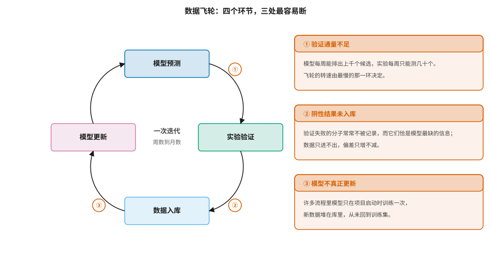
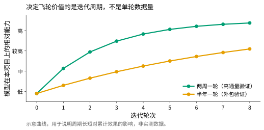
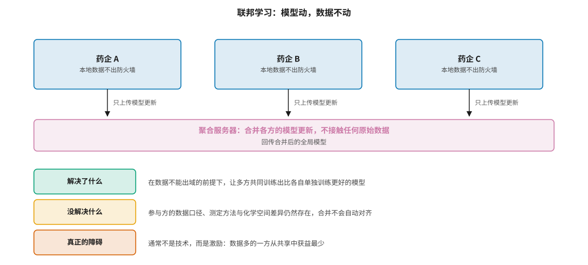

# 数据飞轮、数据协作与联邦学习 {#sec-data-flywheel}

## 本章目的 {.unnumbered .unlisted}

::: {.purpose-question}
公开数据有天花板，企业要自己造数据——这件事具体怎么做，又最容易卡在哪一环？
:::

@sec-data-resources 说明了公开数据的量级限制，@sec-data-quality 说明了它的方向性偏差。两者共同指向同一个结论：**真正的差异化只能来自自有数据**。

这正是“数据飞轮”成为 AI 制药商业叙事核心的原因——模型给出预测，实验验证预测，验证结果回流训练模型，模型变得更好，下一轮预测更准。逻辑链条无可挑剔，现实中却经常转不起来。

本章拆解这个循环的四个环节，指出三处最常断裂的地方；解释为什么**迭代周期比单轮数据量更重要**，以及这一判断对投资优先级的直接含义；最后讨论当数据不能共享时，联邦学习能解决什么、不能解决什么，以及为什么它技术上成熟却迟迟难以普及。

::: {.callout-note title="给非技术读者的摘要"}

公开的数据不够用，所以 AI 制药公司要自己做实验攒数据，形成一个循环：“模型预测哪些分子有希望 → 实验测一测 → 把结果喂回模型 → 模型更准 → 下一轮预测更好”。这个循环叫数据飞轮。

听起来很美，实际转起来有三个常见卡点：**实验做得太慢**（模型一周能排一千个，实验一周只能测几十个）；**失败的结果没人记录**（而失败恰恰是模型最需要知道的）；**数据攒了但模型其实从来没重训过**。

还有一个反直觉的结论：决定飞轮价值的主要是“转得多快”而不是“每轮攒多少”。两周转一圈和半年转一圈，在同样的项目周期里积累的效果差好几倍。

至于不同药企之间能不能把数据合起来用——技术上有办法（叫“联邦学习”，数据不出门，只交换模型），但真正的障碍往往不是技术，而是数据多的那家公司觉得自己吃亏。**成熟度**：概念清晰；真正跑通的案例不多。

:::

::: {.callout-learning-objectives}

- 描述数据飞轮的四个环节及其各自对应的可度量指标，并识别三处最常见的断裂点
- 解释为什么迭代周期对飞轮的累计效果比单轮数据量更关键，以及这对投资优先级的含义
- 说明企业自有阴性结果的三重价值，以及它在实践中被忽略的原因
- 区分飞轮中的“利用”与“探索”两种实验选点策略，并说明长期效果为何依赖后者
- 描述联邦学习的基本机制，区分它能解决与不能解决的三类问题
- 评估数据协作联盟的激励结构，解释为什么技术可行不等于商业可行

:::

## 飞轮的四个环节 {#sec-flywheel-loop}

@fig-data-flywheel 给出飞轮的结构与三个断点。需要强调的是：这不是一个比喻，而是一个**有具体工程含义的闭环**。每个环节都对应可度量的指标——预测通量、验证通量、入库延迟、再训练频率——因此当飞轮转不起来时，总能定位到其中某一项，而不必停留在“协同不够”这类无法执行的诊断上。

::: {#fig-data-flywheel fig-cap="**数据飞轮的四个环节与三个断点**：模型预测、实验验证、数据入库、模型更新构成闭环。三个最常见的断裂点分别是验证通量不足、阴性结果未入库、模型不真正更新。飞轮的转速由最慢的环节决定，而不是由最快的环节决定。" fig-alt="左侧为四个方框围成的环形流程，依次为模型预测、实验验证、数据入库、模型更新，箭头顺时针相连，中心标注一次迭代的周期；右侧三个方框分别说明三个断点及其成因。"}

{width="100%"}

:::

### 断点一：验证通量 {#sec-flywheel-throughput}

计算与实验之间存在巨大的通量差：模型每天可以给出数万个预测，而典型的生物活性测定每周只能处理数十到数百个化合物。两者相差三到四个数量级。

这意味着**飞轮的转速完全由实验端决定**，再快的模型也无法让它转得更快。这一点看似显然，却经常在平台建设中被忽视——因为模型侧的改进可见、可度量、可发论文，而实验侧的改进琐碎且昂贵。

这是许多 AI 制药公司自建自动化实验室的直接原因（@sec-synthesis 讨论的自驱动实验室）。但自动化本身也有明确边界：它主要提升的是**标准化测定**的通量，例如酶活性测定、细胞活力测定这类方案成熟、试剂现成的实验。而真正决定项目成败的往往是非标准的测定——一个新靶点可能根本没有现成的活性检测方法，需要先花数月建立并验证测定体系。自动化无法压缩这部分时间。

因此，评估一家公司的自动化能力时，有价值的问题不是“你们有多少台机器人”，而是“新建一个测定方法要多久”。

::: {#pri-flywheel-slowest .callout-principle title="飞轮的转速由最慢环节决定"}

**判断**：数据飞轮是一个串行闭环，其周期等于各环节耗时之和。优化已经很快的环节——例如把模型推理从一小时压缩到十分钟——对整体周期几乎没有影响；只有缩短当前最慢的那个环节才有意义。

**实践含义**：评估一个 AI 制药平台时，不要问它的模型有多快，而要问它完整走完一轮“预测—验证—入库—更新”需要多久，以及这个数字在过去一年里变化了多少。前者衡量当前状态，后者衡量这家公司是否真的在优化正确的东西。

:::

### 断点二：阴性结果 {#sec-flywheel-negatives}

实验验证会产生两类结果：成功的和失败的。@sec-data-quality 讨论的发表偏差在企业内部同样存在，只是表现形式不同——失败的化合物往往被口头传达后就不再记录，或者只记录在个人实验记录本和临时表格中，而没有进入结构化数据库。

这是一个代价高昂的遗漏，原因有三，而且三者是叠加的。

**第一，阴性结果是模型最缺的信息。** 公开数据几乎全是阳性（@sec-data-quality），因此企业自有的阴性数据具有公开数据无法替代的价值。从信息论角度看，当训练集中某一类样本极度稀缺时，每增加一个该类样本带来的信息增益远高于增加一个多数类样本。

**第二，阴性结果的噪声水平更低。** 它们通常与阳性结果在同一批实验、同样的条件下产生，因此不存在 @sec-data-resources 讨论的跨来源条件差异问题。这使得企业内部的阴阳性配对数据，在质量上明显优于任何公开数据组合。

**第三，这些实验已经做了，成本已经付出。** 不记录等于把已经花掉的钱扔掉——这是整个飞轮中投入产出比最高的一项改进，因为它不需要新增任何实验成本，只需要流程纪律。

Bender 与 Cortes-Ciriano 在对 AI 制药的批判性讨论中反复强调了这一点：化学与生物数据的价值不只在于规模，更在于**覆盖的完整性**——包括失败的那一半 [@bender2021practical]。

### 断点三：模型是否真正更新 {#sec-flywheel-retrain}

在相当多的实际流程中，模型只在项目启动时训练一次，之后产生的数据堆在数据库里，从未被用于再训练。

原因通常不是技术问题。再训练在技术上是例行操作，困难在于流程：谁负责触发再训练？新模型需要用什么标准验证才算合格？什么时候从旧模型切换到新模型？切换后如果效果变差，由谁决定回滚？这些职责在多数组织中没有明确归属，于是默认行为就是“维持现状”。

一个务实的判断标准是：**问团队上一次用新数据重训模型是什么时候**。如果答案以季度甚至年计，那么这个项目实际上没有飞轮，只有一个一次性的模型加上一个在增长的数据库——后者是成本，不是资产。

## 周期比数据量更重要 {#sec-flywheel-cycle}

@fig-cycle-time 说明了一个容易被忽略的事实：飞轮的价值主要来自**迭代次数**，而非单轮的数据量。两周一轮和半年一轮，在同样的项目时长内，累计效果差异巨大。

::: {#fig-cycle-time fig-cap="**迭代周期决定飞轮的累计效果**：两条曲线代表同一个起点、同样的单轮数据增量，但迭代周期不同。在固定的项目时长内，短周期的累计提升远超长周期。这解释了为什么企业愿意为缩短验证周期付出可观的固定成本投入。曲线为示意，用于说明机制。" fig-alt="折线图，横轴为迭代轮次，纵轴为模型在本项目化学空间上的相对能力。绿色的两周一轮曲线快速上升并趋于饱和，橙色的半年一轮曲线上升缓慢，始终低于前者。"}

{width="85%"}

:::

背后的机制是复利：每一轮的模型改进都会提高下一轮选点的质量，因此改进是累乘而非累加的。在固定的项目周期内，轮次数量决定了复利的次数。

这一点对投资与建设决策有直接含义。一笔用于**缩短周期**的投入——自动化测定平台、样品管理系统、数据自动入库管道、标准化的再训练流水线——其回报通常高于同等金额用于**扩大单轮规模**的投入。用一个粗略的比喻：前者改变的是指数的底数，后者只改变系数。

与此相关的是主动学习在飞轮中的作用。@sec-screening 讨论过主动学习在超大库筛选中的应用；在飞轮语境下，它的价值是让每一轮有限的实验预算用在**信息量最大**的分子上——不是选预测分数最高的，而是选模型最不确定的 [@settles2009activelearning]。

这两种选点策略的区别在实践中经常被混淆，但它们服务于完全不同的目标：选高分分子是**利用**（exploitation），目的是尽快拿到可用的化合物；选不确定分子是**探索**（exploration），目的是改进模型本身。项目的短期产出依赖前者，而飞轮的长期效果依赖后者。

::: {.fallacy-pitfall}

**谬误**：*每一轮都测模型打分最高的分子，飞轮就转起来了。*

只测高分分子，模型得到的全是它已经确信的区域的确认信息。这类数据对改进模型几乎没有帮助——模型本来就认为这些分子活性高，实验证实了这一点，参数几乎不会更新。

更糟的是，这种做法会让训练数据越来越集中在已探索的化学空间内，使模型的适用域不断收窄，而表观性能（在同样集中的测试集上）却不断上升。这正是 @sec-data-quality 讨论的偏差放大机制在企业内部的重演。

健康的飞轮需要在每轮实验预算中保留一部分给模型不确定的区域，哪怕这些分子的预期活性不高。常见的做法是按固定比例分配，例如七成用于利用、三成用于探索，具体比例取决于项目阶段——早期探索比例应更高，接近交付时则相反。

:::

::: {#ws-flywheel-mismatch .callout-war-story title="数据攒了三年，模型还是第一版"}

一种在行业中反复出现的情形：公司投入可观资源建设了自动化实验平台和数据湖，三年间积累了数十万条内部测定数据。但当有人问“这些数据让模型提升了多少”时，发现无人能回答——因为从未做过对照实验。

深入追查通常会发现几件事叠加在一起，而每一件单独看都不算严重。数据确实入库了，但分散在几个互不相通的系统中，化合物标识符不统一（@sec-platform 讨论的实体解析问题），需要大量清洗才能用于训练。负责建模的团队与负责实验的团队分属不同部门，数据交接靠临时导出的表格。再训练没有固定的触发条件和验证流程，于是每次讨论的结论都是“等下个版本再说”。

这个案例的教训不在于任何单一环节做错了，而在于飞轮是一个**系统属性**：四个环节各自都在正常运转，闭环却始终没有形成。这也解释了为什么“把每个环节都做好”不等于“飞轮能转”——闭环的形成需要有人对整个循环负责，而不是对其中某一段负责。

@sec-platform 讨论的平台建设，核心任务正是把这些环节在工程上真正接起来，而不是分别优化。

:::

## 跨机构的数据协作 {#sec-flywheel-collab}

单个企业的数据再多，也只覆盖它做过的项目。跨机构合并数据在统计上有明显收益——更大的化学空间覆盖、更多的靶点、更好的长尾代表性——但原始数据的共享在商业上几乎不可能，因为化合物结构本身就是核心资产。

这个矛盾催生了一类技术方案：让模型流动，而数据不流动。

### 联邦学习 {#sec-flywheel-federated}

::: {#dfn-federated .callout-definition title="联邦学习"}

***联邦学习***\index{联邦学习}（federated learning）指多个参与方在不交换原始数据的前提下共同训练一个模型：各方在本地数据上计算模型更新（梯度或参数增量），只把更新上传到聚合服务器，服务器合并后回传全局模型，如此迭代 [@mcmahan2017federated]。

1.  **意义**：它解除了“数据必须集中”这一前提，使得受法规或商业机密限制的数据得以参与建模。对药物研发而言，这意味着多家企业可以共同训练出比任何一方单独训练更好的模型，而无需暴露各自的化合物库。
2.  **区别**：联邦学习不等于隐私保护。模型更新本身携带训练数据的统计信息，在特定条件下可能被用于反推原始样本，因此需要额外的差分隐私或安全聚合机制 [@dwork2014privacy]。把“数据没出门”等同于“信息没泄漏”是一个技术上的误解。
3.  **常见误区**：以为联邦学习能自动解决数据异质性。各方的测定方法、化学空间与数据口径差异依然存在，而参数合并不会对齐这些差异——它只是把带有不同系统性偏移的模型平均起来，结果可能比任何单方模型都更难解释。

:::

@fig-federated 给出机制示意与三层评估。

::: {#fig-federated fig-cap="**联邦学习的机制与边界**：各参与方在本地训练，只上传模型更新，聚合服务器不接触原始数据。它解决了数据不能出域的问题，但没有解决各方数据口径与化学空间的异质性；而实践中最大的障碍通常不是技术，而是激励结构。" fig-alt="上方三个药企方框各自向下连到中间的聚合服务器横条，箭头标注只上传模型更新；下方三行分别标注解决了什么、没解决什么、真正的障碍。"}

{width="100%"}

:::

MELLODDY 是这一思路迄今规模最大的实践：十家制药公司在欧盟创新药物倡议的框架下，用联邦学习在合计数十亿条测定记录上训练 QSAR 模型，各方数据始终不出本地。公开报告的结论是，联邦模型在多数任务上优于单方模型，且未泄漏专有信息 [@heyndrickx2024melloddy]。

但报告中有一个细节值得特别注意：**收益分布极不均匀**。数据量小的参与方获益明显，而数据量大的参与方提升有限。这不是实现上的缺陷，而是统计学的必然——当一方已经拥有足够覆盖某个化学空间的数据时，加入其他方的数据带来的边际信息量自然很小。

这个发现直接引出了下一节的问题。

### 激励结构 {#sec-flywheel-incentive}

技术可行不等于商业可行。数据协作联盟面临一个结构性困难：**贡献与收益不对称**。

数据多的一方贡献了大部分信息，但由于它自己的模型已经较好，从合并中获得的边际提升最小；数据少的一方贡献有限，却获益最大。在没有补偿机制的前提下，理性的大玩家会选择不参与——而联盟失去大玩家后，对小玩家的吸引力也随之下降，最终可能整体瓦解。

这是一个典型的公共品供给问题，可能的缓解方式有三类，但都有各自的局限：

**按贡献度分配权益。** 这要求有可信的贡献度量化方法——例如基于 Shapley 值的数据估值。困难在于计算成本极高，且各方未必接受同一套估值标准。

**限定在竞争性较低的领域。** 例如只共享 ADMET 等通用性质数据，而不共享靶点特异的活性数据。这降低了参与门槛，但也降低了协作的价值，因为最有价值的恰恰是竞争性最强的那部分数据。

**由非营利方主导并提供额外激励。** MELLODDY 的公共资助模式属于此类——用外部资金补偿大玩家的机会成本。这种模式有效，但依赖持续的公共投入，难以自我维持。

这三种方式都在实践中被尝试过，但都没有成为普遍模式。这解释了一个表面上的矛盾：联邦学习的技术成熟度相当高，落地案例却很少。**瓶颈不在算法。**

::: {#chk-flywheel .callout-checkpoint}

1. 数据飞轮的四个环节是什么？各自对应什么可度量的指标？三个最常见的断点分别出在哪个环节？
2. 为什么说优化模型推理速度对飞轮周期几乎没有影响？评估自动化能力时应该问什么问题？
3. 企业自有的阴性结果数据，为什么比同等数量的阳性数据更有价值？列出三个理由。
4. 在飞轮中，“测打分最高的分子”与“测模型最不确定的分子”各自对应什么目标？为什么长期效果依赖后者？
5. 为什么迭代周期的改进是“改变指数的底数”，而单轮规模的改进只是“改变系数”？
6. 联邦学习解决了哪个问题？它没有解决哪两类问题？
7. 为什么数据量大的参与方缺乏加入数据联盟的动机？三种缓解方式各自的局限是什么？

:::

## 小结 {#sec-data-flywheel-summary}

数据飞轮是 AI 制药最有说服力的商业逻辑，也是最难在工程上真正实现的。

它的困难不在任何单一环节——预测、实验、入库、再训练各自都有成熟做法——而在于把四者接成闭环并持续运转。三个断点（验证通量、阴性结果、再训练）的共同特征是：它们都是组织与流程问题，而非算法问题，因此也无法靠引进更好的模型来解决。

迭代周期比单轮数据量更重要这一事实，为投资决策提供了清晰的优先级：缩短周期的投入优于扩大规模的投入。而在选点策略上，健康的飞轮必须为探索保留预算，否则会在表观性能上升的同时收窄适用域。

跨机构协作方面，联邦学习在技术上已经可行，MELLODDY 证明了它的有效性，但贡献与收益的结构性不对称仍是普及的主要障碍——这是一个激励设计问题，不是一个技术问题。

第三篇到此结束。数据的数量有限、方向有偏、自建困难、共享受阻——这四重约束构成了后续所有技术与商业讨论的背景。

::: {.callout-takeaways title="飞轮是系统属性，不是环节属性"}

* **四环节闭环**：预测、验证、入库、更新。任一环断开，飞轮就只是一个在增长的数据库——那是成本，不是资产。
* **转速由最慢环节决定**：验证通量通常是瓶颈，而自动化只能加速标准化测定，加速不了新测定方法的建立。
* **阴性结果最值钱**：公开数据几乎全是阳性，企业自有阴性数据不可替代，且噪声更低、成本已付。
* **周期优于规模**：缩短迭代周期改变复利次数，扩大单轮规模只改变单次增量。
* **探索与利用要平衡**：只测高分分子会让适用域收窄而表观性能上升，这是最有欺骗性的失败模式。
* **联邦学习的瓶颈不在技术**：贡献与收益的不对称，使数据联盟难以在没有外部补偿的情况下维系。

:::

::: {.callout-chapter-connection title="从数据到把一切接起来的工程"}

第三篇反复指向同一个结论：药物研发 AI 的瓶颈经常不在模型，而在把数据、工具与流程接起来的工程。第四篇转向这一层。@sec-toolchain 梳理开源工具链与模型生态的现状，说明为什么碎片化带来的“无声失败”是本领域特有的风险；@sec-platform 给出企业级 AI 平台的参考架构，并解释为什么决定成败的通常不是模型层；@sec-adoption 讨论组织、流程与投资回报——即技术如何真正被用起来。

:::
