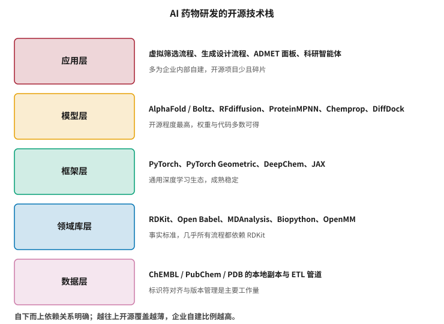
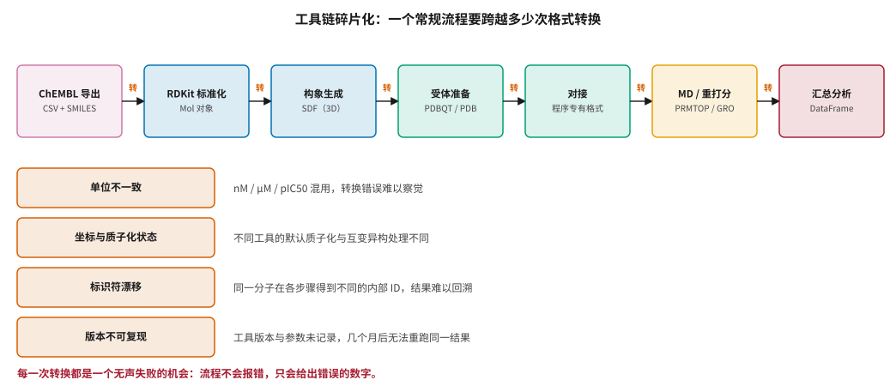
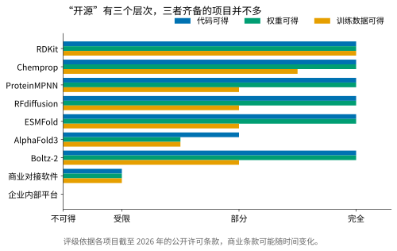

# 开源工具链与模型生态 {#sec-toolchain}

## 本章目的 {.unnumbered .unlisted}

::: {.purpose-question}
要真正跑通一条 AI 药物研发流程，需要哪些工具，它们之间最容易在哪里出错？
:::

第二篇讨论的模型、第三篇讨论的数据，在实践中都要通过具体的软件落地。这一层很少被写进论文，却消耗了项目中最多的工程时间——而且这部分时间的消耗往往不被计入“AI 研发成本”，从而造成对技术成熟度的系统性高估。

本章盘点 AI 药物研发的技术栈，说明为什么**工具链的碎片化**是这个领域特有、且被严重低估的成本来源。接着提出一个有实际后果的区分：“开源”实际上有三个层次——代码、权重、训练数据——三者齐备的项目远比宣传中少，而其中最稀缺的一层恰恰是企业最需要的。最后给出可复现性的最低要求清单，因为它不只是学术规范，还是 @sec-reg-west 讨论的监管可信度评估的前提。

::: {.callout-note title="给非技术读者的摘要"}

做 AI 药物研发不是写一个模型就完了，而是要把十几个不同的软件串起来：处理分子结构的、准备蛋白质的、做对接计算的、做分子动力学的、最后汇总分析的。

麻烦在于这些软件各自为政。文件格式不通用，单位有时是纳摩尔有时是微摩尔，同一个分子在不同软件里的内部编号还不一样。每接一次都有出错的可能，而且——这是最危险的部分——**出错时程序通常不会报错，只会安静地给出一个错误的数字**。等到几个月后实验结果对不上了才发现，中间已经基于错误数据做了好几个决定。

另外，大家常说的“开源模型”其实有讲究：有的只开放代码不给训练好的参数，有的给参数但不给训练数据，还有的加了“不可商用”的限制。用在企业项目里之前必须看清楚，因为后期替换的代价极高。**成熟度**：底层库成熟稳定；上层集成仍然很原始。

:::

::: {.callout-learning-objectives}

- 描述 AI 药物研发技术栈的五个层次、各层的代表性工具，以及开源覆盖密度自下而上递减的规律
- 解释“无声失败”的概念，说明它与程序崩溃相比为什么更危险
- 识别工具链碎片化的四类具体表现，并为每类给出可操作的检测方法
- 区分开源的三个层次（代码、权重、训练数据），说明各自对企业使用的不同含义
- 识别常见开源许可条款中影响商业使用的限制类型，并说明为什么必须在选型阶段确认
- 列出可复现性的五项最低要求，并解释每项缺失会导致什么后果

:::

## 技术栈的五层 {#sec-stack}

@fig-oss-stack 自下而上给出五层结构。一个值得注意的规律是：**越往上，开源覆盖越薄**。底层的领域库是全行业共用的事实标准，模型层也有大量高质量开源实现；但到了应用层——把这些拼成可用流程的那一层——几乎没有通用的开源方案，各家都在重复造轮子。

::: {#fig-oss-stack fig-cap="**AI 药物研发的开源技术栈**：自下而上为数据层、领域库层、框架层、模型层、应用层。依赖关系自下而上明确，但开源覆盖密度自下而上递减——底层是全行业共用的事实标准，顶层基本靠企业自建。" fig-alt="五层横向结构，自上而下依次为应用层、模型层、框架层、领域库层、数据层，每层左侧为彩色方框标注层名，右侧列出代表性工具与该层特征说明。"}

{width="72%"}

:::

**领域库层**是整个生态的地基。RDKit 承担了分子读写、标准化、指纹计算、子结构匹配、构象生成等几乎所有化学信息学的基础操作 [@rdkit]，其 API 设计与默认行为事实上定义了行业惯例。OpenMM 在分子动力学侧承担类似角色 [@eastman2017openmm]，Biopython 与 MDAnalysis 则覆盖序列处理与轨迹分析。

这种高度集中带来效率上的好处，但也意味着一个值得警惕的**单点依赖**：RDKit 对互变异构、芳香性感知、立体化学的处理方式，会无差别地传导到所有下游结果。当这些默认行为在版本之间发生细微变化时，整个行业的计算结果会同步发生漂移，而多数使用者不会察觉。

**框架层**是通用深度学习生态——PyTorch 及其图神经网络扩展、JAX——加上面向生命科学的封装如 DeepChem [@ramsundar2019deepchem]。这一层最成熟，基本不构成瓶颈，也是整个栈中唯一可以放心使用默认配置的部分。

**模型层**的开源程度出人意料地高。Chemprop 提供了分子性质预测的标准实现 [@yang2019chemprop]，AlphaFold、ESMFold、RFdiffusion、ProteinMPNN、Boltz-2 [@wohlwend2025boltz2] 的代码与权重大多可获取。这是本领域与许多其他 AI 领域的显著差别，根源在于结构生物学长期的开放传统——PDB 从创立起就是完全公开的，这一文化延续到了模型发布上。

**应用层**是最薄弱的一环。把模型串成可用流程、处理失败重试、管理中间结果、保证可复现——这些工作每家公司都在做，而且都在从头做。缺乏通用方案的原因不难理解：这一层与各企业的实验流程、数据模型、决策习惯深度耦合，很难抽象成通用组件。@sec-platform 会说明，这也正是差异化真正所在的地方。

## 碎片化的代价 {#sec-fragmentation}

@fig-fragmentation 追踪一条常规虚拟筛选流程需要跨越的格式转换。七个步骤，六次转换，每次转换都是一次潜在的失败点。

::: {#fig-fragmentation fig-cap="**工具链碎片化的具体形态**：一条常规流程需跨越六次格式转换，每次转换都是一次潜在的无声失败。四类常见问题分别是单位不一致、坐标与质子化状态处理差异、标识符漂移与版本不可复现。关键风险在于这些错误不会让程序报错，只会让它给出错误的数字。" fig-alt="上方七个方框依次相连，标注流程各步骤与其数据格式，步骤之间的箭头标注格式转换；下方四行列出单位不一致、坐标与质子化状态、标识符漂移、版本不可复现四类问题及说明。"}

{width="100%"}

:::

::: {#dfn-silent-failure .callout-definition title="无声失败"}

***无声失败***\index{无声失败}（silent failure）指计算流程在没有抛出任何错误的情况下产生了错误结果。它与崩溃或异常的区别在于：没有任何信号提示出了问题，结果看起来完全正常，只是不对。

1.  **意义**：在科学计算中，无声失败比崩溃危险得多。崩溃会立即被发现并修复，成本是几小时；无声失败可能在几个月后才因实验结果对不上而暴露，而此时已经基于它做了若干决策，成本是整个项目方向。
2.  **区别**：无声失败不是 bug 的一种，而是**接口假设不匹配**的后果。两个工具各自的实现都正确，只是对同一份数据的理解不同——因此没有任何一方会报错。
3.  **常见误区**：以为跑通了就是对的。流程能跑完只说明格式上兼容，不说明语义上一致。

:::

四类最常见的无声失败来源值得逐一说明，每一类都附带一个可操作的检测方法。

**单位不一致。** 活性数据可能以 nM、μM、`pIC50` 等形式出现。一次漏掉的单位换算会让结果偏差三个数量级，而这个偏差在排序结果中表现为“某些分子排得莫名其妙”，极容易被归因为“模型不够准”而非数据错误。**检测方法**：在流程入口处断言数值落在该量纲的合理范围内（例如 `pIC50` 应在 3–12 之间），超出即中止。

**质子化与互变异构。** 不同工具对同一分子在生理 pH 下的默认质子化状态处理不同，对互变异构体的选择也不同。这会直接改变对接计算中的氢键模式和静电分布，而输入输出的文件格式始终正常。**检测方法**：在准备步骤后导出分子的净电荷与可电离基团状态，与预期比对。

**标识符漂移。** 分子在流程各步骤中可能获得不同的内部编号——行号、文件名、程序生成的临时 ID——到汇总阶段难以确定某个结果对应哪个原始分子。这是实践中最常见也最耗时的调试来源。**检测方法**：在每一步都携带一个不可变的主键（如 InChIKey），并在汇总时校验主键集合与输入一致。

**版本不可复现。** 工具版本、参数设置、随机种子没有记录，几个月后无法重跑出同一结果。这在需要向监管机构或合作方解释某个决策依据时尤其麻烦（@sec-reg-west 讨论监管对可追溯性的要求）。**检测方法**：把环境清单与参数哈希随结果一同存储，并定期抽样重跑验证。

::: {#pri-toolchain-contract .callout-principle title="接口即契约，必须显式化"}

**判断**：工具之间传递的每一份数据都隐含着一组假设——单位、坐标系、质子化状态、标识符含义、缺失值约定。这些假设若不被显式记录和校验，就会在某次工具升级或流程变更后悄然失配，而流程不会给出任何提示。

**实践含义**：在流程的每个边界处加入断言检查（分子数量守恒、数值落在合理范围、标识符可回溯），宁可让流程在错误时崩溃，也不要让它安静地给出错误结果。这条原则在工程上的代价很小——几行断言——而收益是把无声失败转化为有声失败。

:::

::: {.fallacy-pitfall}

**谬误**：*流程跑通了，结果就是可信的。*

格式兼容与语义一致是两回事。一条流程可以在每一步都成功执行，同时在第三步就已经把分子的立体化学信息丢掉了——后续步骤会忠实地处理一个错误的分子，并给出格式完全正确的结果。

唯一可靠的验证方式是端到端的对照：用一组已知答案的分子跑完整条流程，看结果是否符合预期。这个“金标准集”应当在流程建立之初就准备好——通常包含若干已知活性的阳性对照、已知无活性的阴性对照、以及几个在立体化学或互变异构上容易出错的分子——并在每次工具升级或流程变更后重跑。

:::

## 开源的三个层次 {#sec-openness}

“开源”在本领域是一个需要拆解的词。@fig-openness-levels 按三个维度评估代表性项目。

::: {#fig-openness-levels fig-cap="**开源的三个层次**：代码可得、权重可得、训练数据可得。三者齐备的项目并不多，而三者对使用者的含义完全不同——代码决定能否审查与修改，权重决定能否直接使用，训练数据决定能否判断适用域与复现训练。评级依据各项目截至 2026 年的公开许可条款。" fig-alt="水平分组条形图，纵轴为项目名称，每个项目有三根条分别代表代码可得、权重可得与训练数据可得的程度，自不可得到完全分级。"}

{width="92%"}

:::

三个层次对使用者的含义各不相同，而它们通常被笼统地称为“开源”。

**代码可得**意味着可以审查实现细节、修改行为、理解模型实际做了什么。对于需要向监管机构解释决策依据的场景，这是必要条件——一个无法审查内部逻辑的模型，很难支撑 @sec-reg-west 讨论的可信度评估。

**权重可得**意味着可以直接使用而无需重新训练。这是最常被关注的一层，也是“开源”一词在公众讨论中通常指代的含义。但它本身不足以判断模型是否适用于手头的问题——权重告诉你模型会输出什么，不告诉你这个输出在什么范围内可信。

**训练数据可得**是三者中最稀缺、也最被低估的一层。没有训练数据，就无法判断 @sec-data-quality 讨论的适用域问题：不知道模型见过什么化学空间与什么靶点家族，也就无法判断手头的分子是在分布内还是分布外。对企业使用而言，这一层往往比权重更重要，因为它直接决定了能否为模型输出附上可信的不确定性估计。

### 许可条款的实际约束 {#sec-license}

学术项目常用的许可中，有四类条款会直接影响企业使用，而它们的影响程度差别很大。

**非商业使用限制**：学术免费、商用需单独授权。这是最容易识别的一类，但也最容易在原型阶段被忽略——因为原型本身通常属于“研究用途”。

**copyleft 传染性**：基于该代码的衍生作品必须以同样许可开源。对于把模型嵌入内部平台的场景，需要仔细判断“衍生作品”的边界在哪里。

**专利条款**：许可是否同时授予相关专利的使用权。缺少明确的专利授予条款意味着即使代码可用，使用它仍可能构成专利侵权。

**模型特有的使用场景限制**：某些模型许可明确禁止用于特定用途，这在生物设计类模型中逐渐增多（@sec-ip-biosecurity 讨论其治理背景）。

这些条款需要在**项目选型阶段**就确认，而非在产品化前夕。原因是替换成本的不对称：一个在原型阶段广泛使用的库，如果许可不允许商用，后期替换需要重写所有依赖它的代码并重新验证所有结果，成本可能远超重新实现本身。

## 可复现性的最低要求 {#sec-reproducibility}

计算流程的可复现性在这个领域有超出学术规范的重要性：它是 @sec-reg-west 讨论的监管可信度评估的前提——无法重现的计算结果，无法支撑任何监管结论。

一份最低要求的清单包括以下五项，每一项缺失都会导致特定的后果。

**环境固化。** 用容器或锁定的依赖清单固定所有软件版本。Bioconda 等生物信息学专用的包管理生态在这方面提供了基础设施 [@gruning2018bioconda]，但仅靠包管理器不足——还需要记录具体的版本号，因为“安装当时的最新版”在几个月后指向的是不同的软件。**缺失后果**：结果无法重现，且无法定位差异来源。

**参数与种子记录。** 所有非默认参数、随机种子、硬件配置都应随结果一起保存。硬件需要记录是因为不同 GPU 型号的浮点运算顺序可能不同，在迭代算法中会放大为可观的差异。**缺失后果**：同一环境下也无法重现。

**数据版本。** 公开数据库会定期更新，“用 ChEMBL 训练”没有意义，必须记录具体版本号与下载日期。**缺失后果**：无法判断模型见过哪些数据，也无法排除时间泄漏（@sec-evaluation）。

**中间结果留存。** 保留关键中间产物，使得出问题时能定位到具体环节而非重跑整条流程。**缺失后果**：调试成本随流程长度线性增长。

**代码归档。** 对于支撑了重要决策的流程，代码本身应当被归档到不可变的存储中 [@dicosmo2020softwareheritage]，而非仅依赖某个 Git 仓库的某个分支——分支会被删除，仓库会被重组。**缺失后果**：几年后监管问询时无法提供当时的计算依据。

::: {#ws-toolchain-versions .callout-war-story title="同一份输入，两套环境，两个答案"}

一种在计算化学团队中反复发生的情形：两位研究者用“同样的流程”处理同一批分子，得到了不一致的结果。

排查往往会追溯到一些看似无关的差异。RDKit 的小版本不同，导致芳香性感知或立体化学标注的行为有细微变化；或者受体准备步骤使用了不同版本的工具，质子化状态的默认判断发生了改变；又或者两人的 CUDA 版本不同，使得某个迭代算法的收敛路径略有分叉。

这类差异有三个共同特点。第一，**单独看每一步都没错**——每个版本的行为都是该版本的正确行为，没有任何一方是 bug。第二，**差异很小**，往往只影响一小部分分子的某些数值。第三，**后果可能很大**：在排序任务中，一小部分分子的位置变化足以改变最终挑选出来的候选集合，而候选集合决定了接下来几个月的实验方向。

这个现象的教训不是“要用新版本”或“要用旧版本”，而是**必须固定版本并记录**。而更深一层的教训是：如果一条流程的结果对工具小版本如此敏感，那么它对真实世界中那些未被控制的变量（晶体结构的选择、质子化状态的假设、构象采样的随机性）可能同样敏感。这种敏感性本身就是对结果可靠性的一个提示——它说明结论位于方法的不稳定区域，应当用独立方法交叉验证，而不是简单地相信其中一个。

:::

## 生态的现状判断 {#sec-toolchain-state}

把上述内容收敛成四条对实践有指导意义的判断。

**底层已经足够好，不要重造。** RDKit、OpenMM、PyTorch 这一层的成熟度很高，自研没有收益，反而会失去社区的 bug 修复与持续优化。企业的工程投入应该放在集成层。

**模型层的开放度高于预期，但要看训练数据。** 大量高质量模型可直接使用，真正的工作在于判断它们是否适用于手头的化学与生物空间——而这需要训练数据的信息，恰恰是最常缺失的一层。

**集成层是真正的差异化所在。** @sec-platform 会展开这一点：企业平台的价值不在于拥有更好的模型，而在于把模型、数据与实验流程可靠地接起来。

**评测基础设施仍然缺失。** Wognum 等人呼吁建立由产业界主导的、面向真实场景的评测体系 [@wognum2024benchmarking]，这一缺口是 @sec-evaluation 的主题，也是本领域当前最值得投入却最少有人投入的方向。

::: {#chk-toolchain .callout-checkpoint}

1. 为什么说技术栈越往上开源覆盖越薄？这一规律对企业的工程投入方向有什么含义？
2. 什么是无声失败？它与程序崩溃相比为什么更危险？成本差异体现在哪里？
3. 列举四类常见的无声失败来源，并为每类给出一种可操作的检测方法。
4. 开源的三个层次分别是什么？为什么训练数据的可得性对企业使用尤其重要？
5. 四类许可条款各自如何影响商业使用？为什么必须在选型阶段而非产品化前夕确认？
6. “用 ChEMBL 训练” 这句话为什么不足以支撑可复现性？缺少数据版本会导致什么具体风险？
7. 如果一条流程的结果对工具小版本敏感，这提示了什么更深层的问题？应当如何应对？

:::

## 小结 {#sec-toolchain-summary}

AI 药物研发的工具生态呈现一个明显的倒三角：底层领域库成熟稳定且高度集中，模型层的开放程度超出多数人的预期，而把它们拼成可靠流程的应用层几乎完全缺位。

这个结构决定了工程成本的分布——绝大部分时间花在集成、格式转换与可复现性保障上，而非模型开发。碎片化带来的无声失败是这个领域特有的风险，其危险之处在于它不会被发现，而应对它的方法不复杂但需要纪律：在每个接口处显式校验假设，固化环境与版本，准备金标准集做端到端验证。

关于“开源”，必须区分代码、权重与训练数据三个层次。其中训练数据的可得性决定了能否判断模型的适用域，而这恰恰是最常缺失的一层——这意味着大量“开源模型”在企业场景中实际上无法被负责任地使用。

::: {.callout-takeaways title="工程成本在集成层，不在模型层"}

* **倒三角结构**：底层库成熟集中，模型层相当开放，应用层几乎空白——工程投入应该瞄准后者。
* **无声失败是主要风险**：流程不报错却给出错误数字，往往数月后才因实验对不上而暴露。
* **接口即契约**：单位、质子化、标识符、版本——这些假设必须显式校验，断言的代价远低于收益。
* **开源有三层**：代码、权重、训练数据。缺了训练数据就无法判断适用域，模型也就无法被负责任地使用。
* **许可要在选型时确认**：非商业限制与 copyleft 条款的后期替换成本，可能超过重新实现本身。
* **可复现的五项最低要求**：固化环境、记录参数与种子、锁定数据版本、留存中间结果、归档代码。

:::

::: {.callout-chapter-connection title="从工具到平台"}

既然集成层是差异化所在，下一个问题就是怎么建。@sec-platform 讨论企业级 AI 药物研发平台的系统架构：它需要解决哪些问题、典型的分层设计是什么、自建与采购如何按组件权衡，以及为什么大多数平台建设项目的失败原因与技术无关。

:::
