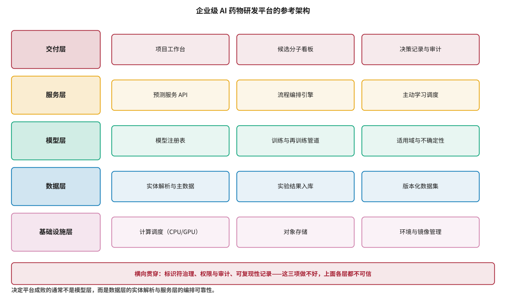
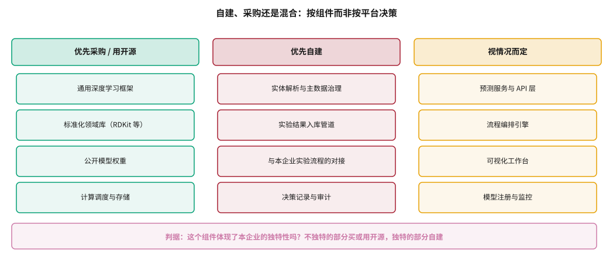
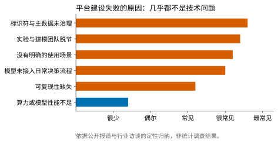

# AI 药物研发平台的系统架构 {#sec-platform}

## 本章目的 {.unnumbered .unlisted}

::: {.purpose-question}
把模型、数据和实验真正接成一个能用的系统，需要什么，又为什么这么难？
:::

@sec-toolchain 的结论是：底层工具已经足够好，真正的差异化在集成层。本章讨论这一层的具体形态——企业级 AI 药物研发平台。

这类项目的失败率很高，而失败原因几乎从不是模型不够好或算力不够多。本章给出一个参考架构，说明每一层的职责与各自最容易出问题的地方；着重讨论两件常被忽略的事——**横向贯穿的三项治理**（标识符、权限审计、可复现性）为什么决定了上面各层是否可信，以及**自建与采购的决策应当按组件而非按平台做出**；最后归纳平台建设失败的常见原因，并说明为什么它们几乎全是组织问题。

::: {.callout-note title="给非技术读者的摘要"}

AI 药物研发平台就是把前面讲的所有东西装进一个系统：数据存在哪、模型怎么调用、预测结果怎么传给做实验的人、实验结果又怎么回流。

听起来像常规的 IT 项目，但失败率出奇地高。失败的原因很少是技术不行，而是一些听上去很无聊的事：同一个分子在不同系统里有五个不同的编号；做实验的团队和建模的团队互相不知道对方在干什么；平台做好了但没人在日常工作中用它，大家还是在用 Excel。

本章给出一个参考架构，以及一条判断原则：**体现本企业独特性的部分自己建，不独特的部分直接买或用开源**。按这条原则，分子指纹库应该直接用现成的，而主数据治理必须自己做——现实中很多企业做反了。**成熟度**：参考架构清晰；成功落地案例有限。

:::

::: {.callout-learning-objectives}

- 描述 AI 药物研发平台的五层参考架构，说明各层职责与最易出问题的环节
- 解释为什么模型层不是架构的顶层，以及把它当作终点会导致什么后果
- 说明横向贯穿的三项治理为什么决定上层各组件的可信度
- 用“是否体现本企业独特性”这一判据做出自建与采购的组件级决策
- 解释机器学习系统特有的技术债形态，以及本领域独有的三种表现
- 说明适用域与不确定性为什么必须是平台的一等公民而非模型的附属功能
- 识别平台建设失败的常见非技术原因，并理解为什么使用率是设计问题

:::

## 参考架构 {#sec-platform-arch}

@fig-platform-arch 给出五层架构。它与常规的企业 IT 架构有一个关键差别：**模型层不是最上面一层**。模型的输出只有被服务层编排、被交付层呈现、并最终进入实际决策，才产生价值。把模型层当作终点，是平台建设中最常见的定位错误，其后果是系统在技术指标上很好看，却对研发决策没有可观测的影响。

::: {#fig-platform-arch fig-cap="**企业级 AI 药物研发平台的参考架构**：自下而上为基础设施层、数据层、模型层、服务层、交付层，加上横向贯穿的标识符治理、权限审计与可复现性记录。决定平台成败的通常不是模型层，而是数据层的实体解析与服务层的编排可靠性。" fig-alt="五层横向结构，自上而下为交付层、服务层、模型层、数据层、基础设施层，每层左侧为层名方框、右侧为三个组件方框；底部红色横条标注三项横向贯穿的治理要求。"}

{width="100%"}

:::

### 数据层：实体解析是真正的难点 {#sec-platform-data}

数据层的核心任务不是存储，而是**实体解析**：确定两条记录指的是不是同一个东西。这件事在药物研发中出奇地困难，困难的程度通常要到项目中期才被充分认识。

困难来自三个方向。在化合物侧，同一个分子可能以不同的盐型、不同的立体化学标注、不同的互变异构体形式出现在不同系统中——而这些差异在化学上有时重要、有时不重要，取决于上下文，因此无法用一条规则统一处理。在靶点侧，同一个蛋白可能有 UniProt 编号、基因名、多个历史别名和若干同工型，而文献中使用的往往是最不规范的那个。在测定侧，同一类实验在不同项目中可能用了不同的名称，而名称相同的测定实际方案却可能不同。

没有统一的主数据，后续一切都不可靠：模型会把同一个分子当作两个独立样本（人为放大样本量并引入标签冲突），或把两个不同的分子当作一个（产生无法解释的“矛盾数据”）。更隐蔽的是，这类错误会让 @sec-evaluation 讨论的数据泄漏以一种难以察觉的方式发生——训练集和测试集里“不同”的分子其实是同一个。

这项工作没有技术捷径。它需要的是持续的治理：一套权威的内部标识符体系，一个负责维护它的团队，以及**所有系统都必须通过它注册新实体**的流程纪律。最后一项是关键——缺少它，前两项会在几个月内退化成一个无人更新的对照表。

### 模型层：适用域必须是一等公民 {#sec-platform-model}

平台的模型层不只是放模型的地方。它必须能回答三个问题：**现在用的是哪个版本**（模型注册表）、**什么时候该重训**（训练管道与触发条件）、**这个预测可不可信**（适用域与不确定性）。

第三项最常被忽略，也最影响实际使用。@sec-data-quality 讨论的适用域问题，在平台层面意味着每个预测都应当附带一个“这个分子是否落在模型见过的空间内”的判断，而不是只给一个数值。Sheridan 给出了随机森林模型中几种实用的适用域度量 [@sheridan2012applicability]；对神经网络模型，常用的方式包括集成方差、到训练集最近邻的距离，以及能给出统计保证的保形预测。

这三类方法衡量的东西并不相同：集成方差反映模型内部的分歧，最近邻距离反映输入的新颖程度，保形预测给出有覆盖率保证的区间。实践中它们往往不一致——一个分子可能距离训练集很远但集成一致，反之亦然——因此更稳妥的做法是同时呈现多个指标，而不是合成一个单一的“置信度”。

::: {#pri-platform-uncertainty .callout-principle title="没有不确定性的预测不应进入决策流程"}

**判断**：一个孤立的预测值无法支撑决策，因为使用者无法区分“模型很有把握地认为是 7.2”和“模型没见过这类分子，随口给了 7.2”。这两种情况在数值上完全一样，在决策含义上截然相反。

**实践含义**：预测服务的返回值应当是一个结构（预测值、不确定性、适用域判断、所用模型版本），而不是一个数字。交付层应当把低置信度的预测以视觉上明显不同的方式呈现——例如灰显或加注警示——而不是让使用者自己去查。这是工程设计问题，不是模型问题。

:::

### 服务层：编排的可靠性 {#sec-platform-service}

服务层把模型变成可调用的能力，并把多个步骤编排成流程。它的工程挑战集中在失败处理上，而这一点在原型阶段几乎察觉不到，到生产规模才暴露。

长时间运行的计算任务会失败，外部工具会超时，中间结果会损坏，节点会被抢占。一个没有重试、断点续跑和幂等性保证的编排引擎，在处理万级分子时会持续地产出部分完成的结果——而且往往不会报错，只是结果比预期少了一些分子。这正是 @dfn-silent-failure 讨论的无声失败在系统层面的表现：汇总报表看起来完全正常，只是少了 3% 的数据，而这 3% 可能恰好是运行时间最长、结构最复杂的那些分子，因而不是随机缺失。

这一层还承担主动学习的调度职责（@sec-data-flywheel 讨论的探索—利用平衡），即决定下一批送去实验的分子如何选取。把这一职责放在服务层而非让使用者手工挑选，是让飞轮真正转起来的前提。

### 交付层：进入日常工作流 {#sec-platform-delivery}

交付层决定平台是否真的被使用。一个常见的失败模式是：平台建好了，功能齐备，但化学家仍然在用 Excel 和邮件工作——因为平台要求他们改变既有习惯，而收益不够明显。

有效的交付层通常不是一个全新的工作方式，而是**嵌入既有流程的增量**：在他们本来就要看的化合物列表上多两列预测值和置信度，在他们本来就要开的项目会上多一张图，在他们本来就要填的实验申请单上多一个推荐选项。这种设计的好处是采用成本接近于零——使用者不需要学习新工具，也不需要改变工作节奏。

@sec-adoption 会从组织角度展开这一点，并说明为什么使用率是设计问题而非推广问题。

## 横向贯穿的三项治理 {#sec-platform-governance}

架构图底部的横条不是装饰。三项横向能力决定了上面各层是否可信，而它们的共同特点是：必须在平台建设之初就内建，事后补做的成本极高。

**标识符治理**已在数据层讨论，它是一切的前提。没有它，其余两项也无从谈起——无法追溯的记录和无法复现的计算，根源往往都是实体对不上。

**权限与审计**不只是合规要求。在药物研发中，“谁在什么时候基于什么数据做了什么决策”本身就是需要留存的科学记录。当一个候选分子最终进入临床，监管机构可能要求追溯它被选中的依据（@sec-reg-west 讨论的可追溯性要求）。更日常的场景是内部复盘：一个项目失败后，团队需要知道当初的判断基于什么信息，才能区分“判断错了”和“信息不全”。

**可复现性记录**要求平台自动捕获每次计算的完整上下文：模型版本、数据版本、参数、环境。这里的关键词是**自动**——靠人工记录必然会遗漏，而遗漏的往往正是日后最需要的那次计算。@sec-toolchain 列出的五项最低要求，在平台语境下应当由服务层无条件执行，而不是作为使用者的纪律要求。

## 自建还是采购 {#sec-platform-buildbuy}

@fig-build-buy 把常见组件分成三类。这个划分的依据只有一条：**这个组件是否体现了本企业的独特性**。

::: {#fig-build-buy fig-cap="**自建与采购的组件级决策**：通用能力（框架、领域库、公开模型、计算存储）优先采购或使用开源；体现企业独特性的部分（主数据治理、实验对接、决策记录）必须自建；中间层视团队能力与时间窗口而定。判据是组件是否体现本企业的独特性，而非平台整体的买或建。" fig-alt="三列对照，列标题分别为优先采购或用开源、优先自建、视情况而定，每列下方四个组件方框；底部横条标注判断依据。"}

{width="100%"}

:::

这个判据的推论有时违反直觉。通用深度学习框架、分子处理库、公开模型权重、计算与存储调度——这些是全行业共用的基础设施，自研没有任何差异化价值，反而会失去社区维护带来的持续改进。而与本企业实验流程的对接、内部主数据治理、决策记录与审计——这些无法外购，因为它们编码的恰恰是这家公司特有的做事方式：你的实验方案、你的数据口径、你的决策流程。

常见的错误恰恰是反过来：花大量精力重新实现一个分子指纹库（因为这件事技术上有趣、边界清晰、容易立项），同时把数据治理外包给一个不了解业务的 IT 供应商（因为这件事枯燥、边界模糊、难以验收）。判断一个平台团队是否清醒，看他们在这两件事上的投入比例即可。

## 平台建设为什么失败 {#sec-platform-failure}

@fig-platform-failures 归纳了常见原因。最值得注意的是排序：技术性原因排在最后。

::: {#fig-platform-failures fig-cap="**平台建设失败的常见原因**：标识符与主数据未治理、实验与建模团队脱节、没有明确的使用场景、模型未接入日常决策流程、可复现性缺失——这五项都是组织与流程问题。算力或模型性能不足排在最后。依据公开报道与行业访谈的定性归纳。" fig-alt="水平条形图，六项失败原因自上而下为标识符与主数据未治理、实验与建模团队脱节、没有明确的使用场景、模型未接入日常决策流程、可复现性缺失、算力或模型性能不足，前五项为橙色且条长较长，最后一项为蓝色且明显较短。"}

{width="88%"}

:::

Sculley 等人关于机器学习系统技术债的经典分析在本领域格外适用 [@sculley2015techdebt]：模型代码只占整个系统的一小部分，围绕它的数据收集、特征管理、配置、监控、服务基础设施才是主体，而这些部分的债务积累既隐蔽又昂贵。Paleyes 等人对机器学习部署案例的系统综述给出了类似结论 [@paleyes2022challenges]。

本领域还有三种特有的技术债形态，值得单独列出。

**模型与实验方法的耦合。** 实验方案变更后（换了检测试剂盒、调整了细胞系、改了读板参数），基于旧方案数据训练的模型会悄然失效——因为标签的含义变了，而模型不知道。这类失效没有任何报错，只表现为预测与实验的吻合度逐渐下降。

**数据版本与模型版本的纠缠。** 当两者都在独立演进时，很快就无法确定某个历史结论用的是哪个组合。这使得“为什么当时选了这个分子”成为一个无法回答的问题。

**适用域的漂移。** 项目推进到新的化学空间后，模型仍在给出自信的预测，而它实际上已经处于分布外。这是前面强调不确定性必须是一等公民的直接理由。

::: {#ws-platform-adoption .callout-war-story title="平台上线一年，化学家还在用 Excel"}

一个在大型药企和 AI 制药公司都出现过的情形：平台按期交付，功能齐备，模型指标也不错，但使用率始终上不去。

追查原因，往往不是任何单一功能缺失，而是几件事的组合。

化学家关心的问题是“下一轮合成哪十个分子”，而平台提供的是“这批分子的十二项预测性质”——后者是前者的输入，但中间那步权衡（活性、选择性、代谢、可合成性之间如何取舍）仍然要靠人在 Excel 里做，于是平台只是多了一个导出数据的地方。

另外，平台的预测没有给出置信度。化学家凭经验知道某些结构类型的预测不可靠，但平台不区分，于是他们对所有预测都保持同等程度的怀疑——这等于把高质量预测和低质量预测的价值拉平到了低的那一端。

再加上数据更新有延迟：上周的实验结果还没进去，于是平台显示的状态总是落后于真实项目状态，使用者不得不另外维护一份“真正的”记录。

这个案例的核心教训是：**平台的使用率不是推广问题，而是设计问题**。要让一个工具被使用，它必须在用户本来就要做的那个决策上提供帮助，而不是在决策的上游提供原材料。把原材料加工成决策输入的那一步，恰恰是最难也最有价值的部分。

:::

::: {.fallacy-pitfall}

**谬误**：*先把平台建好，使用场景自然会出现。*

平台建设需要一个具体的第一用例来定义优先级，否则每一层都会被建成“通用的”——数据层支持所有数据类型，模型层支持所有模型框架，服务层支持所有编排模式——结果是哪一层都不够深，哪一个真实需求都无法完整满足。

务实的路径与常规平台思路相反：选一个真实项目，把这条路径端到端打通（哪怕其他部分还是手工的），再向两侧扩展。这样做的好处是每一步都有真实反馈，而且第一个用例的成功会为后续投入提供组织内的说服力。这一点在 AI 药物研发中反复被验证为更可行。

:::

::: {#chk-platform .callout-checkpoint}

1. 为什么说模型层不是平台架构的最上层？把它当作终点会导致什么具体问题？
2. 实体解析在药物研发中为什么特别困难？列举化合物、靶点、测定三侧各自的歧义来源。
3. 适用域的三类度量方法（集成方差、最近邻距离、保形预测）各自衡量什么？为什么不应合成单一置信度？
4. 预测服务的返回值为什么应当是一个结构而非一个数字？
5. 用“是否体现本企业独特性”这一判据，判断以下组件应自建还是采购：分子指纹计算、实验结果入库管道、GPU 调度、决策记录。
6. 本领域特有的机器学习技术债有哪三种形态？各自如何表现？
7. 为什么说平台使用率是设计问题而非推广问题？

:::

## 小结 {#sec-platform-summary}

AI 药物研发平台的参考架构本身不复杂：五层加三项横向治理。困难在于其中最关键的部分——实体解析、编排可靠性、适用域管理、决策记录——都是不出彩的基础工程，而最容易吸引投入的模型层恰恰是差异化最小的一层。

自建与采购的决策应当按组件做出，判据是该组件是否编码了本企业特有的做事方式。按这一判据，通用能力应当直接使用成熟方案，而主数据治理、实验对接与决策记录必须自建——现实中很多团队把这个顺序做反了。

平台失败的原因几乎总是组织性的：主数据没治理、团队没打通、场景没定义、工具没嵌入工作流。这意味着平台建设的负责人需要的不只是技术判断力，更需要对研发流程本身的理解——这正是下一章的主题。

::: {.callout-takeaways title="差异化在基础工程，不在模型"}

* **模型层不是顶层**：预测只有进入决策才有价值，交付层决定平台是否真被使用。
* **实体解析是真正的难点**：化合物、靶点、测定三侧都有歧义，没有统一主数据则上层全不可靠。
* **不确定性必须随预测一起交付**：使用者要能区分“有把握的 7.2”和“没见过的 7.2”，这是工程设计问题。
* **三项横向治理要内建**：标识符、权限审计、可复现性记录，事后补做的成本极高。
* **按组件决定自建还是采购**：独特的部分自建，通用的部分用成熟方案；常见错误是做反。
* **技术债主要在模型之外**：数据管道、配置、监控、服务基础设施才是系统主体。
* **先打通一条路径再扩展**：从一个真实项目端到端开始，而非先建通用平台。

:::

::: {.callout-chapter-connection title="从系统到组织"}

平台失败的原因几乎都是组织性的，那么组织层面应该怎么做？@sec-adoption 讨论企业落地的方法论：从哪个场景切入、如何组织跨职能团队、三个接口在哪里断裂、如何度量投资回报，以及为什么“AI 节省了多少时间”往往是一个无法验证的指标。

:::
