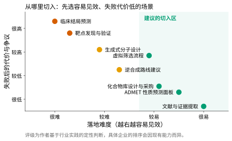
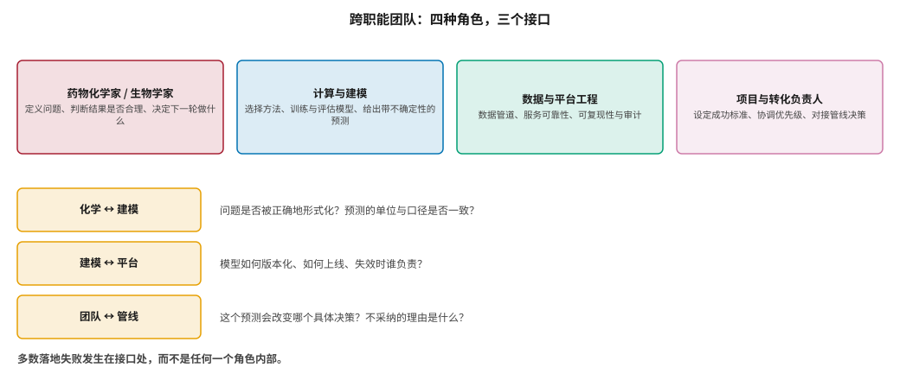
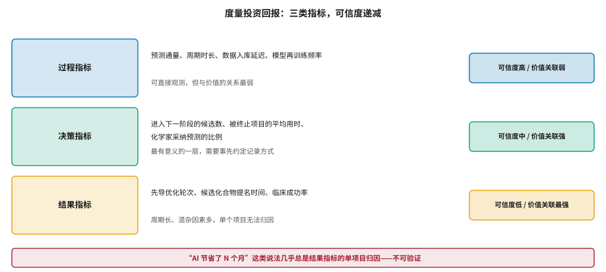

# 企业落地方法论：组织、流程与投资回报 {#sec-adoption}

## 本章目的 {.unnumbered .unlisted}

::: {.purpose-question}
技术都有了，为什么大多数企业的 AI 还是用不起来？
:::

@sec-platform 的结论是：平台失败的原因几乎都是组织性的。本章正面讨论这一层。

与前面各章不同，这里几乎没有算法内容——讨论的是从哪个场景切入、团队怎么组、决策怎么接、价值怎么量。这些问题没有普适的最优解，但有一些**反复被验证的错误**值得避开，而避开它们本身就能显著提高成功概率。

本章的核心判断有两条，且都与直觉相反：落地应当从**失败代价低、见效快**的场景切入，而不是从最有价值的场景切入；投资回报的度量应当落在**决策指标**上，因为过程指标与价值关系太弱，而结果指标在单个项目上根本无法归因。

::: {.callout-note title="给非技术读者的摘要"}

一家药企买了 AI 工具、招了算法团队，为什么常常看不到效果？常见的原因有三个。

第一，**上来就挑最难最值钱的问题**（比如“用 AI 找新靶点”）。这类项目验证周期以年计，中途看不出进展，一旦没成，整个 AI 投入就会被连带否定。更务实的做法是先从简单但天天要用的事做起，攒下可重复的工作方式。

第二，**做实验的人和做模型的人各干各的**——模型算出来的东西没人用，实验做出来的数据没进模型。失败几乎都发生在这些交接处，而不是某个团队内部。

第三，**没想清楚怎么算账**。“AI 帮我们省了八个月”这种说法听起来很好，但没人能证明如果不用 AI 就一定会多花八个月——因为那个“如果”根本观察不到。

本章讲的是怎么绕开这三个坑。**成熟度**：方法论逐渐清晰；量化证据仍然薄弱。

:::

::: {.callout-learning-objectives}

- 用“落地难度—失败代价”二维框架选择合适的切入场景，并解释它为何与价值地图互为镜像
- 描述跨职能团队的四种角色与三个关键接口，识别各接口最常见的断裂形式
- 区分过程指标、决策指标与结果指标，说明三者在可信度与价值关联上的反向关系
- 解释为什么“AI 节省了 N 个月”类宣称在单个项目上无法验证，并指出三重困难各自的性质
- 设计一个可以事先约定、事后可核的 AI 项目成功标准，包含四个必要要素
- 识别阻碍采纳的三类组织性因素，并为每类给出针对性的应对方式

:::

## 从哪里切入 {#sec-adoption-entry}

@fig-entry-points 把常见应用场景放在“落地难度”与“失败代价”两个维度上。值得注意的是，这张图与 @sec-economics 的价值地图几乎是**互为镜像**的：价值最高的场景（靶点发现、临床结局预测）恰恰落地最难、失败代价最高。

这不是巧合，而是同一个结构的两面。一个场景之所以价值高，是因为它影响的决策后果重大；而后果重大的决策，验证周期必然长、失败代价必然高。两者由同一个因素决定，因此必然同向。

::: {#fig-entry-points fig-cap="**落地场景的选择框架**：横轴为落地难度（越右越容易见效），纵轴为失败后的代价与争议。右下方的绿色区域是建议的切入区——容易见效、失败代价低。这张图与价值地图几乎互为镜像：价值最高的场景落地最难。评级为作者基于行业实践的定性判断。" fig-alt="散点图，横轴为落地难度，纵轴为失败后的代价与争议。文献提取与 ADMET 预测位于右下角绿色区域，靶点发现与临床结局预测位于左上角，整体呈自左上向右下的分布。"}

{width="88%"}

:::

::: {#pri-adoption-entry .callout-principle title="从能力建设而非价值最大化出发选择第一个场景"}

**判断**：第一个 AI 项目的首要目标不是创造最大价值，而是**建立可重复的工作方式**——把数据管道打通、让两个团队学会对话、形成一套评估与决策的惯例。这些能力是后续所有项目的基础，而它们只能通过完整地做成一件事来积累，无法通过规划或培训获得。

**实践含义**：选择一个化学家每周都要做、结果几天内就能验证、做错了也没什么损失的任务作为起点。见效快的小胜利带来的组织信任，比一次高风险的尝试更有价值——因为信任决定了第二个、第三个项目能否获得资源。

:::

这条原则的反面是一个常见错误：从“AI 发现新靶点”这类旗舰项目启动。这类项目有三个特征叠加在一起，使它成为最糟糕的起点：验证周期以年计，中途无法判断进展（因此无法及时纠偏），一旦失败会连带否定整个 AI 投入的合理性。而在 @sec-science-gaps 讨论的科学现实下，这类项目失败的概率本来就不低——用一个高失败率的项目去建立组织对一项新技术的信任，是把两个独立的风险绑在了一起。

## 团队与接口 {#sec-adoption-team}

@fig-team-interfaces 给出四种角色和三个接口。一个经验性的观察是：**失败几乎都发生在接口处，而不是任何一个角色内部**。每个角色的专业能力通常都没问题，问题出在他们之间传递的东西上。

::: {#fig-team-interfaces fig-cap="**跨职能团队的四种角色与三个接口**：药物化学家与生物学家、计算与建模、数据与平台工程、项目与转化负责人。三个接口分别是化学与建模、建模与平台、团队与管线。多数落地失败发生在接口处，而不是任何一个角色内部。" fig-alt="上方四个方框并列，分别标注四种角色及其职责；下方三行，每行左侧方框标注一个接口名称，右侧列出该接口需要回答的关键问题。"}

{width="100%"}

:::

**化学与建模的接口**最常见的断裂是**问题形式化错误**。化学家关心的问题是“这个系列还有没有优化空间”，而它被转译成一个建模任务“预测这批类似物的活性”。两者并不等价：后者即使做得很准，也不直接回答前者——因为“有没有优化空间”取决于活性、选择性、代谢稳定性之间的权衡边界在哪里，而不只是某一项性质的数值。

Davies 等人在总结工业界经验时强调，建模团队必须参与**问题定义阶段**，而不是在问题被定义好之后接单 [@davies2021adoption]。这一点在组织上不容易做到，因为它要求建模人员花时间在看似与建模无关的讨论上。

**建模与平台的接口**的断裂点是**责任边界**：模型上线后谁负责监控它是否失效？数据分布漂移了谁来发现？实验方案变更后谁来触发再训练？在多数组织中，这些问题没有明确答案，结果是模型默默地劣化而无人察觉——而劣化的模型比没有模型更危险，因为使用者仍在信任它。

**团队与管线的接口**是最关键也最常被忽略的。它需要回答一个非常具体的问题：**这个预测会改变哪个决策？** 如果答案是“提供参考”，那么这个项目很可能不会产生可度量的价值——因为“参考”意味着没有任何行为会因为它而改变。

::: {.fallacy-pitfall}

**谬误**：*先把模型做准，采纳自然会发生。*

化学家不采纳预测的原因，往往不是预测不准，而是两类更基础的问题：预测没有回答他们正在面对的那个问题，或者没有告诉他们该多相信它。

一个误差 0.8 个对数单位但清楚标注了适用域与置信度的模型，实际采纳率可能高于一个误差 0.5 但只给一个孤立数字的模型。原因是前者让使用者知道什么时候该信、什么时候该自己判断，从而可以把它整合进既有的决策流程；而后者要求使用者要么全信要么全不信，而经验丰富的化学家通常选择后者。

采纳是接口设计问题，不只是精度问题。

:::

## 度量投资回报 {#sec-adoption-roi}

@fig-roi-metrics 把指标分成三层，并指出一个结构性困难：**可信度与价值关联呈反向关系**——越容易可靠测量的指标，与真实价值的联系越弱。

::: {#fig-roi-metrics fig-cap="**投资回报的三类指标**：过程指标可直接观测但与价值关系弱；决策指标最有意义，但需要事先约定记录方式；结果指标与价值关联最强，却因周期长、混杂因素多而无法在单个项目上归因。「AI 节省了 N 个月」这类说法几乎总是结果指标的单项目归因。" fig-alt="三行结构，每行左侧为彩色方框标注指标类型，中间列出具体指标与说明，右侧标注该类指标的可信度与价值关联评价；底部红色横条给出关于单项目归因的警示。"}

{width="100%"}

:::

### 为什么“节省了 N 个月”不可验证 {#sec-adoption-counterfactual}

这类宣称的问题在于它需要一个**反事实**：如果不用 AI，这个项目会花多久？而这个反事实不可观测——同一个项目不可能既用 AI 又不用 AI 地各做一遍。

更具体地说，有三重困难叠加，而且它们的性质各不相同，因此无法用同一种方法克服。

**第一重是缺乏对照。** 药物研发项目之间的差异极大——靶点难度、适应症、团队经验、起始化学空间的质量——没有两个项目可比到足以互为对照的程度。这是一个设计问题：除非事先随机分组，否则无法构造对照。

**第二重是混杂。** 采用 AI 的项目通常同时也在其他方面有所不同：团队更年轻、资源更充足、靶点选择更谨慎、管理层关注度更高。这些因素都会独立影响项目速度，因此无法把观测到的差异归因到 AI 这一个因素上。这是一个统计问题，在样本量足够时可以部分缓解，但单个项目无能为力。

**第三重是选择偏差。** 报告出来的案例存在系统性筛选——顺利的项目被写成案例，不顺利的不会。这意味着即使每个案例本身都真实，它们的集合也不代表总体。这是一个抽样问题，只能通过预先登记所有项目来解决。

@sec-landscape 讨论过的那些“AI 把临床前周期从四年缩短到十八个月”的说法，都同时受制于这三重困难。这不意味着它们一定是假的——很可能确实缩短了——而意味着它们**不可验证**，因此不应作为决策依据。

::: {#dfn-decision-metric .callout-definition title="决策指标"}

***决策指标***\index{决策指标}指度量 AI 输出是否以及如何改变了实际决策的指标，例如化学家采纳预测建议的比例、因模型预警而被提前终止的化合物数量、每轮合成中由模型选出的分子占比。

1.  **意义**：它位于过程指标与结果指标之间，既可观测，又与价值有直接的因果链接——如果决策确实改变了，价值的产生就有了机制上的解释。它是三类指标中唯一能在项目进行中提供反馈的，因此也是唯一能用于中途纠偏的。
2.  **区别**：决策指标度量的是**行为改变**，不是预测精度。一个精度很高但无人采纳的模型，决策指标为零——而这恰恰是它应该反映的事实。
3.  **常见误区**：事后才想起要度量。决策指标必须在项目启动时就约定记录方式（例如在化合物选择记录中增加一个“是否参考了模型建议”的字段），事后无法重建——因为没有人能准确回忆几个月前某个决定是否受到了某个预测的影响。

:::

### 一份可核的成功标准 {#sec-adoption-criteria}

一个在项目启动时就能写下、结束时能客观核验的成功标准，通常包含四个要素。缺少任何一个，这份标准都会在项目后期失去约束力。

**场景**：具体到哪个项目的哪个决策点，而非“提升研发效率”。模糊的场景会导致项目范围在执行中不断漂移。

**基线**：当前这个决策是怎么做的、花多久、结果如何。没有基线就没有比较——而基线必须在项目开始前测量，事后无法重建。

**阈值**：什么程度算成功。例如“在连续三轮合成中，模型推荐的分子里至少有 30% 被化学家采纳”，而非“模型表现良好”。阈值必须是一个可以用是/否回答的陈述。

**否证条件**：什么情况下判定失败并停止。这一条最容易被省略，也最重要——没有否证条件的项目会无限延长，因为总可以说“再给一个季度就好了”。

## 组织性阻力 {#sec-adoption-resistance}

三类阻力值得分别对待，因为它们的成因完全不同，因而需要完全不同的应对。把三者混为一谈并用同一种方式（通常是“加强培训”）去应对，是常见的无效做法。

**合理的专业怀疑。** 资深化学家对模型输出的怀疑往往有充分依据：他们见过太多“革命性方法”的落空（@sec-history 回顾的历史给了这种怀疑正当性）。

对这类阻力，有效的应对**不是说服，而是证据**：在他们熟悉的问题上做出可验证的预测，并诚实地呈现失败案例。把模型的失败公开讨论——这个结构类型为什么预测不准、模型的适用域边界在哪里——比强调它的成功更能建立信任。原因很简单：一个承认自己局限的工具，才是一个可以被专业人士纳入判断的工具。

**职业安全感。** 如果 AI 被定位为“替代”，抵触是理性的，而且无法通过沟通消除——因为抵触的对象是真实存在的利益冲突。

实践中更可持续的定位是分工而非替代：模型承担那些重复且判断标准明确的部分，专家的时间转向需要判断力的部分。这不是修辞上的缓和——@sec-agents 讨论的任务适配规律本来就指向这个分工，因为模型在需要精确数值与因果判断的任务上本来就不可靠。

**流程惯性。** 既有流程中的每个环节都有其存在理由，强行插入新步骤会遇到阻力。

有效的做法是**嵌入而非替换**：在既有的化合物评审会上多一张图，在既有的数据表里多两列，在既有的实验申请流程里多一个推荐选项。这与 @sec-platform 讨论的交付层设计是同一件事的两面。

::: {#ws-adoption-pilot .callout-war-story title="三个试点，一个落地"}

一种在大型药企中常见的模式：同时启动多个 AI 试点项目，一年后只有一个真正进入了日常使用。

回顾差异，成功的那个往往有四个共同点，而且这四点都与技术无关。

它解决的是一个**反复出现的小问题**，而不是一次性的大问题——因此每周都在产生价值，也每周都在积累反馈。它的结果**几天内可验证**，于是团队能快速知道哪里不对并修正，而不是等几个月后才发现方向错了。它**嵌入了既有工具**，而不是要求用户去一个新系统，因此采用成本接近于零。最后，它从一开始就有一位既懂化学又愿意用新工具的**内部拥护者**深度参与——这个人既是第一个用户，也是对其他化学家最有说服力的证人。

失败的试点往往在技术指标上并不更差，有时甚至更好。它们的问题是选了周期长、验证慢、需要改变工作方式的场景——于是没能在组织耐心耗尽之前产生可见的结果。

这个对比说明：试点的成败主要由**场景选择**决定，而场景选择发生在项目开始之前。

:::

::: {#chk-adoption .callout-checkpoint}

1. 为什么第一个 AI 项目不应该选价值最高的场景？落地难度与失败代价为什么必然同向？
2. 跨职能团队的三个接口分别需要回答什么问题？哪一个最常被忽略，为什么？
3. 过程指标、决策指标与结果指标在可信度与价值关联上呈什么关系？为什么是反向的？
4. “AI 把周期从四年缩短到十八个月”面临哪三重验证困难？它们的性质有何不同？
5. 为什么决策指标必须在项目启动时就约定记录方式？事后重建为什么不可行？
6. 可核的成功标准包含哪四个要素？省略否证条件会导致什么后果？
7. 面对资深专家的合理怀疑，为什么公开讨论模型的失败比强调成功更有效？

:::

## 小结 {#sec-adoption-summary}

AI 在药企的落地是一个组织问题多于技术问题。

有效的路径是反直觉的：从价值不高但见效快的场景切入，先建立跨职能的工作方式，再逐步向高价值场景推进。把注意力放在三个接口上，尤其是“这个预测会改变哪个决策”这一问题——它看似简单，却能在项目启动时就筛掉大部分注定无效的方案。

度量方面，用决策指标而非结果指标跟踪进展，因为后者在单个项目上无法归因，而前者是唯一能在过程中提供反馈的一类。

这些做法都不会产生引人注目的叙事，但它们是少数几个经得起检验的共同特征。第四篇到此结束——工具链、平台与组织，三章共同指向同一个结论：这个领域的瓶颈长期以来被定位在模型上，而实际上它在模型之外。

::: {.callout-takeaways title="先建能力，再追价值"}

* **切入点选择**：从失败代价低、验证快的场景开始，而非从价值最高的场景开始；两者必然互为镜像。
* **失败在接口**：化学与建模、建模与平台、团队与管线——三个接口比任何单个角色更关键。
* **采纳是设计问题**：带适用域与置信度的中等精度模型，采纳率可能高于只给数字的高精度模型。
* **用决策指标**：过程指标与价值无关，结果指标无法归因，决策指标是唯一可用的中途反馈。
* **“节省 N 个月”不可验证**：缺乏对照、存在混杂、案例有选择偏差，三者性质不同且无法同时克服。
* **成功标准四要素**：场景、基线、阈值、否证条件——缺了最后一条，项目会无限延长。
* **三类阻力三种应对**：专业怀疑用证据、职业安全感用分工定位、流程惯性用嵌入而非替换。

:::

::: {.callout-chapter-connection title="从怎么做到做得对不对"}

前四篇讨论了产业、技术、数据与工程落地。但有一个问题贯穿始终却尚未正面处理：**我们怎么知道一个方法真的有效？** 第五篇转向这些根本性的挑战。@sec-evaluation 讨论评测与基准的可信度危机，并给出一份读到任何性能数字时都该过一遍的清单；@sec-science-gaps 讨论从分子到患者的科学鸿沟；@sec-org-challenges 讨论组织、人才与商业模式层面尚未解决的问题。

:::
