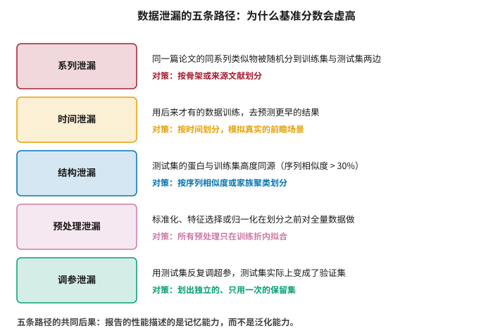
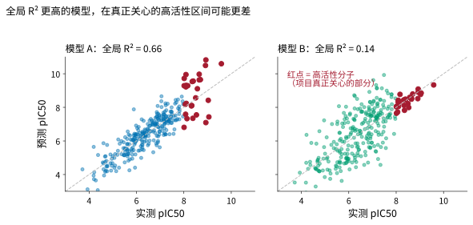
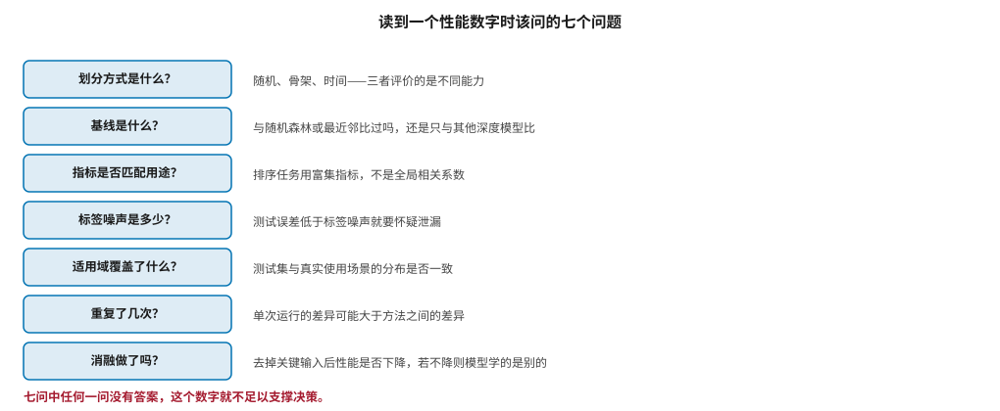

# 评测、基准与可复现性 {#sec-evaluation}

## 本章目的 {.unnumbered .unlisted}

::: {.purpose-question}
我们怎么知道一个方法真的有效，而不是基准恰好设计得让它好看？
:::

这是全书最重要的一章，因为它提供的是判断其他所有章节内容的工具。

前面反复出现一个模式：某方法在基准上表现优异，在真实项目中却不如预期。这不是偶然，也不是个别研究者的疏忽，而是**评测体系本身的系统性问题**——数据泄漏、指标与用途错配、基线过弱、缺乏前瞻验证。四者各自独立，却都朝同一个方向作用：让报告出的性能高于真实可用的性能。

本章把这些问题归类，给出可操作的检测方法，并提出一份读到任何性能数字时都应该过一遍的七问清单。本章的立场需要明确陈述：在这个领域，**怀疑一个漂亮的数字是默认的合理态度**，而举证责任在宣称方——这不是犬儒，而是在举证标准尚未建立时唯一负责任的做法。

::: {.callout-note title="给非技术读者的摘要"}

AI 论文里经常出现“我们的方法比之前最好的提高了 15%”。问题是，这个数字是在一套考试题上考出来的，而这套考试题可能出得不对。

最常见的毛病叫“泄漏”——相当于考试题提前被模型见过了。比如一篇论文里报道了同一类的五十个分子，如果随便一分，二十五个进了“复习资料”、二十五个进了“考卷”，那模型只要认出“这是那一类”就能考高分，并不说明它真懂化学。

还有一类问题是**考的东西不对**：项目真正关心的是“最好的那几个分子是哪几个”，而论文报告的是“所有分子平均预测得多准”——两者可以完全不一致，甚至给出相反的排序。

第三类问题是**跟谁比**。如果只跟其他花哨的方法比，而不跟一个认真调过参的简单方法比，提升幅度往往会大幅缩水。

本章给出一张清单，读到任何性能数字时照着问七个问题。**成熟度**：问题被充分认识；行业评测标准仍未建立。

:::

::: {.callout-learning-objectives}

- 识别数据泄漏的五条主要路径，并说明各自的检测与规避方法
- 用标签噪声水平对评测结果做快速自查，判断报告精度是否可信
- 解释指标与用途错配的后果，并为给定任务选择合适的评测指标
- 说明活性悬崖为什么对深度模型构成特殊困难，以及这对全局指标意味着什么
- 说明弱基线如何系统性地夸大新方法的改进幅度
- 描述消融实验作为通用诊断工具的使用方式，并为不同模型类型设计具体的消融方案
- 列举前瞻性验证相对于回顾性评测的不可替代之处，以及企业中可操作的实施形式
- 用七问清单评估一项性能宣称是否足以支撑决策

:::

## 数据泄漏 {#sec-eval-leakage}

::: {#dfn-leakage .callout-definition title="数据泄漏"}

***数据泄漏***\index{数据泄漏}（data leakage）指测试集中包含了模型在训练阶段本不应获得的信息，使得评测结果高于模型在真实使用中的表现。

1.  **意义**：泄漏是机器学习科学中可复现性危机的首要技术原因。Kapoor 与 Narayanan 系统梳理了多个学科中因泄漏导致结论无法复现的案例，发现它普遍存在，且绝大多数情况下**不被作者察觉** [@kapoor2023leakage]。
2.  **区别**：泄漏不是作弊。划分方式往往看起来完全合理，问题藏在数据的生成过程里——而那个过程通常不是建模者设计的，甚至不是他们了解的。
3.  **常见误区**：以为“我用了交叉验证”就排除了泄漏。交叉验证只保证每个样本都做过一次测试，不保证训练与测试之间没有信息流动。如果信息流动来自数据本身的结构（如同系列分子），交叉验证的每一折都会同样受影响。

:::

@fig-leakage-paths 列出五条主要路径。它们的共同后果是：**报告的性能描述的是记忆能力，而不是泛化能力**。

::: {#fig-leakage-paths fig-cap="**数据泄漏的五条路径**：系列泄漏、时间泄漏、结构泄漏、预处理泄漏、调参泄漏，以及各自的对策。五者的共同后果是报告出的性能描述的是模型的记忆能力而非泛化能力。" fig-alt="五行结构，每行左侧为彩色方框标注泄漏类型，右侧两行文字分别说明该泄漏的机制与对应的划分或流程对策。"}

{width="66%"}

:::

**系列泄漏**在化学数据中最普遍，@sec-data-quality 已讨论其成因——医药化学以系列形式探索，使得同骨架分子在数据中高度聚集。

**时间泄漏**的形式是用后来才产生的信息去预测更早的结果。它在药物研发中有一种隐蔽的变体：某个靶点在后期获得了大量研究，使得数据库中该靶点的早期记录也被回溯修订过，于是“历史数据”实际上包含了未来的知识。

**结构泄漏**是蛋白相关任务的对应物：如果测试集的蛋白与训练集序列相似度很高，模型只需做同源匹配即可给出好结果。CASP 等评测之所以坚持使用尚未公开的新结构，正是为了杜绝这条路径。

**预处理泄漏**与**调参泄漏**是方法学上的经典问题，在神经科学领域被称为“循环分析”或“双重浸泡” [@kriegeskorte2009circular]。后者尤其隐蔽：一个测试集被用来比较了几十个模型变体之后，它报告的已经不再是泛化性能，而是“在这个特定测试集上表现最好的变体的性能”——这是一个有偏的最大值统计量。

### 一个有用的自查 {#sec-eval-selfcheck}

判断自己的评测是否存在泄漏，最有效的单一方法是问：**测试集的误差是否低于标签噪声？**

@sec-data-resources 给出的参考值是 0.5–0.7 个对数单位。如果一个活性预测模型报告的 RMSE 显著低于这个水平，那么合理的推论不是它突破了物理限制，而是测试集中的分子与训练集中的某些分子来自同一次测定——因此共享了同样的条件偏移，使得预测它们比预测真正的新分子容易得多。

这个自查的优点是它不需要任何额外实验，而且是单向的：低于噪声下限几乎必然意味着问题，而高于下限并不保证没有问题。

## 指标与用途的错配 {#sec-eval-metrics}

即使完全没有泄漏，指标选错也会让评测失去意义。@fig-metric-mismatch 用一个模拟例子说明这一点。

::: {#fig-metric-mismatch fig-cap="**全局指标与实际用途的错配**：模型 A 的全局 R² 远高于模型 B，但在高活性区间（红点）的预测明显更差；模型 B 全局表现平庸，却把项目真正关心的高活性分子排得很准。如果任务是挑出最好的几个分子，模型 B 更有用，而全局 R² 会给出相反的结论。数据为模拟。" fig-alt="两个并排散点图，横轴为实测活性，纵轴为预测活性。左图整体贴近对角线但高活性区红点散开；右图整体散开但高活性区红点紧贴对角线。"}

{width="100%"}

:::

这个例子不是人为构造的极端情况，而是实践中的常态。原因在于数据分布本身：**绝大多数分子活性平庸，而项目只关心少数高活性分子**。全局相关系数被大量平庸分子主导——它们贡献了绝大部分样本量，因而决定了统计量的取值——对高活性区间的表现几乎不敏感。

换句话说，全局 R² 回答的是“模型对典型分子的预测有多准”，而项目问的是“模型能不能把最好的几个挑出来”。这是两个不同的问题，而且在实践中经常给出不同的答案。

::: {#pri-eval-metric-match .callout-principle title="指标必须匹配决策"}

**判断**：评测指标应当由该模型将要支持的决策决定，而非由领域惯例或论文传统决定。

- 要从大库里挑出少数候选 → 用富集指标（`EF1%`、BEDROC），不是 R² 或 AUC。
- 要在一个系列内排序以决定合成哪个 → 用该系列内的排序相关系数，不是全局指标。
- 要判断某个分子是否超标（例如 hERG 风险） → 用决策阈值附近的敏感度与特异度，不是整体准确率。
- 要给出可用于计算的数值（例如剂量推算） → 用绝对误差与校准曲线，排序指标在此无效。

**实践含义**：如果一篇论文报告的指标与你的用途不匹配，它的结论对你没有参考价值，无论数字多好看。反过来，在自己的项目中，应当先确定决策形式，再选指标——而不是先算一堆常用指标再挑好看的报告。

:::

### 活性悬崖的特殊困难 {#sec-eval-cliff}

van Tilborg 等人揭示了一个尤其值得注意的现象：在**活性悬崖**（结构高度相似但活性差异巨大的分子对）上，深度学习模型的表现往往不如简单的描述符加随机森林 [@vanTilborg2022exposing]。

这个结果之所以重要，是因为活性悬崖恰恰是医药化学最关心的情形——它意味着一个小的结构修改带来了大幅的活性提升，而找到这样的修改正是先导优化的核心目标。模型在最平淡的地方表现最好，在最有价值的地方表现最差。

背后的机制不难理解：深度模型通过“相似分子活性相似”这一平滑假设取得了大部分预测精度，而活性悬崖按定义就是这个假设失效的地方。全局指标会把悬崖处的失败平均到大量平滑区域的成功中，从而掩盖这一结构性缺陷。

这提示了一种有价值的评测补充：**单独报告模型在活性悬崖对上的表现**，而不是只看全局统计量。

## 基线与消融 {#sec-eval-baseline}

### 弱基线的系统性夸大 {#sec-eval-weakbaseline}

一个新方法的改进幅度，完全取决于与什么比较。在分子性质预测中，一个被反复验证的事实是：**经过合理调参的随机森林或梯度提升，加上标准分子指纹，在许多任务上与复杂的深度模型相当**。

Robinson 等人重新分析了一项大规模深度学习与传统机器学习的对比研究，发现在校正了评测方法问题后，两者的差距远小于原报告 [@robinson2020validating]。这类再分析的结论具有普遍性：**当基线被认真对待时，改进幅度通常会大幅缩水**。

这里有一个结构性的激励问题值得指出。调优基线不会给研究者带来任何学术回报——没有人因为“证明了简单方法同样好”而获得关注——而调优新方法则直接决定论文能否发表。因此基线被认真对待的程度系统性地低于新方法，而这种不对称不需要任何人有意为之就会发生。

实践含义是：读一篇方法学论文时，比“新方法得分多少”更重要的问题是“**基线是什么、调参了吗**”。一篇只与其他深度模型比较而不与随机森林加指纹比较的论文，没有回答最基本的问题。

### 消融作为通用诊断 {#sec-eval-ablation}

@sec-data-quality 介绍过的那个诊断方法值得在这里正式化：**把模型理应依赖的信息去掉，看性能是否下降**。

针对不同模型类型，具体的消融设计不同：

- **结构依赖的打分函数** → 遮蔽蛋白结构，只给配体。性能不降，说明学的不是结合，而是配体本身的性质。
- **需要三维构象的模型** → 换成随机生成的构象。性能不降，说明三维信息没有被真正使用。
- **声称利用了蛋白序列的模型** → 打乱序列顺序。性能不降，说明序列只是被当作一个查找键，而非结构信息的载体。
- **多模态模型** → 逐一去掉每个模态。如果去掉任何一个性能都不降，说明模型实际只依赖其中一个。
- **声称利用了图结构的模型** → 把分子图替换为随机图但保留原子组成。性能不降，说明拓扑没有被用上。

这个方法有三个优点：不需要额外数据、实施成本极低、而且结论是**决定性的**——如果去掉关键信息性能不降，那么无论基准分数多高，模型学的都是别的东西，没有任何辩解空间。

::: {.fallacy-pitfall}

**谬误**：*在公开基准上刷新纪录等同于方法更好。*

公开基准会被长期优化。当一个数据集被几百篇论文反复使用后，方法选择、超参设置乃至架构设计都已经隐式地针对它调过——**整个社区共同构成了一次巨大的调参泄漏**，而这次泄漏没有任何单个研究者需要为之负责。

此时榜首位置反映的是对该基准的适配程度，而非方法本身的优劣。一个有用的判断是看改进的幅度与趋势：如果一个基准上的最优成绩在多年间以很小的幅度持续改进，这通常是过拟合该基准的信号，而非真实进展的信号。

MOSES 等生成模型基准 [@polykovskiy2020moses] 的作者们本身也强调，这类基准衡量的是分布层面的性质（有效性、新颖性、多样性），而非分子是否真正有用——后者需要实验验证，而基准无法提供。

:::

## 前瞻性验证 {#sec-eval-prospective}

回顾性评测——在历史数据上划分训练与测试——无论做得多严谨，都有一个无法弥补的缺陷：**待预测的答案已经存在**。

这一点比它听起来更严重。答案已经存在意味着数据集的构成本身受到了那些答案的影响：哪些分子被合成、哪些实验被做、哪些结果被发表，都是在知道部分答案之后的选择。因此即使划分方式完美，测试集也不是对“未来会遇到的分子”的无偏抽样。

前瞻性验证——先公开预测，再做实验——是唯一能完全排除这类问题的方式。它在本领域的代表是 CASP：组织者使用尚未发布的结构，参赛者在不知道答案的情况下提交预测，组织者在结构公布后统一评分。AlphaFold2 在 CASP14 的成绩之所以具有说服力，正因为它是前瞻性的（@sec-structure）——没有任何方式可以事后调整。

对企业而言，前瞻性验证的可操作形式非常简单：在一批化合物送去合成测试**之前**，把模型预测冻结并记录下来（带时间戳，不可修改），测试完成后再对比。

这件事成本极低——它不需要额外实验，只需要在既有流程中加一个记录步骤——却极少被执行。原因可能是它会产生一个无法事后美化的记录，而这正是它有价值的理由。一个坚持做了两年前瞻性记录的团队，能给出的证据比任何回顾性评测都更有说服力。

::: {#ws-eval-benchmark-gap .callout-war-story title="基准上的第一名，项目里的平手"}

一种在计算化学团队中反复出现的经历：引入一个在公开基准上排名领先的新模型，在内部数据上做回顾性评测也不错，但在实际项目中与原有方法相比没有明显差别。

事后分析通常能找到三个叠加的原因，而它们分别对应三个不同层次的缺口。

**基准与真实分布的缺口。** 公开基准的化学空间与本企业项目的化学空间差异很大——企业项目集中在少数几个系列上（窄而深），而基准覆盖的是广泛而浅的分布。在广分布上表现好，不保证在窄分布上表现好，因为后者要求的是对细微差异的分辨能力。

**回顾与前瞻的缺口。** 内部回顾性评测使用了随机划分，而真实场景是对新系列做外推。这是 @pri-split-defines-claim 的直接后果。

**预测与决策的缺口。** 模型给出的是点预测，没有不确定性。于是化学家对它和对旧方法保持同样程度的怀疑，决策行为并未改变——而决策不变，结果自然不变。

这个案例说明三层缺口同时存在，而补上任何一层都需要额外工作。更重要的是：**三层都不补时，再好的模型也不会改变结果**——这解释了为什么模型性能的进步与项目结果的改善之间，常常看不到相关性。

:::

## 七问清单 {#sec-eval-checklist}

@fig-eval-checklist 把本章内容收敛成一份可以随身携带的清单。

::: {#fig-eval-checklist fig-cap="**读到一个性能数字时该问的七个问题**：划分方式、基线、指标是否匹配用途、标签噪声水平、适用域覆盖、重复次数、是否做了消融。七问中任何一问没有答案，这个数字就不足以支撑决策。" fig-alt="七行结构，每行左侧为蓝色方框标注一个问题，右侧为该问题的说明。"}

{width="92%"}

:::

关于其中三项补充说明。

**重复次数**常被忽略。单次训练的随机性——权重初始化、数据顺序、数据增强、dropout 掩码——带来的性能波动，在小数据集上可能大于方法之间的真实差异。只报告单次运行结果而不给出多次重复的均值与标准差，等于没有报告性能。一个实用的判据是：如果方法间的差距小于同一方法多次运行的标准差，那么这个差距不构成证据。

**适用域覆盖**要求把测试集的分布与实际使用场景的分布做对比。一个在广泛化学空间上训练并测试的模型，用在某个特定系列上时，其有效性能需要重新评估——因为全局平均性能不保证局部性能。

**是否做了消融**是七问中唯一能给出决定性结论的一项。其余六问帮助判断一个数字是否可信，而消融能直接回答模型是否在做它声称在做的事。

## 行业评测基础设施的缺失 {#sec-eval-infrastructure}

本章讨论的所有问题有一个共同的结构性原因：**没有人负责建设面向真实场景的评测基础设施**。

这是一个典型的公共品供给失灵。学术界的激励指向发表新方法而非验证旧方法——没有期刊会因为“我们认真复现了别人的工作并发现差距没那么大”而给出版面。企业有真实数据和真实需求，但公开这些数据会损害竞争地位。而公开基准的维护往往依赖个别研究组的志愿投入，一旦主要维护者转向其他课题，基准就会停止更新，进而被过拟合。

Wognum 等人呼吁由产业界主导建立评测倡议 [@wognum2024benchmarking]，其核心主张包含四点：评测集应当来自真实项目、按时间划分、由第三方维护、且定期更新以避免被过度拟合。这一主张在逻辑上无可辩驳，困难在于它要求企业贡献有商业价值的数据——与 @sec-data-flywheel 讨论的数据联盟面临完全相同的激励问题。

Bender 与 Cortes-Ciriano 在他们广为引用的两篇评论中给出了相似的判断 [@bender2021part1]：这个领域不缺方法，缺的是把方法的真实价值区分出来的机制。

::: {#chk-evaluation .callout-checkpoint}

1. 为什么交叉验证不能排除数据泄漏？在什么情况下它会系统性地给出乐观结果？
2. 如何用标签噪声水平自查评测结果是否可疑？为什么这个自查是单向的？
3. 给定任务“从一百万个分子中挑出一百个去做实验”，应该用什么指标评价模型？为什么不用 R²？
4. 活性悬崖为什么对深度学习模型构成特殊困难？这对全局指标意味着什么？
5. 为什么基线被认真对待的程度会系统性地低于新方法？这不需要任何人有意为之，为什么？
6. 为多模态模型和图神经网络各设计一个消融实验，并说明各自能诊断什么。
7. 前瞻性验证相对于回顾性评测的不可替代之处是什么？企业中可操作的形式是什么？
8. 为什么一个被几百篇论文使用过的公开基准，其榜首名次的含义会发生变化？

:::

## 小结 {#sec-evaluation-summary}

评测是这个领域最薄弱也最关键的环节。

数据泄漏使报告的性能描述记忆而非泛化；指标错配使评测衡量的不是实际关心的能力；弱基线使改进幅度被系统性夸大；而缺乏前瞻性验证使所有回顾性结论都带有不可消除的不确定性。这四个问题各自独立，却都朝同一个方向作用——让报告出的性能高于真实可用的性能。

这些问题的根源不是个别研究者的疏忽，而是激励结构：发表新方法的回报远高于严谨验证旧方法，而没有任何机构承担建设评测基础设施的职责。这意味着问题不会自行改善。

在这样的环境下，读者唯一可靠的防护是方法学纪律：对每个数字过一遍七问清单，对缺乏答案的宣称保持怀疑。这不是犬儒，而是在一个举证标准尚未建立的领域里，唯一负责任的态度。

::: {.callout-takeaways title="怀疑一个漂亮的数字是默认的合理态度"}

* **泄漏有五条路径**：系列、时间、结构、预处理、调参——且绝大多数是无意的。
* **自查标尺**：测试误差显著低于标签噪声（0.5–0.7 对数单位），优先怀疑泄漏；该判据是单向的。
* **指标由决策决定**：挑少数候选用富集指标，系列内排序用局部相关，阈值判断用敏感度特异度。
* **模型在最有价值处最弱**：活性悬崖恰是平滑假设失效之处，而全局指标会掩盖这一点。
* **基线决定改进幅度**：认真调过的随机森林常与深度模型相当，不与它比就没回答基本问题。
* **消融是唯一决定性的检验**：去掉关键输入性能不降，说明模型学的是别的，没有辩解空间。
* **前瞻性验证不可替代**：预测冻结在前、实验在后，成本很低却极少被执行。

:::

::: {.callout-chapter-connection title="从评测缺口到科学缺口"}

评测问题是方法学层面的，原则上可以通过更严谨的做法解决。但即使评测做到完美，仍有一类更根本的困难：我们对生物系统的理解本身就不足以支撑从分子到患者的推断。@sec-science-gaps 讨论这些科学瓶颈——模型生物的预测效力、靶点与表型的鸿沟、替代终点与临床结局的因果关系，以及为什么“预测得准”与“治得好病”之间隔着的不只是工程问题。

:::
