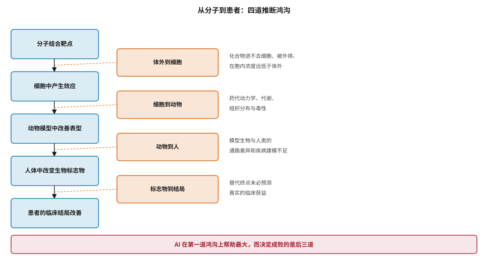
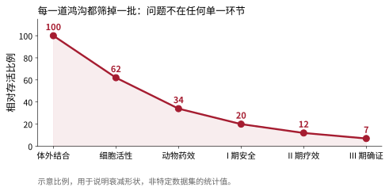
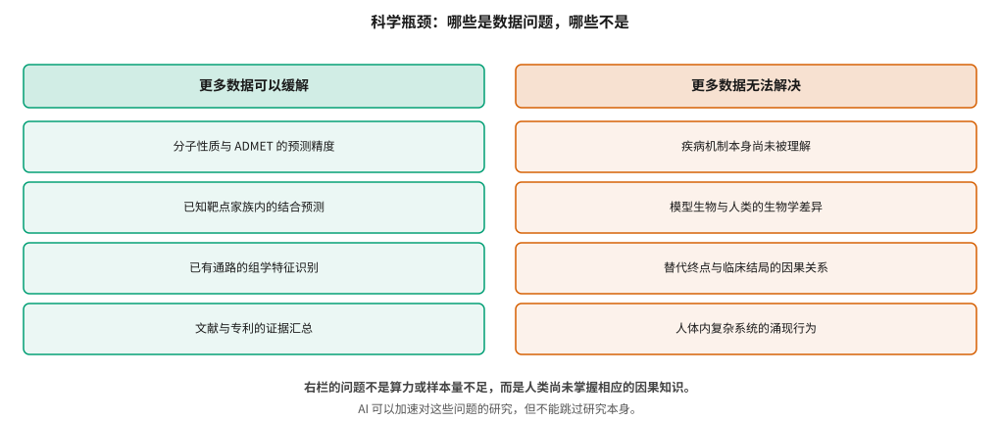

# 科学瓶颈：从分子到患者的转化鸿沟 {#sec-science-gaps}

## 本章目的 {.unnumbered .unlisted}

::: {.purpose-question}
就算每一个模型都预测得很准，为什么药还是大概率失败？
:::

@sec-evaluation 讨论的是方法学问题——它们原则上可以通过更严谨的做法解决。本章讨论的是另一类问题：**即使模型完美，药物研发仍然会失败**。原因在于，从“一个分子结合了一个靶点”到“一个患者的病情改善了”之间隔着四道推断鸿沟，而 AI 的能力高度集中在第一道上。这不是悲观，而是定位：理解哪些是数据与算力能解决的问题、哪些不是，决定了投入应当如何分配，也决定了对这个领域该抱有什么样的时间预期。

::: {.callout-note title="给非技术读者的摘要"}

假设 AI 把“哪个分子能结合哪个蛋白”算得完全准确——药就能做出来了吗？不能。因为还要跨过四道坎：分子能不能进到细胞里起作用；在动物身上是不是安全有效；动物有效在人身上是不是也有效；人身上某个指标改善了是不是真的意味着病好了。AI 目前帮得上忙的主要是第一道坎，而决定成败的是后面三道。更关键的是，后面三道坎很多时候**不是数据不够**，而是人类对疾病本身的理解还不够——这不是增加算力能解决的。**成熟度**：问题边界清晰；根本性突破尚未出现。

:::

::: {.callout-learning-objectives}

- 描述从分子到患者的四道推断鸿沟，并说明 AI 在各道上的实际作用
- 解释模型生物的预测效力问题及其对靶点验证的影响
- 区分“数据不足”与“知识不足”两类瓶颈，并举例说明
- 说明替代终点与临床结局之间因果关系的验证要求
- 解释人类遗传学证据为什么能提高成功率，以及这一效应的边界
- 评估表型筛选与靶点导向两条路线在 AI 时代的相对位置

:::

## 四道鸿沟 {#sec-gaps-chain}

@fig-inference-chain 把从分子到患者的推断链拆成五个环节与四道鸿沟。一个贯穿本书的判断在这里得到最清晰的表达：**AI 的能力分布与鸿沟的重要性分布不匹配**。

::: {#fig-inference-chain fig-cap="**从分子到患者的四道推断鸿沟**：分子结合靶点、细胞中产生效应、动物模型中改善表型、人体中改变生物标志物、患者的临床结局改善。四道鸿沟分别是体外到细胞、细胞到动物、动物到人、标志物到结局。AI 在第一道上帮助最大，而决定成败的是后三道。" fig-alt="左侧五个方框自上而下用箭头相连，表示推断链的五个环节；右侧四个橙色方框分别标注四道鸿沟的名称与主要障碍；底部红色横条给出总结判断。"}

{width="100%"}

:::

@fig-translation-attrition 用衰减曲线表达同一事实的另一面：每道鸿沟都筛掉一批，而问题不集中在任何单一环节。这意味着任何只改善一个环节的技术，对整体成功率的提升都是有限的——这是 @sec-economics 讨论的价值地图背后的科学基础。

::: {#fig-translation-attrition fig-cap="**转化过程中的逐级衰减**：从体外结合到 III 期确证，每一道鸿沟都筛掉一批候选。衰减分布在各个环节，而非集中于某一处，因此改善单一环节对整体成功率的提升有限。示意比例，用于说明衰减形状。" fig-alt="折线图，横轴自左向右为体外结合、细胞活性、动物药效、I 期安全、II 期疗效、III 期确证，纵轴为相对存活比例，曲线自 100 逐级下降至 7，曲线下方填充淡色。"}

{width="88%"}

:::

### 第一道：体外到细胞 {#sec-gaps-invitro}

一个在纯化蛋白实验中结合得很好的分子，在细胞中可能完全无效。这道鸿沟的成因可以归为四类，而它们在机制上彼此独立，因此无法用单一手段同时解决。

**进不去**：分子的膜透过性不足，胞内浓度远低于加药浓度。**被赶出来**：被 P-糖蛋白等外排转运体主动泵出细胞，形成一个动态的浓度上限。**被分解**：在胞内被代谢酶转化，有效形式迅速消失。**浓度不够用**：这一类最容易被忽略——即使分子顺利进入细胞并保持稳定，它仍需与胞内的内源性配体竞争。对激酶抑制剂而言，胞内 ATP 浓度在毫摩尔量级，远高于酶活性测定中常用的微摩尔量级，因此一个在体外测得的优秀 `IC50`，在细胞中可能因竞争加剧而上升一到两个数量级。

这是四道鸿沟中 AI 相对最有办法的一道——@sec-admet 讨论的渗透性与外排预测模型正是针对前两类成因。但即便如此，细胞水平的预测精度仍明显低于结合预测，因为需要同时正确预测四个独立过程，而误差是累积的。

### 第二道：细胞到动物 {#sec-gaps-invivo}

药代动力学、代谢、组织分布与毒性在此集中出现。这道鸿沟的特点是**失败模式多样且彼此独立**：一个分子可以因为半衰期太短而无法维持有效暴露，因为首过代谢太强而口服生物利用度过低，因为无法穿过血脑屏障而到不了靶器官，或者因为在肝脏或心脏蓄积而产生毒性。

这种多样性本身就构成建模困难：每一类失败都需要单独的预测模型与单独的训练数据，而这些数据分散在不同的实验体系中，彼此口径不一（@sec-data-resources）。一个“整体药代预测”模型实际上是多个独立模型的拼接，因而误差会叠加。

Horvath 等人指出了另一层更根本的问题：**细胞模型本身是否与疾病相关** [@horvath2016screening]。许多广泛使用的细胞系经过数十年传代，其基因组与表观遗传状态已经与原始组织相去甚远；更重要的是，单一细胞系无法反映真实组织中细胞类型之间的相互作用。在这样的体系中测得的活性，即使完全可重复，也不构成转化证据——可重复性与相关性是两件事。

类器官与微生理系统正是针对这一缺口发展起来的，它们保留了部分组织结构与细胞多样性。但它们的通量远低于传统细胞系，且标准化程度不足，因而目前主要用于后期确证而非大规模筛选。

### 第三道：动物到人 {#sec-gaps-animal}

这是最受争议也最难跨越的一道。Seok 等人的经典研究比较了小鼠与人类在炎症相关疾病中的基因组响应，发现两者的相关性接近随机 [@seok2018mouse]。这篇论文引发了持续至今的讨论，而无论对其方法学如何评价，一个共识已经形成：**动物模型的预测效力高度依赖疾病领域，且在许多领域明显不足**。

Pound 与 Ritskes-Hoitinga 从外部效度的角度分析了这一问题，认为许多动物模型的设计从一开始就无法支撑向人类的外推 [@pound2018animal]。

这道鸿沟对 AI 的含义是双重的。一方面，用动物数据训练的模型继承了动物模型本身的局限——模型学到的是“在小鼠身上怎样”，而非“在人身上怎样”。另一方面，这也是 @sec-target 讨论的人类遗传学证据之所以特别有价值的原因：它绕过了物种外推。

### 第四道：标志物到结局 {#sec-gaps-surrogate}

药物改变了某个生物标志物，不等于改善了患者的健康。这看起来显然，但它是药物研发史上代价最高的一类错误的根源。

Fleming 与 Powers 系统论述了替代终点的验证要求 [@fleming2012surrogate]。一个标志物要成为有效的替代终点，需要同时满足三个条件，而第三个条件最常被忽略：

1. **标志物与临床结局相关**——这是最容易满足的，也是唯一常被检验的。
2. **药物对标志物有影响**——这通常在早期试验中就能确认。
3. **药物对结局的全部影响都通过该标志物实现**——即标志物**完整地中介**了治疗效应。

第三个条件之所以关键，是因为药物几乎总有多重作用。如果药物在改善标志物的同时，还通过其他通路产生了有害影响，那么标志物的改善与结局的恶化可以并存。@sec-economics 讨论的 torcetrapib 正是这一结构的典型：药物确实大幅升高了 HDL-C（条件 2 满足），HDL-C 也确实与心血管风险负相关（条件 1 满足），但药物同时带来了脱靶的血压升高，使净效应为害。

更根本的是，条件 3 无法从观察数据中验证，只能通过干预试验本身来检验——而这恰恰是使用替代终点想要避免的。这个循环是替代终点问题无解的核心原因，也是 @sec-clinical 讨论的决策类应用证据最少的根本原因。

## 数据问题与知识问题 {#sec-gaps-knowledge}

@fig-data-vs-science 做出一个本章最重要的区分。

::: {#fig-data-vs-science fig-cap="**数据问题与知识问题的区分**：左栏列出更多数据可以缓解的瓶颈，右栏列出更多数据无法解决的瓶颈。右栏的问题不是算力或样本量不足，而是人类尚未掌握相应的因果知识。AI 可以加速对这些问题的研究，但不能跳过研究本身。" fig-alt="左右两栏对照，左栏标题为更多数据可以缓解，下列四项；右栏标题为更多数据无法解决，下列四项；底部两行为总结说明。"}

{width="100%"}

:::

::: {#pri-gaps-knowledge-limit .callout-principle title="数据不能替代未被获得的知识"}

当一个现象的机制尚未被理解时，任何规模的观测数据都无法通过统计手段补出因果结构。模型只能学到数据中已经存在的关联，而关联的方向性与可干预性需要来自实验或理论。

**实践含义**：面对“用 AI 发现新的疾病机制”这类主张，应当追问它依据的是什么数据、这些数据是否包含干预（而非仅观察）、以及结论是否已被独立实验验证。机制发现需要的是假设—实验循环，AI 可以加速这个循环，但不能跳过其中的实验。

:::

这个区分在实践中有直接后果，而且后果是**方向性**的，不只是程度上的。

如果瓶颈是数据问题，投资方向应当是数据生产（@sec-data-flywheel 讨论的飞轮）：更多的实验、更快的迭代、更完整的记录。这条路径有明确的投入产出关系，可以按预算规划。

如果瓶颈是知识问题，投资方向应当是基础研究与更好的实验系统——更接近人体的疾病模型、更可靠的因果推断工具、对机制的直接研究。这条路径的回报无法按预算规划，但它是唯一能改变上限的路径。

把知识问题误判为数据问题，会导致一种特定的失败模式：持续加大投入、各项过程指标（数据量、模型规模、预测精度）都在改善，而最终结果没有变化。这种失败特别难以及时发现，因为所有可见的指标都在变好。@sec-adoption 讨论的决策指标之所以重要，部分原因正在于它能比结果指标更早地暴露这种情形——如果预测更准了却没有改变任何决策，那么瓶颈很可能不在预测精度上。

如何区分两者？一个实用的判据是问：**如果现在有十倍的数据，这个问题能解决吗？** 对于分子性质预测，答案多半是肯定的；对于“这个靶点在人体中是否成立”，答案是否定的——因为所缺的不是同类数据的数量，而是一类根本不存在的数据（人体干预实验的结果）。

## 遗传学证据：一个真实的例外 {#sec-gaps-genetics}

在普遍的悲观图景中，人类遗传学证据是少数有坚实量化支撑的例外。Nelson 等人 2015 年的分析发现，有人类遗传学证据支持的靶点—适应症对，在临床开发中的成功率约为无此证据者的两倍 [@nelson2015genetic]。Minikel 等人 2024 年用更大的数据集和更细致的方法重新估计，确认了这一效应并进一步刻画了它的强度随证据类型变化的规律 [@minikel2024target]。

这个发现之所以重要，是因为它直接针对第三道鸿沟：遗传学证据来自人类本身，因而绕过了物种外推这一最难跨越的环节。它也为 @sec-target 讨论的靶点证据分级提供了实证基础。

Minikel 等人的分析还给出了一个实践上更有用的细节：**不同类型的遗传学证据强度不同**。罕见的功能丧失变异与疾病的关联，比常见变异的全基因组关联信号更有预测力，因为前者更接近“敲除这个基因会怎样”这一药物干预所模拟的情形。这意味着在评估一个靶点的遗传学支持时，证据的**类型**比证据的**数量**更重要——十项全基因组关联研究的支持，可能不如一个明确的功能丧失变异表型。

但这一效应有明确边界。第一，成功率翻倍意味着从约 10% 提高到约 20%，仍有八成失败。第二，如 @sec-data-quality 所述，遗传学研究的人群构成偏斜，这一效应在非欧洲血统人群中的强度尚不清楚。第三，有遗传学证据的靶点只占全部靶点的一小部分，且这部分正在被快速开发。

## 表型路线的再评估 {#sec-gaps-phenotypic}

面对靶点导向路线在后三道鸿沟上的困难，表型筛选——直接在细胞或类器官模型中筛选能改善疾病相关表型的化合物，而不预设靶点——提供了另一条路径。Moffat 等人从工业视角系统比较了两条路线 [@moffat2017phenotypic]：表型路线的优势在于它从一个更接近疾病的系统出发，不受“靶点假设是否正确”的制约；劣势在于命中后难以确定作用机制，而机制不明会给后续优化与监管带来困难。

AI 对这条路线的影响有两面，而这两面并不对称。

**正面的一半**相当实在：图像表型分析是深度学习最成熟的应用之一。细胞形态学分析（如 Cell Painting 这类多通道染色方案）能从单张图像中提取上千维的特征，而卷积网络在这类任务上的表现远超人工设计的特征。配合高内涵成像设备，表型筛选的通量与可解析性在过去十年有数量级的提升。转录组表型（@sec-data-resources 提到的 LINCS/L1000）同样受益于表示学习方法。

**负面的一半**同样实在：@sec-representation 讨论的分子表示与 @sec-screening 讨论的结构方法，都高度依赖已知靶点——它们的核心操作是“预测这个分子与那个蛋白的相互作用”。在表型路线中没有“那个蛋白”，因此这套工具链整体失效。换言之，AI 在表型路线的**读出端**帮助很大，在**设计端**几乎帮不上忙。

这造成一个有趣的不平衡：表型筛选更容易发现意外的活性分子，却更难对它们做理性优化。实践中的常见折中是分两步走——先用表型筛选发现命中，再通过化学蛋白质组学等手段反向确定靶点，之后切换回靶点导向的优化流程。这条路径把两种方法的优势结合起来，代价是靶点鉴定本身可能耗时数年。

::: {#ws-gaps-ad .callout-war-story title="一个假说失败了三十年"}

阿尔茨海默病的淀粉样蛋白假说是本章所有论点的集中体现。该假说认为淀粉样蛋白斑块的沉积是疾病的核心驱动因素，由此指导了三十余年的药物开发。

从计算的角度看，这条路线的每一步都做得不错：靶点明确，结合可以优化，抗体可以设计，淀粉样蛋白清除在影像学上可以被清楚地测量——换言之，第一道鸿沟和生物标志物层面都没有问题。多数候选药物确实显著降低了斑块负荷。

困难出现在第四道鸿沟：斑块清除与认知改善之间的关系远比预期弱。近年获批的几个抗淀粉样蛋白抗体在认知终点上显示了统计学显著但临床意义有限的获益，围绕其价值的争论持续至今。

这个案例对 AI 制药的启示是直接的：**如果疾病假说本身不成立或不完整，那么在这个假说内部把每一步都优化到极致，也不会产生有效的药物**。AI 能让错误的方向被更快地走完，这既可能是好事（更快证伪）也可能是坏事（更大的沉没成本），取决于组织是否建立了及时终止的机制。

:::

::: {.fallacy-pitfall}

**谬误**：*模型预测得越准，药物成功率就越高。*

预测精度的提升只在它所对应的那个环节产生价值。如果一个项目的失败原因是靶点假设错误（第三道或更早的科学判断），那么把结合预测从 80% 准提高到 95% 准，不会改变任何结果。评估一项 AI 技术的价值，必须先确定它作用于哪道鸿沟，以及该鸿沟在当前项目的失败原因中占多大比重。

:::

::: {#chk-science-gaps .callout-checkpoint}

1. 列举从分子到患者的四道鸿沟，并说明 AI 在每一道上的实际能力。
2. 为什么说用动物数据训练的模型继承了动物模型本身的局限？
3. 一个生物标志物要成为有效的替代终点，除了与结局相关之外还需要满足什么条件？
4. 区分数据问题与知识问题，各举两个本领域的例子。
5. 人类遗传学证据为什么能提高成功率？这一效应有哪三条边界？
6. 表型筛选路线的优势与劣势分别是什么？AI 对它的影响为什么是两面的？

:::

## 小结 {#sec-science-gaps-summary}

药物研发的失败绝大多数不发生在“分子能不能结合”这个问题上，而发生在之后的四道推断鸿沟里。AI 的能力高度集中在链条最前端，而链条的强度由最薄弱的环节决定。更重要的是，后几道鸿沟中有相当一部分不是数据问题而是知识问题——疾病机制未被理解、模型生物与人类不同、替代终点与结局的因果关系未被确立。这类问题无法通过增大模型或增加数据解决，只能通过更好的实验系统与持续的基础研究逐步推进。人类遗传学证据是少数有量化支撑的真实改进，但它也只把成功率从一成提高到两成。承认这些边界不是贬低 AI 的价值，而是把它放在正确的位置：它是一个强有力的加速器，作用于一条由生物学而非计算能力决定长度的链条。

::: {.callout-takeaways title="链条的强度由最薄弱的环节决定"}

* **四道鸿沟**：体外到细胞、细胞到动物、动物到人、标志物到结局。AI 主要作用于最前端。
* **衰减是分布的**：失败分散在各环节，改善单一环节对整体成功率的提升有限。
* **数据问题与知识问题要分开**：前者可以靠投入解决，后者需要新的科学理解。
* **动物模型是最受争议的一道**：预测效力高度依赖疾病领域，且在许多领域明显不足。
* **遗传学证据是真实的例外**：成功率约翻倍，但仍有八成失败，且有人群与覆盖面的边界。
* **错误的假说不会因为优化得更好而变对**：AI 能让错误方向被更快走完，组织需要及时终止机制。

:::

::: {.callout-chapter-connection title="从科学瓶颈到商业现实"}

科学上的困难最终会反映在商业上：如果成功率的提升有限且难以证明，那么 AI 制药的商业模式如何成立？@sec-org-challenges 讨论这一层——人才结构的错配、组织形态的试验、商业模式的几种形态及其各自面临的质疑，以及这个行业在经历了一轮高热之后正在如何重新定价。

:::
