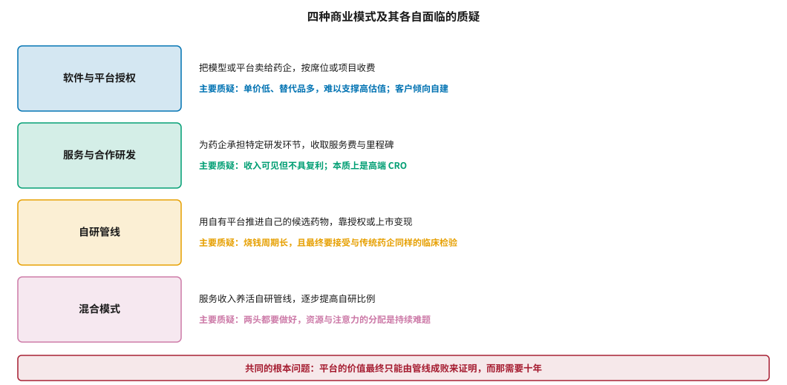
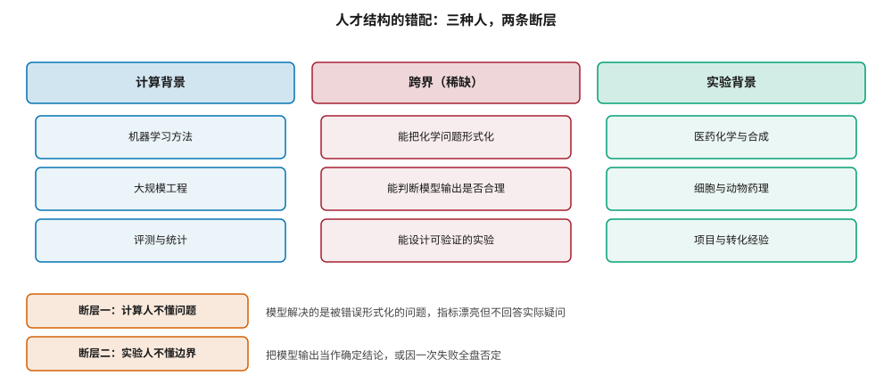
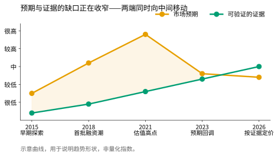

# 组织、人才与商业化挑战 {#sec-org-challenges}

## 本章目的 {.unnumbered .unlisted}

::: {.purpose-question}
如果价值难以证明，这门生意靠什么成立？
:::

@sec-science-gaps 的结论对商业有直接后果：如果 AI 带来的成功率提升有限且在十年内难以被证明，那么任何以“提高成功率”为核心叙事的商业模式都面临一个**证据滞后**问题——价值主张需要十年才能被验证，而资本的耐心周期远短于此。本章讨论这一矛盾如何塑造了行业的组织形态、人才结构与商业模式，以及 2021 年高点之后的重新定价正在把这个行业推向哪里。

::: {.callout-note title="给非技术读者的摘要"}

AI 制药公司怎么赚钱？大致四条路：把软件卖给药企、替药企做一部分研发工作收服务费、自己做药然后卖掉或上市、或者前两者养着第三者。每条路都有人质疑：卖软件单价太低撑不起估值；做服务本质上是个高级外包公司；自己做药要烧十年钱，最后还是要在临床试验里见真章。更麻烦的是，“我们的 AI 让成功率更高”这件事，只有等自己做的药真的上市了才算证明——那是十年以后的事，而投资人等不了十年。2021 年这个行业估值到顶，之后回调，现在正在按实际拿得出的证据重新定价。**成熟度**：商业模式仍在收敛过程中。

:::

::: {.callout-learning-objectives}

- 比较四种商业模式的收入结构与各自面临的质疑
- 解释证据滞后问题如何影响估值与融资节奏
- 描述人才结构中的两条断层及其各自的后果
- 评估“AI 原生药企”与“大药企内部 AI 团队”两种组织形态的相对优劣
- 说明当前阶段哪些指标可以作为中间证据使用
- 判断一项合作交易的结构反映了双方对价值的什么判断

:::

## 四种商业模式 {#sec-biz-models}

@fig-business-models 列出四种模式与各自面临的质疑。需要强调的是，这些质疑都不是致命的——每种模式都有企业在实践中验证——但它们共同指向同一个根本问题。

::: {#fig-business-models fig-cap="**四种商业模式及其各自面临的质疑**：软件与平台授权、服务与合作研发、自研管线、混合模式。四者的共同根本问题是平台的价值最终只能由管线成败来证明，而那需要十年。" fig-alt="四行结构，每行左侧为彩色方框标注商业模式名称，右侧两行分别说明该模式的收入方式与主要质疑；底部红色横条给出共同的根本问题。"}

{width="100%"}

:::

### 证据滞后 {#sec-biz-evidence-lag}

::: {#dfn-evidence-lag .callout-definition title="证据滞后"}

***证据滞后***\index{证据滞后}指一项技术的核心价值主张，其验证所需的时间远长于支撑该技术发展的资本周期。在 AI 制药中，“平台能提高临床成功率”这一主张的验证需要若干个自研项目完整走完临床，时间尺度在十年以上。

1.  **意义**：证据滞后使得估值必须建立在**代理信号**上——管线进度、合作交易、里程碑付款、阶段性数据，而非最终结果。
2.  **区别**：这与一般的早期技术风险不同。软件公司的价值主张可以在一两年内被使用量验证；AI 制药的核心主张无法被加速验证。
3.  **常见误区**：把合作交易的首付款当作价值验证。交易结构反映的是合作方对风险的判断，首付款规模更多体现谈判地位而非技术评价。

:::

证据滞后造成了一个结构性的困境：**在能够证明价值之前，必须先筹到用于证明价值的钱**。这与软件行业形成鲜明对比——后者可以用早期用户数据说服下一轮投资者，而 AI 制药的早期指标（分子数量、周期长度）与最终价值的关联太弱，无法承担同样的说服功能。

这也解释了一个表面上矛盾的现象：行业中最被认真对待的进展信号，往往是**统计量而非个案**。一个 AI 发现的分子进入 II 期是正面信号，但不构成证明——按历史基线，本来就有约三成的分子能做到这一点。真正的证据是一批这样的分子在 II 期的通过率显著高于历史基线，而“一批”意味着至少数十个独立项目，这需要样本量，因此需要时间。

从这个角度看，单个项目的失败同样不构成反证。如果 AI 把 II 期通过率从 29% 提高到 40%，那么六成的项目仍然会失败——而观察到几个失败案例，与这一改进完全相容。这意味着无论支持者还是怀疑者，在样本量足够之前都无法用个案支撑自己的立场。

@sec-landscape 讨论的管线数据正在累积这一样本量。到 2026 年，已有足够数量的 AI 来源候选药物进入临床中后期，使得前瞻性的统计比较在未来几年内变得可能。这是本领域最值得关注的发展，远胜于任何单个分子的进展。

### 交易结构的信息量 {#sec-biz-deals}

当证据不足时，交易结构本身携带信息。一个典型的合作交易包含首付款、研发里程碑、监管里程碑、销售里程碑和特许权使用费。各部分的比例反映了合作方对不同阶段风险的判断：

**首付款占比高**意味着合作方认为技术本身有即时可用的价值（例如一个具体的候选分子或一套数据）。

**里程碑占比高且后置**意味着合作方愿意分担探索风险，但要求结果验证——这是本领域绝大多数交易的形态。

**按靶点计价而非按分子计价**意味着合作方购买的是平台能力而非具体产出——这是对技术本身最强的背书形式，因为它承诺的是未来未知产出的价值。

还有两个结构细节值得关注，它们往往比金额更能说明问题。其一是**选择权的行权记录**：多数平台型合作允许合作方在每个靶点上决定是否继续投入，因此“合作方在多少个靶点上行使了继续选择权”是一个比总交易额可信得多的信号——它是用真金白银投出的票。其二是**合作的续约与扩展**：初次合作可能出于探索意图，而扩大合作范围或延长期限，意味着第一阶段的结果达到了对方的内部标准。

@sec-capital 从资本角度详细讨论了这些结构。这里要补充的是，当一个领域的交易普遍呈现“首付款小、里程碑大且后置”的形态时，它表明买方认可潜力但不认可当前证据——这正是 2023 年以后的常态。

## 人才结构 {#sec-org-talent}

@fig-talent-gap 给出一个简化但有用的刻画：三种人，两条断层。

::: {#fig-talent-gap fig-cap="**人才结构的错配**：计算背景、跨界人才（稀缺）、实验背景三类人，以及两条断层——计算人不懂问题（模型解决被错误形式化的问题）与实验人不懂边界（把模型输出当作确定结论或因一次失败全盘否定）。跨界人才的稀缺是行业的结构性瓶颈。" fig-alt="上方三列方框分别标注计算背景、跨界、实验背景三类人才及其各自的能力项；下方两行列出两条断层的名称与后果。"}

{width="98%"}

:::

两条断层需要分别应对，因为它们的成因不同。

**断层一**源于问题形式化的失败。@sec-adoption 讨论过这一点：化学家的问题（“这个系列还值不值得继续”）与建模任务（“预测这批分子的活性”）之间存在翻译损失。弥合它需要的不是更好的模型，而是建模者在问题定义阶段的深度参与。

**断层二**源于对模型能力边界的误解，而且表现为两个相反的方向：过度信任（把点预测当作确定结论）与过度怀疑（因一次预测失败而全盘否定）。两者的根源相同——不理解模型输出的统计含义。@sec-platform 讨论的“预测必须附带不确定性”正是对此的工程回应。

**跨界人才的稀缺是结构性的**，因为培养周期长且无法压缩：既要受过严格的计算训练，又要在真实的研发项目中待过足够久以形成直觉——而后者按年计，没有捷径。这类人在当前市场上的议价能力极高。

企业能做的主要是内部培养，而有效的做法有两个共同特征。第一是**双向嵌入**：把计算人员放进项目团队参加日常的化合物评审，把实验人员纳入模型的评审与验收。第二是**让两边都经历对方的失败**——让建模者看到自己的预测在实验中怎样落空，让化学家看到自己提的问题如何无法被形式化。单纯的交叉培训（上课、读文献）效果有限，因为它传递的是知识而非判断力，而跨界的难点恰恰在判断力。

一个值得注意的现象是：跨界人才往往不是从两个方向“各走一半”培养出来的，而是其中一方深入另一方足够久而形成的。这意味着招聘时应当看重在对方领域的**实际项目经历**，而不是学位或课程背景。

## 两种组织形态 {#sec-org-forms}

**AI 原生药企**从零开始组建，技术与研发流程同步设计，没有历史包袱。它的优势是一致性：数据标准、工具链、决策流程可以围绕 AI 重新设计。劣势是缺乏药物研发的组织记忆——临床开发、监管沟通、工艺放大这些能力需要时间积累，或者通过引入资深人才快速补充（这也是行业高管流动频繁的原因）。

**大药企内部 AI 团队**拥有数据、管线与经验，但面临另一组困难：历史数据分散在多个不兼容的系统中（@sec-platform 讨论的实体解析问题在这里最严重）；AI 团队在组织中的位置往往使其难以影响真正的决策；而既有流程的惯性使得新方法的引入周期很长。

两种形态的差异可以用一句话概括：**AI 原生药企缺的是做药的组织记忆，大药企缺的是改变流程的自由度**。前者可以通过招聘弥补（代价是成本与文化冲突），后者几乎无法通过招聘弥补，因为流程惯性属于组织而非个人。

实践中出现了若干中间形态：大药企设立独立运营的 AI 子公司、与 AI 公司成立合资实体、或采用“内部孵化加外部合作”的组合。这些设计的共同思路是给新能力一块不受既有流程约束的试验田，同时保留与主体组织的资源连接。

它们的共同风险也很一致：**隔离得太彻底会导致成果无法回流**。一个完全独立运营的 AI 子公司可能做出很好的技术，却因为与母公司的管线团队没有工作接口而无法影响实际决策——这正是 @sec-adoption 讨论的“团队与管线接口”问题在组织层面的放大版。目前尚无足够证据判断哪种形态更有效，但可以观察的指标是明确的：母公司的管线决策中，有多少比例实际采纳了该实体的输出。

::: {#pri-org-decision-proximity .callout-principle title="AI 团队的有效性取决于它与决策的距离"}

一个 AI 团队产生的影响，与它在组织中距离真正的“继续/终止”决策有多远成反比。作为独立的服务部门接收需求、交付结果，其影响受限于需求方的提问质量；作为项目团队的常驻成员参与决策讨论，其影响则体现在问题被如何定义上。

**实践含义**：评估一个组织的 AI 成熟度，看的不是团队规模或模型数量，而是 AI 人员是否参与项目的立项与终止讨论。

:::

## 重新定价 {#sec-org-repricing}

@fig-repricing 刻画了预期与证据之间缺口的演变。2021 年的高点之后，市场预期显著回落，而与此同时可验证的证据在稳步积累——缺口从两端同时收窄。

::: {#fig-repricing fig-cap="**预期与证据缺口的演变**：市场预期在 2021 年达到高点后回落，而可验证的证据持续积累，缺口从两端同时收窄。这一过程对行业是健康的——它把竞争焦点从叙事转向可核验的产出。示意曲线，用于说明趋势形状。" fig-alt="折线图，横轴为 2015 至 2026 的五个阶段，橙色的市场预期曲线先升至高点后回落，绿色的可验证证据曲线持续上升，两条曲线在后期接近，中间区域填充淡色。"}

{width="88%"}

:::

这个过程对行业的长期健康是有利的，原因有三。

**竞争焦点转移。** 当叙事不再足以融资，竞争就转向可核验的产出——管线进度、合作质量、以及 @sec-adoption 讨论的决策指标。这会筛掉纯粹以概念融资的参与者，而留下的企业必须回答更具体的问题。

这一转移对行业内部的工作方式也有影响：当估值不再奖励“我们用了最新的模型架构”，而开始奖励“我们的候选分子通过了 IND”，研发资源的配置就会从追逐方法学热点转向解决实际瓶颈——而本书反复指出，实际瓶颈大多不在模型层（@sec-platform、@sec-adoption）。

**定价更接近风险。** 2021 年的估值隐含了对技术确定性的乐观假设。回调后的定价更接近药物研发本身的风险特征，这使得后续的投入决策更可持续。

**合作结构趋于务实。** 早期那种“平台授权+大额首付”的交易逐渐让位于按项目、按靶点、按里程碑的结构，双方的风险分担更对称。

Schuhmacher 等人对制药研发生产力的长期分析提醒我们把这些变化放在更长的周期中看 [@schuhmacher2023rnd]：研发生产力的波动受多重因素影响，任何单一技术的贡献都需要很长时间才能从噪声中分离出来。Smietana 等人对临床成功率趋势的分析也显示，成功率的变化更多与适应症结构和监管环境相关，而非单一方法学突破 [@smietana2016trends]。

::: {#ws-org-pivot .callout-war-story title="从卖软件到做管线，再到两者兼顾"}

行业中一个反复出现的演化路径：公司成立时以技术平台为核心，计划把软件或预测服务卖给药企；几年后发现这条路的收入规模与估值预期不匹配，于是转向自研管线以获得更高的价值捕获；再过几年，发现自研管线的资金消耗远超预期且验证周期太长，于是回头重建服务与合作业务来支撑现金流。

这个路径不是战略失误的证据，而是对**价值捕获与证据周期之间矛盾**的理性应对。卖软件的价值捕获率低但现金流快；做管线的价值捕获率高但周期极长。在证据尚不足以支撑任一端的纯粹模式时，混合是合理的选择。

真正的风险在于混合带来的注意力分散：服务业务的客户需求与自研管线的科学优先级经常冲突，而稀缺的跨界人才会被反复拉扯。能把这一点处理好的公司，往往是明确划分了两条业务线的资源边界，而不是让它们共享同一批人。

:::

::: {.fallacy-pitfall}

**谬误**：*融资规模或估值反映了技术水平。*

融资规模主要反映市场环境、团队背景与叙事能力，与技术的实际有效性关联很弱。在 2021 年前后，同等技术水平的公司能拿到的估值可能相差数倍；而在回调期，技术确有进展的公司也可能融资困难。判断技术水平需要看可核验的产出：发表的方法是否经得起 @sec-evaluation 的七问、管线是否按预期推进、合作方是否持续追加投入。

:::

::: {#chk-org-challenges .callout-checkpoint}

1. 什么是证据滞后？它为什么使 AI 制药的估值必须建立在代理信号上？
2. 一笔“首付款小、里程碑大且后置”的交易反映了合作方的什么判断？
3. 人才结构的两条断层各自的成因是什么？应对方式为什么不同？
4. 为什么说 AI 团队的有效性取决于它与决策的距离？
5. 预期与证据的缺口从两端同时收窄，对行业有哪三方面的有利影响？
6. 为什么“从卖软件转向做管线再回到两者兼顾”不一定是战略失误？

:::

## 小结 {#sec-org-challenges-summary}

AI 制药的商业困境源于一个无法绕开的事实：它的核心价值主张需要十年才能被验证，而资本周期短得多。这个矛盾塑造了行业的一切——四种商业模式各自是对它的不同应对，交易结构反映了双方对它的不同判断，而 2021 年之后的重新定价则是市场对它的重新认识。在证据累积的过程中，组织层面能做的是缩短反馈回路：让 AI 人员靠近真正的决策、用决策指标代替结果承诺、培养能在两种语言之间翻译的跨界人才。第五篇到此结束——评测的方法学缺口、科学的转化鸿沟、商业的证据滞后，三者共同构成了这个领域当前最实在的挑战清单。

::: {.callout-takeaways title="价值需要十年验证，而资本等不了十年"}

* **证据滞后是根本矛盾**：核心主张的验证周期远超资本周期，估值只能建立在代理信号上。
* **真正的证据是统计量**：单个分子进入 II 期不构成证明，一批分子的通过率高于基线才是。
* **交易结构携带信息**：首付款与里程碑的比例反映合作方对技术成熟度的真实判断。
* **两条人才断层**：问题形式化失败与能力边界误解，成因不同、应对不同。
* **AI 团队的影响力取决于与决策的距离**：看它是否参与立项与终止讨论，而非团队规模。
* **重新定价是健康的**：竞争焦点从叙事转向可核验产出，定价更接近真实风险。

:::

::: {.callout-chapter-connection title="从挑战到规则"}

本篇讨论的挑战中，有一类正在被制度化地回应：当 AI 的输出要用于支持监管决策时，它必须满足什么要求？第六篇转向监管与合规。@sec-reg-west 梳理欧美的可信度评估框架与 EU AI Act，@sec-reg-china 讨论中国的监管体系与数据合规要求，@sec-ip-biosecurity 讨论知识产权归属与生物安全治理。

:::
