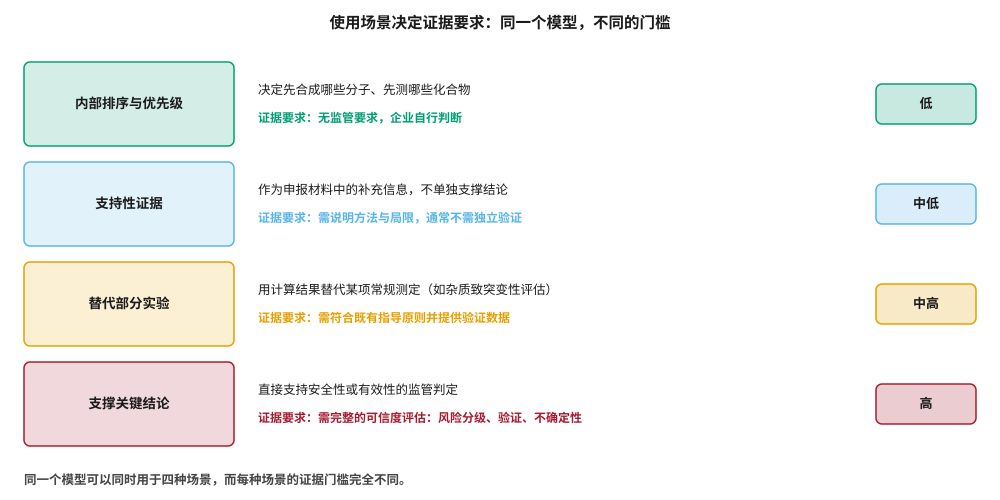
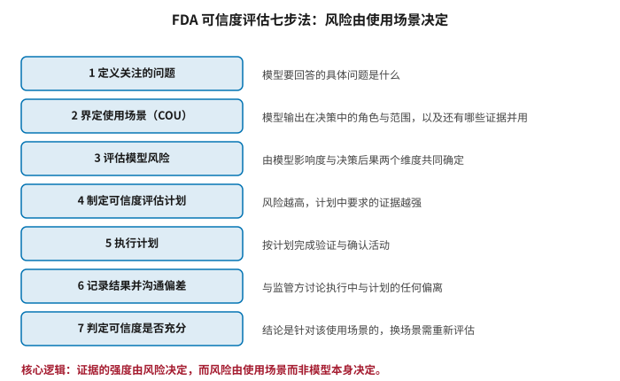
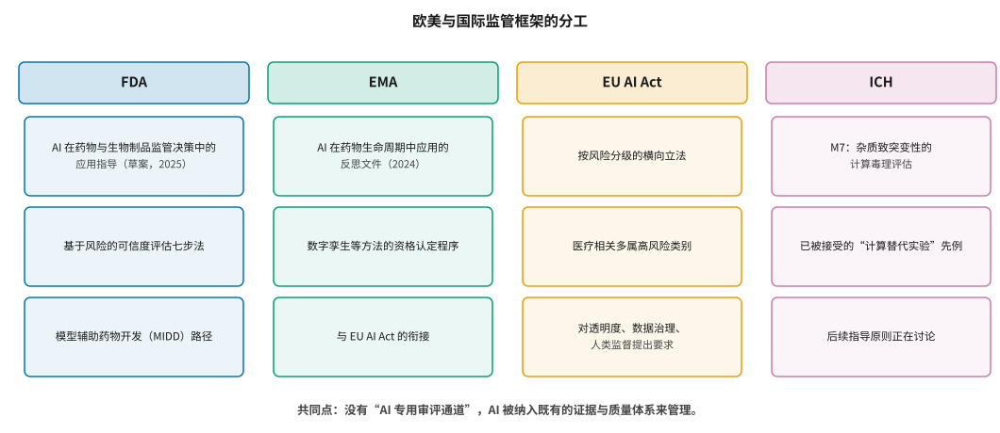

# 欧美监管框架：可信度评估与 EU AI Act {#sec-reg-west}

## 本章目的 {.unnumbered .unlisted}

::: {.purpose-question}
要让监管机构接受一个模型的输出，需要证明什么？
:::

前面各章反复出现一个问题：模型的输出该被多大程度地信任？监管机构面对的是同一个问题，但必须给出可操作的答案。本章梳理欧美的监管框架，其核心是一个看似简单却影响深远的原则：**证据要求由使用场景决定，而非由模型本身决定**。同一个模型，用于内部排序时无需任何监管证据，用于支撑关键安全性结论时则需要完整的可信度评估。理解这个原则，比记住任何一份指导文件的条款都重要。

::: {.callout-note title="给非技术读者的摘要"}

监管机构（美国 FDA、欧洲 EMA）怎么看待 AI？他们的态度可以概括为一句话：**不看你用的是什么技术，看你拿它来干什么**。如果 AI 只是帮你决定内部先做哪个实验，监管完全不管；如果你要用 AI 的计算结果代替一项本来必须做的实验，那就要按既有规则提供验证数据；如果你要用 AI 的结论直接支撑“这个药是安全的”这种判断，要求就非常严格。值得注意的是，监管并没有为 AI 开设专门通道，而是把它放进已有的证据体系里管。欧盟另有一部《人工智能法案》按风险分级立法，医疗相关的用途多数被划为高风险。**成熟度**：框架已成形；具体先例仍在积累。

:::

::: {.callout-learning-objectives}

- 解释“使用场景”概念及其为什么是监管判断的核心
- 描述 FDA 可信度评估七步法的内容与适用方式
- 说明模型风险如何由模型影响度与决策后果两个维度共同确定
- 比较 FDA、EMA、EU AI Act 与 ICH 在 AI 治理中的分工
- 以 ICH M7 为例说明“计算替代实验”被接受的前提条件
- 判断一项具体应用所处的使用场景层级及相应的证据要求

:::

## 核心原则：使用场景 {#sec-reg-cou}

::: {#dfn-cou .callout-definition title="使用场景"}

***使用场景***\index{使用场景}（context of use, COU）指一个模型在回答某个特定问题时所扮演的具体角色与范围：它产出什么、这些输出如何被用于决策、以及是否还有其他证据与之并用。

1.  **意义**：COU 是监管评估的起点。所有后续要求——风险等级、验证强度、文档深度——都由它推导而来，而不是由模型的算法类型决定。
2.  **区别**：COU 不是“模型是什么”，而是“模型在这个决定中起什么作用”。同一个模型在不同 COU 下面临完全不同的要求。
3.  **常见误区**：以为模型一旦被某次申报接受，就可以在其他场景中援引这次接受。可信度结论是针对特定 COU 的，换场景需重新评估。

:::

@fig-context-of-use 把使用场景分成四个层级，证据门槛逐级上升。

::: {#fig-context-of-use fig-cap="**使用场景决定证据要求**：从内部排序与优先级、支持性证据、替代部分实验，到支撑关键结论，证据门槛逐级上升。同一个模型可以同时用于四种场景，而每种场景的门槛完全不同——这是欧美监管对 AI 的基本态度。" fig-alt="四行结构，每行左侧为彩色方框标注使用场景层级，中间说明该层级的含义与证据要求，右侧标注风险等级从低到高。"}

{width="94%"}

:::

这个分层有一个重要的实践含义：**绝大多数 AI 药物研发应用落在第一层，监管完全不介入**。虚拟筛选的排序、生成模型的设计建议、ADMET 的内部预测——这些都只影响企业自己的资源分配，错了也只是浪费自己的钱，监管机构不关心。

这一点经常被误解，而误解的方向是双向的。一方面，有企业因为担心“监管要求”而推迟采用本来完全不受约束的内部工具，白白损失了效率收益；另一方面，也有企业把本应纳入第三、四层的用途当作内部工具处理，直到申报前夕才发现缺少必要的验证记录，而此时补做往往已经来不及。

真正触发监管审视的边界其实相当明确：**当模型的输出被写进申报材料、用来替代某项本应进行的实验、或用来支撑某个监管结论时**。判断是否越过这条边界有一个实用问题——如果审评员问“这个结论的依据是什么”，模型的输出会不会出现在答案里？会，就属于第二层以上；不会，就仍在第一层。

::: {#pri-reg-use-not-tech .callout-principle title="监管看用途，不看技术"}

监管机构不按算法类型（线性回归、随机森林、深度神经网络、大语言模型）区别对待，也没有设立“AI 专用审评通道”。决定要求强度的是模型输出在决策链中的位置与后果。

**实践含义**：企业在规划一项 AI 应用时，第一个问题不是“用什么模型”，而是“这个输出会出现在申报材料的哪个位置、支撑什么结论”。答案决定了需要准备多少验证工作，而这个判断应当在项目开始时就做出，而非在申报前夕。

:::

## FDA 的可信度评估 {#sec-reg-fda}

FDA 在 2025 年初发布了关于在药物与生物制品监管决策中使用 AI 的指导文件草案 [@fda2025ai]。截至 2026 年下半年，该文件仍处于草案状态，尚未定稿——这一点在引用时需要注意，因为草案不具有实施效力。

其核心是一个**可信度评估七步法**（@fig-credibility-steps），其思路源自 ASME V&V 40 这一原本面向医疗器械计算建模的标准 [@asme2018vv40]，并针对药物开发场景做了调整。

::: {#fig-credibility-steps fig-cap="**FDA 可信度评估七步法**：定义关注的问题、界定使用场景、评估模型风险、制定可信度评估计划、执行计划、记录结果并沟通偏差、判定可信度是否充分。核心逻辑是证据的强度由风险决定，而风险由使用场景而非模型本身决定。" fig-alt="七行方框自上而下排列，依次编号一至七，每个方框标注一个步骤名称，右侧为该步骤的说明文字；底部为核心逻辑的总结。"}

{width="70%"}

:::

其中第三步——**模型风险评估**——是整个框架的枢纽。它由两个维度相乘得到：

**模型影响度**：模型的输出在这个决策中占多大分量。是唯一依据，还是与实验数据并用？若模型错了，是否有其他证据能发现？

**决策后果**：这个决策若错误，后果有多严重。影响的是一次内部排序，还是患者安全？

两者的组合决定风险等级，而风险等级决定第四步计划中需要什么强度的证据。一个高影响度、高后果的应用需要完整的独立验证；一个低影响度、低后果的应用可能只需要说明方法与局限。

值得注意的是这两个维度的**不对称性**：模型影响度是申办方可以主动调整的，决策后果通常不是。如果一个模型的输出在决策中与实验数据并用、且存在独立的交叉检验，那么即使决策本身后果严重，模型风险也可以被控制在中等水平。这给出了一条实用的设计思路——**与其试图把模型做到足以单独承担高风险决策，不如设计一个让模型只承担部分权重的证据结构**。后者在工程上容易得多，在监管上也更容易被接受。

这个框架的另一个优点是它**可以在项目早期执行**。企业不必等到申报前才知道需要什么证据——只要确定了 COU，所需的验证强度就可以推算出来，从而把验证工作安排进研发计划，而不是在申报前夕发现证据不足。这一点与 @sec-adoption 讨论的“成功标准要事先约定”是同一种思路：把事后的核验要求前置为事前的设计约束。

## EMA 与 EU AI Act {#sec-reg-eu}

EMA 于 2024 年发布了关于 AI 在药物生命周期中应用的反思文件 [@ema2024reflection]。与 FDA 的框架相比，它的覆盖面更广（从发现一直到上市后监测），立场也相似：按风险分级、强调数据治理与可追溯性、要求人类监督。

@sec-clinical 讨论的数字孪生用于预后协变量调整，正是通过 EMA 的**资格认定程序**获得认可的——这个程序允许方法学工具在不绑定于某个具体药物的前提下获得监管意见，是目前新方法进入监管接受的主要路径之一。

EU AI Act [@euaiact2024] 是另一回事：它是一部横向立法，适用于所有行业的 AI 系统，按风险分为不可接受、高风险、有限风险与最小风险四级。医疗健康相关的用途大多落入高风险类别，相应要求包括风险管理体系、数据治理、技术文档、记录保存、透明度、人类监督与稳健性。

需要注意两者的关系：**药品监管与 AI 法案是并行的两套要求**，而非替代关系。一个用于药物研发的 AI 系统可能同时需要满足 EMA 的证据要求和 AI Act 的合规要求。

两者的侧重点有本质区别。药品监管问的是“**这个结论是否可信**”——它关心某一次具体的科学判断有没有足够证据支撑，因此是面向结果的。AI 法案问的是“**这个系统是否被负责任地构建与运行**”——它关心风险管理流程、数据治理记录、人类监督机制是否到位，因此是面向过程的。

这一区别有实际后果：一个模型可能完全满足药品监管对某次申报的证据要求，却因为缺少完整的风险管理文档而不符合 AI 法案；反之，一套流程完备的系统也不会因此免除对具体结论的证据义务。企业需要分别规划，而不能假设满足其一即可覆盖另一方。

@fig-reg-map 概括了四个框架的分工。

::: {#fig-reg-map fig-cap="**欧美与国际监管框架的分工**：FDA 的可信度评估、EMA 的反思文件与资格认定、EU AI Act 的横向风险分级立法、ICH 的具体技术指导原则。共同点是没有设立 AI 专用审评通道，而是把 AI 纳入既有的证据与质量体系来管理。" fig-alt="四列方框，列标题分别为 FDA、EMA、EU AI Act、ICH，每列下方三个方框列出该机构的主要文件与机制。"}

{width="100%"}

:::

## 一个已有的先例：ICH M7 {#sec-reg-m7}

讨论“计算能否替代实验”时，ICH M7 是最有价值的参照，因为它是**已经生效多年、被各国监管机构接受的现成案例** [@ich2017m7]。

该指导原则针对药物中的致突变性杂质，允许用两套互补的 (Q)SAR 计算方法——一套基于**专家规则**（由毒理学家总结的结构警示，如芳香硝基、环氧化物等已知致突变基团），一套基于**统计学习**（从实验数据中归纳的模型）——的预测结果替代 Ames 试验。

判定逻辑是非对称的：两套方法都预测阴性且无相互矛盾时，可以免做实验；只要有任何一套预测阳性，或两者结果冲突，就需要实验确认。换言之，**计算只能用于免除实验，不能用于判定有害**——后者仍需实验证据。这种非对称设计把计算方法的误判风险限制在“多做了不必要的实验”这一侧，而不会流向“漏掉了真正的风险”那一侧。

这个先例值得仔细体会，因为它展示了“计算替代实验”被接受的四个前提：

**第一，问题被严格限定。** 只针对一个明确的毒理学终点，不是泛泛的“安全性”。

**第二，要求方法学互补。** 用两套原理不同的方法交叉验证，而非依赖单一模型。

**第三，保守的失败处理。** 不一致时倒向做实验，而非倒向省事。

**第四，有专家复核环节。** 计算结果需经有资质人员评估，而非自动采纳。

Myatt 等人进一步发展了计算毒理学的流程化方案 [@myatt2018insilico]，其设计思路与上述四条一致。

::: {#pri-reg-m7-template .callout-principle title="M7 是所有“计算替代实验”主张的模板"}

任何声称可以用计算替代某项实验的主张，都应当按 M7 的四个前提来检验：问题是否被严格限定？是否有方法学互补？不一致时如何处理？是否保留专家复核？

**实践含义**：这四条也是企业内部评估一项计算方法能否进入正式流程的实用标准，即使该应用并不涉及监管申报。

:::

## 模型辅助药物开发 {#sec-reg-midd}

一个容易被忽略的事实是：**计算模型在药物监管中已有数十年的接受历史**。群体药代动力学、生理药代动力学（PBPK）、暴露—效应建模这些统称为模型辅助药物开发（model-informed drug development, MIDD）的方法，长期被用于支持剂量选择、儿科外推、药物相互作用评估等监管决策 [@galetin2024midd]。

这一传统的意义在于，它提供了现成的基础设施：模型如何被记录、如何被审评、如何在申报中被表述，都有成熟的惯例与可参照的先例。新的 AI 方法进入监管体系时，最可行的路径不是另起炉灶要求建立新规则，而是接入这套既有框架——这也正是 FDA 把可信度评估建立在 V&V 40 之上的原因。

两者的关键差别在于**论证方式**。PBPK 模型的每个参数都有明确的物理意义（器官体积、血流量、分配系数），因此可以通过“参数取值是否合理、方程是否反映真实生理过程”来论证模型的可信度——这是一种**机理论证**。深度学习模型的内部表示没有这样的对应关系，机理论证的路径不可用。

这一差别的后果是：AI 模型必须更多地依赖**经验验证**——用独立数据证明预测与实测吻合，并说明在什么范围内吻合。相应地，对验证数据集的独立性、代表性与规模的要求也更高。这解释了为什么 @sec-evaluation 讨论的评测方法学问题在监管语境下格外重要：当机理论证不可用时，评测就是唯一的论证手段。

::: {#ws-reg-qsar .callout-war-story title="为什么要求两套方法而不是一套更好的方法"}

M7 要求两套原理不同的 (Q)SAR 方法同时预测阴性，这个设计常被问及：为什么不直接要求用最准的那一套？

原因在于**误差的相关性**。两套基于相同原理的方法，其错误往往发生在同样的分子上——它们共享同样的盲区。而专家规则系统与统计学习模型的失败模式不同：前者在规则未覆盖的新结构上失效，后者在训练数据稀疏的区域失效。要求两者同时为阴性，等于要求这个分子不落在任何一方的盲区里。

这个思路对企业内部的计算流程同样适用。当一个关键判断依赖计算时，与其追求单一模型的最高精度，不如用原理不同的两种方法交叉验证，并把不一致当作需要实验澄清的信号，而非需要用更好模型解决的技术问题。

:::

::: {.fallacy-pitfall}

**谬误**：*模型通过了一次监管审评，就可以在其他项目中直接使用。*

可信度结论是针对特定使用场景的。同一个模型用于另一个适应症、另一类化合物、或在决策链中的另一个位置时，模型影响度与决策后果都可能改变，风险等级随之改变，所需证据也要重新评估。此外，模型本身若经过再训练，其验证状态也需要重新确认——这正是 @sec-platform 强调模型注册表与版本管理的监管层面理由。

:::

::: {#chk-reg-west .callout-checkpoint}

1. 什么是使用场景？为什么说它而非算法类型决定了监管要求？
2. 模型风险由哪两个维度共同确定？各举一个高低组合的例子。
3. FDA 可信度评估七步法中，哪一步决定了后续证据的强度？
4. EMA 的反思文件与 EU AI Act 的要求侧重点有何不同？两者是替代关系吗？
5. ICH M7 允许计算替代实验的四个前提是什么？
6. 为什么 M7 要求两套原理不同的方法，而不是一套最准的方法？
7. 与 PBPK 等传统模型相比，AI 模型在监管论证上的主要劣势是什么？

:::

## 小结 {#sec-reg-west-summary}

欧美监管对 AI 的态度可以归结为一条原则：**看用途，不看技术**。没有 AI 专用通道，AI 被纳入既有的证据与质量体系来管理，而管理的强度由使用场景决定。FDA 的可信度评估七步法提供了可操作的框架，其枢纽是模型风险——由模型影响度与决策后果共同确定。EMA 的立场相似，而 EU AI Act 作为横向立法提出了并行的合规要求。ICH M7 是理解“计算替代实验”边界的最佳参照，它的四个前提——问题限定、方法学互补、保守的失败处理、专家复核——构成了一个可以普遍使用的检验标准。对企业而言，最实际的启示是把 COU 的判断前置：在项目开始时就确定这个模型的输出会出现在哪里，相应的验证工作才能被安排进研发计划，而不是在申报前夕发现证据不足。

::: {.callout-takeaways title="看用途，不看技术"}

* **使用场景是起点**：所有要求由 COU 推导，换场景需重新评估可信度。
* **风险 = 模型影响度 × 决策后果**：这个乘积决定需要多强的证据。
* **没有 AI 专用通道**：AI 被纳入既有的证据与质量体系，而非另设规则。
* **FDA 指导仍是草案**：截至 2026 年下半年尚未定稿，引用时需注明状态。
* **M7 是现成模板**：问题限定、方法学互补、保守失败处理、专家复核。
* **两套方法优于一套好方法**：原理不同的方法失败模式不同，交叉验证覆盖各自盲区。

:::

::: {.callout-chapter-connection title="从欧美到中国"}

中国的监管体系有自己的结构与重点，而数据合规方面的要求尤其不同——人类遗传资源管理、数据出境、个人信息保护构成了一套欧美没有的约束。@sec-reg-china 讨论中国药品监管对 AI 的态度、数据合规的具体要求，以及这些要求如何影响跨国合作与数据使用。

:::
