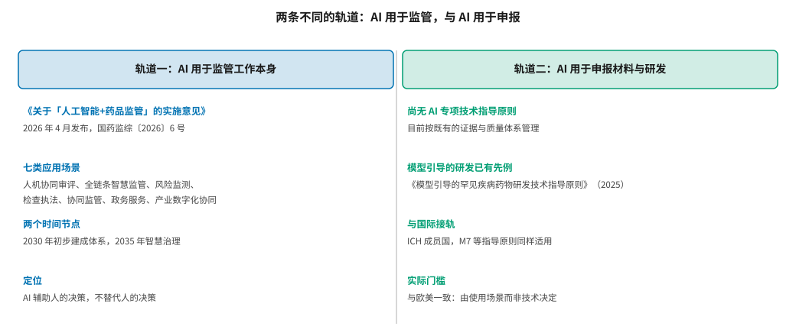
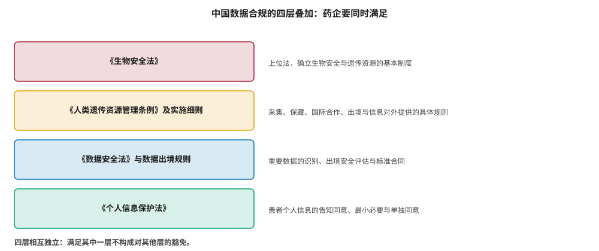
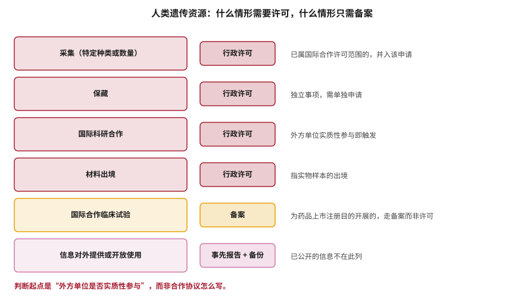

# 中国监管、数据合规与产业政策 {#sec-reg-china}

## 本章目的 {.unnumbered .unlisted}

::: {.purpose-question}
在中国做 AI 药物研发，监管和数据合规上有哪些不一样的约束？
:::

@sec-reg-west 梳理的欧美框架有一个共同前提：数据可以自由使用，问题只在于证据是否充分。中国的情况多了一个维度——**数据本身的使用、跨境与开放受到独立于药品监管的另一套法律约束**。人类遗传资源管理、数据安全、个人信息保护三者叠加，构成了一套欧美没有的合规结构，而这套结构对跨国合作、数据共享与模型训练都有直接影响。本章分两部分：药品监管对 AI 的态度，以及数据合规的具体要求。

::: {.callout-note title="给非技术读者的摘要"}

在中国做 AI 制药，要分清两件不同的事。第一件是**药监局自己用 AI**：2026 年 4 月药监局发了一份文件，计划用 AI 辅助审评、风险监测等工作，目标是 2030 年初步建成、2035 年实现“智慧治理”——这是监管机构自身的数字化，不是对企业的要求。第二件是**企业用 AI 做研发和申报**：目前没有专门的 AI 指导原则，按既有的证据体系管，门槛逻辑和欧美一样，看用途不看技术。真正特殊的是数据合规：涉及中国人的遗传资源（血样、基因数据等），采集、保存、与外方合作、样本出境都要走审批，把数据给境外还要事先报告并留备份。这套要求和药品审评是两条线，各管各的。**成熟度**：数据合规规则明确；AI 专项规则尚未出台。

:::

::: {.callout-learning-objectives}

- 区分“AI 用于监管工作”与“AI 用于申报与研发”两条不同的政策轨道
- 说明中国药品监管目前对 AI 的基本态度及其与欧美的异同
- 判断一项活动是否触发人类遗传资源的行政许可或备案要求
- 解释“外方单位实质性参与”这一判断标准的含义
- 描述数据合规四层法律的叠加关系及各自的管辖范围
- 评估跨国合作中数据安排的合规风险点

:::

## 两条轨道 {#sec-china-tracks}

讨论“中国对 AI 制药的监管”时，首先要区分两件经常被混为一谈的事（@fig-china-two-tracks）。

::: {#fig-china-two-tracks fig-cap="**两条不同的轨道**：左侧是 AI 用于监管工作本身，以 2026 年发布的《关于「人工智能+药品监管」的实施意见》为代表；右侧是 AI 用于企业的申报材料与研发，目前尚无专项技术指导原则，按既有证据体系管理。两条轨道的对象、目的与约束力都不同。" fig-alt="左右两栏对照，左栏标题为轨道一 AI 用于监管工作本身，下列四项要点；右栏标题为轨道二 AI 用于申报材料与研发，下列四项要点，中间以竖线分隔。"}

{width="100%"}

:::

### 轨道一：监管机构自身的 AI 应用 {#sec-china-track1}

2026 年 4 月，国家药监局发布《关于「人工智能+药品监管」的实施意见》（国药监综〔2026〕6 号）[@nmpa2026ai]，提出以人机协同审评审批、全链条智慧监管、风险监测预警、检查执法、协同监管、智能政务服务、产业数字化协同为代表的七类应用场景，并设定了两个时间节点：2030 年初步建成“人工智能+药品监管”体系，2035 年实现智慧治理。文件明确 AI 用于辅助人的决策而非替代人的决策。

这份文件的性质需要准确理解：**它主要是监管机构自身的数字化规划，而非对企业使用 AI 的技术要求**。把它当作合规义务来应对，会造成不必要的投入；完全忽略它，又会错过几项确实会影响企业的变化。

它对企业的间接影响主要体现在三点。

**申报资料的结构化程度会越来越重要。** 机器预审需要可解析的材料——结构化的数据表优于嵌在 PDF 里的图片，标准化的字段优于自由文本。这意味着注册团队的文档生产方式需要相应调整，而这件事越早做成本越低。

**临床试验数据的标准化要求可能提高。** 文件明确提到推动临床试验数据的标准化与电子化。对同时在中国和海外申报的企业，值得考虑用一套能同时满足 NMPA 与 ICH 预期的数据架构，而不是事后做两次转换。

**用于注册申报的 AI 工具本身可能被纳入管理。** 如果一个工具直接参与申报材料的生成或临床数据的分析，它可能触及医疗器械软件的相关规则；而仅用于内部质量管理的工具则不涉及额外注册要求，但仍需符合 GMP 对计算机化系统的一般要求。这条边界目前还不够清晰，值得持续关注。

### 轨道二：企业使用 AI 的证据要求 {#sec-china-track2}

截至 2026 年下半年，中国尚无专门针对 AI 用于药物研发与申报的技术指导原则。这意味着现阶段的管理逻辑与欧美一致：按既有的证据与质量体系处理，由使用场景而非技术类型决定要求。

两个事实使这一判断更可靠。第一，中国是 ICH 成员国，ICH M7 等已采纳的指导原则同样适用——@sec-reg-west 讨论的“计算替代实验”的四个前提在中国同样成立。第二，模型引导的药物研发在中国已有专门的指导文件先例：药审中心 2025 年发布了《模型引导的罕见疾病药物研发技术指导原则》[@cde2025rare]，表明监管机构对计算方法支持研发决策持开放态度，且遵循与国际一致的方法学要求。

::: {#pri-china-two-tracks .callout-principle title="政策文件的对象决定它的约束力"}

一份政策文件是面向监管机构自身、面向行业发展，还是面向企业的技术要求，决定了它对企业的实际意义完全不同。把发展规划当作合规要求，会导致不必要的投入；把技术要求当作倡导性文件，则会导致合规风险。

**实践含义**：阅读任何监管文件时，先确认它的发文对象与文件类型（实施意见、技术指导原则、公告、通告），再判断其约束力。

:::

## 数据合规：四层叠加 {#sec-china-data}

这是中国与欧美差异最大的部分。@fig-compliance-stack 给出四层法律的叠加结构。

::: {#fig-compliance-stack fig-cap="**中国数据合规的四层叠加**：《生物安全法》作为上位法确立基本制度，《人类遗传资源管理条例》及实施细则规定具体规则，《数据安全法》及数据出境规则管辖重要数据，《个人信息保护法》管辖患者个人信息。四层相互独立，满足其中一层不构成对其他层的豁免。" fig-alt="四层横向结构，自上而下依次为生物安全法、人类遗传资源管理条例及实施细则、数据安全法与数据出境规则、个人信息保护法，每层右侧说明其管辖范围。"}

{width="96%"}

:::

这四层的关键特征是**相互独立**：一项活动可能同时触发多层要求，而满足其中一层不构成对其他层的豁免。例如，一个涉及中国患者基因数据的国际合作项目，既要办理人类遗传资源的国际科研合作许可，又要满足个人信息的单独同意要求，数据出境时还要符合数据出境的相关规则。

### 人类遗传资源 {#sec-china-hgr}

::: {#dfn-hgr .callout-definition title="人类遗传资源"}

***人类遗传资源***\index{人类遗传资源}分为**材料**与**信息**两类。材料指含有人类基因组、基因等遗传物质的器官、组织、细胞等遗传材料；信息指利用这些材料产生的数据，如基因、基因组、转录组、表观组数据与核酸类生物标志物数据。

1.  **意义**：两类的监管路径不同。材料的采集、保藏与出境需要行政许可；信息的管理则主要针对国际合作、对外提供与开放使用三种情形。
2.  **区别**：实施细则明确尿液、粪便、血清、血浆不再作为人类遗传资源材料管理，但对这些样本检测产生的遗传信息仍按信息管理。
3.  **常见误区**：以为只要不把样本带出境就不涉及。信息的对外提供同样受管辖，而数据传输比样本运输更容易在无意中发生。

:::

@fig-hgr-matrix 给出主要情形的判断矩阵。

::: {#fig-hgr-matrix fig-cap="**人类遗传资源的许可与备案情形**：采集（特定种类或数量）、保藏、国际科研合作、材料出境需行政许可；为药品上市注册目的开展的国际合作临床试验走备案；信息对外提供或开放使用需事先报告并备份。判断起点是外方单位是否实质性参与。" fig-alt="六行结构，每行左侧为活动名称方框，中间为该活动对应的程序要求标签，右侧为补充说明。"}

{width="86%"}

:::

其中最关键也最常被误判的是**“外方单位实质性参与”**这一标准。按实施细则与相关问答，若所有合作方均为中方单位，仅 EDC 供应商为外方，不需要许可或备案；若外方不实质性参与（不接触数据、不共享结果，仅提供药物或资金），同样不需要。反之，一个能够接触人类遗传资源材料或信息并实质性参与的单位，无论协议如何表述，都构成“外方单位”。

这一标准对 AI 项目有直接含义：**模型训练天然涉及数据接触**。如果一个跨国团队共同训练一个使用中国患者基因数据的模型，即使数据物理上不出境，外方团队对数据的访问本身就可能构成实质性参与。

这里有三个在实践中容易出问题的场景值得单独指出。

**云服务的位置。** 如果训练在境外云平台上进行，即使操作者是中方人员，数据也已经出境——合规判断看的是数据所在地与可访问方，而非操作者身份。

**代码与中间产物。** 特征工程的中间文件、模型检查点、甚至详细的实验日志，都可能包含足以回溯的遗传信息。合规评估通常只覆盖“原始数据”，而忽略了这些衍生物。

**人员流动。** 外方人员短期派驻中方机构期间接触数据，与数据传输到境外在法律性质上并不相同，但同样可能构成实质性参与，需要在合作协议中事先明确。

这三点的共同特征是：它们都发生在技术团队的日常工作中，而不是在正式的数据交付环节——因此很容易绕过合规审查而不被察觉。

### 信息对外提供与备份 {#sec-china-info}

将人类遗传资源信息向境外组织提供或开放使用的，需要事先报告并提交信息备份。已公开的信息不在此列；在约定数据范围内传给 EDC 供应商或统计公司的，也不需要。超出约定范围的共享或使用，则需要申请对外提供或进行事先报告。

::: {#ws-china-federated .callout-war-story title="联邦学习能解决数据出境问题吗"}

@sec-data-flywheel 讨论的联邦学习，在中国语境下常被提出作为跨境数据合作的技术解法：数据不出境，只交换模型参数，看起来绕开了数据出境的约束。

这个想法在技术上成立，在合规上却需要谨慎。几个问题需要逐一回答：第一，模型参数是否构成“信息对外提供”？参数由数据训练得来，携带了数据的统计特征，其法律定性并非显然。第二，外方作为联邦学习的参与方，是否构成“实质性参与”？他们不直接接触原始数据，但参与了基于该数据的研究并共享成果。第三，模型更新中的信息泄漏风险——@sec-data-flywheel 提到的差分隐私问题——在合规论证中如何处理？

目前这些问题没有公开的权威答复，实践中的做法是在项目设计阶段就与主管部门沟通，而非在技术方案确定后再补合规。这个案例的普遍教训是：**合规问题越早介入越便宜**。在数据架构确定之前讨论合规，可选方案很多；在模型已经训练完之后讨论，往往只剩下推倒重来一条路。

:::

::: {.fallacy-pitfall}

**谬误**：*数据脱敏或匿名化之后就不再受管辖。*

这三套法律的管辖依据各不相同，而理解这一点是避免误判的关键。

**个人信息保护法**关注的是**可识别性**——数据能否指向特定自然人。匿名化确实能降低它的适用性，这也是“脱敏即合规”这一直觉的来源。

**人类遗传资源管理**关注的是**遗传信息本身的属性**，与能否识别到个人并不等同。一份完全去标识的基因组数据仍然是人类遗传资源信息，因为受保护的客体是遗传资源这一战略性资源，而非个人隐私。这是两套法律在立法目的上的根本差异：前者保护个人权益，后者保护国家资源安全。

**数据安全法**关注的是**数据的重要性**，以是否构成“重要数据”为判断标准，与标识与否同样没有直接关系。

因此“脱敏即合规”在这里不成立。三套法律需要分别论证，而且论证的逻辑完全不同——对个保法论证的是“无法识别到个人”，对人遗条例论证的是“活动类型不在管辖范围或已履行程序”，对数据安全法论证的是“不属于重要数据或已通过评估”。

:::

## 产业政策环境 {#sec-regchina-industrial-policy}

@sec-china 从产业角度讨论过中国 AI 制药生态的特点。从政策角度补充三点。

**支持方向明确。** 生物医药与人工智能都被列为战略性新兴产业，地方政府在算力、园区、人才方面提供实质性支持。这降低了早期创业的门槛，但也带来了同质化竞争。

**审评资源持续改善。** 药审中心的审评能力与效率在过去十年有显著提升，ICH 成员身份使中国的技术要求与国际主流接轨，这对计划“中美双报”的企业降低了成本。

**数据合规是真实约束。** 相比之下，数据合规的要求没有放松趋势，而且对跨国合作的影响是结构性的而非程序性的——它改变的不是办事的流程，而是方案本身可行与否。

在设计涉及中国人群数据的国际项目时，合规方案应当与科学方案**同步设计**，而不是在科学方案确定后再寻求合规路径。原因在 @ws-china-federated 中已有说明：合规介入越早，可选方案越多；介入越晚，剩下的选项越少，到最后往往只剩推倒重来。

一个实用的做法是在项目立项文档中增加一节“数据流图”：明确标出每一份数据的产生地、存储地、访问方、以及每一次跨境或跨主体的传递。这份图既是合规评估的输入，也往往能在科学方案阶段就暴露出不必要的数据流动——而减少不必要的流动，本身就是最有效的合规措施。

::: {#chk-reg-china .callout-checkpoint}

1. 《关于「人工智能+药品监管」的实施意见》的主要对象是谁？它对企业的间接影响体现在哪两点？
2. 中国目前如何管理企业在申报中使用 AI？与欧美的逻辑有何异同？
3. 哪些人类遗传资源活动需要行政许可？哪些只需备案？
4. “外方单位实质性参与”的判断标准是什么？它对跨国 AI 项目意味着什么？
5. 数据合规的四层法律各自的管辖依据是什么？为什么匿名化不能一并解决？
6. 联邦学习在跨境数据合作中面临哪三个尚无权威答复的合规问题？

:::

## 小结 {#sec-reg-china-summary}

中国的监管环境在两个层面上需要分别理解。药品监管层面，对 AI 的态度与国际主流一致——没有专项规则，按使用场景决定证据要求，而 ICH 成员身份与模型引导研发的既有指导文件为计算方法提供了明确的接入路径。2026 年的“人工智能+药品监管”实施意见是监管机构自身的数字化规划，其对企业的影响主要体现在申报材料结构化与数据标准化的要求上。数据合规层面则完全不同：人类遗传资源、数据安全、个人信息保护三套独立的法律叠加，构成了欧美没有的约束结构，而“外方单位实质性参与”这一标准使得跨国 AI 合作的合规判断需要在项目设计阶段就完成。对在中国开展 AI 药物研发的组织而言，最实际的建议是把合规方案与科学方案同步设计——这件事越早做越便宜。

::: {.callout-takeaways title="两条轨道，四层合规"}

* **先分清轨道**：AI 用于监管工作与 AI 用于企业申报是两件事，约束力完全不同。
* **企业侧暂无专项规则**：按既有证据体系管理，逻辑与欧美一致，由使用场景决定要求。
* **ICH 成员身份是接入点**：M7 等已采纳指导原则同样适用，模型引导研发已有指导文件先例。
* **数据合规四层独立**：生物安全法、人遗条例、数据安全法、个保法，满足一层不豁免其他层。
* **实质性参与是关键标准**：外方能否接触数据并参与研究，而非协议如何表述。
* **合规要前置**：数据架构确定之前讨论，可选方案多；模型训练完之后讨论，常只剩推倒重来。

:::

::: {.callout-chapter-connection title="从合规到知识产权与安全"}

监管与数据合规之外，还有两类制度性问题随着 AI 能力提升而变得紧迫：AI 参与产生的发明归谁所有、能否获得专利保护；以及当设计分子的门槛大幅降低后，如何防止这种能力被用于制造危害。@sec-ip-biosecurity 讨论这两个问题的现状与争论。

:::
