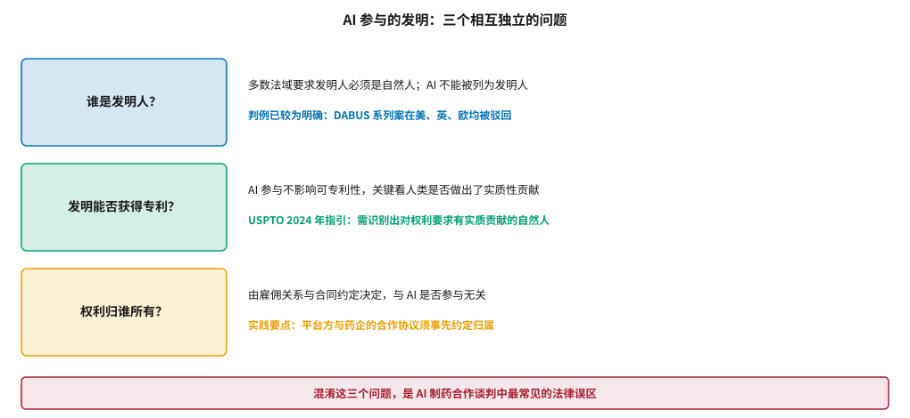
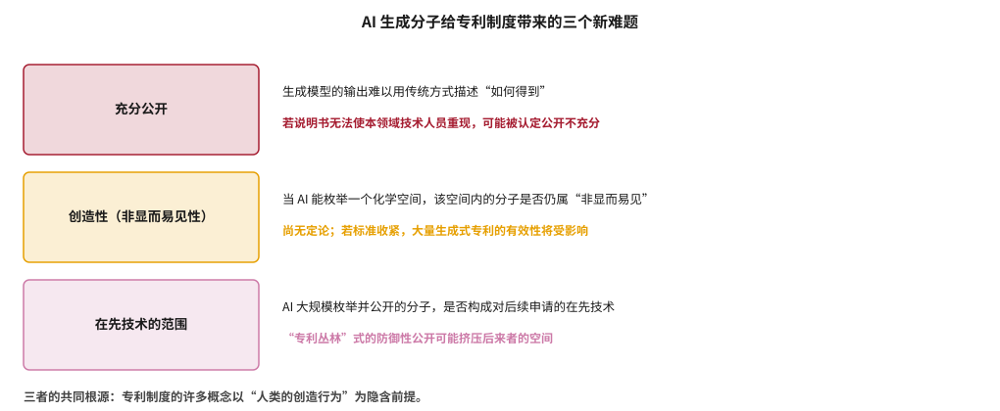
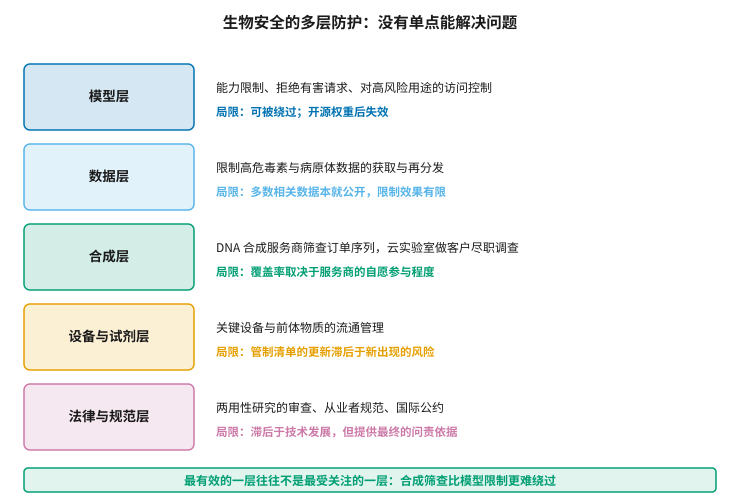

# 知识产权与生物安全 {#sec-ip-biosecurity}

## 本章目的 {.unnumbered .unlisted}

::: {.purpose-question}
AI 设计出来的分子归谁，以及当设计门槛降低后该如何防止滥用？
:::

本章处理两个表面上无关、实际上同源的问题。两者都源于同一个事实：**AI 大幅降低了产生新分子的成本**。在知识产权上，这挑战了专利制度中以人类创造行为为前提的若干概念；在生物安全上，它降低了设计有害物质的门槛。本章的立场在两个问题上是一致的：**现有制度的框架大体够用，需要调整的是具体标准与执行环节，而非推倒重建**；同时，对两个问题都应避免两种极端——既不夸大即时风险，也不以“技术中性”回避责任。

::: {.callout-note title="给非技术读者的摘要"}

两个问题。第一，AI 设计出一个分子，专利算谁的？目前各国的答案比较一致：**AI 不能当发明人，发明人必须是人**，但这不妨碍发明本身申请专利——只要能指出哪个人做出了实质性贡献。真正要在合同里写清楚的是“权利归谁”，这和 AI 没关系，和雇佣关系与协议条款有关。第二，AI 让设计分子变容易了，会不会被用来做坏事？这里有一个重要判断：**最有效的防线不是限制模型，而是在合成环节把关**——因为设计出一个序列不等于能做出实物，而做实物要通过 DNA 合成服务商和实验室，那里的筛查比限制模型更难绕过。**成熟度**：知识产权规则渐趋明确；生物安全治理仍在建设中。

:::

::: {.callout-learning-objectives}

- 区分发明人身份、可专利性与权利归属三个相互独立的问题
- 说明 DABUS 系列案与 USPTO 2024 年指引确立的基本规则
- 识别 AI 生成分子对充分公开、创造性与在先技术三项专利要件的挑战
- 描述生物安全的五层防护结构及各层的能力与局限
- 解释为什么合成环节的筛查比模型层的限制更有效
- 评估一项两用性风险主张时应当追问的问题

:::

## 知识产权：三个独立的问题 {#sec-ip}

讨论“AI 发明的专利”时，最常见的混乱是把三个独立的问题搅在一起（@fig-inventorship）。

::: {#fig-inventorship fig-cap="**AI 参与的发明涉及三个相互独立的问题**：谁是发明人、发明能否获得专利、权利归谁所有。三者的法律依据不同，答案也不同。混淆它们是 AI 制药合作谈判中最常见的法律误区。" fig-alt="三行结构，每行左侧为彩色方框标注一个问题，右侧两行分别给出该问题的答案与相应的法律依据或实践要点；底部红色横条给出总结。"}

{width="96%"}

:::

### 发明人必须是自然人 {#sec-ip-inventor}

这一点在主要法域已经相当明确。以 DABUS 系统为申请人的系列案件在美国、英国、欧洲专利局均被驳回，理由一致：现行专利法中的“发明人”概念以自然人为前提。Abbott 对这一系列诉讼及其理论争议有系统论述 [@abbott2020reasonable]。

需要注意的是，这些判决回答的是“AI 能否被列为发明人”，**不是**“AI 参与的发明能否获得专利”。两者经常被媒体混为一谈。

### 可专利性取决于人类贡献 {#sec-ip-patentability}

USPTO 在 2024 年发布的 AI 辅助发明的发明人身份指引 [@uspto2024inventorship] 给出了可操作的标准：AI 的参与不使发明丧失可专利性，但申请必须能够识别出至少一位对权利要求做出**实质性贡献**的自然人。

这一标准在实践中的含义是：设定问题、选择约束条件、从 AI 输出中识别并挑选出有价值的方案、设计验证实验——这些人类活动都可能构成实质性贡献。相反，仅仅“运行了模型”或“提出了一般性目标”通常不够。

这条界线的实际位置可以用一个对比说明。如果研究者只是输入“设计一个 EGFR 抑制剂”并接受模型的第一个输出，很难主张实质性贡献；而如果研究者基于对该靶点口袋特征的理解设定了具体的结构约束、在数千个输出中依据可合成性与选择性判断筛选出十个、并设计了区分性的验证实验，那么这些判断显然构成贡献——而且是对最终权利要求有直接影响的贡献。

这对 AI 制药公司的直接启示是**记录过程**：哪位研究者做了哪些判断、如何设定的目标与约束、依据什么标准筛选的输出、为什么排除了其他候选。这些记录在后续的专利审查或诉讼中可能成为关键证据，而它们必须在当时产生——事后补写的说明既不可信也可能带来额外风险。

值得注意的是，这一要求与 @sec-platform 讨论的决策记录能力高度重合。一个为了可追溯性而建设的平台，恰好也满足了发明人身份举证的需要——这是少数几处合规要求与工程最佳实践完全一致的地方。

### 权利归属是合同问题 {#sec-ip-ownership}

这一项与 AI 完全无关，但在实践中最容易出问题。当一家 AI 平台公司与一家药企合作时，由此产生的分子专利归谁、平台方是否保留在其他项目中使用衍生知识的权利、改进后的模型归谁——这些都必须在合作协议中事先约定。@sec-capital 讨论的交易结构中，知识产权条款往往比财务条款更难谈。

::: {#pri-ip-three-questions .callout-principle title="三个问题分开问"}

“AI 发明的专利问题”不是一个问题，而是三个：谁被列为发明人（法律规定，无谈判空间）、发明能否获得专利（取决于能否指认人类的实质性贡献）、权利归谁（完全由合同决定）。

**实践含义**：合作谈判中，第三个问题才是需要花时间的；前两个问题的答案已经相对确定，花时间争论它们是浪费。而对内部研发，重点是建立记录人类贡献的流程。

:::

## 专利制度面临的新难题 {#sec-ip-challenges}

上述三个问题的答案相对清晰，但 AI 的规模化能力给专利制度带来了更深层的挑战（@fig-patent-challenges）。

::: {#fig-patent-challenges fig-cap="**AI 生成分子给专利制度带来的三个新难题**：充分公开、创造性（非显而易见性）、在先技术的范围。三者的共同根源是专利制度的许多概念以人类的创造行为为隐含前提。" fig-alt="三行结构，每行左侧为彩色方框标注一项专利要件，右侧两行分别说明 AI 带来的困难与可能的后果。"}

{width="96%"}

:::

**充分公开**要求说明书使本领域技术人员能够重现发明。当分子来自一个随机初始化、依赖特定权重与采样过程的生成模型时，“如何得到”难以用传统方式描述。实践中的变通是着重描述分子本身与其合成路线，而非生成过程——但这回避而非解决了问题。

**创造性**的挑战更根本，因为它触及专利制度的一个核心拟制。非显而易见性的判断以“**本领域技术人员**”为基准——一个掌握该领域全部现有技术、但不具备创造能力的假想人物。

问题在于：如果本领域技术人员被认为掌握了生成模型，那么一个模型能够枚举出的化学空间内的任何分子，是否还算“非显而易见”？按字面逻辑，只要运行模型就能得到的东西，似乎就不该获得专利保护。

这个推论若被接受，影响将是深远的：大量基于生成设计的专利可能失去有效性基础，而这反过来会削弱企业投资生成式方法的动力——这正好与专利制度鼓励创新的初衷相悖。Gervais 对这一张力有详细分析 [@gervais2024ai]。

目前这个问题没有定论，各法域也尚未形成明确判例。可以观察的是，实践中的折中方向似乎是强调**人类选择的贡献**：模型可以枚举，但从枚举结果中识别出哪一个值得开发仍需判断，而这种判断构成创造性。这一思路与前述发明人身份的认定逻辑一致，但它能否经受住系统性的挑战，还有待观察。

**在先技术的范围**涉及一种策略行为：企业可以用 AI 大规模枚举并公开分子，构筑防御性的在先技术，挤压竞争对手的专利空间。这种做法的合法性没有疑问，但它可能导致化学空间被“占满”而非被实际开发——与专利制度鼓励实际创新的初衷相悖。

::: {.fallacy-pitfall}

**谬误**：*AI 生成的分子可以不加区别地批量申请专利。*

批量申请面临两重现实障碍。审查层面，每项申请都需要证明实用性与充分公开，而对一个从未被合成与测试的分子，这两项都难以满足。经济层面，专利的维持费用随数量线性增长，而绝大多数分子永远不会产生价值。实践中更常见的做法是用马库什权利要求覆盖一个结构范围，并辅以若干具体实施例——这与 AI 出现之前的做法并无本质不同。

:::

## 生物安全：多层防护 {#sec-biosecurity}

@sec-agents 提到过 Urbina 等人的警示：用于毒性最小化的生成模型，反转优化目标即可用于设计高毒性化合物 [@urbina2022dualuse]。这一发现广为传播，也常被过度解读。本节试图给出一个更准确的图景。

### 设计不等于制造 {#sec-bio-design-vs-make}

关键的事实是：**设计出一个分子结构或一段序列，与实际获得该物质之间，隔着相当大的距离**。合成、纯化、表征、配制、递送——每一步都需要专门的设施、试剂与技能。Sandbrink 对语言模型与生物设计工具的风险差异做了细致区分 [@sandbrink2023ai]，其核心观点是：**瓶颈通常不在“知道做什么”，而在“能做出来”**。

这一判断有两个推论。第一，单纯讨论模型能不能输出有害设计，会系统性地高估模型层防护的重要性——因为它把注意力集中在信息环节，而真正的约束在物质环节。第二，真正有效的干预点在物理环节，这正是下一节的主题。

但这个判断有明确边界，不应被当作安心的理由，原因有三。

**瓶颈正在变窄。** 随着自动化实验与云实验室的普及（@sec-synthesis），“能做出来”所需的专业技能在下降——一些原本需要多年训练的操作，现在可以通过服务外包完成。

**不同模态的门槛差异很大。** 对小分子而言，合成仍需真实的化学能力与设备；而对核酸类分子，从序列到实物的路径短得多——这正是基因合成筛查成为治理重点的原因。

**知识门槛与实操门槛的下降是不同步的。** 大语言模型降低的主要是知识门槛（找到相关文献、理解实验方案），而这部分知识多数本来就公开。真正值得关注的是生物设计工具带来的**新设计能力**——它们可能产出在已知数据库中不存在、因而无法被相似性筛查拦截的序列。

### 五层防护 {#sec-bio-layers}

@fig-biosecurity-layers 给出分层结构与各层的局限。

::: {#fig-biosecurity-layers fig-cap="**生物安全的五层防护及各层局限**：模型层、数据层、合成层、设备与试剂层、法律与规范层。最有效的一层往往不是最受关注的一层——合成环节的筛查比模型层的限制更难绕过，因为它作用于物理世界而非信息世界。" fig-alt="五行结构，每行左侧为彩色方框标注防护层名称，右侧两行分别说明该层的措施与其局限。"}

{width="72%"}

:::

**模型层**的限制（拒绝有害请求、访问控制）是最受公众关注的一层，也是效果最有限的一层：它可以被绕过，而一旦模型权重开源就完全失效。这不意味着不该做，而意味着不能依赖它作为主要防线。

**合成层**是目前最实在的一层。国际基因合成联盟的协调筛查协议要求成员对订单序列进行筛查并对客户做身份核验 [@iga2023synthesis]；Diggans 与 Leproust 讨论了把这一机制扩展为更完整框架的路径 [@nti2024screening]。

它之所以有效，有三个结构性原因。**它作用于物理世界**：绕过一个软件限制只需要改几行提示词，绕过所有合规的合成服务商则需要自建合成能力，而那是一笔真实的资本投入。**它留下痕迹**：订单涉及付款、物流与身份信息，这些都是可审计的记录。**它是集中的**：全球有能力提供高质量基因合成服务的厂商数量有限，因此覆盖少数几十家就能覆盖大部分实际需求——这与试图监管无数个模型使用者形成鲜明对比。

它的主要弱点是覆盖率：筛查目前主要依靠服务商自愿参与，非成员企业与自建合成能力不在覆盖范围内。把筛查从行业自律变为法定要求，是当前治理讨论的焦点之一 [@carter2023biosecurity]。

::: {#pri-bio-physical-chokepoint .callout-principle title="有效的管控点在物理世界"}

信息层面的限制（模型拒答、数据不公开）在面对有决心的行为者时容易失效，因为信息可以被复制、推导与重新获得。物理层面的管控点（合成服务、关键设备、受控试剂）更难绕过，因为它们要求真实的交易与物流。

**实践含义**：评估一项生物安全措施的有效性，看它作用在信息层还是物理层。同时，这也解释了为什么负责任的能力开放讨论应当聚焦于物理瓶颈的加固，而非仅仅争论模型要不要开源。

:::

### 评估风险主张的方法 {#sec-bio-assess}

两用性风险的讨论常常在“杞人忧天”与“掉以轻心”之间摇摆。几个具体问题有助于做出更准确的判断：

这项能力提供的是**什么类型的帮助**？是降低了知识门槛（相关知识多数已公开），还是降低了实操门槛（更值得关注）？

与**已有途径相比**提升了多少？如果一项信息通过公开文献同样可得，限制模型输出的边际收益有限。

**瓶颈在哪里**？如果真实瓶颈是获取特定设备或材料，那么针对信息层的措施不会改变风险水平。

**防护措施的代价是什么**？过度限制会影响正当研究，而这种影响往往落在资源较少的研究者身上。

::: {#ws-bio-screening .callout-war-story title="为什么筛查协议盯的是序列而不是意图"}

基因合成筛查的一个设计细节值得注意：它比对的是**订单序列与已知危险序列的相似性**，而不是试图判断客户的意图。

这个设计初看是技术妥协——毕竟判断意图才是真正想要的。但它实际上是更稳健的选择。意图无法被可靠地观测，任何基于意图的判断都依赖自述或推测，容易被规避也容易误伤。序列相似性则是客观的、可自动化的、可审计的。

代价是这套机制只能覆盖已知的危险序列——对于 AI 设计出的、与已知危险序列不相似但功能相当的新序列，传统的相似性比对会失效。这是当前筛查体系面临的最实质的技术挑战，也是把 AI 用于防护侧（预测新序列的功能而非仅比对相似性）最有价值的方向之一。

这个案例的普遍意义在于：**好的管控机制依赖可观测、可审计的量，而非依赖对动机的判断**。这一原则在数据治理、模型审计等其他治理场景中同样适用。

:::

::: {#chk-ip-biosecurity .callout-checkpoint}

1. “AI 不能被列为发明人”与“AI 参与的发明不能获得专利”——这两句话的区别是什么？
2. 按 USPTO 2024 年指引，哪些人类活动可能构成实质性贡献？哪些通常不够？
3. AI 生成分子对充分公开、创造性、在先技术三项要件各带来什么挑战？
4. 为什么说模型层的限制不能作为生物安全的主要防线？
5. 基因合成筛查为什么比对序列而非判断意图？这个设计的代价是什么？
6. 评估一项两用性风险主张时，应当追问哪四个问题？

:::

## 小结 {#sec-ip-biosecurity-summary}

知识产权方面，三个独立问题的答案已趋明确：发明人必须是自然人，可专利性取决于能否指认人类的实质性贡献，权利归属由合同决定。真正尚未解决的是更深层的问题——当 AI 能够枚举化学空间时，创造性的判断标准是否需要调整。生物安全方面，核心判断是设计与制造之间仍有实质距离，因而最有效的管控点在物理环节而非信息环节；基因合成筛查是目前最实在的一层，其主要弱点是覆盖率依赖自愿参与。两个议题的共同点在于：现有制度的框架大体够用，需要调整的是具体标准与执行力度。而两者都提示了同一种思维方式——**评估一项制度安排时，看它作用在哪个环节，以及那个环节是否真的是瓶颈**。

::: {.callout-takeaways title="制度框架够用，执行环节需要加固"}

* **三个问题分开问**：发明人身份（法律规定）、可专利性（人类贡献）、权利归属（合同约定）。
* **记录人类贡献**：谁设定了问题、谁挑选了输出、谁设计了验证——这些记录可能成为关键证据。
* **创造性标准是真正的未解问题**：若本领域技术人员被视为掌握生成模型，判断基准将发生改变。
* **设计不等于制造**：瓶颈通常不在知道做什么，而在能否做出来——但自动化正在收窄这个瓶颈。
* **物理管控点更有效**：合成筛查比模型限制更难绕过，因为它作用于真实的交易与物流。
* **好的机制依赖可观测量**：筛查序列相似性而非判断意图，这一原则适用于更广泛的治理场景。

:::

::: {.callout-chapter-connection title="从规则到未来"}

第六篇梳理了当前的制度环境。最后一篇转向前瞻：@sec-trends 讨论 2027–2035 年可能出现的技术变化及其判断依据；@sec-ethics 讨论 AI 制药的伦理问题——可及性、公平、责任归属与人的位置；@sec-milestones 给出一组可验证的里程碑，用来在未来几年检验本书的判断是否成立。

:::
