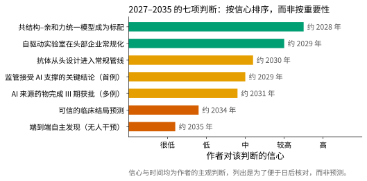
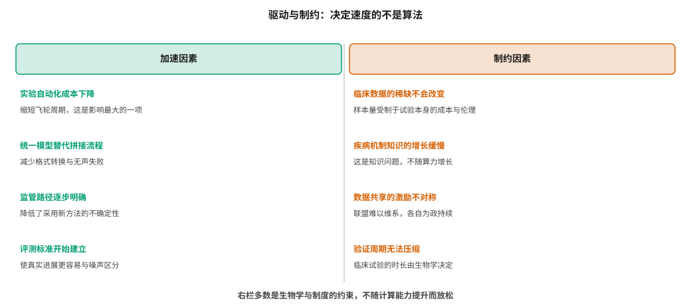
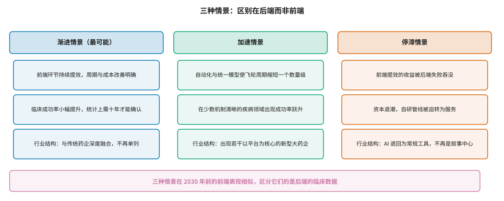

# 技术趋势：2027–2035 {#sec-trends}

## 本章目的 {.unnumbered .unlisted}

::: {.purpose-question}
未来十年哪些会变，哪些不会变，判断的依据是什么？
:::

预测是危险的，@sec-history 回顾的六十年历史里满是落空的预言。本章因此不做预测，而做**有条件的判断**：列出七项具体的、可以在未来某个时点被核对的命题，标注作者对每项的信心程度与大致时间，并说明判断的依据。更重要的是分析驱动与制约因素——因为决定这个领域速度的，大部分不是算法的进步速度。本章的核心判断是：**前端环节的改进会持续且明确，而后端的瓶颈不随计算能力提升而放松**，三种可能的情景之间的区别全部体现在后端。

::: {.callout-note title="给非技术读者的摘要"}

未来十年会怎样？有把握的是：计算工具会越来越好用、实验自动化会越来越普及、一些现在需要拼几个软件才能做的事会由一个模型搞定。没把握的是：这些改进最终能不能让更多药成功。原因在于，决定成败的那些环节——人体试验要花多长时间、疾病机制是否被理解、临床数据能不能攒够——都不是算力能解决的。所以本章给出的七项判断，越靠近“工具变好”的信心越高，越靠近“病治好了”的信心越低。书里列出这些判断，不是为了预测对，而是为了几年后可以拿出来核对。**成熟度**：这是判断，不是数据。

:::

::: {.callout-learning-objectives}

- 评估七项具体技术判断的内容、时间尺度与依据
- 区分加速因素与制约因素，并说明为什么后者多为非计算性的
- 描述三种可能的产业情景及其分叉点
- 解释为什么前端改进的确定性远高于后端
- 识别一项技术预测是否可被证伪，以及如何设定核对条件
- 说明哪些当前的热点在十年尺度上可能不重要

:::

## 七项判断 {#sec-trends-claims}

@fig-trend-confidence 列出七项判断，按作者的信心程度排序。排序不代表重要性——事实上信心最低的几项恰恰最重要，这本身就是本领域的一个基本特征。

::: {#fig-trend-confidence fig-cap="**2027–2035 的七项判断**：横轴为作者对该判断的信心，右侧标注大致时间。信心最高的是工具层面的改进，信心最低的是涉及临床结局与自主发现的判断。信心与时间均为主观判断，列出是为了便于日后核对，而非预测。" fig-alt="水平条形图，七项判断自上而下为共结构–亲和力统一模型成为标配、自驱动实验室常规化、抗体从头设计进入常规管线、监管接受 AI 支撑的关键结论、AI 来源药物完成 III 期获批、可信的临床结局预测、端到端自主发现，条长自上而下递减，右侧标注预计年份。"}

{width="96%"}

:::

**一、结构与亲和力的统一模型成为标配（约 2028，信心高）。** @sec-structure 讨论的 Boltz-2 等工作已经显示了方向：把结构预测与亲和力预测放进同一个模型，而非两步拼接。依据是这条路径的技术障碍已经清楚，且不依赖新数据——它主要是建模方式的改变。

**二、自驱动实验室在头部企业常规化（约 2029，信心较高）。** @sec-synthesis 讨论的闭环实验系统，其瓶颈主要是工程与成本而非原理。依据是自动化设备成本持续下降，且 @sec-data-flywheel 说明的周期价值给了企业明确的投资理由。

**三、抗体从头设计进入常规管线（约 2030，信心中）。** @sec-biologics 讨论的 CDR 环设计困难正在被逐步解决，但 @sec-biologics 同样指出，真正的瓶颈已经从“能结合”转移到“能成药”——因此这项判断的实现程度取决于可开发性预测的进展，不确定性较高。

**四、监管接受 AI 支撑关键结论的首个案例（约 2029，信心中）。** @sec-reg-west 讨论的可信度评估框架定稿后，会有企业去试。依据是框架已经给出了明确路径，而首例通常出现在风险相对可控的具体场景（如某项质量控制或某个非关键终点）而非核心有效性结论。

**五、多例 AI 来源药物完成 III 期获批（约 2031，信心中低）。** @sec-landscape 讨论的管线正在推进，时间上会到达。不确定的是数量，以及更关键的——这些获批能否在统计上证明成功率的提升。

**六、可信的临床结局预测（约 2034，信心低）。** @sec-clinical 与 @sec-science-gaps 说明了为什么：这需要的不只是更好的模型，而是对疾病机制的更深理解和更多的临床样本，两者都不随算力增长。

**七、端到端自主发现（约 2035，信心很低）。** @sec-agents 分析了这类宣称的实际含义。本书对此持保留态度，不是因为技术不可能，而是因为“自主”的定义中隐含了对验证环节的忽略——而验证环节的时长由生物学决定。

::: {#pri-trends-front-back .callout-principle title="前端的确定性远高于后端"}

涉及工具、流程与计算能力的判断（前端）有较高的确定性，因为它们的障碍是工程性的；涉及临床结局、疾病机制与成功率的判断（后端）确定性很低，因为它们的障碍是科学性与制度性的。

**实践含义**：对任何关于 AI 制药未来的论断，先判断它属于前端还是后端。前端的乐观通常有依据，后端的乐观需要额外的论证——而这种论证往往诉诸“数据会越来越多”，而 @sec-science-gaps 说明了为什么这不足够。

:::

## 驱动与制约 {#sec-trends-drivers}

@fig-drivers 把影响速度的因素分成两栏。一个值得注意的不对称：**加速因素多为技术性的，制约因素多为生物学与制度性的**。这意味着技术进步能推动的部分有明确上限。

::: {#fig-drivers fig-cap="**驱动与制约因素**：左栏的加速因素多为技术性的——自动化成本下降、统一模型、监管路径明确、评测标准建立；右栏的制约因素多为生物学与制度性的——临床数据稀缺、机制知识增长缓慢、数据共享激励不对称、验证周期无法压缩。右栏不随计算能力提升而放松。" fig-alt="左右两栏对照，左栏标题为加速因素，下列四项及其说明；右栏标题为制约因素，下列四项及其说明，中间以竖线分隔。"}

{width="100%"}

:::

四项制约因素中，有三项在前面各章已经论证过：临床数据的稀缺（@sec-data-resources）、疾病机制知识的增长速度（@sec-science-gaps）、数据共享的激励不对称（@sec-data-flywheel）。第四项——**验证周期无法压缩**——值得单独说明，因为它是四项中最硬的一条。

一个 III 期试验需要多长时间，主要由两个生物学量决定：疾病的自然病程，以及终点事件的发生率。对于一个中位生存期以年计的适应症，确证性试验必须观察到足够数量的终点事件才能达到预设的统计功效，而事件的积累速度由疾病本身决定，不由研究者决定。

AI 可以加快招募、减少数据清理时间、优化入排标准与样本量设计，这些都能缩短试验的“非观察期”。但它无法改变“**要观察足够多的事件才能得出结论**”这一约束——这是统计学与生物学共同设定的下限。

这一点有一个重要推论：**即使药物发现阶段被压缩到零，从立项到获批的总时长也只能减少约四分之一**。@sec-economics 的成本结构分析给出了金额上的同一结论，而这里给出的是时间上的版本。两者共同解释了为什么前端的巨大进步在总体指标上表现得如此有限。

## 三种情景 {#sec-trends-scenarios}

@fig-scenarios 给出三种可能的演化路径。关键观察是：**三者在 2030 年前的前端表现相似，区分它们的是后端的临床数据**。

::: {#fig-scenarios fig-cap="**三种可能的产业情景**：渐进情景（最可能）、加速情景、停滞情景。三者在 2030 年前的前端表现相似——工具都会变好、周期都会缩短；区分它们的是后端的临床数据是否显示成功率的实质提升。" fig-alt="三列对照，列标题分别为渐进情景（最可能）、加速情景、停滞情景，每列下方三个方框描述该情景下的前端表现、临床结果与行业结构。"}

{width="100%"}

:::

**渐进情景**是本书认为最可能的，它有三个相互关联的特征。

前端持续提效，周期与成本的改善明确且可度量——这部分几乎没有悬念，因为技术路径清楚且已有大量在建投入。临床成功率小幅提升，但提升幅度小于统计噪声，因此需要约十年的样本积累才能在统计上确认——这意味着在 2030 年代中期之前，关于“AI 是否真的提高了成功率”的争论无法通过数据解决。行业结构上，AI 能力逐渐成为所有药企的标配，“AI 制药公司”作为一个独立类别逐渐消失——正如今天没有“使用计算机的药企”这个类别。

需要强调的是，第三点不是失败的标志，而是技术成熟的常态路径：一项技术从差异化优势变成行业基础设施，恰恰说明它已经被证明有用并被普遍采纳。

**加速情景**的触发条件是飞轮周期的数量级缩短，加上在某些机制清晰的疾病领域出现成功率的明显跃升。它的可能性不为零，但需要的不只是技术进步，还需要后端的科学瓶颈在某些领域恰好被突破。

**停滞情景**的特征是前端提效的收益被后端失败吞没——周期缩短了，但失败的项目只是更快地失败。这会导致资本进一步退潮，自研管线被迫转为服务业务。

需要强调的是，这三种情景在**前端的可观测表现上几乎没有区别**。这意味着在未来几年，任何基于前端指标（流程速度、候选分子数量、发表的方法学进展）的乐观或悲观判断都缺乏区分力。真正的证据只能来自临床——这正是 @sec-milestones 要设定可核对里程碑的原因。

::: {.fallacy-pitfall}

**谬误**：*某项技术突破将改变整个行业。*

这类论断的问题在于它隐含了“瓶颈是单一的”这一假设。@sec-science-gaps 的衰减分析说明，失败分布在各个环节，任何单点突破的影响都被其他环节的失败率稀释。历史上 AlphaFold2 是本领域迄今最大的单点突破，而它对临床成功率的可观测影响至今不明显——不是因为它不重要，而是因为结构预测只是整条链上的一环。

:::

## 哪些当前热点可能不重要 {#sec-trends-overrated}

一个对称的判断：有些当前受到大量关注的方向，在十年尺度上可能不重要。

**模型规模的竞争。** @sec-agents 指出，智能体的科学能力上限由工具决定而非模型参数量决定。在药物研发中，数据量的限制使得模型规模的收益比在语言任务中饱和得更早。

**生成模型的新架构。** @sec-generative 讨论的分子生成，其瓶颈早已不在生成能力（生成一百万个新颖分子是容易的），而在评价与验证。新的生成架构改善的是已经不稀缺的那一端。

**端到端的自动化叙事。** 真正的价值来自缩短单个环节的周期，而非取消人的参与。@sec-agents 讨论的级联错误问题说明，随着自主步数增加，端到端正确率迅速衰减。

与此相对，有几个受关注较少但可能更重要的方向，它们的共同特征是**改善整个体系的信号质量**。

**评测基础设施的建设**（@sec-evaluation）决定了真实进展能否与噪声区分开。在一个无法可靠区分优劣的领域里，资源配置必然低效——因为没有可信的反馈来引导它。

**适用域与不确定性量化的工程化**（@sec-platform）决定了模型输出能否真正进入决策。一个不知道自己何时不可靠的模型，使用者只能要么全信要么全不信，而两者都会浪费它的价值。

**阴性结果的系统性记录**（@sec-data-flywheel）决定了数据的完整性。这是整个清单中投入产出比最高的一项，因为相关实验已经做了，成本已经付出。

这三项都不性感，很难写进融资材料，也不会出现在技术新闻里。但它们有一个共同的性质：**它们是元能力**——改善的不是某项具体任务的表现，而是整个体系识别和积累改进的能力。在一个判断标准尚未建立的领域，提高判断力本身可能比提高任何单项能力更有价值。

::: {#ws-trends-alphafold .callout-war-story title="最大的突破，最难归因的影响"}

AlphaFold2 是本领域迄今最无争议的突破：它解决了一个公认的难题，在前瞻性评测中被独立验证，其成果被免费开放给全世界。按任何标准，这都是教科书式的科学成功。

但如果问“它让多少个药物项目成功了”，没有人能给出答案。原因不是它没用——结构生物学家的工作方式确实被改变了，许多项目确实因此节省了时间——而是这种改变难以归因到临床结局上。一个项目使用了 AlphaFold 预测的结构、推进得更快、最终在 II 期失败了，这既不能证明 AlphaFold 无用，也不能说明它有用。

这个案例浓缩了本章的核心判断：**即使是最大的技术突破，其对最终结局的影响也会被下游的高失败率稀释到难以观测**。

这一判断是双向的，两个方向同样重要。对过度乐观者，它说明不能用环节上的突破推断整体的改变——AlphaFold2 解决了一个真实的难题，但结构预测只是整条推断链上的一环（@sec-science-gaps）。对过度悲观者，它同样说明不能用整体的停滞否定环节上的进步——看不到影响不等于没有影响，只说明我们的观测能力不足以从噪声中分离出它。

这两点合起来给出一个不太令人满意但诚实的结论：**在观测能力改善之前，关于 AI 制药整体价值的争论无法用证据解决**。而改善观测能力——更好的评测、更长的前瞻性记录、更系统的对照——可能比任何单项技术进步都更有价值，因为它是其余一切判断的前提。

:::

::: {#chk-trends .callout-checkpoint}

1. 为什么前端判断的确定性远高于后端判断？各举两例。
2. 四项制约因素中，哪一项是纯粹由生物学决定的？为什么 AI 无法改变它？
3. 三种情景在 2030 年前的前端表现为什么相似？这对判断进展有什么含义？
4. 为什么说“某项技术突破将改变整个行业”这类论断隐含了错误假设？
5. 列举三个当前受关注但可能不重要的方向，并说明理由。
6. AlphaFold2 的影响为什么难以归因？这说明了什么更普遍的问题？

:::

## 小结 {#sec-trends-summary}

未来十年的变化在前端是可预期的：工具会更好用，流程会更连贯，自动化会更普及，监管路径会更清晰。这些改进有明确的技术路径，也有企业投资的理由。后端则不然——临床数据的稀缺、疾病机制的认识速度、验证周期的生物学下限，这三项约束不随计算能力提升而放松。三种可能的产业情景在前端表现上几乎相同，区分它们的全部证据都在后端，而那些证据要到 2030 年前后才会积累到足以做统计判断的程度。在此之前，任何基于前端指标的强判断都缺乏区分力。对读者而言，最有用的态度或许是：对工具层面的进展抱有合理的乐观，对结局层面的宣称保持充分的耐心，并把注意力放在那些能提高整个体系信号质量的不起眼工作上。

::: {.callout-takeaways title="前端可预期，后端要耐心"}

* **七项判断按信心排序**：工具层面信心高，结局层面信心低——这个排序本身就是本领域的特征。
* **加速因素是技术性的，制约因素是生物学与制度性的**：后者不随算力增长而放松。
* **验证周期有生物学下限**：观察足够多的事件才能得出结论，这无法被效率优化。
* **三种情景的前端相同**：区分它们的证据只能来自临床，而那要到 2030 年前后才足够。
* **单点突破会被稀释**：AlphaFold2 是最大的突破，其对临床结局的影响至今难以观测。
* **最被低估的方向是信号质量**：评测基础设施、不确定性量化、阴性结果记录。

:::

::: {.callout-chapter-connection title="从技术到人"}

技术判断之外，还有一类问题无法用技术标准回答：谁能用上这些药、责任由谁承担、数据属于谁、人在这个体系中处于什么位置。@sec-ethics 讨论 AI 制药的伦理维度——这些问题不会因为技术进步而自动解决，而且往往在技术最成功的时候最尖锐。

:::
