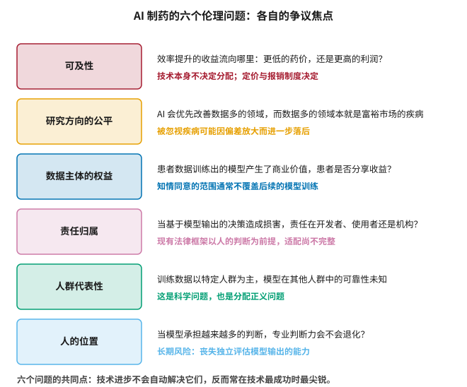
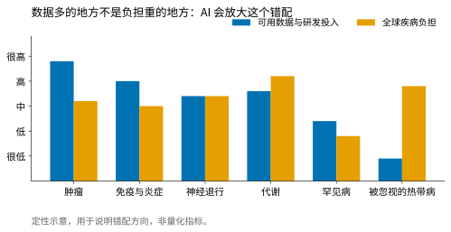
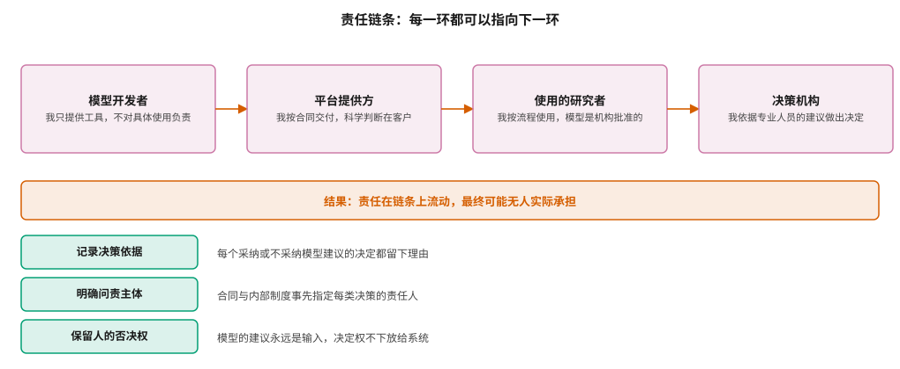

# AI 制药的伦理 {#sec-ethics}

## 本章目的 {.unnumbered .unlisted}

::: {.purpose-question}
技术变好之后，谁受益、谁承担风险、谁负责？
:::

本书前面二十九章讨论的都是“能不能”的问题——模型能不能预测准、流程能不能跑通、方法能不能被监管接受。本章转向“应不应该”与“对谁而言”。这些问题的共同特征是：**技术进步不会自动解决它们，而且往往在技术最成功的时候最尖锐**。如果 AI 真的大幅提高了新药研发的效率，收益流向哪里？如果模型只在数据充足的疾病上有效，那些数据稀缺的疾病会怎样？如果一个基于模型输出的决策造成了损害，责任在谁？本章不提供答案——这些问题的答案属于社会选择而非技术判断——但试图把问题问清楚，并指出哪些是可以在组织层面被处理的。

::: {.callout-note title="给非技术读者的摘要"}

假设 AI 真的让新药研发变便宜了，药价会降吗？不一定——药价由定价和医保制度决定，和研发成本的关系并不直接。另外还有几个问题：AI 在数据多的病上管用，而数据多的往往是发达国家的常见病，那些本来就被忽视的疾病会不会更被落下？用患者数据训练出来的模型赚了钱，患者有份吗？如果照着模型的建议做出了错误决定，谁负责——开发模型的、卖平台的、用的人、还是批准的机构？这些问题技术解决不了，但组织层面可以做一些具体的事：记录每个决定的理由、事先指定责任人、永远保留人否决模型的权力。**成熟度**：问题被提出；制度性回应刚起步。

:::

::: {.callout-learning-objectives}

- 列举 AI 制药的六类伦理问题及各自的争议焦点
- 解释效率提升与可及性之间为什么不存在自动的因果链接
- 说明数据分布与疾病负担的错配如何被 AI 放大
- 描述责任链条的扩散机制及可行的组织性对策
- 评估知情同意的现有范围与模型训练之间的缺口
- 识别专业判断力退化这一长期风险的表现与防护

:::

## 六个问题 {#sec-ethics-six}

@fig-six-questions 列出六类问题及其争议焦点。它们彼此独立，需要分别处理。

::: {#fig-six-questions fig-cap="**AI 制药的六个伦理问题**：可及性、研究方向的公平、数据主体的权益、责任归属、人群代表性、人的位置。六者的共同点是技术进步不会自动解决它们，反而常在技术最成功时最尖锐。" fig-alt="六行结构，每行左侧为彩色方框标注一个伦理问题，右侧两行分别提出该问题的核心疑问与争议焦点。"}

{width="64%"}

:::

## 可及性：效率不等于可负担 {#sec-ethics-access}

一个常见的论证链条是：AI 降低研发成本 → 药品可以更便宜 → 更多人用得起。这个链条的每一环都值得质疑。

**第一环就有问题。** @sec-economics 讨论过，研发成本中的大部分来自临床失败的分摊，而 @sec-science-gaps 说明 AI 对后端失败率的影响有限。因此“AI 降低研发成本”这一前提本身，在量级上就比通常设想的小得多。

**第二环更关键：药品定价与研发成本之间没有机械的联系。** 定价主要由支付方的支付意愿、竞争格局与专利保护期决定——这在经济学上有充分论证，也符合直觉：一个研发成本极低但无可替代的药物，定价不会因为成本低而降低；反之，一个研发成本极高但有多个竞品的药物，也无法因为成本高而提价。

降低成本会提高利润率，而是否转化为降价，取决于市场结构与制度安排，与成本本身无关。

**第三环同样不自动成立。** 即使价格下降，可及性也未必改善——它还取决于医保覆盖、分销网络、以及目标人群所在地区的支付能力。一个在高收入国家降价 30% 的药物，对低收入国家的患者可及性可能毫无改变。

需要说明的是，这不是对 AI 的批评，而是对因果链条的澄清。技术改变的是成本曲线，而分配由制度决定。如果希望效率提升转化为可及性改善，需要的是定价、报销与许可政策层面的设计——例如分层定价、专利池、自愿许可——而非寄望于技术本身自动产生这一效果。

::: {#pri-ethics-distribution .callout-principle title="技术决定可能性，制度决定分配"}

一项技术降低了做某件事的成本，这决定了什么变得可能；而谁受益、以什么代价受益，由定价、报销、知识产权与竞争政策决定。两者之间没有自动的传导。

**实践含义**：讨论“AI 让药更便宜”时，必须指出是什么机制实现这一点。如果说不出机制，这个判断就只是一个愿望。

:::

## 研究方向的公平 {#sec-ethics-neglected}

@fig-neglected-mismatch 刻画了一个长期存在的错配：**数据与投入集中的领域，不是疾病负担最重的领域**。

::: {#fig-neglected-mismatch fig-cap="**数据分布与疾病负担的错配**：肿瘤与免疫领域的数据与投入远超其疾病负担占比，而被忽视的热带病则相反。AI 的能力依赖数据，因此倾向于在数据充足的领域产生价值——这会放大既有的错配。定性示意，用于说明方向。" fig-alt="分组柱状图，六类疾病领域各有两根柱，蓝色代表可用数据与研发投入，橙色代表全球疾病负担。肿瘤与免疫领域蓝柱远高于橙柱，被忽视的热带病则橙柱远高于蓝柱。"}

{width="88%"}

:::

Pedrique 等人的系统评估记录了被忽视疾病在新药获批中的极低占比 [@pedrique2013neglected]，而这一格局的成因是经济性的：这些疾病的患者缺乏支付能力，研发投入无法回收。

AI 在此处的作用是**中性偏放大**的。@sec-data-quality 讨论的偏差放大机制在疾病领域层面同样运行：数据多的领域模型表现好 → 更受信任 → 更多投入 → 更多数据。被忽视的疾病则处在相反的循环中。

这意味着，如果希望 AI 的能力惠及被忽视疾病，需要有意识的干预——专项资助、数据共建、优先审评券等既有机制在 AI 时代依然必要，甚至更必要。值得注意的是，AI 确实降低了某些环节的成本，这使得资源有限的研究者更容易参与——这是一个真实的正面效应，但它需要公开可用的模型与数据作为前提，而 @sec-toolchain 讨论的开源三层次说明这一前提并不总是满足。

## 数据主体的权益 {#sec-ethics-data-subject}

患者捐献样本或同意使用其临床数据时，知情同意书通常描述的是“用于本研究”或“用于相关医学研究”。而一个用这些数据训练出的模型可能在十年后被用于完全不同的项目，并产生可观的商业价值。

这里有三个层面的问题，而它们的难度递增。

**同意的范围。** 现有的知情同意框架建立在“告知具体用途、取得具体同意”的逻辑上，而模型训练的用途在同意时根本无法具体描述——没有人能预见一个模型十年后会被用于什么。这不是表述不够清楚的问题，而是知情同意这一制度与通用模型的根本性不匹配。

**收益的分享。** 目前几乎没有机制让数据贡献者分享由此产生的价值。这与生物样本库领域长期争论的问题同源，而 AI 使它更尖锐：模型的价值可能远超任何单次研究，而贡献者的参与方式却与过去完全相同。

**撤回的可能。** 个人信息保护法规通常赋予撤回同意的权利，但一个已经训练完成的模型无法真正“忘记”某条训练数据——机器遗忘（machine unlearning）是一个活跃的研究方向，但尚无可在生产环境中可靠使用的通用方案。这意味着“可撤回”这一法定权利，在技术上目前无法完整实现。

@sec-reg-china 讨论的中国数据合规要求在这方面相对严格，而 WHO 的健康 AI 伦理指南也把数据主体权益列为核心关切 [@who2021ethics]。但在实践层面，这些问题的制度性回应仍然处于起步阶段。

## 责任归属 {#sec-ethics-responsibility}

@fig-responsibility-chain 展示了一个结构性问题：责任在链条上流动，每一环都可以合理地指向下一环，最终可能无人实际承担。

::: {#fig-responsibility-chain fig-cap="**责任链条的扩散**：模型开发者、平台提供方、使用的研究者、决策机构，每一环都有看似合理的免责理由，结果是责任在链条上流动而最终可能无人实际承担。下方三项是可行的组织性对策：记录决策依据、明确问责主体、保留人的否决权。" fig-alt="上方四个方框依次相连，分别标注责任链条中的四个角色及其免责说法；中间横条指出责任流动的结果；下方三行列出三项组织性对策。"}

{width="100%"}

:::

这不是 AI 特有的问题——任何复杂的技术系统都有类似的责任扩散现象，航空与核电领域对此已有长期研究——但 AI 使它更尖锐，原因有三。

**模型的不透明性**使得“我无法预见这个输出”成为一个更有说服力的抗辩。在传统软件中，开发者原则上能够推演系统在给定输入下的行为；而对深度模型，这一推演在实践中不可行，于是“不可预见”从借口变成了部分属实的陈述。

**“提供参考”式的定位**使得没有任何一方在形式上做出了决定。@sec-adoption 指出，这种定位会让项目难以产生可度量的价值；在责任层面，它还会让问责失去抓手——如果模型只是“参考”，那么采纳它的人要负全责；但如果采纳者又说“我信任了专业工具”，责任就回到了工具提供方，形成循环。

**自动化偏见**使得人类监督这一防线比想象中脆弱。研究反复显示，当系统在多数情况下正确时，人类审核者会逐渐降低审查强度——于是“保留人的否决权”在制度上存在，在实际行为中却逐渐空心化。这意味着仅仅规定“必须有人复核”是不够的，还需要设计让复核真正发生的机制。

Mittelstadt 等人对算法伦理的梳理 [@mittelstadt2016ethics] 与 Char 等人对医疗机器学习伦理挑战的分析 [@char2018implementing] 都指出，可追溯性是应对责任扩散的核心手段。

@fig-responsibility-chain 下方的三项对策都是组织层面可以立即实施的，而且与 @sec-platform 讨论的平台能力直接对应：**记录决策依据**需要决策记录功能；**明确问责主体**需要在合同与内部制度中事先指定；**保留人的否决权**需要流程设计上不把任何决定自动化。

## 人群代表性 {#sec-ethics-representation}

@sec-data-quality 讨论的人群偏差在伦理层面有额外的含义：它不只是一个会降低模型精度的技术问题，也是一个分配正义问题——**模型对谁更准，谁就更受益**。

Obermeyer 等人的研究是这一问题的经典案例 [@obermeyer2019dissecting]：一个被广泛使用的医疗资源分配算法，因为用“历史医疗支出”作为“健康需求”的代理变量，系统性地低估了黑人患者的需求——而支出的差异本身反映的是获取医疗服务的不平等。模型忠实地学习了一个有偏的世界，并把这种偏向固化为看似客观的分数。

这个案例的教训超出了医疗资源分配：**代理变量的选择承载了价值判断**。在药物研发中，类似的问题出现在终点选择、患者分层标准、以及什么被算作“有效”的定义上。

## 人的位置 {#sec-ethics-human}

最后一个问题最难量化，也最容易被推迟：当模型承担越来越多的判断，人的专业判断力会发生什么？

@sec-agents 讨论的智能体定位——“降低核查成本的助手”而非“替代判断的专家”——隐含了一个前提：人仍然有能力核查。但如果一代研究者的训练过程中，大部分初级判断都由模型完成，这个能力还会存在吗？

这个担忧不应被夸大。历史上每一次工具的进步都伴随着类似的焦虑，而多数情况下人的能力是迁移而非退化的——计算器没有让人失去数学能力，而是让注意力转向更高层的问题。但在药物研发中，有一个特殊之处：**判断模型输出是否合理，恰恰需要那些可能因为依赖模型而不再被训练的直觉**。一个从未亲手做过构效关系分析的化学家，很难判断一个模型的预测是否违背化学常识。

可行的应对不是限制工具的使用，而是在训练体系中有意识地保留那些“不用工具”的环节——就像飞行员仍要接受手动飞行训练，即使自动驾驶能处理绝大多数情况。

::: {#ws-ethics-proxy .callout-war-story title="当代理变量承载了价值判断"}

Obermeyer 等人研究的算法本身没有技术缺陷：它用历史数据训练，用标准方法验证，预测“未来的医疗支出”的准确度相当好。问题出在更早的一步——把“支出”当作“需求”的代理。

这个选择在技术上是合理的（支出有数据，需求没有），在价值上却是错的：同样病情的黑人患者历史支出更低，不是因为他们更健康，而是因为他们获取医疗服务的障碍更多。算法学到了这个事实，并把它当作“需求更低”输出。

这个案例值得本领域的每个从业者反复体会，因为代理变量的选择在药物研发中无处不在：用细胞活性代理临床疗效、用生物标志物代理患者获益、用发表文献代理证据强度。每一次代理都是一次简化，而简化中隐含了关于“什么重要”的判断。

技术上的对策是 @sec-evaluation 讨论的消融与敏感性分析；但更根本的对策是让受影响的人群在代理变量的选择过程中有发言权——这是一个治理问题，不是一个建模问题。

:::

::: {.fallacy-pitfall}

**谬误**：*技术是中立的，伦理问题应该留给政策制定者。*

技术选择本身就包含价值判断：训练数据覆盖哪些人群、用什么作为优化目标、把什么定义为成功、不确定性如何呈现给使用者——每一项都影响谁受益、谁承担风险。把这些选择称为“纯技术的”，实际上是把价值判断隐藏在技术细节中，使它免于审视。承认技术选择的价值负载，不是要求工程师成为伦理学家，而是要求这些选择被明示并接受讨论。

:::

::: {#chk-ethics .callout-checkpoint}

1. “AI 降低研发成本 → 药价下降”这一论证链条的哪些环节值得质疑？
2. AI 为什么倾向于放大数据分布与疾病负担之间的错配？有哪些可行的干预？
3. 现有的知情同意框架在模型训练这一用途上存在哪三个缺口？
4. 责任扩散的机制是什么？AI 使它更尖锐的两个原因是什么？
5. Obermeyer 等人的案例中，技术上没有缺陷的算法为什么产生了系统性偏差？
6. 为什么说“判断模型输出是否合理，需要可能因依赖模型而不再被训练的直觉”？

:::

## 小结 {#sec-ethics-summary}

本章的六个问题没有技术解。可及性取决于定价与报销制度而非研发成本；研究方向的公平需要有意识的干预来对抗数据驱动的马太效应；数据主体的权益缺乏与价值创造相匹配的制度安排；责任在链条上扩散，需要组织层面的可追溯性设计来固定；人群代表性既是科学问题也是分配正义问题，而代理变量的选择始终承载价值判断；人的专业判断力需要被有意识地维护。这些问题的共同点是，它们都会随着技术变得更成功而变得更重要——一个无效的技术不会引发分配问题。因此，正确的态度不是等问题出现再应对，而是在技术仍在塑造过程中就把它们纳入讨论。可以立即做的事不多但很具体：记录决策依据、明确问责主体、保留人的否决权、明示代理变量的选择及其含义。

::: {.callout-takeaways title="技术决定可能性，制度决定分配"}

* **效率不自动等于可及**：成本曲线由技术改变，分配由定价与报销制度决定。
* **AI 会放大领域间的错配**：数据多的领域获益更多，被忽视疾病需要有意识的干预。
* **知情同意存在缺口**：同意范围、收益分享、撤回可能，三者都未被现有框架覆盖。
* **责任会在链条上扩散**：对策是记录依据、明确问责、保留否决权，都在组织层面可做。
* **代理变量承载价值判断**：用支出代理需求、用标志物代理获益，每次简化都隐含取舍。
* **判断力需要被维护**：核查模型输出需要那些可能因依赖模型而不再被训练的直觉。

:::

::: {.callout-chapter-connection title="从问题到核对表"}

本书的论点贯穿始终：前端的改进真实可见，后端的证据仍在积累，而判断两者差异需要耐心与方法。最后一章给出一组具体的、可在未来几年核对的里程碑——用来检验本书的判断是否成立，也用来替代那些无法验证的宏大叙事。

:::
