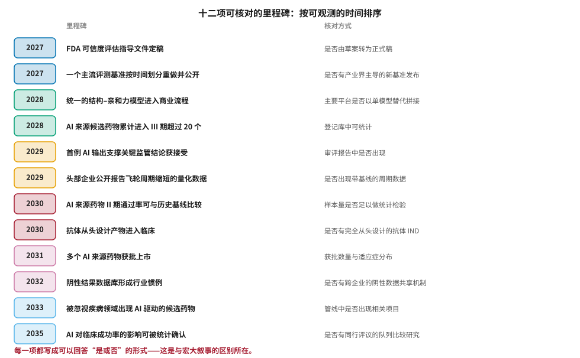
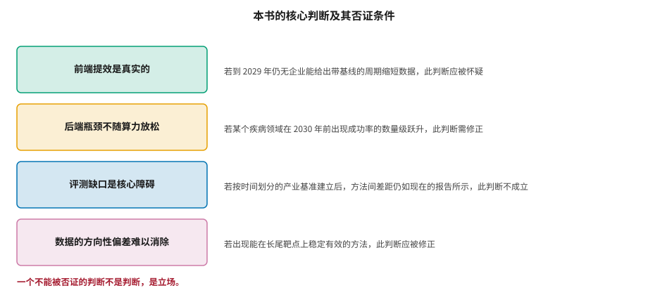

# 产业格局演变与可验证的里程碑 {#sec-milestones}

## 本章目的 {.unnumbered .unlisted}

::: {.purpose-question}
几年之后，用什么来检验本书说对了没有？
:::

本书的论证贯穿三十章，核心判断可以压缩成一句话：**前端的改进真实、可观测、将持续；后端的证据仍在积累，而区分两者需要方法与耐心**。但一本书不能只给判断，还必须给出**检验判断的方式**。本章做两件事：列出十二项具体的、可在未来几年回答“是或否”的里程碑；以及明确写出本书核心判断各自的否证条件。一个不能被否证的判断不是判断，是立场——这是本书对自己采用的标准，也是它建议读者用于评估其他一切宣称的标准。

::: {.callout-note title="给非技术读者的摘要"}

这本书讲了很多判断，但判断可能是错的。所以最后一章列了十二件具体的事，每件都写成“到某年，某件事发生了没有”的形式——比如“FDA 那份指导文件定稿了吗”、“AI 做出来的药进入三期试验的有没有超过二十个”。几年后拿出来一条条对，就知道这本书判断得准不准。同样重要的是另一张表：本书的四个核心判断，分别在什么情况下应该被认为是错的。能说清楚自己什么时候算错，才算是个判断。**成熟度**：这是一份核对清单，不是预言。

:::

::: {.callout-learning-objectives}

- 使用十二项里程碑作为跟踪行业进展的核对清单
- 区分可观测的里程碑与不可验证的宏大叙事
- 说明本书四项核心判断各自的否证条件
- 解释为什么 2030 年前后是关键的证据窗口
- 描述产业结构可能的演变方向及其判断依据
- 为自己关心的问题设计可核对的判断

:::

## 十二项里程碑 {#sec-milestones-list}

@fig-milestones 按可观测的时间排序列出十二项。每一项的设计原则是：**可以由第三方独立核对，且答案是“是”或“否”而非程度判断**。

::: {#fig-milestones fig-cap="**十二项可核对的里程碑**：从 2027 年的监管文件定稿与评测基准重建，到 2035 年 AI 对临床成功率影响的统计确认。每一项都标注了核对方式。写成可以回答是或否的形式，是这份清单与宏大叙事的区别所在。" fig-alt="十二行列表，每行左侧为年份标签，中间为里程碑描述，右侧为该里程碑的核对方式说明，年份自 2027 递增至 2035。"}

{width="96%"}

:::

这份清单的结构反映了全书的论证，三组里程碑对应三个不同的确定性层次。

前四项（2027–2028）集中在**基础设施**：监管路径的明确、评测基准的重建、工具的整合、管线数量的累积。这些是 @sec-reg-west、@sec-evaluation、@sec-trends 讨论的内容，确定性较高——因为它们的实现主要取决于已经在进行的工作能否完成，而非取决于未知的科学突破。

中间四项（2029–2030）是**第一批实质证据**：首例监管接受、第一组带基线的周期数据、II 期通过率的可比较性、抗体从头设计的临床转化。

这一组最关键，因为它们是前端与后端之间的桥梁——在此之前，所有证据都停留在“流程更快了”的层面；从这里开始，才会出现关于“结果更好了”的可检验陈述。这也是本书判断最可能被证伪的区间：如果到 2030 年这四项一项都没有发生，那么本书对前端改进能够传导到后端的预期就需要大幅下调。

后四项（2031–2035）涉及**最终结论**：获批数量、行业惯例的改变、被忽视疾病的覆盖、以及对成功率影响的统计确认。这些的时间估计最不可靠——它们依赖的链条最长，每一环的延迟都会累积——但它们是真正重要的那些。对这一组，时间点本身不必过于当真，值得关注的是**方向与顺序**：如果获批数量上升但成功率的统计确认迟迟不来，那说明上升来自管线基数的扩大而非效率的改善。

::: {#pri-milestones-falsifiable .callout-principle title="写成可以回答是或否的形式"}

一个判断的价值与它的可证伪程度成正比。“AI 将变革药物研发”无法被证伪，因为它没有指定什么算变革、何时、如何观测。“到 2028 年，登记库中标注为 AI 来源的 III 期候选药物超过 20 个”可以被证伪，因此它携带信息。

**实践含义**：无论是评估他人的宣称还是表达自己的判断，都把它改写成可核对的形式。如果改写不出来，说明这个判断实际上没有内容。

:::

## 本书判断的否证条件 {#sec-milestones-falsify}

@fig-falsification 列出本书四项核心判断及其各自的否证条件。

::: {#fig-falsification fig-cap="**本书核心判断及其否证条件**：前端提效是真实的、后端瓶颈不随算力放松、评测缺口是核心障碍、数据的方向性偏差难以消除。每项都附有明确的否证条件。一个不能被否证的判断不是判断，是立场。" fig-alt="四行结构，每行左侧为彩色方框标注一项核心判断，右侧说明该判断在什么情况下应被认为错误或需要修正。"}

{width="88%"}

:::

关于这四项，需要补充几点说明。

**前端提效是真实的。** 这是本书信心最高的判断，但需要指出它目前主要建立在定性报告与企业自披露之上，缺少带基线的、第三方可核对的数据。

如果到 2029 年仍然没有任何企业能给出这样的数据，那么“提效”可能更多是一种感受而非事实。这种情形完全可能发生，而且有具体的机制：@sec-adoption 讨论的度量困难（缺乏对照、存在混杂、案例选择偏差）使得即使提效真实存在，也可能始终无法被严格证明；而一旦长期无法证明，“提效”就会逐渐退化为一种行业共识性的叙事，其可靠性与“大家都这么说”相当。

值得注意的是，这一判断的否证条件与其他三项不同：它不需要出现相反的证据，只需要**持续缺少支持的证据**。

**后端瓶颈不随算力放松。** 这是本书最可能被证明过于悲观的判断。它依据的是 @sec-science-gaps 分析的转化鸿沟，而这些鸿沟的成因是生物学的。但生物学知识本身也在进步，若某个机制清晰的疾病领域出现成功率的数量级跃升，这一判断需要修正。

**评测缺口是核心障碍。** 这项判断可以被相对干净地检验：如果按时间划分的产业级基准建立起来后，各方法之间的差距仍然像现在的论文报告的那样大，那么说明现有评测体系并没有系统性地夸大，本书在这一点上判断错误。

**数据的方向性偏差难以消除。** @sec-data-quality 论证了增大数据量无法抵消系统性偏差。如果出现一种能在长尾靶点上稳定有效的方法——而不只是在基准上表现好——这一判断应被修正。

## 2030 年：关键的证据窗口 {#sec-milestones-window}

@sec-trends 指出三种情景在前端表现上几乎相同。把这一观察与里程碑清单结合，可以定位一个关键时点：**2030 年前后**。

理由是样本量。到那时，第一批以 AI 为核心的候选药物将有足够数量完成 II 期，使得与历史基线的统计比较成为可能。@sec-org-challenges 讨论过，单个分子的成功不构成证据，一批分子的通过率才是。

需要补充的是，这种比较本身也有方法学要求，否则即使样本量够了也得不出可靠结论。至少需要处理三件事：**可比的对照**——AI 项目的靶点选择是否系统性地偏向更容易的靶点？**一致的定义**——“AI 发现的分子”这一标签的口径必须统一，否则不同来源的统计无法合并。**完整的分母**——必须包含那些未被宣传的失败项目，而这需要依赖试验登记而非企业披露。

这三项要求意味着，有意义的比较研究需要在 2030 年之前就开始设计并预先登记，而不是等数据齐了再回头分析。

这个窗口的重要性在于它是**不可加速的**。无论计算能力如何进步、融资环境如何变化，这些试验的时长由疾病的自然病程决定。这意味着在 2030 年之前，关于 AI 制药有效性的争论无法通过新的证据解决——只能通过更严谨的方法学（@sec-evaluation）减少不必要的分歧。

对读者的含义是：在此之前，对任何声称已经证明了成功率提升的说法保持怀疑；同时也对任何声称已经证明了无效的说法保持怀疑。**现在的状态是证据不足，而不是证据为负。**

## 产业结构的可能演变 {#sec-milestones-structure}

@sec-trends 的渐进情景中有一个判断值得展开：**“AI 制药公司”作为独立类别可能逐渐消失**。

这不是悲观预测，而是技术成熟的常见路径。今天没有“使用高通量筛选的药企”或“使用计算机的药企”这类分类，因为这些能力已经成为所有药企的基础设施。如果 AI 走同样的路径，那么十年后的分类方式可能回到传统的维度——治疗领域、模态、规模——而 AI 能力的差异成为企业内部的一个属性而非身份标签。

这一演变的观测指标包括：以“AI 制药”为标签的融资轮次占比下降、传统药企内部 AI 团队的规模与权限上升、AI 公司的收入结构向服务与里程碑倾斜、以及@sec-capital 讨论的交易结构从“平台授权”转向“按项目计价”。

值得强调的是，这种“消失”对行业是好事：它意味着能力已经扩散。而对 @sec-org-challenges 讨论的那些以平台叙事融资的公司，它意味着必须找到新的价值证明方式。

::: {#ws-milestones-hts .callout-war-story title="高通量筛选是怎么从革命变成基础设施的"}

1990 年代，高通量筛选被广泛认为将变革药物发现：自动化设备可以在几周内测试数十万化合物，而传统方法需要数年。当时的叙事与今天的 AI 叙事高度相似。

实际发生的是三件事。第一，它确实大幅提高了筛选通量，这一点从未被推翻。第二，它没有带来新药获批数量的相应增长——@sec-history 讨论的 Eroom 定律在那之后仍然持续了二十年。第三，它成为了标准配置：今天每家药企都有高通量筛选能力，没有人再把它当作差异化优势。

这个历史最有价值的部分不是“所以 AI 也会失败”——这个推论过于简单。而是它展示了一种**特定的成功方式**：一项技术可以在它承诺的那个环节上完全兑现（通量确实提高了几个数量级），同时对最终结局的影响被下游环节稀释到难以观测。@sec-trends 关于 AlphaFold2 的讨论指向同一个模式。

理解这个模式，有助于避免两种错误：把环节上的成功误认为整体的成功，以及把整体的停滞误认为环节上的失败。

:::

::: {.fallacy-pitfall}

**谬误**：*等更多证据出来再做判断。*

这个态度在认识论上无可指摘，在实践上却不可行——企业必须现在决定投多少、研究者必须现在决定做什么方向。本书的主张不是等待，而是**在证据不足的条件下，用方法学纪律代替信念**：区分前端与后端、追问划分方式与基线、用决策指标代替结果承诺、把判断写成可核对的形式。这些做法不能替代证据，但它们能让有限的证据被正确地使用，并让错误的判断更早地暴露。

:::

::: {#chk-milestones .callout-checkpoint}

1. 十二项里程碑中，哪四项属于“基础设施”类？为什么它们的确定性较高？
2. 为什么说 2030 年前后是不可加速的证据窗口？
3. 本书四项核心判断中，哪一项最可能被证明过于悲观？其否证条件是什么？
4. 把“AI 将变革药物研发”改写成一个可核对的判断。
5. “AI 制药公司”作为独立类别消失，为什么是行业成熟而非失败的标志？
6. 高通量筛选的历史展示了哪一种“特定的成功方式”？

:::

## 全书结语 {#sec-milestones-conclusion}

本书从新药研发的经济结构开始，经过六十年的计算药物设计史、十章技术细节、三章数据现实、三章工程落地、三章根本挑战、三章制度环境，最后回到这里。如果要把三十一章压缩成几句话，大致是这样：

**AI 在药物研发中的能力是真实的，但它分布得很不均匀。** 它在分子表示、结构预测、性质预测、逆合成、蛋白设计这些环节上提供了实实在在的改进，这些改进可度量、可复现、正在被广泛采用。它在靶点验证、临床结局预测这些环节上的能力远不如宣传，而这些恰恰是决定成败的环节。

**瓶颈经常不在模型。** 数据的量与方向、工具链的碎片化、评测体系的失真、组织的接口、以及最根本的——人类对疾病机制的理解程度——这些才是限制因素。把它们当作可以靠更大的模型解决的问题，会导致持续的投入而没有相应的产出。

**判断的方法比判断本身更重要。** 本书给出的所有具体判断都可能被证明是错的，而且作者明确列出了它们各自的否证条件。但那些方法——追问划分方式与基线、区分代理指标与真实目标、把宣称改写成可核对的形式、分清数据问题与知识问题——这些在判断被推翻之后仍然有用。如果读者只从这本书里带走一件东西，我希望是这个。

最后一点或许值得说明：这本书的基调可能被读作保守。但保守不是悲观。**药物研发是人类最困难的工程之一，它的进展历来以十年计。在这样一个领域里，任何真实的改进都值得认真对待，而任何无法验证的宣称都值得耐心等待。** 这两者并不矛盾——它们是同一种态度的两面。

::: {.callout-takeaways title="判断要写成可以被推翻的形式"}

* **十二项里程碑**：可由第三方核对、答案是“是”或“否”，覆盖 2027–2035。
* **四项核心判断都附否证条件**：不能被否证的判断不是判断，是立场。
* **2030 年是不可加速的证据窗口**：样本量由临床试验的时长决定，与算力无关。
* **现在是证据不足，不是证据为负**：对两个方向的强判断都应保持怀疑。
* **“AI 制药”类别消失是成熟的标志**：正如今天没有“使用计算机的药企”。
* **方法比判断更持久**：具体判断会被推翻，追问的方式不会。

:::
